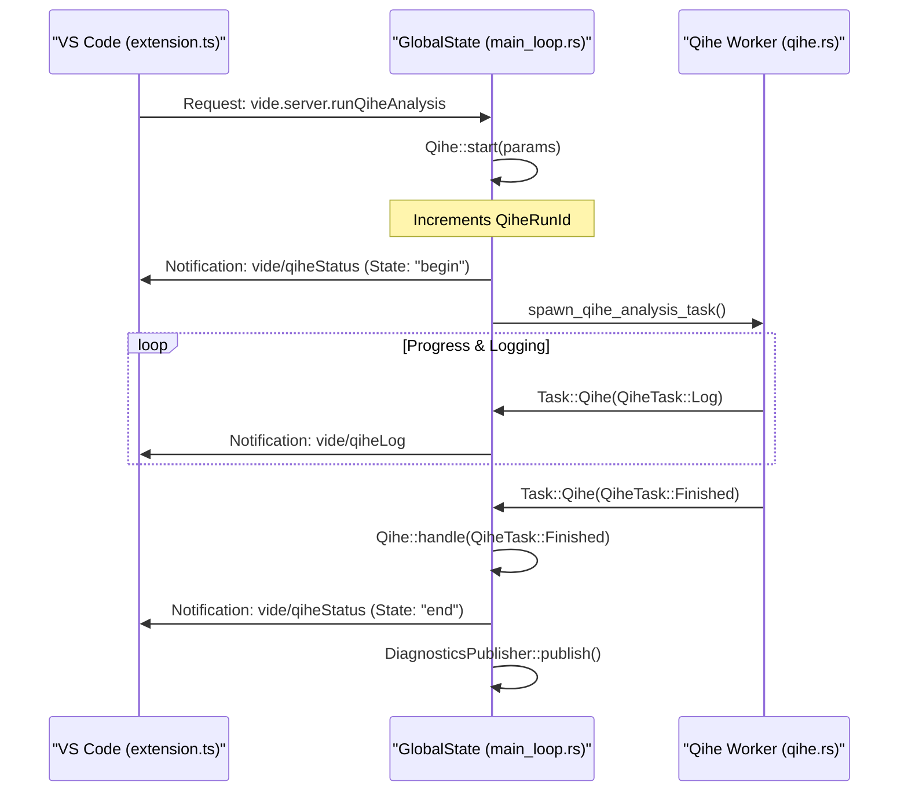
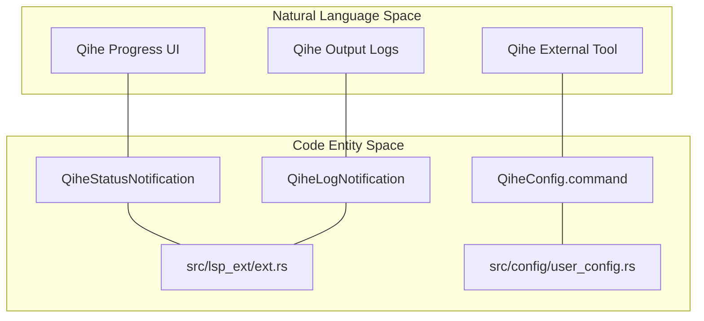
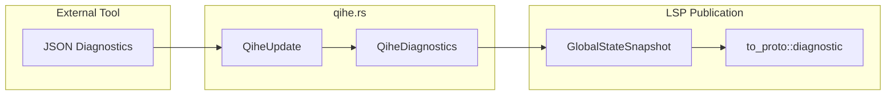

<!-- source: DeepWiki mcp.deepwiki.com · repo pascal-lab/vide · page 6.5 Qihe Analysis Integration · fetched 2026-10-12 -->

# Qihe Analysis Integration

Relevant source files

The following files were used as context for generating this wiki page:

- [crates/ide/src/analysis.rs](crates/ide/src/analysis.rs)
- [crates/ide/src/lib.rs](crates/ide/src/lib.rs)
- [src/config/caps.rs](src/config/caps.rs)
- [src/config/user_config.rs](src/config/user_config.rs)
- [src/global_state/diagnostics.rs](src/global_state/diagnostics.rs)
- [src/global_state/handlers/request.rs](src/global_state/handlers/request.rs)
- [src/global_state/handlers/request/code_action.rs](src/global_state/handlers/request/code_action.rs)
- [src/global_state/qihe.rs](src/global_state/qihe.rs)
- [src/global_state/semantic_compiler.rs](src/global_state/semantic_compiler.rs)
- [src/lsp_ext/ext.rs](src/lsp_ext/ext.rs)
- [src/lsp_ext/to_proto.rs](src/lsp_ext/to_proto.rs)
- [src/tests/code_actions.rs](src/tests/code_actions.rs)
- [src/tests/diagnostics.rs](src/tests/diagnostics.rs)
- [src/tests/workspace_symbols.rs](src/tests/workspace_symbols.rs)

The Qihe sub-system provides a mechanism for integrating external Verilog/SystemVerilog analysis tools (such as linting or synthesis-style checkers) into the Vide environment. It manages server-side state, handles custom LSP extensions for execution and logging, and provides rich progress reporting and diagnostic feedback within the VS Code client.

## Overview and Implementation

Qihe operates as an asynchronous task managed by the `GlobalState`. It allows users to trigger deep analysis that might be too computationally expensive for the primary incremental diagnostic pipeline.

### Server-Side State Management

The server tracks Qihe runs using a monotonic `QiheRunId` [src/global_state/qihe.rs:132-134](). This ensures that if multiple analysis requests are sent, only the results and logs from the latest run are processed, effectively ignoring stale data from superseded processes [src/global_state/qihe.rs:226-228]().

Key structures in `qihe.rs`:
- `QiheRunId`: A unique identifier for a specific analysis session [src/global_state/qihe.rs:133]().
- `QiheUpdate`: Encapsulates the diagnostics and summary produced by a completed run [src/global_state/qihe.rs:61-65]().
- `QiheLogSink`: A handle used by the worker thread to stream logs back to the main loop via `Task::Qihe(QiheTask::Log)` [src/global_state/qihe.rs:151-172]().
- `QiheDiagnostics`: Thread-safe storage for external diagnostics, implementing the `DiagnosticSource` trait [src/global_state/qihe.rs:76-126]().

### Data Flow: Analysis Execution

The following diagram illustrates the lifecycle of a Qihe analysis request from the VS Code client to the internal worker thread.

**Qihe Analysis Execution Flow**

Sources: [src/global_state/qihe.rs:225-250](), [src/lsp_ext/ext.rs:143-155](), [src/global_state/qihe.rs:157-172]()

## Custom LSP Extensions

Vide extends the standard Language Server Protocol to support the Qihe workflow. These extensions are defined in `src/lsp_ext/ext.rs`.

### Extension Types and Methods

| Name | Type | Method | Description |
| :--- | :--- | :--- | :--- |
| `RunQiheAnalysisParams` | Request | `vide.server.runQiheAnalysis` | Triggers analysis for a specific URI [src/lsp_ext/ext.rs:143-155](). |
| `QiheStatusNotification` | Notification | `vide/qiheStatus` | Reports analysis lifecycle (begin/end/failed) [src/lsp_ext/ext.rs:200-206](). |
| `QiheLogNotification` | Notification | `vide/qiheLog` | Streams stdout/stderr from the analysis tool [src/lsp_ext/ext.rs:215-221](). |

Sources: [src/lsp_ext/ext.rs:143-221](), [src/config/caps.rs:15-21]()

## Client-Side Integration (VS Code)

The VS Code extension handles the UI representation of Qihe's state, including a dedicated status bar item and output channel.

### Progress Reporting and Logging
The extension listens for `vide/qiheLog` to populate the "Vide Qihe" output channel. It uses `vscode.window.withProgress` to show a notification spinner while the analysis is active, keyed by the token provided by the server.

### Configuration
Qihe behavior is controlled via `QiheConfig` [src/config/user_config.rs:103-108](), which includes:
- `command`: The executable to run (default `qihe` or `qihe.bat`) [src/config/user_config.rs:27-29]().
- `run_args`: Arguments passed to the tool [src/config/user_config.rs:30]().

**Qihe System Mapping**

Sources: [src/lsp_ext/ext.rs:191-221](), [src/config/user_config.rs:103-108]()

## The Qihe Diagnostic Pipeline

Diagnostics produced by Qihe are integrated into the standard LSP `PublishDiagnostics` flow but are managed as a separate `DiagnosticSource` [src/global_state/qihe.rs:90-126]() to prevent them from being cleared by regular incremental checks.

### Diagnostic Conversion
When the external tool finishes, `QiheUpdate::from_json_diagnostics` is called [src/global_state/qihe.rs:174-201](). It uses a `DiagnosticConverter` to map external file paths and line/column information to internal `FileId` and `TextRange` types [src/global_state/qihe.rs:187-191]().

### Publication
Once processed, diagnostics are stored in the `QiheDiagnostics` state [src/global_state/qihe.rs:76-83](). When the server publishes diagnostics to the client:
1. The `DiagnosticsPublisher` [src/global_state/diagnostics/publisher.rs]() iterates through all `DiagnosticSource` implementations.
2. It calls `QiheDiagnostics::lsp_diagnostics` to retrieve the latest results for a `FileId` [src/global_state/qihe.rs:91-101]().
3. These are merged with standard IDE diagnostics produced by `AnalysisSnapshot::diagnostics` [crates/ide/src/analysis.rs:84-86]() and sent via the LSP protocol.

**Diagnostic Pipeline Mapping**

Sources: [src/global_state/qihe.rs:61-65](), [src/global_state/qihe.rs:174-201](), [src/lsp_ext/to_proto.rs:148-174](), [crates/ide/src/analysis.rs:84-86]()

---

