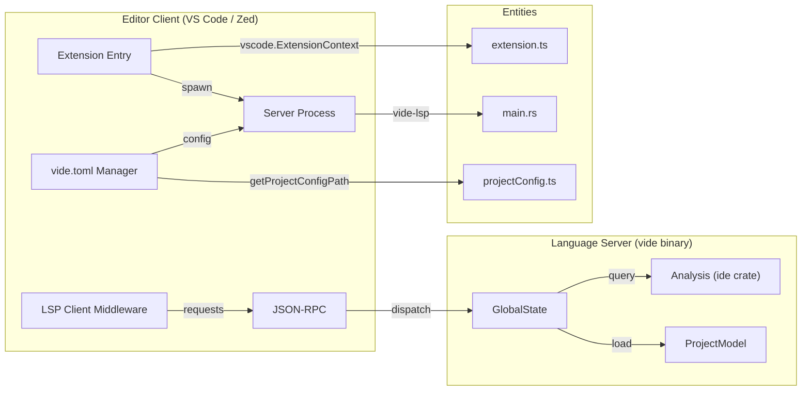
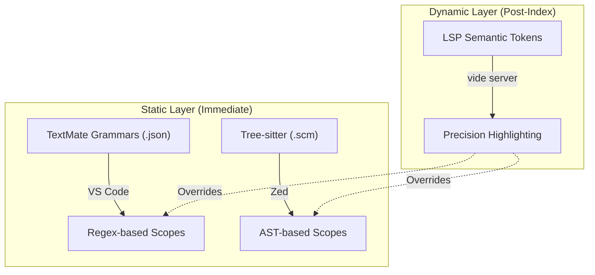

<!-- source: DeepWiki mcp.deepwiki.com · repo pascal-lab/vide · page 7 Editor Integrations · fetched 2026-10-12 -->

# Editor Integrations

Relevant source files

The following files were used as context for generating this wiki page:

- [Cargo.toml](Cargo.toml)
- [editors/vscode/LICENSE](editors/vscode/LICENSE)
- [editors/vscode/package-lock.json](editors/vscode/package-lock.json)
- [editors/vscode/package.json](editors/vscode/package.json)
- [editors/vscode/src/extension.ts](editors/vscode/src/extension.ts)
- [editors/vscode/src/projectConfig.ts](editors/vscode/src/projectConfig.ts)
- [editors/vscode/test/projectConfig.test.ts](editors/vscode/test/projectConfig.test.ts)

The Vide project provides native support for multiple code editors, primarily focusing on VS Code and Zed. These integrations handle the lifecycle of the `vide` language server, manage workspace configurations, and provide editor-specific UI elements like status bars and custom commands. While the core analysis logic resides in the Rust-based language server, these client-side extensions are responsible for binary resolution, protocol translation, and providing immediate feedback via TextMate or Tree-sitter grammars.

### Architecture Overview

The editor clients act as orchestration layers. They resolve the appropriate server binary for the host platform, manage the `LanguageClient` (LSP) instance, and handle custom notifications that fall outside the standard LSP specification.

**Diagram: Editor-to-Server System Mapping**
This diagram maps editor-side TypeScript/Rust entities to the core server components they interact with.

Sources: [editors/vscode/src/extension.ts:35-52](), [editors/vscode/src/projectConfig.ts:7-12](), [Cargo.toml:1-11]()

### VS Code Extension

The VS Code extension (`vide-ide`) is the reference implementation. It is written in TypeScript and uses the `vscode-languageclient` library. It manages server activation based on file extensions (`.v`, `.sv`, `.svh`, etc.) and provides a rich set of commands for HDL-specific workflows.

*   **Lifecycle Management**: The extension activates on `verilog` or `systemverilog` language IDs [editors/vscode/package.json:34-58]().
*   **Binary Resolution**: It locates the bundled server binary using platform-specific logic or respects the `vide.server.command` user setting [editors/vscode/package.json:105-112]().
*   **Custom Features**: Includes specialized support for "Qihe" analysis and manual workspace reloading [editors/vscode/src/extension.ts:43-52]().

For details, see [Extension Activation and Commands](#7.1) and [Extension Configuration and Localization](#7.2).

### Zed Extension

The Zed extension provides a high-performance alternative for users of the Zed editor. Unlike the VS Code extension, it is implemented in Rust and leverages Zed's native extension API.

*   **Binary Management**: Automatically downloads pre-compiled `vide` binaries from GitHub releases based on the user's architecture.
*   **Syntax Support**: Uses Tree-sitter for SystemVerilog instead of TextMate grammars, providing faster initial highlighting and better structural awareness within Zed.

For details, see [Zed Editor Extension](#7.4).

### Cross-Editor Syntax Support

To ensure a consistent experience before the language server fully indexes a project, Vide provides static syntax highlighting definitions for both editors.

**Diagram: Syntax Highlighting Hierarchy**

Sources: [editors/vscode/package.json:59-70](), [editors/vscode/package.json:71-91]()

### Custom Protocol Extensions

Vide implements several non-standard LSP features to support specialized hardware development workflows:

| Feature | Description | Code Symbol |
| :--- | :--- | :--- |
| **Qihe Analysis** | Integration with the Qihe verification toolchain. | `runQiheAnalysisCommand` [editors/vscode/src/extension.ts:46]() |
| **Workspace Reload** | Forces the server to re-read `vide.toml` and re-index. | `reloadWorkspaceRequest` [editors/vscode/src/extension.ts:29]() |
| **Status Reporting** | Custom status bar updates for server indexing and analysis. | `VideStatusController` [editors/vscode/src/extension.ts:32]() |
| **Diagnostic Actions** | Custom code actions for specific HDL diagnostic rules. | `registerDiagnosticActions` [editors/vscode/src/extension.ts:15]() |

### Child Pages

*   **[Extension Activation and Commands](#7.1)**: Detailed look at the VS Code `activate()` entrypoint, server binary resolution, and automated `vide.toml` onboarding.
*   **[Extension Configuration and Localization](#7.2)**: Exploration of VS Code settings schema, i18n support (English/Chinese), and initialization options.
*   **[TextMate Grammars and Syntax Highlighting](#7.3)**: Technical details of the bundled grammars for Verilog and SystemVerilog.
*   **[Zed Editor Extension](#7.4)**: Overview of the Rust-based Zed integration and its Tree-sitter implementation.

Sources: [editors/vscode/src/extension.ts:1-58](), [editors/vscode/package.json:1-100]()

---

