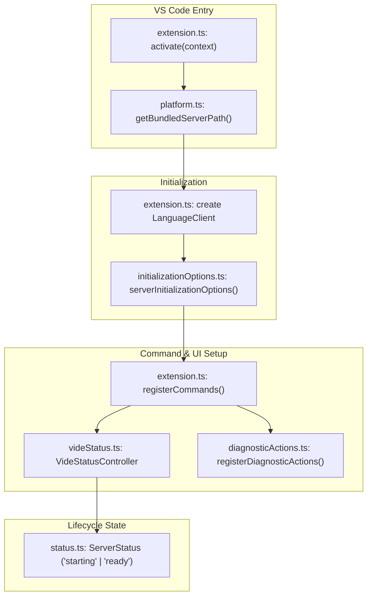
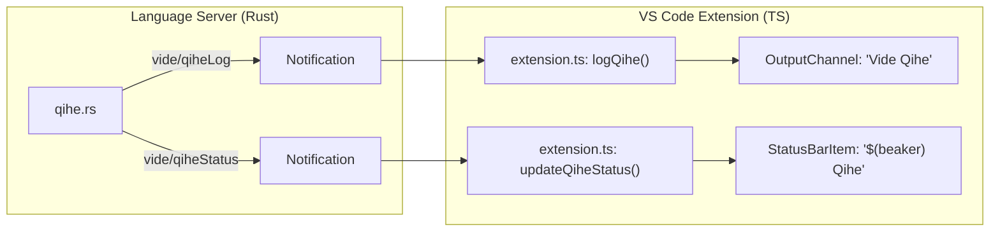

<!-- source: DeepWiki mcp.deepwiki.com · repo pascal-lab/vide · page 7.1 Extension Activation and Commands · fetched 2026-10-12 -->

# Extension Activation and Commands

Relevant source files

The following files were used as context for generating this wiki page:

- [editors/vscode/src/extension.ts](editors/vscode/src/extension.ts)
- [editors/vscode/src/projectConfig.ts](editors/vscode/src/projectConfig.ts)
- [editors/vscode/test/projectConfig.test.ts](editors/vscode/test/projectConfig.test.ts)
- [src/i18n.rs](src/i18n.rs)
- [src/i18n/en.toml](src/i18n/en.toml)
- [src/i18n/zh-CN.toml](src/i18n/zh-CN.toml)

The Vide VS Code extension serves as the primary client interface for the Vide language server. Its lifecycle is managed through the `activate()` entrypoint, which handles server binary resolution, command registration, and the onboarding flow for unconfigured projects.

## Extension Lifecycle and Activation

The extension activates when a Verilog or SystemVerilog file is opened, or when specific Vide commands are invoked. The `activate()` function initializes the `LanguageClient`, sets up the output channels, and registers a variety of commands and notification handlers.

### Activation Sequence

1.  **Output Channel Initialization**: Creates the "Vide Language Server" and "Vide Qihe" output channels for logging [editors/vscode/src/extension.ts:55-56]().
2.  **Server Path Resolution**: Determines the path to the language server binary using platform-specific logic [editors/vscode/src/extension.ts:14]().
3.  **Client Configuration**: Sets up `LanguageClientOptions`, including middleware for document synchronization and initialization options [editors/vscode/src/extension.ts:17]().
4.  **Command Registration**: Binds VS Code command IDs to internal TypeScript functions [editors/vscode/src/extension.ts:43-46]().
5.  **Status Monitoring**: Initializes the `VideStatusController` to provide feedback in the Language Status bar [editors/vscode/src/extension.ts:31-33]().

### Code Entity Mapping: Activation Flow

The following diagram maps the natural language activation steps to the specific code entities in the `editors/vscode/src` directory.

Title: Extension Activation Logic

Sources: [editors/vscode/src/extension.ts:241-260](), [editors/vscode/src/platform.ts:14](), [editors/vscode/src/videStatus.ts:32-33]()

## Server Binary Resolution

The extension must locate a compatible `vide` server binary. It uses a prioritized search strategy:

1.  **User Configuration**: If a specific path is provided in VS Code settings.
2.  **Bundled Binary**: The extension checks its own `bin/` directory, which is populated during the packaging process based on the `getPlatformFolder()` result (e.g., `win32-x64`, `linux-x64`) [editors/vscode/src/platform.ts:14]().
3.  **System PATH**: As a fallback, it attempts to find `vide` in the environment's executable path.

Sources: [editors/vscode/src/extension.ts:14](), [editors/vscode/src/platform.ts:1-20]()

## Command Registration

The extension registers several commands to facilitate server management and advanced analysis.

| Command ID | Function | Description |
| :--- | :--- | :--- |
| `vide.restartServer` | `restartServer()` | Disposes of the current `LanguageClient` and creates a new one [editors/vscode/src/extension.ts:43](). |
| `vide.reloadWorkspace` | `reloadWorkspace()` | Sends a custom `vide/reloadWorkspace` request to the server [editors/vscode/src/videStatus.ts:28-29](). |
| `vide.runQiheAnalysis` | `runQiheAnalysis()` | Triggers the server-side Qihe analysis engine [editors/vscode/src/extension.ts:46-47](). |
| `vide.showServerVersion` | `showServerVersion()` | Executes `vide --version` and displays the output in a message [editors/vscode/src/extension.ts:44](). |
| `vide.profileDiagnostics` | `registerProfilingCommand()` | Launches a profiling session to analyze server performance [editors/vscode/src/profiling.ts:16](). |

Sources: [editors/vscode/src/extension.ts:43-50](), [editors/vscode/src/videStatus.ts:28-31](), [editors/vscode/src/profiling.ts:16]()

## Automated vide.toml Onboarding

When the server detects a Verilog file that is not part of a configured project (missing `vide.toml`), it sends a `vide/projectStatus` notification [editors/vscode/src/extension.ts:27-33](). The extension handles this via the `VideStatusController`:

1.  **Detection**: The `projectStatusNotification` handler identifies unconfigured roots [editors/vscode/src/videStatus.ts:27]().
2.  **User Prompt**: If a workspace is unconfigured, the extension can suggest creating a default `vide.toml`.
3.  **Template Generation**: The `DEFAULT_PROJECT_CONFIG_TEXT` provides a commented-out template including `sources`, `include_dirs`, and `top_modules` [editors/vscode/src/projectConfig.ts:19]().
4.  **Path Resolution**: `getProjectConfigPath` ensures the file is created at the workspace root [editors/vscode/src/projectConfig.ts:7-12]().

Sources: [editors/vscode/src/extension.ts:23-24](), [editors/vscode/src/projectConfig.ts:7-12](), [editors/vscode/test/projectConfig.test.ts:42-57]()

## LanguageClient Middleware and Communication

The `LanguageClient` uses middleware to intercept and augment communication between VS Code and the server.

### Qihe Analysis Integration
The Qihe subsystem uses custom LSP notifications to report progress and logs:
- `vide/qiheStatus`: Updates the status bar with a "beaker" icon [editors/vscode/src/extension.ts:51-53]().
- `vide/qiheLog`: Redirects server-side analysis logs to the "Vide Qihe" output channel [editors/vscode/src/extension.ts:52]().
- **Progress Reporting**: Uses `vscode.window.withProgress` to show a notification spinner during long-running analyses [editors/vscode/src/extension.ts:204-215]().

### Code Entity Mapping: Qihe Notification Flow

Title: Qihe Analysis Data Flow

Sources: [editors/vscode/src/extension.ts:74-76](), [editors/vscode/src/extension.ts:159-182](), [editors/vscode/src/extension.ts:51-52]()

### Localization (i18n)
The server supports multiple locales (English and Chinese) for diagnostic messages and progress reporting [src/i18n.rs:4-8]().
- **Locale Detection**: The server determines the locale from LSP initialization options using `Locale::from_lsp` [src/i18n.rs:11-19]().
- **Translation Keys**: Keys like `qihe.finished` or `rename.project_scope_required` are resolved against `en.toml` or `zh-CN.toml` [src/i18n/en.toml:7](), [src/i18n/zh-CN.toml:96]().

Sources: [src/i18n.rs:1-46](), [src/i18n/en.toml:1-102](), [src/i18n/zh-CN.toml:1-102]()

---

