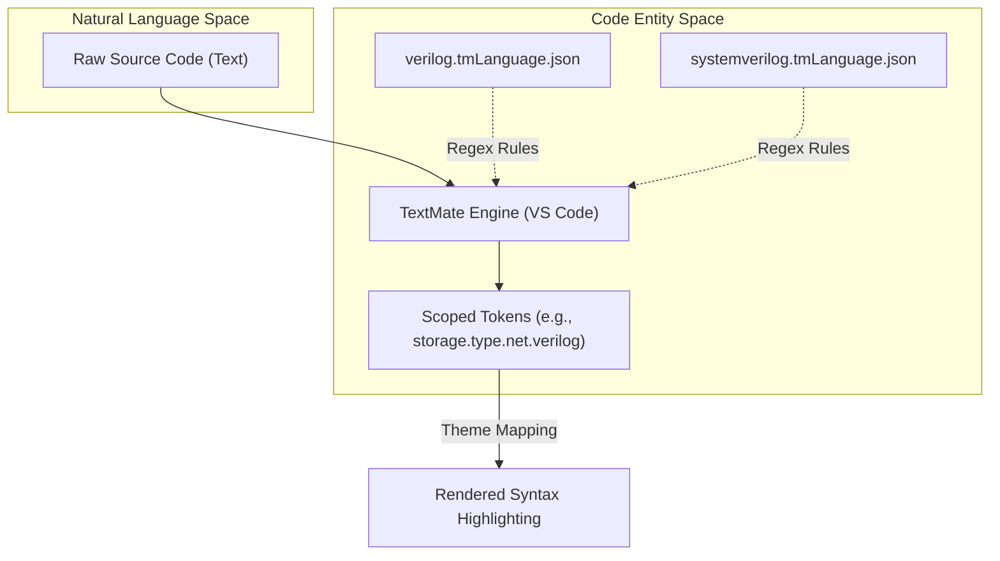
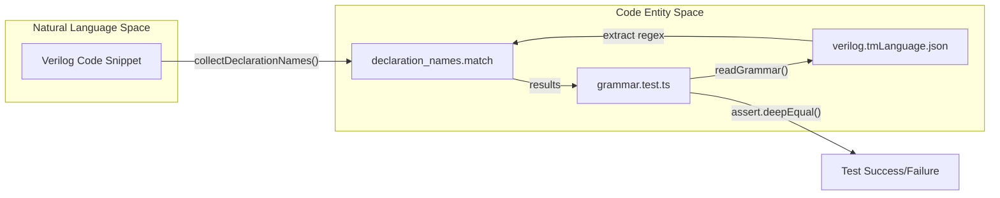

<!-- source: DeepWiki mcp.deepwiki.com · repo pascal-lab/vide · page 7.3 TextMate Grammars and Syntax Highlighting · fetched 2026-10-12 -->

# TextMate Grammars and Syntax Highlighting

Relevant source files

The following files were used as context for generating this wiki page:

- [editors/vscode/THIRD_PARTY_NOTICES.md](editors/vscode/THIRD_PARTY_NOTICES.md)
- [editors/vscode/scripts/copy-speedscope-assets.ts](editors/vscode/scripts/copy-speedscope-assets.ts)
- [editors/vscode/syntaxes/systemverilog.tmLanguage.json](editors/vscode/syntaxes/systemverilog.tmLanguage.json)
- [editors/vscode/syntaxes/verilog.tmLanguage.json](editors/vscode/syntaxes/verilog.tmLanguage.json)
- [editors/vscode/test/grammar.test.ts](editors/vscode/test/grammar.test.ts)

Vide provides syntax highlighting through a hybrid approach: fast, regex-based **TextMate grammars** for immediate feedback during typing, and server-side **Semantic Tokens** for high-precision coloring based on full language analysis.

## Overview of Bundled Grammars

Vide bundles two primary TextMate grammar files within the VS Code extension to support Verilog and SystemVerilog files. These grammars are derived from the `vscode-verilog-hdl-support` project and are licensed under MIT [editors/vscode/THIRD_PARTY_NOTICES.md:3-31]().

### File Associations
The grammars are associated with the following file extensions:
*   **Verilog**: `.v`, `.vh` [editors/vscode/syntaxes/verilog.tmLanguage.json:2-5]()
*   **SystemVerilog**: `.sv`, `.svh`, `.svi` [editors/vscode/syntaxes/systemverilog.tmLanguage.json:4-8]()

## Grammar Structure and Token Scopes

The grammars use nested patterns and repository references to break down source code into tokens. This "Code Entity Space" mapping allows the editor to apply themes to specific language constructs.

### Verilog Grammar Logic
The Verilog grammar (`verilog.tmLanguage.json`) prioritizes patterns to ensure declarations are captured before generic keywords [editors/vscode/syntaxes/verilog.tmLanguage.json:8-30]().

| Scope Name | Description | Pattern Example |
| :--- | :--- | :--- |
| `comment.line.double-slash.verilog` | Single-line comments | `// comment` [editors/vscode/syntaxes/verilog.tmLanguage.json:51-51]() |
| `storage.type.net.verilog` | Net types | `wire`, `tri`, `wand` [editors/vscode/syntaxes/verilog.tmLanguage.json:140-140]() |
| `entity.name.tag.module.reference.verilog` | Module instantiation type | `MyModule u_top (...);` [editors/vscode/syntaxes/verilog.tmLanguage.json:231-231]() |
| `constant.numeric.sized_integer.verilog` | Sized literals | `8'hFF` [editors/vscode/syntaxes/verilog.tmLanguage.json:70-70]() |
| `variable.other.constant.verilog` | Preprocessor macros | \``MY_MACRO` [editors/vscode/syntaxes/verilog.tmLanguage.json:65-66]() |

### SystemVerilog Grammar Logic
The SystemVerilog grammar (`systemverilog.tmLanguage.json`) extends the base Verilog logic to include complex constructs like classes, packages, and assertions [editors/vscode/syntaxes/systemverilog.tmLanguage.json:9-97]().

| Feature | Scope / Pattern |
| :--- | :--- |
| **Functions/Tasks** | `meta.function.systemverilog` handles `virtual`, `static`, and `automatic` modifiers [editors/vscode/syntaxes/systemverilog.tmLanguage.json:100-172](). |
| **Typedefs** | `meta.typedef-enum-struct-union.systemverilog` captures complex user-defined types [editors/vscode/syntaxes/systemverilog.tmLanguage.json:221-279](). |
| **Directives** | Support for `bind`, `import`, and `assertion` blocks [editors/vscode/syntaxes/systemverilog.tmLanguage.json:68-84](). |

### Data Flow: TextMate Tokenization
The following diagram illustrates how raw text is transformed into scoped tokens via the TextMate engine.

**TextMate Tokenization Pipeline**

Sources: [editors/vscode/syntaxes/verilog.tmLanguage.json:8-30](), [editors/vscode/syntaxes/systemverilog.tmLanguage.json:9-97]()

## Grammar Test Infrastructure

Vide includes a specialized test suite for the TextMate grammars to prevent regressions in highlighting logic, particularly for complex declaration patterns.

### Key Test Utilities
The testing framework in `editors/vscode/test/grammar.test.ts` provides functions to validate the JSON grammar structure:
*   `readGrammar(fileName)`: Loads the grammar file from the `syntaxes` directory [editors/vscode/test/grammar.test.ts:19-21]().
*   `assertIncludesBefore(rule, before, after, message)`: Ensures that one pattern (e.g., `#declarations`) is evaluated before another (e.g., `#keywords`) to prevent keyword shadowing [editors/vscode/test/grammar.test.ts:32-40]().
*   `collectDeclarationNames(grammar, text)`: Uses the `declaration_names` regex from the grammar to simulate how identifiers are extracted from comma-separated lists [editors/vscode/test/grammar.test.ts:42-47]().

### Test Scenarios
1.  **Declaration Priority**: Verifies that `input`, `output`, and `wire` are handled by declaration rules rather than generic keyword rules [editors/vscode/test/grammar.test.ts:49-58]().
2.  **Instantiation Isolation**: Ensures that internal declaration rules do not leak into module instantiation bodies [editors/vscode/test/grammar.test.ts:60-70]().
3.  **Multi-line Declarations**: Validates that the `declaration_names` pattern correctly captures identifiers in split-line or comma-separated lists like `[15:0] x, y, z;` [editors/vscode/test/grammar.test.ts:72-90]().

**Grammar Validation Flow**

Sources: [editors/vscode/test/grammar.test.ts:42-90]()

## Complementing Semantic Tokens

While TextMate grammars provide immediate coloring, they lack semantic context (e.g., they cannot distinguish between a local variable and a global net if the declaration is in another file). Vide's LSP server provides **Semantic Tokens** to enhance this:

1.  **Initial Load**: VS Code applies the TextMate grammar (`verilog.tmLanguage.json`) [editors/vscode/syntaxes/verilog.tmLanguage.json:1-30]().
2.  **Analysis**: The LSP server processes the workspace using Slang and HIR.
3.  **Refinement**: The server sends semantic tokens that override TextMate scopes with precise information (e.g., distinguishing a `parameter` from a `localparam`).

Sources: [editors/vscode/syntaxes/verilog.tmLanguage.json:1-30](), [editors/vscode/test/grammar.test.ts:49-51]()

---

