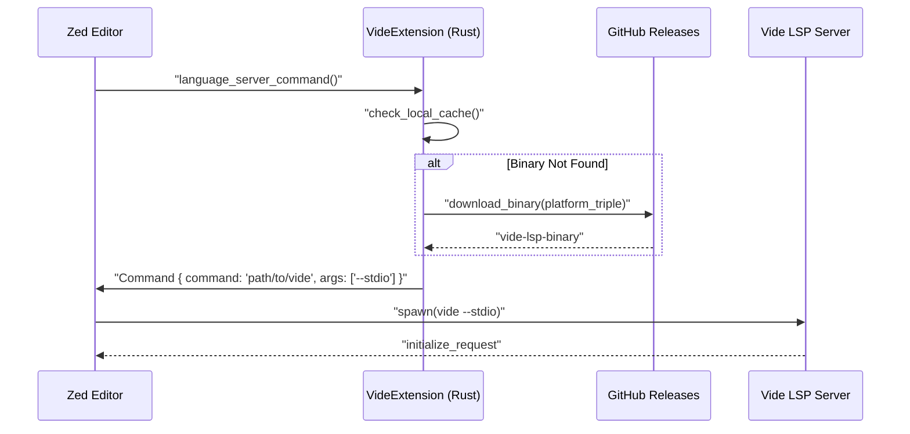
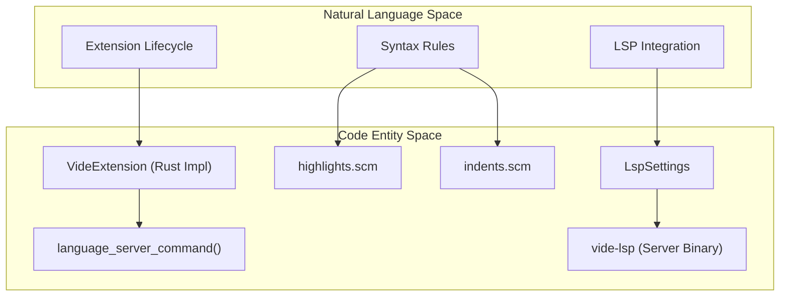

<!-- source: DeepWiki mcp.deepwiki.com · repo pascal-lab/vide · page 7.4 Zed Editor Extension · fetched 2026-10-12 -->

# Zed Editor Extension

<details>
<summary>Relevant source files</summary>

The following files were used as context for generating this wiki page:

- [Cargo.toml](Cargo.toml)
- [editors/vscode/LICENSE](editors/vscode/LICENSE)
- [editors/vscode/THIRD_PARTY_NOTICES.md](editors/vscode/THIRD_PARTY_NOTICES.md)
- [editors/vscode/package-lock.json](editors/vscode/package-lock.json)
- [editors/vscode/package.json](editors/vscode/package.json)
- [editors/vscode/scripts/copy-speedscope-assets.ts](editors/vscode/scripts/copy-speedscope-assets.ts)
- [editors/vscode/syntaxes/systemverilog.tmLanguage.json](editors/vscode/syntaxes/systemverilog.tmLanguage.json)
- [editors/vscode/syntaxes/verilog.tmLanguage.json](editors/vscode/syntaxes/verilog.tmLanguage.json)
- [editors/vscode/test/grammar.test.ts](editors/vscode/test/grammar.test.ts)

</details>


The Zed editor integration for Vide provides a high-performance, native editing experience for Verilog and SystemVerilog by leveraging Zed's extension system. Unlike the VS Code extension which is written in TypeScript, the Zed extension is implemented in Rust and integrates directly with Zed's language-specific features like Tree-sitter for local syntax highlighting and the Language Server Protocol (LSP) for semantic intelligence.

## Extension Implementation

The core of the integration is the `VideExtension` struct, which implements the Zed Extension API in Rust. This implementation handles the lifecycle of the language server, including downloading the appropriate binary for the host platform and configuring the LSP client.

### Automatic Binary Management
To ensure a seamless user experience, the extension automatically resolves and downloads the `vide` language server binary from GitHub releases. 

1.  **Platform Detection**: The extension identifies the host operating system and architecture (e.g., `x86_64-unknown-linux-gnu`, `aarch64-apple-darwin`).
2.  **Download Logic**: It queries the Vide repository releases and downloads the pre-compiled binary matching the extension's version.
3.  **Caching**: Binaries are stored locally in the Zed extension's storage directory to avoid redundant downloads.

### Data Flow: Extension Initialization
The following diagram illustrates how the `VideExtension` prepares the environment and starts the language server.

**Zed Extension Startup Sequence**

Sources: [Cargo.toml:1-11](), [editors/vscode/package.json:105-136]()

## Language Configuration

The Zed extension utilizes several configuration files to define how Verilog and SystemVerilog files are handled within the editor.

### Tree-sitter and Syntax Highlighting
While the Vide LSP server provides semantic tokens for advanced highlighting (e.g., distinguishing between a wire and a reg), Zed uses Tree-sitter for immediate, flicker-free syntax highlighting.

*   **Grammar**: The extension bundles a Tree-sitter SystemVerilog grammar.
*   **Highlights (`highlights.scm`)**: Maps Tree-sitter nodes to Zed's theme tokens.
*   **Indents (`indents.scm`)**: Defines indentation rules for blocks (e.g., `begin`/`end`, `module`/`endmodule`).
*   **Outline (`outline.scm`)**: Configures the "Symbol Tree" or "Outline" view in Zed by identifying module declarations, functions, and tasks.

### LSP Settings
The extension passes `LspSettings` during the initialization phase, which allows users to customize Vide's behavior via Zed's `settings.json`. These settings mirror the configuration available in VS Code.

| Setting | Type | Description |
| :--- | :--- | :--- |
| `vide.trace.server` | `string` | Sets the verbosity of LSP logs (`off`, `messages`, `verbose`). |
| `vide.formatter.provider` | `string` | Currently supports `verible`. |
| `vide.references.includeDeclaration` | `boolean` | Whether to include the definition in "Find All References". |

Sources: [editors/vscode/package.json:95-104](), [editors/vscode/package.json:206-210](), [editors/vscode/package.json:211-221]()

## Comparison with VS Code Extension

The Zed extension differs from the VS Code extension primarily in its execution environment and syntax engine.

| Feature | VS Code Extension | Zed Extension |
| :--- | :--- | :--- |
| **Language** | TypeScript / Node.js | Rust (WASM) |
| **Syntax Highlighting** | TextMate Grammars (`.tmLanguage.json`) | Tree-sitter (`.scm` queries) |
| **LSP Client** | `vscode-languageclient` | Zed Native LSP |
| **Binary Download** | Handled via TypeScript scripts | Handled via `VideExtension` Rust code |
| **Semantic Tokens** | Supported | Supported |

### Code Entity Mapping
This diagram bridges the conceptual "Editor Extension" to the specific entities in the codebase.

**Extension Entity Mapping**

Sources: [editors/vscode/package.json:33-70](), [editors/vscode/package.json:92-136]()

## Configuration and Defaults

The extension contributes default settings that align with the Vide ecosystem. For example, it configures semantic token rules to highlight read/write access differently in Verilog and SystemVerilog.

**Semantic Token Customizations**
```json
"editor.semanticTokenColorCustomizations": {
  "rules": {
    "*.read:verilog": { "bold": true },
    "*.write:verilog": { "bold": true, "underline": true }
  }
}
```
Sources: [editors/vscode/package.json:71-91]()

### Third-Party Grammars
The extension's TextMate grammars (used for fallback or comparison) are derived from the `vscode-verilog-hdl-support` project and are licensed under MIT.

Sources: [editors/vscode/THIRD_PARTY_NOTICES.md:3-31](), [editors/vscode/syntaxes/verilog.tmLanguage.json:1-30]()

---

