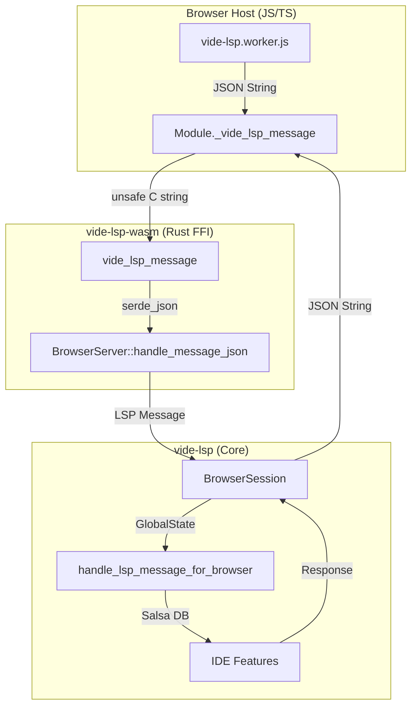
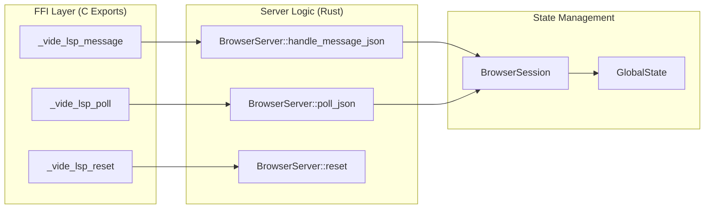

<!-- source: DeepWiki mcp.deepwiki.com · repo pascal-lab/vide · page 8.1 WASM Server Entry Points · fetched 2026-10-12 -->

# WASM Server Entry Points

Relevant source files

The following files were used as context for generating this wiki page:

- [.github/actions/setup-rust/action.yml](.github/actions/setup-rust/action.yml)
- [.github/actions/setup-sccache/action.yml](.github/actions/setup-sccache/action.yml)
- [.github/ci-modules.yml](.github/ci-modules.yml)
- [crates/slang/Cargo.toml](crates/slang/Cargo.toml)
- [crates/slang/bindings/rust/build.rs](crates/slang/bindings/rust/build.rs)
- [crates/slang/bindings/rust/sourcegen.rs](crates/slang/bindings/rust/sourcegen.rs)
- [editors/vscode/scripts/copy-web-assets.ts](editors/vscode/scripts/copy-web-assets.ts)
- [editors/vscode/src/browser/client.ts](editors/vscode/src/browser/client.ts)
- [editors/vscode/src/browser/worker.ts](editors/vscode/src/browser/worker.ts)
- [editors/vscode/src/browser/workspaceSnapshot.ts](editors/vscode/src/browser/workspaceSnapshot.ts)
- [editors/vscode/tsconfig.browser.json](editors/vscode/tsconfig.browser.json)
- [editors/vscode/tsconfig.json](editors/vscode/tsconfig.json)
- [rust-toolchain.toml](rust-toolchain.toml)

The `vide-lsp-wasm` crate provides the necessary infrastructure to run the Vide Language Server within a WebAssembly (WASM) environment, specifically targeting the browser via Emscripten. This allows Vide to power IDE features in web-based editors and the Vide Playground without a backend server.

## Overview

The WASM server operates by exposing a C-compatible FFI (Foreign Function Interface) that a JavaScript host can call. Unlike the native server which uses standard I/O and threading, the WASM version uses a synchronous request-response model managed by a `BrowserServer` session.

### Data Flow: Host to WASM
The following diagram illustrates how an LSP message travels from the Browser host into the Rust core.

**WASM Message Pipeline**

Sources: [editors/vscode/src/browser/client.ts:46-56](), [website/playground/scripts/build-vide-wasm.mjs:46-46]()

---

## BrowserServer and Session Management

The `BrowserServer` struct acts as the top-level container for the WASM execution context. It manages a `BrowserSession`, which encapsulates the `GlobalState` and an outgoing message channel.

### Key Components
| Entity | Description |
| :--- | :--- |
| `BrowserServer` | High-level API for the JS host. Handles initialization and polling. |
| `BrowserSession` | Represents an active LSP session. Contains the `GlobalState`. |
| `InitializeOutput` | Internal structure used during the `initialize` handshake to return both the session and initial messages. |

### Lifecycle Management
1.  **Initialization**: The session is created only after receiving an `initialize` request.
2.  **State Persistence**: The `BrowserServer` persists between calls, allowing the `GlobalState` to maintain the incremental Salsa database in memory.
3.  **Reset**: The `reset` function clears the current session, effectively restarting the server.

Sources: [editors/vscode/src/browser/client.ts:58-80](), [editors/vscode/src/browser/workspaceSnapshot.ts:14-21]()

---

## Exported C FFI Functions

The crate exports several functions decorated with `#[no_mangle]` to allow Emscripten to link them to the JavaScript environment. These are defined in the WASM crate and consumed by the `VideBrowserClient`.

### Primary Entry Points
*   **`vide_lsp_message(json_ptr)`**: The main entry point for LSP requests and notifications. It deserializes the JSON, processes it through `GlobalState`, and returns a JSON string containing any immediate responses.
*   **`vide_lsp_poll()`**: Since WASM is single-threaded in this context, background tasks (like workspace loading or diagnostics) are progressed by "polling".
*   **`vide_lsp_write_file(path_ptr, content_ptr)`**: Injects file content directly into the VFS. This is used by the playground and the VS Code browser extension to sync editor state [editors/vscode/src/browser/workspaceSnapshot.ts:23-52]().
*   **`vide_lsp_reset()`**: Destroys the current `BrowserSession`.
*   **`vide_free_string(ptr)`**: A utility to safely deallocate strings that were allocated by Rust and passed to JavaScript.

**Entity Mapping: FFI to Internal Logic**

Sources: [editors/vscode/src/browser/client.ts:113-118](), [website/playground/scripts/build-vide-wasm.mjs:46-46]()

---

## Emscripten Build Configuration

Building the WASM server requires a specialized toolchain configuration to handle the C++ dependencies (specifically the Slang library) and the Rust-to-WASM compilation.

### Slang FFI Build (`build.rs`)
The `slang` crate's build script handles the complex task of compiling the Slang C++ library for Emscripten:
*   **`emscripten` check**: Detects if the target OS is `emscripten` [crates/slang/bindings/rust/build.rs:28-28]().
*   **CMake Configuration**: Sets specific flags like `-fwasm-exceptions` to support C++ exceptions in WASM [crates/slang/bindings/rust/build.rs:54-54]().
*   **Static Linking**: Links `slang_rust_bridge` and `svlang` as static libraries [crates/slang/bindings/rust/build.rs:117-118]().
*   **Optimization**: Forces `-O2` for release builds to ensure performance in the browser [crates/slang/bindings/rust/build.rs:55-56]().

### Asset Deployment
The VS Code extension includes a script `copy-web-assets.ts` to move the compiled WASM binaries from the playground build directory to the extension's distribution folder:
*   **Files**: `vide-lsp.js`, `vide-core.js`, and `vide-core.wasm` [editors/vscode/scripts/copy-web-assets.ts:8-8]().
*   **Destination**: `dist/browser/wasm` [editors/vscode/scripts/copy-web-assets.ts:7-7]().

Sources: [crates/slang/bindings/rust/build.rs:50-60](), [editors/vscode/scripts/copy-web-assets.ts:1-30]()

---

## Platform Differences

When running in the browser, certain server capabilities are modified compared to the native desktop version.

### Capability Negotiation
The `VideBrowserClient` in VS Code configures specific `initializationOptions` and handles specialized middleware for features like rename:
*   **Rename Expansion**: Uses `vide.server.renameExpansionInfo` to provide intelligent rename across connected ports in the browser [editors/vscode/src/browser/client.ts:25-27]().
*   **VFS Root**: The browser environment uses a synthetic root `file:///workspace` [editors/vscode/src/browser/workspaceSnapshot.ts:14-14]().
*   **Worker Runtime**: The server logic is executed inside a Web Worker via `installVideWorkerRuntime` to keep the UI thread responsive [editors/vscode/src/browser/worker.ts:1-3]().

Sources: [editors/vscode/src/browser/client.ts:138-140](), [editors/vscode/src/browser/workspaceSnapshot.ts:80-84](), [editors/vscode/src/browser/worker.ts:1-4]()

---

