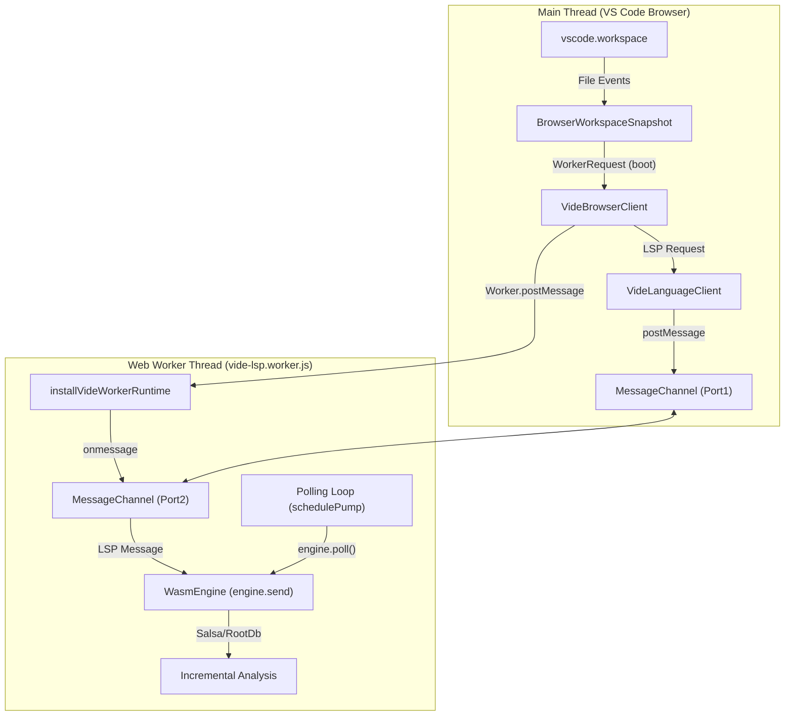
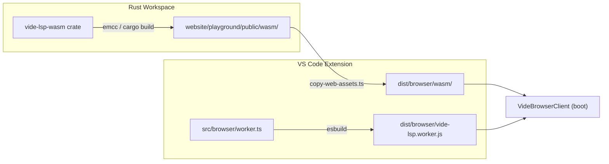

<!-- source: DeepWiki mcp.deepwiki.com · repo pascal-lab/vide · page 8.2 Playground and Online Experience · fetched 2026-10-12 -->

# Playground and Online Experience

Relevant source files

The following files were used as context for generating this wiki page:

- [.github/ci-modules.yml](.github/ci-modules.yml)
- [editors/vscode/scripts/copy-web-assets.ts](editors/vscode/scripts/copy-web-assets.ts)
- [editors/vscode/src/browser/client.ts](editors/vscode/src/browser/client.ts)
- [editors/vscode/src/browser/shared/document-selector.ts](editors/vscode/src/browser/shared/document-selector.ts)
- [editors/vscode/src/browser/shared/initialization-options.ts](editors/vscode/src/browser/shared/initialization-options.ts)
- [editors/vscode/src/browser/shared/lsp-protocol.ts](editors/vscode/src/browser/shared/lsp-protocol.ts)
- [editors/vscode/src/browser/shared/types.ts](editors/vscode/src/browser/shared/types.ts)
- [editors/vscode/src/browser/shared/worker-runtime.ts](editors/vscode/src/browser/shared/worker-runtime.ts)
- [editors/vscode/src/browser/worker.ts](editors/vscode/src/browser/worker.ts)
- [editors/vscode/src/browser/workspaceSnapshot.ts](editors/vscode/src/browser/workspaceSnapshot.ts)
- [editors/vscode/tsconfig.browser.json](editors/vscode/tsconfig.browser.json)
- [editors/vscode/tsconfig.json](editors/vscode/tsconfig.json)

The Vide Playground and Online Experience provide a zero-install, browser-based environment for exploring Vide's RTL IDE features. This system leverages WebAssembly (WASM) to run the Vide Language Server directly in a web worker, providing high-fidelity features like Go-to-Definition, Precise Completion, and Automatic Refactoring without a backend server.

## System Architecture

The online experience is built on a decoupled architecture where the UI (VS Code Browser or Astro/Monaco) communicates with a background Language Server via a message-passing bridge. The server runs as a Web Worker using a WASM-compiled version of the `vide-lsp` crate.

### Data Flow Diagram

The following diagram illustrates how a user interaction in the browser travels to the WASM-based language server and back, specifically focusing on the VS Code Browser implementation.

**Browser-to-WASM Data Flow (VS Code Extension)**

Sources: [editors/vscode/src/browser/client.ts:30-56](), [editors/vscode/src/browser/shared/worker-runtime.ts:88-91](), [editors/vscode/src/browser/shared/worker-runtime.ts:144-169]()

### Code Entity Mapping

This table bridges the conceptual "Online Experience" names to their specific implementations in the codebase.

| System Name | Code Entity | File Path |
| :--- | :--- | :--- |
| **Playground Client** | `VideBrowserClient` | [editors/vscode/src/browser/client.ts:30-30]() |
| **LSP Worker Runtime** | `installVideWorkerRuntime` | [editors/vscode/src/browser/shared/worker-runtime.ts:29-29]() |
| **WASM Engine Interface** | `WasmEngine` | [editors/vscode/src/browser/shared/lsp-protocol.ts:1-6]() |
| **Workspace Mirroring** | `BrowserWorkspaceSnapshot` | [editors/vscode/src/browser/workspaceSnapshot.ts:17-21]() |
| **Asset Builder** | `copy-web-assets.ts` | [editors/vscode/scripts/copy-web-assets.ts:1-10]() |

Sources: [editors/vscode/src/browser/client.ts:30-30](), [editors/vscode/src/browser/shared/worker-runtime.ts:29-29](), [editors/vscode/src/browser/shared/lsp-protocol.ts:1-6](), [editors/vscode/src/browser/workspaceSnapshot.ts:17-21]()

## VideBrowserClient

The `VideBrowserClient` is the primary orchestrator on the main thread for the VS Code browser extension. It manages the lifecycle of the Web Worker and provides a `BaseLanguageClient` compatible interface.

### Key Responsibilities
- **Worker Initialization**: Spawns the `vide-lsp.worker.js` and establishes communication via `Worker.postMessage` [editors/vscode/src/browser/client.ts:42-56]().
- **Bootstrapping**: Sends the `boot` command containing the WASM base URL, workspace root URIs, and the initial `workspaceFiles` snapshot [editors/vscode/src/browser/client.ts:64-79]().
- **LSP Transport**: Creates a `MessageChannel` and passes `port2` to the worker to handle low-latency LSP traffic via `BrowserMessageReader` and `BrowserMessageWriter` [editors/vscode/src/browser/client.ts:58-63]().
- **Middleware Logic**: Implements specialized browser-side logic for features like "Rename Connected Ports/Signals" [editors/vscode/src/browser/client.ts:153-218]().

Sources: [editors/vscode/src/browser/client.ts:30-111](), [editors/vscode/src/browser/client.ts:153-218]()

## vide-lsp.worker.ts Polling Loop

The worker runtime operates as an event-driven loop that interacts with the synchronous WASM exports.

### The Polling Mechanism
Because the WASM engine (compiled from Rust) cannot push messages asynchronously to the JS main thread in all environments, the worker implements a polling loop:
- **`schedulePump`**: Triggered after receiving an LSP message or when pending requests exist [editors/vscode/src/browser/shared/worker-runtime.ts:221-224]().
- **`pollLsp`**: Calls `engine.poll()` to retrieve any pending notifications or responses generated by the server's internal background tasks (like diagnostic computation) [editors/vscode/src/browser/shared/worker-runtime.ts:214-219]().
- **Interval**: Typically runs at a 16ms interval (`POLL_INTERVAL_MS`) to ensure UI responsiveness [editors/vscode/src/browser/shared/worker-runtime.ts:5-5]().

### URI Translation
Since the browser environment uses synthetic URIs (e.g., `file:///workspace`), the worker performs bidirectional translation:
- **Client to Synthetic**: Maps local browser URIs to the internal virtual filesystem paths [editors/vscode/src/browser/shared/worker-runtime.ts:145-148]().
- **Synthetic to Client**: Converts internal server paths back to URIs the VS Code client understands [editors/vscode/src/browser/shared/worker-runtime.ts:174-177]().

Sources: [editors/vscode/src/browser/shared/worker-runtime.ts:1-224]()

## Workspace Mirroring

The `BrowserWorkspaceSnapshot` utility ensures the WASM server has a consistent view of the files available in the browser's virtual file system.

### Snapshot Generation
The `buildBrowserWorkspaceSnapshot` function performs the following:
1. Iterates through all `workspaceFolders` [editors/vscode/src/browser/workspaceSnapshot.ts:29-29]().
2. Uses `vscode.workspace.findFiles` to locate Verilog/SystemVerilog sources and `vide.toml` files [editors/vscode/src/browser/workspaceSnapshot.ts:30-36]().
3. Reads file contents into memory as `WorkerWorkspaceFile` objects [editors/vscode/src/browser/workspaceSnapshot.ts:44-50]().
4. Includes currently open `textDocuments` to ensure unsaved changes are reflected in the server's state [editors/vscode/src/browser/workspaceSnapshot.ts:54-73]().

Sources: [editors/vscode/src/browser/workspaceSnapshot.ts:23-84]()

## Build and Asset Management

The online experience requires a specific build pipeline to bundle the WASM binaries and the worker scripts.

### WASM Asset Build Scripts
1. **`build:wasm`**: A workspace-level command that triggers the Emscripten build for the `vide-lsp-wasm` crate [website/playground/package.json:46-46]().
2. **`copy-web-assets.ts`**: A VS Code specific script that moves the compiled `vide-lsp.js`, `vide-core.js`, and `vide-core.wasm` into the extension's `dist/browser/wasm` directory [editors/vscode/scripts/copy-web-assets.ts:1-29]().
3. **`tsconfig.browser.json`**: Configures the TypeScript compiler for the browser environment, excluding Node.js-specific modules and including browser-compatible shared logic [editors/vscode/tsconfig.browser.json:1-18]().

**Asset Build Flow**

Sources: [editors/vscode/scripts/copy-web-assets.ts:1-29](), [website/playground/scripts/build-vide-wasm.mjs:1-10](), [editors/vscode/tsconfig.browser.json:1-18]()

## Online Experience Configuration

The browser-based server is initialized with a subset of the standard IDE configuration, tailored for the web environment.

### Initialization Options
The `videInitializationOptions` function maps VS Code settings to the server's `InitializationOptions`. Key browser adjustments include:
- **Watcher**: Defaults to `"client"` since the WASM environment cannot use native OS file watching [editors/vscode/src/browser/shared/initialization-options.ts:19-19]().
- **Unsupported Features**: The worker runtime explicitly strips capabilities that are not yet supported in the browser, such as `documentFormattingProvider` (which requires the Verible binary) and the `runQiheAnalysis` command [editors/vscode/src/browser/shared/worker-runtime.ts:184-202]().

Sources: [editors/vscode/src/browser/shared/initialization-options.ts:13-119](), [editors/vscode/src/browser/shared/worker-runtime.ts:184-202]()

---

