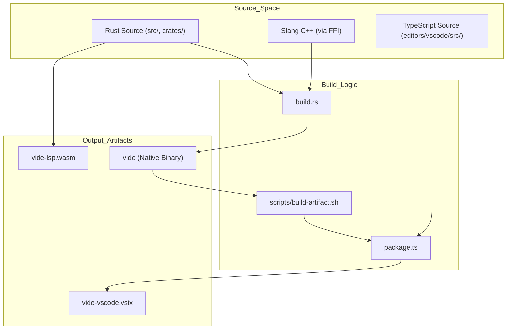
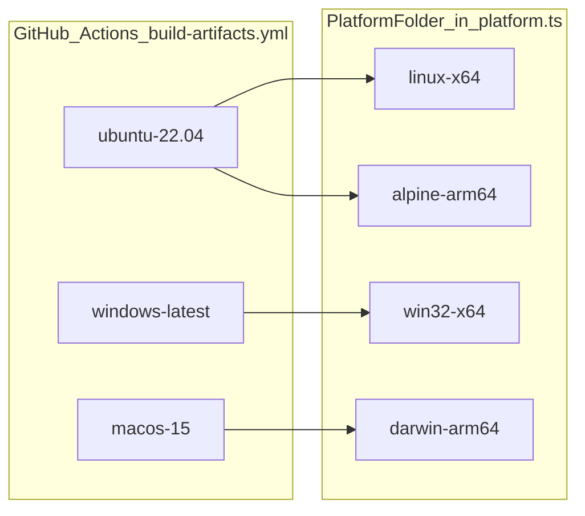

<!-- source: DeepWiki mcp.deepwiki.com · repo pascal-lab/vide · page 9 Build, CI/CD, and Release · fetched 2026-10-12 -->

# Build, CI/CD, and Release

Relevant source files

The following files were used as context for generating this wiki page:

- [.github/workflows/build-artifacts.yml](.github/workflows/build-artifacts.yml)
- [.github/workflows/ci.yml](.github/workflows/ci.yml)
- [.github/workflows/deploy-docs.yml](.github/workflows/deploy-docs.yml)
- [.github/workflows/docs-preview.yml](.github/workflows/docs-preview.yml)
- [.github/workflows/publish-vsix.yml](.github/workflows/publish-vsix.yml)
- [.github/workflows/release.yml](.github/workflows/release.yml)
- [README.md](README.md)
- [README.zh-CN.md](README.zh-CN.md)
- [build.rs](build.rs)
- [docs/website.md](docs/website.md)
- [editors/vscode/.gitignore](editors/vscode/.gitignore)
- [editors/vscode/.vscodeignore](editors/vscode/.vscodeignore)
- [editors/vscode/language-configuration.json](editors/vscode/language-configuration.json)
- [editors/vscode/scripts/package.ts](editors/vscode/scripts/package.ts)
- [editors/vscode/src/platform.ts](editors/vscode/src/platform.ts)
- [editors/vscode/test/platform.test.ts](editors/vscode/test/platform.test.ts)
- [website/package.json](website/package.json)
- [website/site/scripts/release-body-from-changelog.mjs](website/site/scripts/release-body-from-changelog.mjs)
- [website/site/src/content/docs/advanced-guide/advanced-installation.md](website/site/src/content/docs/advanced-guide/advanced-installation.md)

This section provides an overview of the infrastructure used to build, test, and distribute Vide. The project utilizes a sophisticated CI/CD pipeline that handles multi-platform native builds, WebAssembly (WASM) compilation for browser support, and automated documentation deployment.

## Build Infrastructure Overview

The Vide codebase is a multi-crate Rust workspace that requires several external dependencies for building, most notably the Slang C++ library (integrated via FFI) and the Emscripten SDK for WASM targets.

### Key Build Components
*   **Rust Workspace**: Managed via `Cargo.toml`. The build process uses `sccache` to speed up compilation across CI runs [.github/workflows/ci.yml:74-77]().
*   **Slang Integration**: Handled in `build.rs`, which manages the compilation of the C++ backend and passes metadata to the Rust compiler [build.rs:1-13]().
*   **VS Code Extension**: Built using Node.js and TypeScript, located in `editors/vscode`. It bundles the platform-specific language server binary during the packaging phase [.github/workflows/build-artifacts.yml:118-124]().

### Code-to-System Mapping: Build Flow
The following diagram illustrates how the build scripts and configurations interact to produce the final artifacts.

Sources: [build.rs:1-13](), [.github/workflows/build-artifacts.yml:118-124](), [editors/vscode/scripts/package.ts:1-11]()

## CI Pipeline and Dynamic Job Planning

Vide uses GitHub Actions for Continuous Integration. To optimize resource usage, the pipeline employs a dynamic planning script that determines which jobs to run based on the files changed in a Pull Request.

*   **Path Filtering**: Defined in `.github/ci-modules.yml`, mapping file patterns to functional modules like `rust`, `vscode`, or `package` [.github/workflows/ci.yml:31-36]().
*   **Dynamic Planning**: The `ci-plan.mjs` script analyzes these filters to generate an execution matrix, determining whether to run Rust tests, VS Code checks, or documentation builds [.github/workflows/ci.yml:37-61]().
*   **Job Types**: Includes Rust linting (clippy/fmt), cross-platform tests (Linux, Windows, macOS), and VS Code smoke tests [.github/workflows/ci.yml:63-140]().

For details, see [CI Pipeline and Dynamic Job Planning](#9.1).

Sources: [.github/workflows/ci.yml:24-61](), [.github/workflows/ci.yml:93-118]()

## Release and Extension Packaging

The release process is triggered by version tags (e.g., `1.0.0`). It involves a complex packaging script that prepares the VS Code extension for multiple platforms.

*   **Packaging Script**: `package.ts` handles the orchestration of the VSIX generation, supporting different `BuildProfile` and `ServerMode` configurations [editors/vscode/scripts/package.ts:1-11]().
*   **Platform Matrix**: Supports `linux-x64`, `linux-arm64`, `win32-x64`, `darwin-arm64`, and Alpine Linux (musl) targets [.github/workflows/build-artifacts.yml:34-65]().
*   **Metadata Injection**: Build information such as `VIDE_EXTENSION_COMMIT_HASH` and `VIDE_EXTENSION_BUILD_DATE` are injected into the environment during the build process [.github/workflows/build-artifacts.yml:111-117]().

For details, see [Release and Extension Packaging](#9.2).

### Code-to-System Mapping: Release Targets

Sources: [editors/vscode/src/platform.ts:3-12](), [.github/workflows/build-artifacts.yml:34-65]()

## Documentation Site and Deployment

The project documentation is built using Astro and Starlight. It includes an interactive playground that runs the Vide language server in the browser via WASM.

*   **Documentation Pipeline**: The `docs-preview.yml` workflow builds the Astro site and the playground WASM components [.github/workflows/docs-preview.yml:71-156]().
*   **Deployment**: Documentation is deployed to Aliyun OSS via `ossutil`. The system supports "Preview Deploys" for Pull Requests, allowing reviewers to see documentation changes live [.github/workflows/deploy-docs.yml:27-112]().
*   **WASM Caching**: To speed up doc builds, the playground WASM assets are cached based on the hash of the Rust source files and the Emscripten version [.github/workflows/docs-preview.yml:79-92]().

For details, see [Documentation Site and Deployment](#9.3).

Sources: [.github/workflows/docs-preview.yml:1-35](), [.github/workflows/deploy-docs.yml:1-25](), [website/package.json:7-11]()

---

