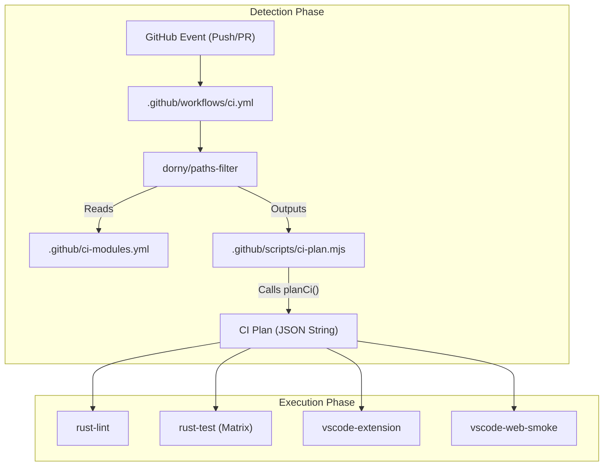
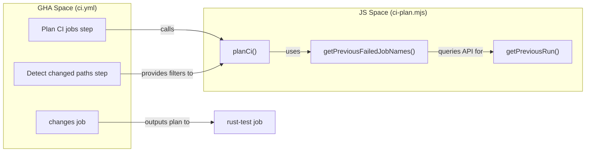

<!-- source: DeepWiki mcp.deepwiki.com · repo pascal-lab/vide · page 9.1 CI Pipeline and Dynamic Job Planning · fetched 2026-10-12 -->

# CI Pipeline and Dynamic Job Planning

Relevant source files

The following files were used as context for generating this wiki page:

- [.github/scripts/ci-plan.mjs](.github/scripts/ci-plan.mjs)
- [.github/workflows/build-artifacts.yml](.github/workflows/build-artifacts.yml)
- [.github/workflows/ci.yml](.github/workflows/ci.yml)
- [.github/workflows/deploy-docs.yml](.github/workflows/deploy-docs.yml)
- [.github/workflows/docs-preview.yml](.github/workflows/docs-preview.yml)
- [README.md](README.md)
- [README.zh-CN.md](README.zh-CN.md)
- [dist-workspace.toml](dist-workspace.toml)
- [docs/website.md](docs/website.md)
- [scripts/build-artifact.sh](scripts/build-artifact.sh)
- [website/package.json](website/package.json)
- [website/site/scripts/release-body-from-changelog.mjs](website/site/scripts/release-body-from-changelog.mjs)
- [website/site/src/content/docs/advanced-guide/advanced-installation.md](website/site/src/content/docs/advanced-guide/advanced-installation.md)

The Vide CI pipeline is designed for high-efficiency, multi-platform validation of a hybrid Rust and TypeScript codebase. It utilizes a dynamic planning phase to minimize redundant compute by analyzing changed paths and historical job failures. The pipeline integrates `sccache` for C++ and Rust compilation and executes specialized smoke tests for both native and WebAssembly (WASM) targets.

## Pipeline Architecture and Data Flow

The CI process is split into two primary stages: **Detection** and **Execution**. The detection stage produces a JSON "plan" that determines which downstream jobs should run and what their configuration (e.g., OS matrix) should be.

### CI Orchestration Diagram

The following diagram illustrates how the GitHub Actions workflow coordinates between file-based filters and the JavaScript planning script.

**Diagram: CI Orchestration and Planning Flow**

Sources: [.github/workflows/ci.yml:24-62](), [.github/scripts/ci-plan.mjs:8-69]()

## Dynamic Job Planning (`ci-plan.mjs`)

The `planCi` function in `.github/scripts/ci-plan.mjs` is the core logic for the pipeline's dynamism. It accepts filters derived from path changes and calculates the execution requirements.

### Path Filtering
The system uses `.github/ci-modules.yml` to define glob patterns for different components. The `dorny/paths-filter` action outputs boolean flags (e.g., `steps.filter.outputs.rust`) based on these definitions [.github/workflows/ci.yml:31-43]().

### Failure Persistence
The planner calls `getPreviousFailedJobNames` to inspect the conclusion of the most recent completed run [.github/scripts/ci-plan.mjs:71-105](). 
- It identifies jobs with conclusions like `failure`, `timed_out`, or `startup_failure` [.github/scripts/ci-plan.mjs:1]().
- If a job failed previously (e.g., `Rust Tests (macos-latest)`), the planner ensures that specific job is retried even if no relevant files changed, preventing intermittent failures from being ignored [.github/scripts/ci-plan.mjs:34-37]().

### Matrix Generation
The planner dynamically constructs the `rust_test_matrix`. 
- **Default**: Tests on `ubuntu-latest`, `windows-latest`, and `macos-latest` [.github/scripts/ci-plan.mjs:3-5]().
- **Narrowed**: If only a subset of OS targets failed previously, it narrows the matrix to just those specific operating systems [.github/scripts/ci-plan.mjs:36]().

**Diagram: Planning Logic Entity Mapping**

Sources: [.github/scripts/ci-plan.mjs:8-69](), [.github/scripts/ci-plan.mjs:71-105](), [.github/scripts/ci-plan.mjs:107-140](), [.github/workflows/ci.yml:31-61]()

## Build Infrastructure and Caching

Vide relies heavily on external C++ libraries (Slang), making build times a critical concern.

### sccache Integration
The pipeline uses a custom action `.github/actions/setup-sccache` which is invoked in Rust-related jobs [.github/workflows/ci.yml:75](), [.github/workflows/ci.yml:105](). 
- The `setup-sccache` action is configured with `cmake-launcher: "true"` to ensure C++ dependencies are cached [.github/workflows/ci.yml:77]().

### Rust and WASM Caching
- **`rust-cache`**: Uses `Swatinem/rust-cache@v2` with a shared key based on the runner OS and a specific key hashing `Cargo.lock`, `rust-toolchain.toml`, and source directories [.github/workflows/ci.yml:79-85]().
- **Playground WASM Cache**: The `vscode-web-smoke` job and documentation build workflows attempt to restore a specialized cache for the WASM artifacts in `website/playground/public/wasm` [.github/workflows/ci.yml:150-155](), [.github/workflows/docs-preview.yml:79-83](). This avoids expensive Emscripten builds if the underlying Rust source or build scripts haven't changed.

Sources: [.github/workflows/ci.yml:74-85](), [.github/workflows/ci.yml:150-162](), [.github/workflows/docs-preview.yml:78-111]()

## Test Suites

The CI pipeline executes several distinct categories of tests:

| Job | Description | Environment |
| :--- | :--- | :--- |
| `rust-lint` | Checks formatting via `cargo fmt` and runs `clippy` with `-D warnings` [.github/workflows/ci.yml:86-91](). | Linux |
| `rust-test` | Executes the workspace-wide test suite via `cargo test --workspace` [.github/workflows/ci.yml:117](). | Multi-OS Matrix |
| `vscode-extension` | Runs extension tests using `npm test` inside `editors/vscode` [.github/workflows/ci.yml:124-138](). | Linux |
| `vscode-web-smoke` | Verifies WASM builds by running `npm --workspace playground run build:wasm` [.github/workflows/ci.yml:200](). | Linux (Emscripten) |

### VS Code Web Smoke Test
This job specifically validates Browser/WASM compatibility. It requires the Emscripten SDK (defined by `EMSDK_VERSION`: 5.0.2) [.github/workflows/ci.yml:21](). It verifies the existence of `vide-lsp.js`, `vide-core.js`, and `vide-core.wasm` [.github/workflows/ci.yml:160-162]().

Sources: [.github/workflows/ci.yml:63-200]()

## Artifact and Documentation Deployment

### Build Artifacts Workflow
The `build-artifacts.yml` workflow is a reusable workflow that handles cross-compilation for multiple targets, including `x86_64-unknown-linux-gnu`, `aarch64-apple-darwin`, and `x86_64-pc-windows-msvc` [.github/workflows/build-artifacts.yml:29-65](). It uses `cargo-zigbuild` for Linux targets to ensure specific GLIBC version contracts (e.g., 2.17) [.github/workflows/build-artifacts.yml:77-84](), [.scripts/build-artifact.sh:24-33]().

### Documentation Previews
The `docs-preview.yml` workflow builds the Astro-based documentation site [.github/workflows/docs-preview.yml:147-149]().
- It uploads a `vide-docs-preview` artifact for pull requests [.github/workflows/docs-preview.yml:157-163]().
- The `deploy-docs.yml` workflow then synchronizes these artifacts to Aliyun OSS using `ossutil` [.github/workflows/deploy-docs.yml:123-148](), creating a preview URL for each PR [.github/workflows/deploy-docs.yml:106-112]().

Sources: [.github/workflows/build-artifacts.yml:29-65](), [.github/workflows/docs-preview.yml:147-163](), [.github/workflows/deploy-docs.yml:106-175](), [.scripts/build-artifact.sh:23-53]()

---

