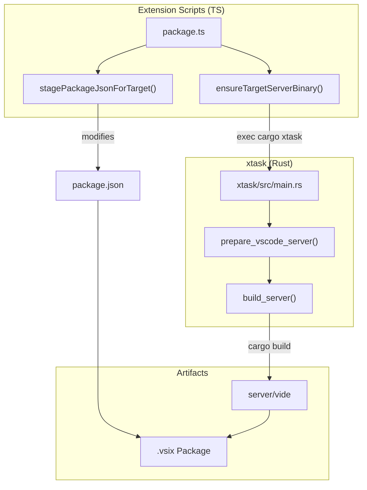
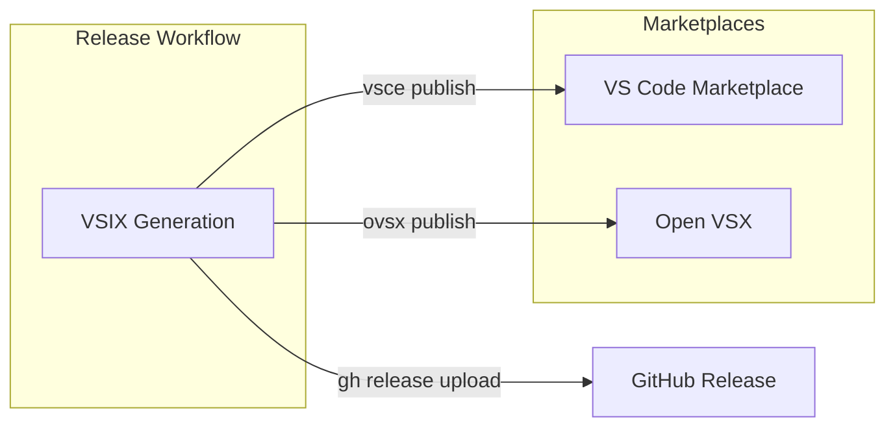

<!-- source: DeepWiki mcp.deepwiki.com · repo pascal-lab/vide · page 9.2 Release and Extension Packaging · fetched 2026-10-12 -->

# Release and Extension Packaging

Relevant source files

The following files were used as context for generating this wiki page:

- [.github/workflows/publish-vsix.yml](.github/workflows/publish-vsix.yml)
- [.github/workflows/release.yml](.github/workflows/release.yml)
- [build.rs](build.rs)
- [editors/vscode/.gitignore](editors/vscode/.gitignore)
- [editors/vscode/.vscodeignore](editors/vscode/.vscodeignore)
- [editors/vscode/language-configuration.json](editors/vscode/language-configuration.json)
- [editors/vscode/scripts/package.ts](editors/vscode/scripts/package.ts)
- [editors/vscode/scripts/package/manifest.ts](editors/vscode/scripts/package/manifest.ts)
- [editors/vscode/scripts/package/packageExtension.ts](editors/vscode/scripts/package/packageExtension.ts)
- [editors/vscode/scripts/package/server.ts](editors/vscode/scripts/package/server.ts)
- [editors/vscode/src/generated/projectConfigSchema.ts](editors/vscode/src/generated/projectConfigSchema.ts)
- [editors/vscode/src/platform.ts](editors/vscode/src/platform.ts)
- [editors/vscode/test/package.test.ts](editors/vscode/test/package.test.ts)
- [editors/vscode/test/platform.test.ts](editors/vscode/test/platform.test.ts)
- [schemas/v1/vide.schema.json](schemas/v1/vide.schema.json)
- [src/lib.rs](src/lib.rs)
- [xtask/Cargo.toml](xtask/Cargo.toml)
- [xtask/src/main.rs](xtask/src/main.rs)

This section describes the infrastructure and processes used to build, package, and distribute the Vide VS Code extension and its associated language server binaries. The system supports multiple native platforms and a specialized WebAssembly (WASM) target for web-based editors.

## Release Orchestration

The release process is driven by GitHub Actions and a custom TypeScript packaging script. The primary workflow, `release.yml`, manages the lifecycle from plan generation to artifact publishing.

### Workflow: release.yml
The `release.yml` workflow is triggered by version tags (e.g., `1.2.3`) or manual dispatch [ .github/workflows/release.yml:41-45](). It utilizes `cargo-dist` to plan and execute the release [ .github/workflows/release.yml:63-83]().

1.  **Planning**: The `plan` job runs `dist plan` to determine the required build tasks and outputs a manifest [ .github/workflows/release.yml:49-83]().
2.  **Custom Artifacts**: The `custom-build-artifacts` job invokes `build-artifacts.yml`, which handles the creation of platform-specific VSIX files [ .github/workflows/release.yml:90-97]().
3.  **Global Artifacts**: Standard archives, installers, and checksums are generated in the `build-global-artifacts` job [ .github/workflows/release.yml:100-144]().
4.  **Publishing**: On success, artifacts are uploaded to a GitHub Release, and the `publish-vsix.yml` workflow is called to distribute to marketplaces [ .github/workflows/publish-vsix.yml:1-114]().

### Build Metadata Injection
Vide uses a `build.rs` script to bake metadata into the Rust language server binary. It specifically looks for the `VIDE_BUILD_METADATA` environment variable to append versioning information to the version string [ build.rs:4-12](). This metadata is combined with the package version and build profile (DEBUG/RELEASE) in the core library [ src/lib.rs:34-37]().

**Sources:** [ .github/workflows/release.yml:41-144](), [ .github/workflows/publish-vsix.yml:1-114](), [ build.rs:1-13](), [ src/lib.rs:33-37]()

---

## Packaging Script: package.ts

The `package.ts` script is the entry point for assembling the VS Code extension [ editors/vscode/scripts/package.ts:5-11](). It coordinates the interaction between the TypeScript extension code and the Rust `xtask` build system.

### Key Concepts
*   **PlatformFolder**: Identifiers for target environments, such as `win32-x64`, `linux-arm64`, and `darwin-arm64` [ editors/vscode/src/platform.ts:3-12]().
*   **ServerMode**: `build` (compiles from source) or `prebuilt` (uses existing binary) [ xtask/src/main.rs:107-111]().
*   **BuildProfile**: `debug` or `release` [ xtask/src/main.rs:101-105]().

### Execution Flow
The packaging process follows this logic:
1.  **CLI Parsing**: `parsePackageCliArgs` processes target and profile flags [ editors/vscode/test/package.test.ts:17-47]().
2.  **Binary Preparation**: The script calls `ensureTargetServerBinary`, which executes `cargo xtask vscode prepare-server` [ editors/vscode/scripts/package/server.ts:8-31]().
3.  **Xtask Build**: The `xtask` binary handles the actual `cargo build` for the requested target and copies the resulting binary to the `server/` directory [ xtask/src/main.rs:173-212]().
4.  **Staging**: `stagePackageJsonForTarget` modifies `package.json` based on the target (e.g., removing `main` for web builds or `browser` for native builds) [ editors/vscode/test/package.test.ts:92-134]().
5.  **VSIX Generation**: The final package is produced using the `@vscode/vsce` tool.

### Code Entity Relationship: Packaging
The following diagram illustrates how the packaging script interacts with the repository structure.

Title: Packaging Data Flow and Code Entities

**Sources:** [ editors/vscode/scripts/package.ts:1-11](), [ editors/vscode/scripts/package/server.ts:8-55](), [ xtask/src/main.rs:145-227](), [ editors/vscode/test/package.test.ts:49-174]()

---

## Native and Web Targets

Vide supports multiple deployment targets, managed through the `VscodeServerTarget` enum and the `PlatformFolder` type.

### Native Targets
Native VSIX packages include a platform-specific binary. Supported folders include `alpine-arm64`, `alpine-x64`, `darwin-arm64`, `linux-arm64`, `linux-x64`, and `win32-x64` [ editors/vscode/src/platform.ts:3-10](). The `xtask` system ensures the correct executable name (e.g., `vide.exe` for Windows) [ xtask/src/main.rs:136-143]().

### Web Target (WASM)
When packaging for the web (`--target web`):
1.  **Manifest Staging**: The `main` entry point is removed from `package.json`, leaving only the `browser` entry point [ editors/vscode/test/package.test.ts:112-128]().
2.  **Asset Cleanup**: Stale native bundles and binaries are removed from the `dist/` and `server/` directories to keep the VSIX lightweight [ editors/vscode/test/package.test.ts:136-154]().
3.  **WASM Bundle**: The extension relies on the `vide-lsp-wasm` components loaded via the browser-specific logic.

**Sources:** [ editors/vscode/src/platform.ts:3-30](), [ xtask/src/main.rs:113-143](), [ editors/vscode/test/package.test.ts:92-174]()

---

## Marketplace Distribution

Once `.vsix` files are generated, they are published to two major registries.

1.  **VS Code Marketplace**: Handled via `@vscode/vsce publish` using the `VSCE_PAT` secret [ .github/workflows/publish-vsix.yml:71-91]().
2.  **Open VSX**: Handled via `ovsx publish` using the `OPEN_VSX_TOKEN` secret [ .github/workflows/publish-vsix.yml:93-113]().

The publishing job is skipped for pre-releases to ensure only stable versions reach the main marketplace channels [ .github/workflows/publish-vsix.yml:44]().

Title: Distribution Flow

**Sources:** [ .github/workflows/publish-vsix.yml:42-114]()

---

## Build Metadata and Versioning

The `src/lib.rs` file defines the canonical `VERSION` string for the server. It incorporates:
*   `CARGO_PKG_VERSION`: The version from `Cargo.toml` [ src/lib.rs:37]().
*   `BUILD_PROFILE`: Either `DEBUG` or `RELEASE` [ src/lib.rs:35]().
*   `VIDE_BUILD_METADATA`: Injected by `build.rs` [ src/lib.rs:37]().

This version is reported during LSP initialization in the `InitializeResult` [ src/lib.rs:142]().

**Sources:** [ src/lib.rs:33-38, 138-144](), [ build.rs:1-13]()

---

