# Page: Overview

# Overview

<details>
<summary>Relevant source files</summary>

The following files were used as context for generating this wiki page:

- [Cargo.toml](Cargo.toml)
- [editors/vscode/LICENSE](editors/vscode/LICENSE)
- [editors/vscode/package-lock.json](editors/vscode/package-lock.json)
- [editors/vscode/package.json](editors/vscode/package.json)
- [src/config.rs](src/config.rs)
- [src/main.rs](src/main.rs)

</details>


Vide is an open-source, modern SystemVerilog Integrated Development Environment (IDE) designed to bring software-engineering-grade productivity to hardware description languages [Cargo.toml:11](). Developed by the PASCAL Research Group, Vide provides a comprehensive Language Server Protocol (LSP) implementation that powers features like precise completion, semantic highlighting, and automatic refactoring [Cargo.toml:7-11]().

The system is built as a multi-crate Rust workspace, leveraging the `slang` C++ library for high-performance SystemVerilog parsing and the `Salsa` framework for incremental computation [Cargo.toml:13-25](), [Cargo.toml:87]().

---

## System Architecture

Vide follows a layered architecture typical of modern compilers and language servers. It abstracts file access via a Virtual File System (VFS), builds a High-level Intermediate Representation (HIR) for semantic analysis, and provides an IDE query layer for editor features.

### High-Level Component Interaction
The following diagram illustrates how a user action in the editor flows through the system components.

**User Request Flow**
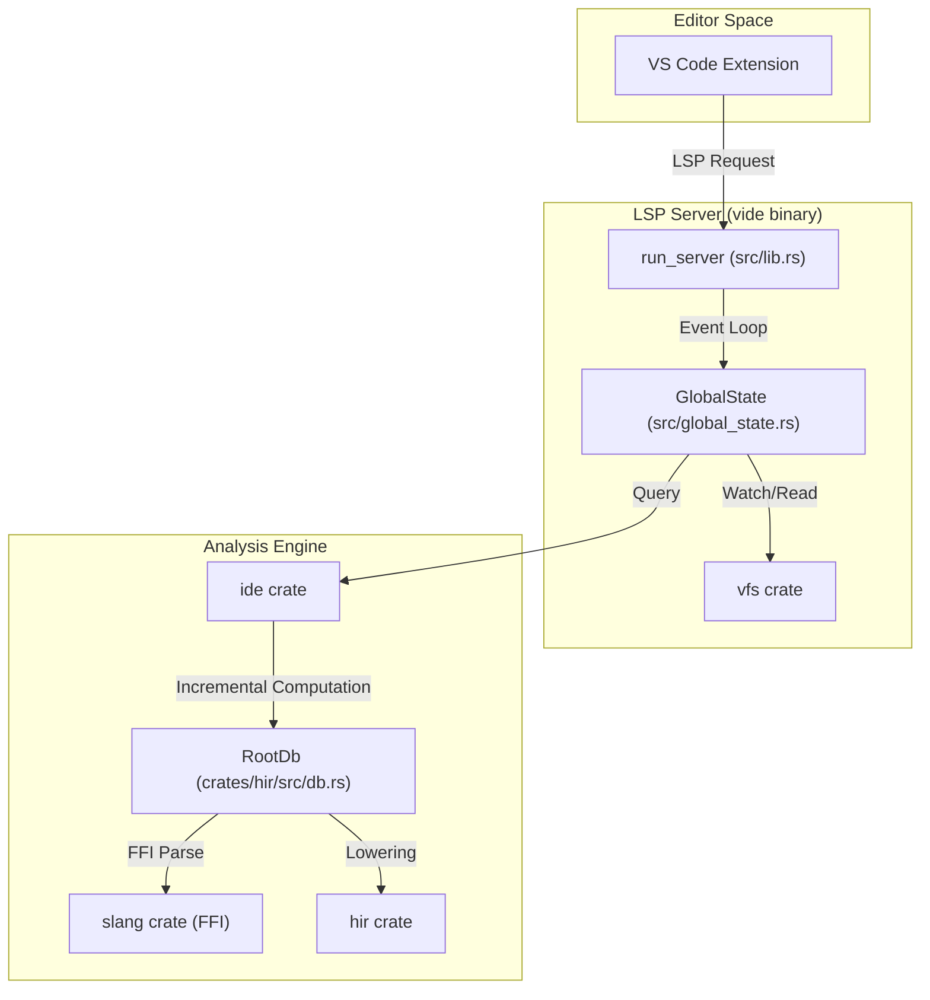
**Sources:** [Cargo.toml:19-25](), [src/main.rs:121-123](), [src/config.rs:78-87]()

---

## Key Subsystems

### 1. Language Server Protocol (LSP)
The entry point of the application is the `vide` crate (root binary), which manages JSON-RPC communication. It handles configuration via `Config` [src/config.rs:78](), manages workspace roots [src/config.rs:80](), and coordinates task execution.
*   **For details, see [LSP Server](#6).**

### 2. Project Modeling
Vide uses a `vide.toml` manifest to define the compilation environment. The `project-model` crate handles manifest discovery and construction of compilation profiles [src/config.rs:9-13](), [src/config.rs:157-167]().
*   **For details, see [Project Configuration (vide.toml)](#1.2).**

### 3. High-level Intermediate Representation (HIR)
The `hir` crate lowers raw syntax trees from Slang into a semantic model. It provides the `HirDb` query interface for scope resolution and name binding [Cargo.toml:54]().
*   **For details, see [HIR (High-level Intermediate Representation)](#4).**

### 4. IDE Intelligence
The `ide` crate implements user-facing features such as diagnostics, completions, and navigation by querying the HIR layer [Cargo.toml:55](). It supports localized messaging via the `i18n` module [src/config.rs:18-19]().
*   **For details, see [IDE Features](#5).**

---

## Code Entity Mapping

This diagram bridges the conceptual subsystems to the specific crates and modules found in the repository.

**Codebase Organization**
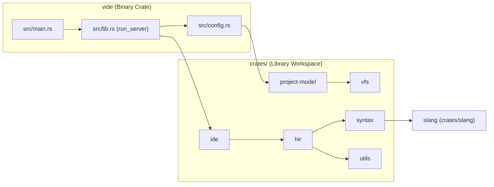
**Sources:** [Cargo.toml:13-14](), [Cargo.toml:53-63](), [src/main.rs:11-12]()

---

## Navigating the Wiki

To explore specific areas of the codebase, refer to the following sections:

*   **Setting up the Environment**: See [Getting Started](#1.1) for installation and VS Code configuration.
*   **Configuring Projects**: See [Project Configuration (vide.toml)](#1.2) to learn how Vide discovers source files and libraries.
*   **Understanding the Internals**:
    *   For the data flow and Salsa database, see [Architecture Overview](#2).
    *   For the SystemVerilog semantic model, see [HIR (High-level Intermediate Representation)](#4).
    *   For the implementation of features like Goto Definition or Completion, see [IDE Features](#5).
*   **Deployment and Testing**:
    *   For WASM/Browser support, see [Browser / WASM Support](#8).
    *   For the testing framework, see [Testing Infrastructure](#11).
*   **Editor Extensions**:
    *   For the VS Code client, see [Editor Integrations](#7).
    *   For the Zed extension, see [Zed Editor Extension](#7.4).

**Sources:** [Cargo.toml:13-25](), [editors/vscode/package.json:1-33]()

---

# Page: Getting Started

# Getting Started

<details>
<summary>Relevant source files</summary>

The following files were used as context for generating this wiki page:

- [Cargo.toml](Cargo.toml)
- [editors/vscode/LICENSE](editors/vscode/LICENSE)
- [editors/vscode/package-lock.json](editors/vscode/package-lock.json)
- [editors/vscode/package.json](editors/vscode/package.json)
- [editors/vscode/src/extension.ts](editors/vscode/src/extension.ts)
- [editors/vscode/src/projectConfig.ts](editors/vscode/src/projectConfig.ts)
- [editors/vscode/test/projectConfig.test.ts](editors/vscode/test/projectConfig.test.ts)

</details>


This page covers the installation, project setup, and initial configuration for Vide. Vide is a modern SystemVerilog IDE built on a Rust-based language server that implements the Language Server Protocol (LSP) [Cargo.toml:1-11]().

## Installation

The primary way to use Vide is through the VS Code extension, which manages the lifecycle of the underlying language server binary.

### Standard Installation (VS Code)
1.  **Extension Marketplace**: Search for `Vide` or the extension ID `pascal-lab.vide-ide` in the VS Code Extensions view [editors/vscode/package.json:2-6]().
2.  **Activation**: The extension contributes support for Verilog (`.v`, `.vh`) and SystemVerilog (`.sv`, `.svh`, `.svi`) [editors/vscode/package.json:34-57](). It activates automatically when these file types are handled by the editor [editors/vscode/package.json:29-29]().
3.  **Status Verification**: A "Vide" status item managed by `VideStatusController` appears in the status bar, providing details on the server state [editors/vscode/src/extension.ts:32-34]().

### Build from Source
For development, the language server and extension can be built from the workspace.

*   **Language Server**: The server is a Rust project located at the root of the repository [Cargo.toml:1-14]().
    *   Command: `cargo build --release`
*   **VS Code Extension**: Located in `editors/vscode/`. It uses `esbuild` for bundling [editors/vscode/package-lock.json:20-20]().
    *   Setup: `npm install` inside `editors/vscode/`.
    *   Development: Use the "Extension" launch configuration in VS Code to debug `extension.ts` [editors/vscode/src/extension.ts:1-12]().

### Data Flow: Extension Activation
The following diagram illustrates the startup sequence and how the VS Code extension resolves the language server binary using platform-specific logic.

**Extension Activation and Server Resolution**
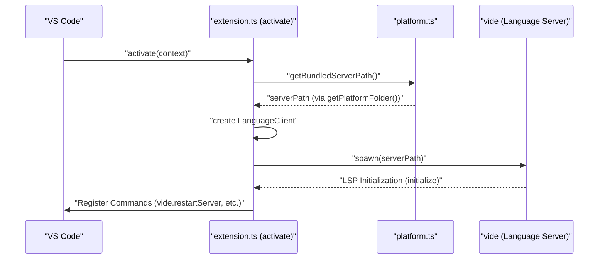
Sources: [editors/vscode/src/extension.ts:14-43](), [editors/vscode/src/extension.ts:146-148]()

---

## First Project Setup

Vide uses a manifest file named `vide.toml` to define the compilation unit and analysis scope.

### Creating vide.toml
Vide looks for a configuration file in the workspace root [editors/vscode/src/projectConfig.ts:7-12](). The default configuration is initialized with an empty `sources` array and commented-out templates for advanced options.

```toml
#:schema https://vide.pascal-lab.net/schemas/v1/vide.schema.json
sources = []

# include_dirs = ["include"]
# defines = ["SYNTHESIS"]
# top_modules = ["top"]
# libraries = ["../common_cells"]
# exclude = ["build/**"]
```
Sources: [editors/vscode/test/projectConfig.test.ts:42-57]()

### Configuration Fields
| Field | Description |
| :--- | :--- |
| `sources` | List of root source files or directories to analyze [editors/vscode/test/projectConfig.test.ts:47-47](). |
| `include_dirs` | Search paths for `` `include `` directives [editors/vscode/test/projectConfig.test.ts:49-49](). |
| `defines` | Global macro definitions [editors/vscode/test/projectConfig.test.ts:50-50](). |
| `top_modules` | Explicitly defined top-level modules for hierarchy analysis [editors/vscode/test/projectConfig.test.ts:51-51](). |
| `libraries` | External library paths for module discovery [editors/vscode/test/projectConfig.test.ts:52-52](). |

---

## Editor Configuration

Vide provides several VS Code settings to customize behavior. These are defined in the `package.json` and passed to the server via `serverInitializationOptions` [editors/vscode/package.json:92-95](), [editors/vscode/src/extension.ts:17-17]().

### Key Settings
*   **`vide.server.command`**: Overrides the path to the language server binary [editors/vscode/package.json:105-112]().
*   **`vide.server.args`**: Additional arguments passed to the server process [editors/vscode/package.json:113-120]().
*   **`vide.formatter.provider`**: Choice of formatter (default is `verible`) [editors/vscode/package.json:211-221]().
*   **`vide.workspace.auto.reload`**: Automatically reload the workspace when `vide.toml` changes [editors/vscode/package.json:192-196]().

### Implementation: Configuration Mapping
The extension maps VS Code settings to LSP `InitializationOptions` which are then processed by the server.

**Settings Mapping to Code Entities**
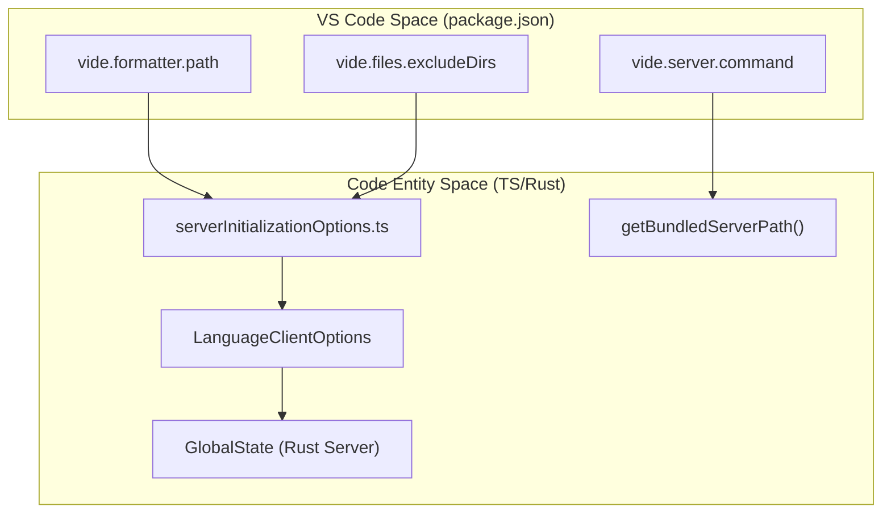
Sources: [editors/vscode/src/extension.ts:14-17](), [editors/vscode/src/initializationOptions.ts:1-10](), [editors/vscode/package.json:105-136]()

---

## Basic Usage

### Commands
Vide registers several commands in the VS Code Command Palette (`Ctrl+Shift+P`):
*   **`Vide: Restart Server`**: Restarts the language server process [editors/vscode/src/extension.ts:43-43]().
*   **`Vide: Show Server Version`**: Displays the version and build metadata (commit hash, build date) [editors/vscode/src/extension.ts:44-44](), [editors/vscode/src/extension.ts:117-124]().
*   **`Vide: Reload Workspace`**: Manually triggers a workspace reload [editors/vscode/src/extension.ts:28-29]().
*   **`Vide: Run Qihe Analysis`**: Triggers advanced semantic analysis [editors/vscode/src/extension.ts:46-47]().

### Diagnostics and Output
The extension provides specialized output channels for monitoring:
1.  **Vide Language Server**: General LSP logs and server-side traces [editors/vscode/src/extension.ts:55-55]().
2.  **Vide Qihe**: Specialized analysis logs for the Qihe semantic engine [editors/vscode/src/extension.ts:56-56]().

If the server fails to start, an error message is shown with an option to "Show Output" to inspect the logs [editors/vscode/src/extension.ts:130-136]().

Sources: [editors/vscode/src/extension.ts:43-57](), [editors/vscode/src/extension.ts:130-144](), [editors/vscode/src/videStatus.ts:28-33]()

---

# Page: Project Configuration (vide.toml)

# Project Configuration (vide.toml)

<details>
<summary>Relevant source files</summary>

The following files were used as context for generating this wiki page:

- [crates/hir/Cargo.toml](crates/hir/Cargo.toml)
- [crates/hir/src/base_db/project.rs](crates/hir/src/base_db/project.rs)
- [crates/hir/src/base_db/source_root.rs](crates/hir/src/base_db/source_root.rs)
- [crates/hir/src/lib.rs](crates/hir/src/lib.rs)
- [crates/ide/src/diagnostics.rs](crates/ide/src/diagnostics.rs)
- [crates/project-model/Cargo.toml](crates/project-model/Cargo.toml)
- [crates/project-model/src/lib.rs](crates/project-model/src/lib.rs)
- [crates/project-model/src/macro_def.rs](crates/project-model/src/macro_def.rs)
- [crates/project-model/src/project_manifest.rs](crates/project-model/src/project_manifest.rs)
- [crates/project-model/src/toml_workspace.rs](crates/project-model/src/toml_workspace.rs)
- [crates/workspace-model/Cargo.toml](crates/workspace-model/Cargo.toml)
- [crates/workspace-model/src/lib.rs](crates/workspace-model/src/lib.rs)
- [crates/workspace-model/src/project.rs](crates/workspace-model/src/project.rs)
- [src/tests.rs](src/tests.rs)

</details>


The `vide.toml` file is the central manifest for a Vide project. It defines the boundaries of the compilation unit, including source file discovery, include search paths, preprocessor macros, and external library dependencies. While Vide can operate in a "best-effort" mode without a manifest, a well-configured `vide.toml` enables accurate cross-file semantic analysis, diagnostics, and advanced refactoring.

## Configuration Schema

The configuration is written in TOML and validated against a JSON schema defined in the `project-model` crate. The schema is generated using the `schemars` crate to ensure consistency between the code and documentation.

| Field | Type | Description |
| :--- | :--- | :--- |
| `sources` | `Option<Vec<String>>` | Workspace-relative shell globs for source files (e.g., `["rtl/**"]`). |
| `include_dirs` | `Option<Vec<Path>>` | Directories searched for `` `include `` directives. |
| `defines` | `Vec<String>` | Predefined macros in `NAME` or `NAME=VALUE` format. |
| `top_modules` | `Vec<String>` | Top-level module names for the compilation profile. |
| `libraries` | `Vec<Path>` | Paths to external dependency workspaces. |
| `exclude` | `Vec<String>` | Workspace-relative globs to ignore (e.g., `["build/**"]`). |

**Sources:** [crates/project-model/src/toml_workspace.rs:47-126](), [crates/project-model/src/toml_workspace.rs:134-145]()

---

## Data Flow: Manifest to Compilation Profile

The conversion from a physical `vide.toml` file to a semantic `CompilationProfile` involves several stages: discovery, deserialization, and path resolution.

### 1. Discovery and Loading
The `ProjectManifest` enum represents either a found `vide.toml` or an unconfigured directory. The `ProjectManifest::from_path` function implements the discovery logic, looking for the primary filename `vide.toml` defined by `MANIFEST_FILE_NAME`.

**Sources:** [crates/project-model/src/project_manifest.rs:7-8](), [crates/project-model/src/project_manifest.rs:33-36](), [crates/project-model/src/project_manifest.rs:59-83]()

### 2. Deserialization
The `TomlWorkspace` struct handles the raw TOML parsing. It uses custom deserializers like `de_macros` to transform strings into `MacroDef` structures, splitting `NAME=VALUE` pairs into `MacroAtom::Flag` or `MacroAtom::KeyValue`.

**Sources:** [crates/project-model/src/toml_workspace.rs:147-185](), [crates/project-model/src/macro_def.rs:7-10]()

### 3. Compilation Profile Construction
The `Workspace::from_toml` function converts the manifest into a `Workspace` object. This involves:
- Validating glob patterns with `validate_manifest_patterns`.
- Compiling globs into `PathMatcher` and `PathGlobMatcher` objects.
- Resolving relative paths for `include_dirs` and `libraries`.
- Constructing a `CompilationProfile` which contains the final `PreprocessConfig` and `Predefine` set.

**Sources:** [crates/project-model/src/lib.rs:183-210](), [crates/project-model/src/macro_def.rs:29-50]()

### Configuration Pipeline Diagram
This diagram shows how `vide.toml` entities map to internal code classes during the loading process.

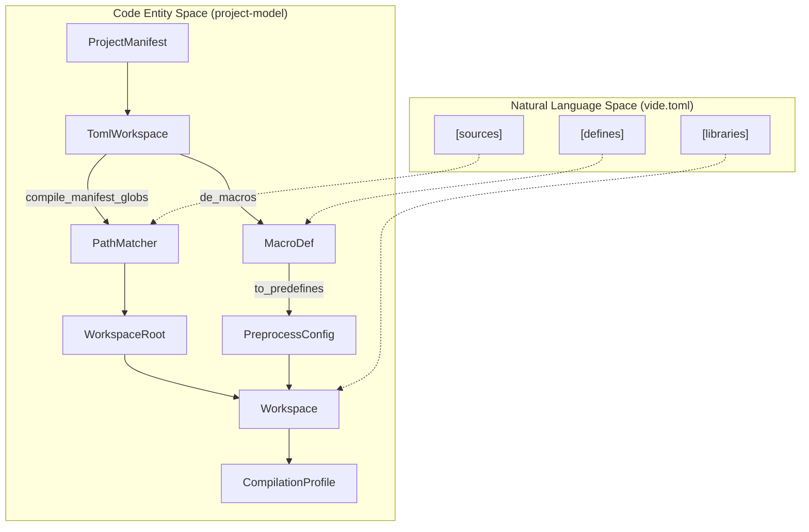
**Sources:** [crates/project-model/src/lib.rs:33-64](), [crates/project-model/src/toml_workspace.rs:47-126](), [crates/project-model/src/project_manifest.rs:33-36](), [crates/project-model/src/macro_def.rs:29-30]()

---

## Analysis Behavior and Policy

The presence and content of `vide.toml` significantly change how the `RootDb` (Salsa database) treats files.

### Manifest Source Policy
Vide implements a `ManifestSourcePolicy` to handle different user intents:
- **Omitted `sources`**: The `DefaultIndex` policy is used. Vide performs best-effort indexing of the entire workspace for navigation but suppresses complex semantic diagnostics to avoid false positives.
- **`sources = []`**: Explicitly disables automatic scanning.
- **`sources = ["..."]`**: The `Explicit` policy is used. Vide treats matching files as the definitive project source set.

**Sources:** [crates/project-model/src/lib.rs:135-161](), [src/tests.rs:60-66]()

### Include Directory Inference
If `sources` is explicitly provided but `include_dirs` is omitted, Vide automatically infers include directories. The `ManifestSourcePolicy::defaults_include_dirs_to_sources` method determines if this fallback is active.

**Sources:** [crates/project-model/src/lib.rs:158-161](), [crates/project-model/src/lib.rs:202-210]()

### Feature Availability Matrix
| Feature | Unconfigured (No vide.toml) | Configured (With vide.toml) |
| :--- | :--- | :--- |
| **Diagnostics** | Syntax/Parse only | Full Semantic + Cross-file |
| **Rename** | Local (Single File) | Global (Project-wide) |
| **Semantic Highlighting** | Basic | Context-aware (Macro branches) |

**Sources:** [crates/ide/src/diagnostics.rs:216-235](), [crates/ide/src/diagnostics.rs:149-154]()

---

## Path Resolution and Globbing

Vide uses strict rules for paths in `vide.toml` to ensure portability:
- **Separators**: Must use `/` as handled by `Utf8PathBuf`.
- **Globbing**: 
    - `*` matches entries within a single directory.
    - `**` matches recursively across nested directories via `PathMatcher`.

**Sources:** [crates/project-model/src/lib.rs:20-24](), [crates/project-model/src/toml_workspace.rs:10-13]()

### Path Normalization Flow
This diagram tracks how a string from `vide.toml` becomes a `VfsPath` used by the analysis engine.

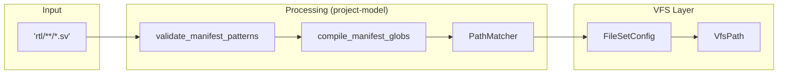
**Sources:** [crates/project-model/src/lib.rs:197-200](), [crates/project-model/src/lib.rs:20]()

---

## Library Management

The `libraries` field allows for modular project structures. Each path in `libraries` is resolved relative to the current manifest directory.

1. **Discovery**: Vide checks if the library path contains its own `vide.toml` using `ProjectManifest::from_path`.
2. **Recursive Loading**: If a manifest is found, it is loaded as a configured `Workspace`.
3. **Unconfigured Fallback**: If no manifest exists, the directory is loaded as an `UnconfiguredRoot`.

**Sources:** [crates/project-model/src/lib.rs:164-182](), [crates/project-model/src/project_manifest.rs:59-83]()

---

# Page: Architecture Overview

# Architecture Overview

<details>
<summary>Relevant source files</summary>

The following files were used as context for generating this wiki page:

- [Cargo.toml](Cargo.toml)
- [crates/hir/src/base_db/analysis_snapshot.rs](crates/hir/src/base_db/analysis_snapshot.rs)
- [crates/hir/src/base_db/source_db.rs](crates/hir/src/base_db/source_db.rs)
- [crates/hir/src/preproc.rs](crates/hir/src/preproc.rs)
- [crates/ide/Cargo.toml](crates/ide/Cargo.toml)
- [crates/ide/src/analysis_host.rs](crates/ide/src/analysis_host.rs)
- [crates/ide/src/db/root_db.rs](crates/ide/src/db/root_db.rs)
- [editors/vscode/LICENSE](editors/vscode/LICENSE)
- [editors/vscode/package-lock.json](editors/vscode/package-lock.json)
- [editors/vscode/package.json](editors/vscode/package.json)

</details>


Vide is a high-performance language server for Verilog and SystemVerilog, built using a multi-crate Rust workspace [Cargo.toml:13-14](). It leverages the **Salsa** incremental computation framework to provide low-latency IDE features by recomputing only the necessary parts of the semantic model when files change.

## High-Level System Structure

The system is organized into several distinct layers, ranging from raw file I/O to high-level IDE logic and the LSP communication protocol.

### System Data Flow
The following diagram illustrates how data flows from the physical file system through the incremental database into the IDE layer.

**Data Transformation Pipeline**
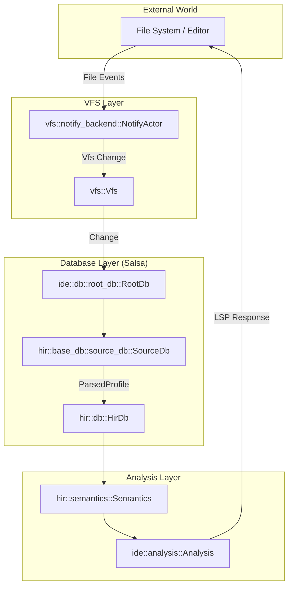
Sources: [crates/ide/src/db/root_db.rs:26-34](), [crates/ide/src/analysis_host.rs:27-30](), [Cargo.toml:19-25]()

---

## Core Subsystems

### 1. Virtual File System (VFS)
The VFS layer abstracts the physical file system, providing a consistent view of files across different environments (Native vs. WASM). It assigns a unique `FileId` [crates/hir/src/base_db/source_db.rs:8]() to every tracked file, ensuring that the rest of the system refers to files by stable identifiers rather than volatile paths.
*   **Key Entities:** `vfs::Vfs`, `vfs::FileId`, `vfs::loader::Handle`.
*   **For details, see [Virtual File System (VFS)](#2.1).**

### 2. Incremental Database (Salsa)
The `RootDb` is the heart of Vide. It is a Salsa database that composes multiple storage layers (Source, HIR, Line Index, and Symbol Index) [crates/ide/src/db/root_db.rs:26-33](). Salsa tracks dependencies between queries; for example, if a file's text changes via `set_file_text`, only the dependent ASTs and HIR structures are invalidated.
*   **Key Entities:** `ide::db::root_db::RootDb`, `hir::base_db::source_db::SourceDb`, `Durability`.
*   **For details, see [Incremental Database (Salsa / RootDb)](#2.2).**

### 3. Project Model
The project model handles workspace discovery and configuration. It parses `vide.toml` manifests to determine include paths, preprocessor defines, and the compilation profiles required for the Slang parser [crates/hir/src/base_db/source_db.rs:14-16]().
*   **Key Entities:** `project_model::ProjectManifest`, `hir::base_db::project::ProjectConfig`.
*   **For details, see [Project Model and Workspace Loading](#2.3).**

### 4. Syntax and HIR
Vide uses the **Slang** C++ library (via Rust FFI) for robust SystemVerilog parsing [Cargo.toml:63](). The resulting AST is then lowered into a **High-level Intermediate Representation (HIR)**. This layer handles preprocessor modeling [crates/hir/src/preproc.rs:1-7](), scope resolution, and name binding.
*   **Key Entities:** `syntax::SyntaxTree`, `hir::base_db::source_db::ParsedCompilationUnit`, `hir::semantics::Semantics`.

### 5. IDE and LSP Server
The `ide` crate provides the high-level API for features like "Go to Definition," "Completion," and "Hover." The `AnalysisHost` manages the `RootDb` and provides thread-safe `Analysis` snapshots [crates/ide/src/analysis_host.rs:12-25](). The LSP server (in `src/`) acts as the glue, dispatching JSON-RPC requests from the editor to the `ide` layer.

---

## Code-to-System Mapping

This diagram maps the logical subsystems to the specific Rust structs and traits that implement them.

**System Entity Map**
```mermaid
classDiagram
    class RootDb {
        +storage: salsa::Storage
        +apply_change(change: Change)
        +snapshot() salsa::Snapshot
    }
    class SourceDb {
        <<trait>>
        +file_text(file_id: FileId) Arc~str~
        +file_path(file_id: FileId) AbsPathBuf
        +project_config() Arc~ProjectConfig~
    }
    class HirDb {
        <<trait>>
        +module_data(id: ModuleId)
        +infer_query(id: ExprId)
    }
    class LineIndexDb {
        <<trait>>
        +line_index(file_id: FileId)
    }

    RootDb ..|> SourceDb
    RootDb ..|> HirDb
    RootDb ..|> LineIndexDb
    
    style RootDb stroke-width:4px
```
Sources: [crates/ide/src/db/root_db.rs:26-34](), [crates/hir/src/base_db/source_db.rs:43-62](), [crates/ide/src/analysis_host.rs:27-30]()

### Crate Dependencies

| Crate | Responsibility |
| :--- | :--- |
| `vfs` | File path and content management; file watching. |
| `syntax` | Slang FFI bindings and syntax tree utilities. |
| `hir` | Semantic model, name resolution, and preprocessor modeling. |
| `project-model` | `vide.toml` parsing and workspace layout. |
| `ide` | Concrete `RootDb` implementation and pure IDE logic. |
| `utils` | Shared utilities like paths, line indexes, and concurrency primitives. |

Sources: [Cargo.toml:53-63]()

---

# Page: Virtual File System (VFS)

# Virtual File System (VFS)

<details>
<summary>Relevant source files</summary>

The following files were used as context for generating this wiki page:

- [crates/vfs/Cargo.toml](crates/vfs/Cargo.toml)
- [crates/vfs/src/anchored_path.rs](crates/vfs/src/anchored_path.rs)
- [crates/vfs/src/dummy.rs](crates/vfs/src/dummy.rs)
- [crates/vfs/src/file_set.rs](crates/vfs/src/file_set.rs)
- [crates/vfs/src/file_set/tests.rs](crates/vfs/src/file_set/tests.rs)
- [crates/vfs/src/lib.rs](crates/vfs/src/lib.rs)
- [crates/vfs/src/loader.rs](crates/vfs/src/loader.rs)
- [crates/vfs/src/notify.rs](crates/vfs/src/notify.rs)
- [crates/vfs/src/path_glob.rs](crates/vfs/src/path_glob.rs)
- [crates/vfs/src/path_interner.rs](crates/vfs/src/path_interner.rs)
- [crates/vfs/src/vfs_path.rs](crates/vfs/src/vfs_path.rs)
- [src/global_state/event_loop.rs](src/global_state/event_loop.rs)
- [src/global_state/workspace_state.rs](src/global_state/workspace_state.rs)

</details>


The Virtual File System (VFS) layer abstracts file access and identity within Vide. It prevents high-level crates from interacting directly with the underlying operating system, enabling consistent file handling across native and WASM environments, supporting incremental computation via `FileId` stability, and providing robust file-watching capabilities.

## File Identity and `FileId`

In Vide, files are never referred to by raw paths in semantic analysis. Instead, every file is assigned a stable `FileId` [crates/vfs/src/lib.rs:50-51](). This integer-based identity is crucial for the Salsa incremental database to track changes efficiently.

### Path Interning and Storage
The `Vfs` struct acts as the central repository for file metadata and content hashes [crates/vfs/src/lib.rs:75-79](). It uses a `PathInterner` to maintain a bidirectional mapping between `VfsPath` and `FileId` [crates/vfs/src/path_interner.rs:12-15]().

- **Stability**: Once a `FileId` is assigned to a path, it remains constant for the lifetime of the `Vfs` instance [crates/vfs/src/path_interner.rs:29-33]().
- **State Tracking**: Each file is associated with a `FileState`, which tracks whether the file `Exists` (with a content hash), is `Deleted`, or is `Excluded` [crates/vfs/src/lib.rs:82-90]().
- **Change Log**: The VFS maintains a log of `ChangedFile` entries [crates/vfs/src/lib.rs:94-99](). These changes are "taken" by the main loop to update the Salsa database [crates/vfs/src/lib.rs:260-264]().

### VFS Identity Resolution
The following diagram illustrates how a raw `VfsPath` is resolved to a canonical `FileId` via the interner.

**Path to FileId Resolution Flow**
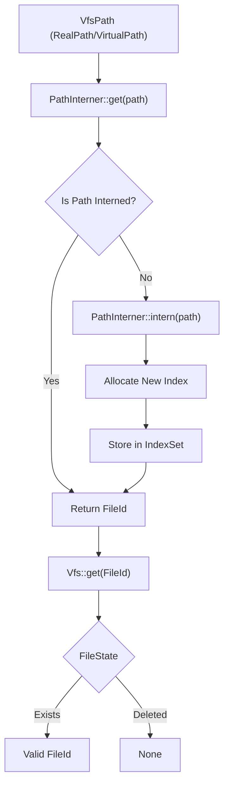
Sources: [crates/vfs/src/lib.rs:207-215](), [crates/vfs/src/path_interner.rs:21-33](), [crates/vfs/src/lib.rs:75-79]()

## VFS Loading and Watching

The `loader::Handle` trait defines the interface for loading file contents and watching for changes [crates/vfs/src/loader.rs:82-97](). Vide provides different implementations based on the environment.

### NotifyActor (Native)
The `NotifyActor` runs in a dedicated background thread named `VfsLoader` [crates/vfs/src/notify.rs:35-37](). It utilizes the `notify` crate for OS-level events and `walkdir` for scanning.

1.  **Configuration**: The actor receives a `loader::Config` containing `Entry::Files` or `Entry::Directories` [crates/vfs/src/loader.rs:37-48]().
2.  **Parallel Scanning**: It performs an initial recursive scan of directories using `rayon` for parallelism [crates/vfs/src/notify.rs:133-162]().
3.  **Watching**: It registers `RecommendedWatcher` instances for configured roots [crates/vfs/src/notify.rs:103-112](). When a file changes, it sends a `loader::Message::Changed` back to the main loop [crates/vfs/src/notify.rs:224-230]().

### DummyHandle (WASM / Browser)
In environments like WASM where OS watching is unavailable, Vide uses the `DummyHandle` [crates/vfs/src/dummy.rs:10-12]().
- **Manual Invalidation**: The LSP server explicitly calls `invalidate` when a `didChange` or `didSave` notification arrives [crates/vfs/src/dummy.rs:39-42]().
- **Synchronous Loading**: It reads files directly via `std::fs::read` (which is often mapped to a virtual filesystem in WASM) [crates/vfs/src/dummy.rs:44-46]().

**VFS Loading Data Flow**
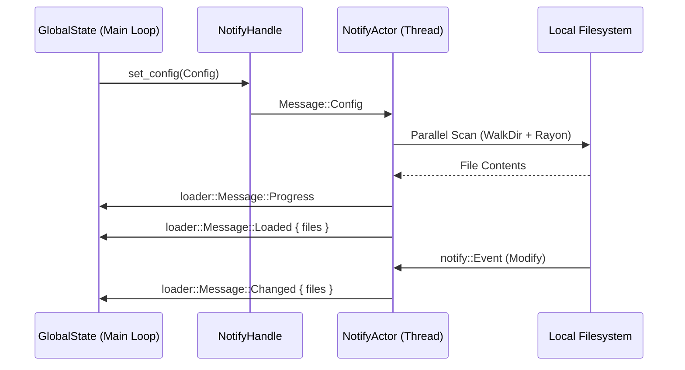
Sources: [crates/vfs/src/notify.rs:94-113](), [crates/vfs/src/notify.rs:133-162](), [src/global_state/event_loop.rs:178-178]()

## Source Root Partitioning

The VFS partitions the global set of files into discrete `FileSet`s [crates/vfs/src/file_set.rs:10-13](). This allows Vide to group files into logical units (e.g., a specific project or library).

### Classification Logic
- **PathMatcher**: Uses include roots and glob patterns to determine if a path belongs to a set [crates/vfs/src/file_set.rs:67-70]().
- **FileSetConfig**: Manages an ordered collection of filters. When partitioning, the first filter that matches a file "claims" it [crates/vfs/src/file_set.rs:51-56]().
- **Partitioning**: The `partition` method iterates through all files in the `Vfs` and assigns them to the appropriate `FileSet` based on the configuration [crates/vfs/src/file_set.rs:211-213]().

| Entity | Role |
| :--- | :--- |
| `FileSet` | A map between `VfsPath` and `FileId` for one source root [crates/vfs/src/file_set.rs:10-13](). |
| `FileSetConfig` | The global partitioning configuration using a finite state transducer (`fst`) for fast lookups [crates/vfs/src/file_set.rs:51-56](). |
| `FileSetFilter` | Defines the `include`, `source`, and `exclude` rules for a specific root [crates/vfs/src/file_set.rs:170-175](). |

Sources: [crates/vfs/src/file_set.rs:178-185](), [crates/vfs/src/file_set.rs:215-225]()

## Path Abstractions

Vide uses specialized path types to ensure platform independence and support virtual environments:

1.  **`VfsPath`**: An abstraction representing either a `PathBuf` (real filesystem path) or a `VirtualPath` (an arbitrary string starting with `/`) [crates/vfs/src/vfs_path.rs:12-13]().
2.  **`AbsPathBuf`**: A wrapper that guarantees the path is absolute and normalized [crates/vfs/src/lib.rs:30-30]().
3.  **`AnchoredPath`**: Represents a path relative to a specific `FileId`. This is essential for resolving SystemVerilog `` `include `` directives where the path is relative to the file containing the directive [crates/vfs/src/anchored_path.rs:43-49]().

### Normalization and Encoding
`VfsPath` provides an `encode` method used for interning paths into a `fst::Map` for fast prefix searching [crates/vfs/src/vfs_path.rs:131-180](). On Windows, it specifically handles path components and prefixes to ensure consistent identity despite OS-specific path variations [crates/vfs/src/vfs_path.rs:139-166]().

Sources: [crates/vfs/src/vfs_path.rs:36-41](), [crates/vfs/src/anchored_path.rs:32-38](), [crates/vfs/src/file_set.rs:32-37]()

---

# Page: Incremental Database (Salsa / RootDb)

# Incremental Database (Salsa / RootDb)

<details>
<summary>Relevant source files</summary>

The following files were used as context for generating this wiki page:

- [crates/hir/src/base_db.rs](crates/hir/src/base_db.rs)
- [crates/hir/src/base_db/analysis_snapshot.rs](crates/hir/src/base_db/analysis_snapshot.rs)
- [crates/hir/src/base_db/change.rs](crates/hir/src/base_db/change.rs)
- [crates/hir/src/base_db/source_db.rs](crates/hir/src/base_db/source_db.rs)
- [crates/hir/src/preproc.rs](crates/hir/src/preproc.rs)
- [crates/ide/Cargo.toml](crates/ide/Cargo.toml)
- [crates/ide/src/analysis_host.rs](crates/ide/src/analysis_host.rs)
- [crates/ide/src/db/root_db.rs](crates/ide/src/db/root_db.rs)

</details>


The Vide codebase utilizes the **Salsa** query framework to provide efficient, incremental recomputation of language analysis. At the core of this system is the `RootDb`, a unified database that composes multiple functional layers (source management, parsing, HIR, and IDE features) into a single reactive entity.

### RootDb Composition

The `RootDb` is the central state holder for the Vide Language Server. It implements the `salsa::Database` trait and aggregates several storage layers via the `#[salsa::database(...)]` attribute [crates/ide/src/db/root_db.rs:26-33]().

#### Database Layers
The `RootDb` is composed of the following sub-databases:
| Storage Layer | Responsibility |
| :--- | :--- |
| `SourceDbStorage` | Basic file text, paths, and project configuration [crates/hir/src/base_db/source_db.rs:43-43](). |
| `SourceRootDbStorage` | Partitioning of files into source roots (Local vs Library) and profile mapping. |
| `HirDbStorage` | Semantic analysis and High-level Intermediate Representation [crates/hir/src/preproc.rs:24-24](). |
| `InternDbStorage` | Interning of IDs for modules, blocks, and subroutines [crates/ide/src/db/root_db.rs:30-30](). |
| `LineIndexDbStorage` | Mapping between byte offsets and line/column coordinates [crates/ide/src/db/root_db.rs:31-31](). |
| `WorkspaceSymbolIndexDbStorage` | Indexing for workspace-wide symbol searches [crates/ide/src/db/root_db.rs:32-32](). |

#### Code-to-Entity Mapping: Database Structure
The following diagram illustrates how the `RootDb` struct aggregates different query groups defined across the workspace.

**RootDb Composition Diagram**
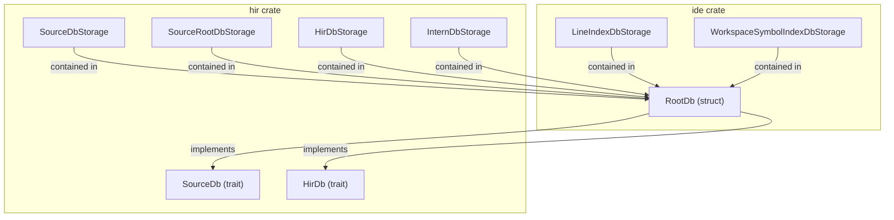
Sources: [crates/ide/src/db/root_db.rs:26-38](), [crates/hir/src/base_db/source_db.rs:43-44](), [crates/hir/src/preproc.rs:24-24]().

---

### Change Application Lifecycle

Updates to the database are performed through the `Change` structure, which encapsulates updates to the VFS (Virtual File System) and project configuration. These changes are applied atomically to the `RootDb`.

1.  **Change Creation**: A `Change` object is populated with new source roots, updated project configurations, or specific file modifications [crates/hir/src/base_db/change.rs:12-16]().
2.  **Durability Determination**: The system assigns a `Durability` level to inputs. Library files are marked as `Durability::HIGH`, while local workspace files are `Durability::LOW` [crates/hir/src/base_db/change.rs:92-94]().
3.  **Salsa Application**: The `apply` method calls Salsa's `set_..._with_durability` methods. This invalidates only the queries that depend on the changed inputs [crates/hir/src/base_db/change.rs:35-89]().
4.  **VFS Synchronization**: Modifications, creations, and deletions from the VFS are synchronized into the Salsa input `files()` set [crates/hir/src/base_db/change.rs:57-88]().

Sources: [crates/hir/src/base_db/change.rs:11-94](), [crates/hir/src/base_db/source_db.rs:43-62]().

---

### Durability and LRU Cache Tuning

To optimize memory usage and performance, Vide utilizes Salsa's durability and LRU (Least Recently Used) caching mechanisms.

#### Durability Levels
-   **Durability::HIGH**: Used for `project_config`, `files` set, and library files [crates/hir/src/base_db/change.rs:37-53](). These rarely change, allowing Salsa to skip re-validation of dependent queries for most user edits.
-   **Durability::LOW**: Used for local source files [crates/hir/src/base_db/change.rs:93-93](). These change frequently during an editing session.

#### LRU Caching
Parsing and HIR lowering are expensive. The `RootDb` maintains an LRU cache for these queries to prevent the memory footprint from growing indefinitely while keeping recent results hot. The default capacity is **128** [crates/ide/src/db/root_db.rs:62-62]().

Queries with LRU tuning include:
-   `ParseSrcForCompilationQuery` [crates/ide/src/db/root_db.rs:79-79]()
-   `HirFileQuery` and `HirFileWithSourceMapQuery` [crates/ide/src/db/root_db.rs:81-84]()
-   `ModuleQuery` and `BlockQuery` [crates/ide/src/db/root_db.rs:85-86]()

Sources: [crates/ide/src/db/root_db.rs:62-91](), [crates/hir/src/base_db/change.rs:92-94]().

---

### Snapshot Isolation and Parallelism

Vide supports parallel request processing by leveraging Salsa's snapshot mechanism. The `RootDb` implements `salsa::ParallelDatabase`, allowing the main thread to handle writes while worker threads handle read-only queries on a consistent point-in-time snapshot. The `AnalysisHost` manages this lifecycle [crates/ide/src/analysis_host.rs:12-25]().

**Snapshot Data Flow**
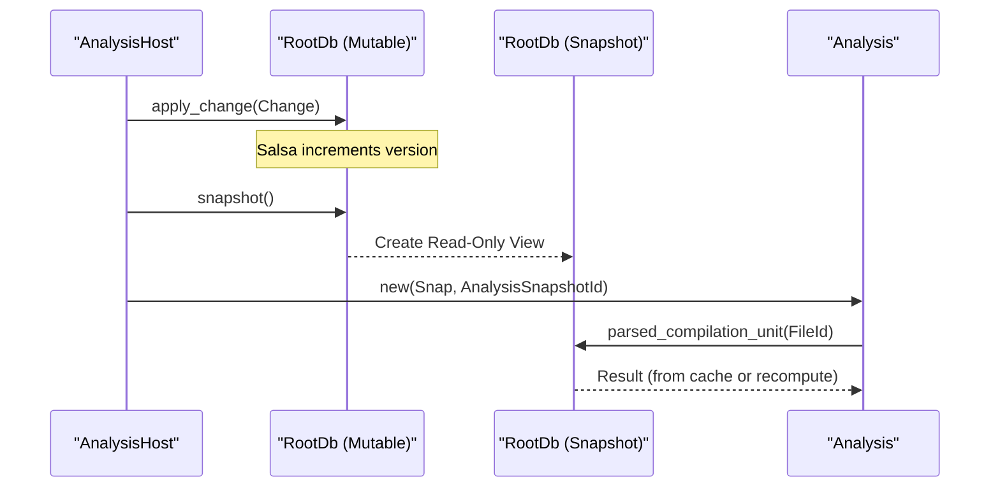
Sources: [crates/ide/src/db/root_db.rs:93-97](), [crates/ide/src/analysis_host.rs:17-30](), [crates/hir/src/base_db/analysis_snapshot.rs:12-13]().

---

### Key Queries and Data Flow

The database provides high-level queries that drive the IDE features. These queries are defined in traits like `SourceDb`.

| Function | Type | Description |
| :--- | :--- | :--- |
| `file_text` | Input | Raw string content of a file [crates/hir/src/base_db/source_db.rs:46-46](). |
| `file_kind` | Input | Categorizes file as SystemVerilog, Header, or Library Map [crates/hir/src/base_db/source_db.rs:49-49](). |
| `parsed_compilation_unit` | Derived | Produces a `SyntaxTree` via Slang parser [crates/hir/src/base_db/source_db.rs:157-157](). |
| `compilation_plan_for_profile` | Derived | Determines the set of files and includes for a specific project profile [crates/hir/src/base_db/source_db.rs:160-160](). |

#### The `parsed_compilation_unit` Logic
The `parsed_compilation_unit` query is a derived query that takes a `FileId` and returns a `ParsedCompilationUnit`. It attempts to reuse authoritative parses from a `ParsedProfile` if the file is a root of a compilation plan [crates/hir/src/base_db/source_db.rs:157-179](). If not, it performs a standalone parse using `syntax_tree_options_for_file` [crates/hir/src/base_db/source_db.rs:197-205]().

Sources: [crates/hir/src/base_db/source_db.rs:43-205](), [crates/hir/src/base_db/analysis_snapshot.rs:36-43](), [crates/ide/src/db/root_db.rs:77-91]().

---

# Page: Project Model and Workspace Loading

# Project Model and Workspace Loading

<details>
<summary>Relevant source files</summary>

The following files were used as context for generating this wiki page:

- [crates/hir/Cargo.toml](crates/hir/Cargo.toml)
- [crates/hir/src/base_db/project.rs](crates/hir/src/base_db/project.rs)
- [crates/hir/src/base_db/source_root.rs](crates/hir/src/base_db/source_root.rs)
- [crates/hir/src/lib.rs](crates/hir/src/lib.rs)
- [crates/ide/src/diagnostics.rs](crates/ide/src/diagnostics.rs)
- [crates/project-model/Cargo.toml](crates/project-model/Cargo.toml)
- [crates/project-model/src/lib.rs](crates/project-model/src/lib.rs)
- [crates/project-model/src/macro_def.rs](crates/project-model/src/macro_def.rs)
- [crates/project-model/src/project_manifest.rs](crates/project-model/src/project_manifest.rs)
- [crates/project-model/src/toml_workspace.rs](crates/project-model/src/toml_workspace.rs)
- [crates/workspace-model/Cargo.toml](crates/workspace-model/Cargo.toml)
- [crates/workspace-model/src/lib.rs](crates/workspace-model/src/lib.rs)
- [crates/workspace-model/src/project.rs](crates/workspace-model/src/project.rs)
- [src/tests.rs](src/tests.rs)

</details>


This page details how Vide discovers, parses, and models SystemVerilog projects. The project model acts as the bridge between the raw file system and the semantic analysis layer, transforming file-based configurations into a structured `ProjectModel` that drives the `SourceDb` and `CompilationProfile` construction.

## Project Discovery

Project discovery is the first phase of workspace loading. Vide searches for `vide.toml` files within the provided workspace roots to identify project boundaries.

### ProjectManifest Discovery
The `ProjectManifest` enum represents a discovered project on disk [crates/project-model/src/project_manifest.rs:33-36](). Discovery logic is encapsulated in `ProjectManifest::from_path` [crates/project-model/src/project_manifest.rs:59-83]().

1.  **Direct Manifest**: If the path points directly to a `vide.toml`, it is loaded as a `ProjectManifest::Toml` [crates/project-model/src/project_manifest.rs:60-62]().
2.  **Directory Search**: If the path is a directory, Vide looks for `vide.toml` inside it using the `DISCOVERY_ORDER` [crates/project-model/src/project_manifest.rs:70-80]().
3.  **Unconfigured Root**: If no manifest is found, Vide treats the directory as a `ProjectManifest::UnconfiguredRoot` [crates/project-model/src/project_manifest.rs:82](), which enables "best-effort" indexing without explicit semantic configuration.

### Data Flow: Discovery to GlobalState
The server initialization and configuration logic maintain the list of discovered manifests, which are then used by the `GlobalState` to trigger workspace fetching and modeling.

Title: Project Discovery Sequence
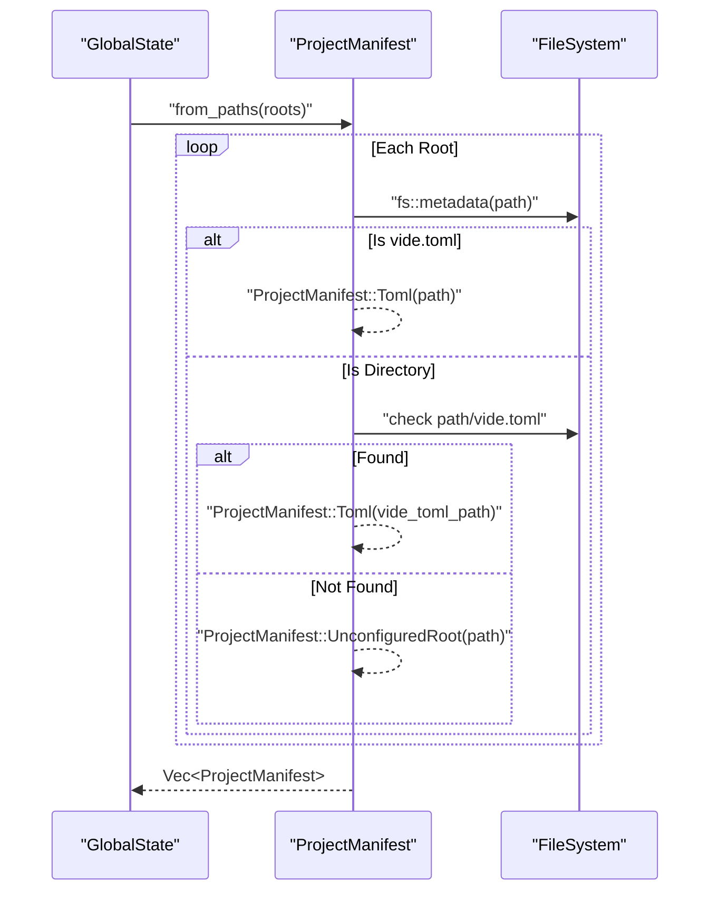
Sources: [crates/project-model/src/project_manifest.rs:43-57](), [crates/project-model/src/project_manifest.rs:59-83](), [crates/project-model/src/project_manifest.rs:7-8]()

## TomlWorkspace Deserialization

When a `vide.toml` is found, it is deserialized into a `TomlWorkspace` using `serde`. The schema is defined by `TomlManifestSchema` [crates/project-model/src/toml_workspace.rs:47-126]().

### Key Manifest Fields
| Field | Type | Description |
| :--- | :--- | :--- |
| `top_modules` | `Vec<String>` | Names of the root modules for the compilation profile [crates/project-model/src/toml_workspace.rs:57](). |
| `defines` | `MacroDef` | Predefined macros parsed from strings like `SYNTHESIS` or `WIDTH=32` [crates/project-model/src/toml_workspace.rs:70](). |
| `sources` | `Option<Vec<String>>` | Glob patterns for source files. Omitted sources trigger best-effort indexing [crates/project-model/src/toml_workspace.rs:84](). |
| `include_dirs` | `Option<Vec<Utf8PathBuf>>` | Search paths for `` `include `` directives [crates/project-model/src/toml_workspace.rs:98](). |
| `libraries` | `Vec<Utf8PathBuf>` | Paths to external dependencies to be loaded as workspaces [crates/project-model/src/toml_workspace.rs:113](). |
| `exclude` | `Vec<String>` | Globs to remove files from the loaded set [crates/project-model/src/toml_workspace.rs:125](). |

### Macro Deserialization
Macros are handled by a custom deserializer `de_macros` [crates/project-model/src/toml_workspace.rs:147-172](), which uses `IDENT_RE` and `KV_RE` regexes to distinguish between simple flags and key-value pairs [crates/project-model/src/toml_workspace.rs:31-34](). These are stored as `MacroAtom` variants [crates/project-model/src/macro_def.rs:7-10]().

Sources: [crates/project-model/src/toml_workspace.rs:47-126](), [crates/project-model/src/toml_workspace.rs:147-172](), [crates/project-model/src/macro_def.rs:7-10]()

## Workspace Modeling and Source Policy

Once deserialized, the `Workspace` struct is constructed. This involves resolving relative paths and applying the `ManifestSourcePolicy`.

### ManifestSourcePolicy
The `ManifestSourcePolicy` determines how files are classified during indexing [crates/project-model/src/lib.rs:135-141]():
*   **Explicit**: If `sources` is defined in `vide.toml` (even if empty), only matching files are treated as semantic sources [crates/project-model/src/lib.rs:140]().
*   **DefaultIndex**: If `sources` is omitted, Vide defaults to `["**"]` for a "best-effort" scan [crates/project-model/src/lib.rs:30](), [crates/project-model/src/lib.rs:138]().

### WorkspaceRoot Construction
The `Workspace` is composed of `WorkspaceRoot` objects [crates/project-model/src/lib.rs:53-70](). Each root encapsulates:
*   `PathMatcher`: Compiled globs for semantic source files (`source`) and directory expansion (`source_directories`) [crates/project-model/src/lib.rs:56-58]().
*   `include_dirs`: Absolute paths for preprocessor header searching [crates/project-model/src/lib.rs:64]().
*   `exclude_prefixes` / `exclude_globs`: Logic to skip unwanted directories or files [crates/project-model/src/lib.rs:67-69]().

Title: Project Model Entity Mapping
```mermaid
classDiagram
    class TomlManifestSchema {
        +top_modules: Vec~String~
        +sources: Option~Vec~String~~
        +include_dirs: Option~Vec~Utf8PathBuf~~
        +defines: MacroDef
    }
    class Workspace {
        +workspace_root: AbsPathBuf
        +kind: WorkspaceKind
        +roots: Vec~WorkspaceRoot~
    }
    class WorkspaceRoot {
        +role: SourceRootRole
        +source: PathMatcher
        +include_dirs: Vec~AbsPathBuf~
        +source_files: Vec~AbsPathBuf~
    }
    class CompilationProfile {
        +top_modules: Vec~String~
        +preprocess: PreprocessConfig
    }

    TomlManifestSchema --> Workspace : "Workspace::from_toml()"
    Workspace *-- WorkspaceRoot : "contains"
    Workspace --> CompilationProfile : "Workspace::semantic_profile()"
```
Sources: [crates/project-model/src/lib.rs:33-70](), [crates/project-model/src/lib.rs:183-204](), [crates/project-model/src/toml_workspace.rs:47-126]()

## Workspace Loading Flow

The loading process transforms `ProjectManifest` into a `ProjectModel` containing one or more `Workspace` instances.

1.  **Helper Dispatch**: `Workspace::load` calls `load_helper` which branches based on manifest type [crates/project-model/src/lib.rs:164-181]().
2.  **TOML Loading**: `TomlWorkspace::load_from_file` reads and deserializes the manifest [crates/project-model/src/lib.rs:172]().
3.  **Path Resolution**: Relative patterns in `sources`, `include_dirs`, and `exclude` are resolved against the workspace root [crates/project-model/src/lib.rs:197-202]().
4.  **Unconfigured Loading**: If no manifest exists, `from_unconfigured_root` creates a default workspace with a `DefaultIndex` policy [crates/project-model/src/lib.rs:178]().

### Dependency Closure Calculation
If a manifest contains `libraries`, Vide recursively loads those paths. Each library is treated as a dependency workspace [crates/project-model/src/toml_workspace.rs:113](). This allows a single top-level project to aggregate multiple IP cores or library repositories, each with its own `vide.toml` or unconfigured structure.

Title: Workspace Loading Logic
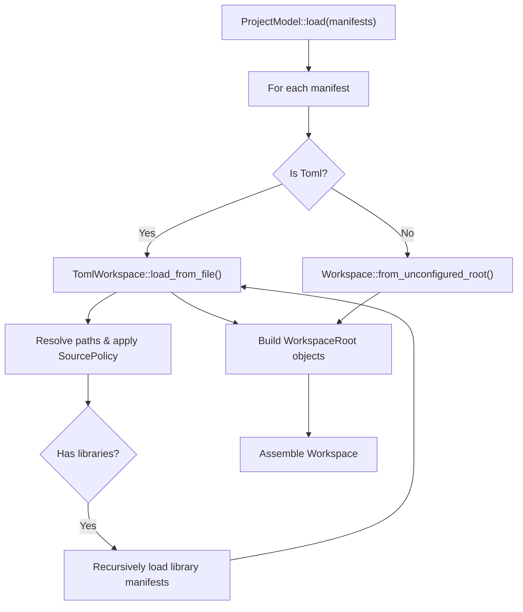
Sources: [crates/project-model/src/lib.rs:164-181](), [crates/project-model/src/lib.rs:183-210](), [crates/project-model/src/toml_workspace.rs:99-113]()

## Compilation Profile Construction

The final step in modeling is translating the `Workspace` into a `CompilationProfile` used by the semantic layer (`hir` and `workspace-model`).

*   **Top Modules**: Extracted from `top_modules` in the manifest [crates/project-model/src/lib.rs:131]().
*   **Preprocess Config**: Combines `MacroDef` (converted to `Predefine` strings) and the resolved `include_dirs` [crates/project-model/src/lib.rs:132](), [crates/project-model/src/macro_def.rs:25-27]().
*   **Source Roots**: The `WorkspaceRoot` objects are used to configure `SourceRootConfig`, partitioning the VFS into logical units based on their `SourceRootRole` [crates/project-model/src/lib.rs:54]().

This profile is eventually consumed by the Salsa database (`RootDb`) to provide the necessary context for preprocessing and semantic analysis.

Sources: [crates/project-model/src/lib.rs:130-133](), [crates/project-model/src/macro_def.rs:25-49](), [crates/workspace-model/src/project.rs:1-10]() (referenced via `workspace-model`)

---

# Page: Syntax and Slang Integration

# Syntax and Slang Integration

<details>
<summary>Relevant source files</summary>

The following files were used as context for generating this wiki page:

- [crates/preproc/src/source/model/tests.rs](crates/preproc/src/source/model/tests.rs)
- [crates/slang/bindings/rust/ffi.rs](crates/slang/bindings/rust/ffi.rs)
- [crates/slang/bindings/rust/ffi/wrapper.cc](crates/slang/bindings/rust/ffi/wrapper.cc)
- [crates/slang/bindings/rust/ffi/wrapper.h](crates/slang/bindings/rust/ffi/wrapper.h)
- [crates/slang/bindings/rust/lib.rs](crates/slang/bindings/rust/lib.rs)
- [crates/slang/bindings/rust/syntax_tree.rs](crates/slang/bindings/rust/syntax_tree.rs)
- [crates/slang/bindings/rust/tests.rs](crates/slang/bindings/rust/tests.rs)
- [crates/slang/source/parsing/Preprocessor_macros.cpp](crates/slang/source/parsing/Preprocessor_macros.cpp)
- [crates/syntax/Cargo.toml](crates/syntax/Cargo.toml)
- [crates/syntax/src/lib.rs](crates/syntax/src/lib.rs)

</details>


This page provides a high-level overview of how Vide leverages the [Slang](https://github.com/MikePopoloski/slang) C++ library to parse SystemVerilog and how the resulting syntax trees are integrated into the Rust-based IDE infrastructure.

Vide does not implement its own SystemVerilog parser. Instead, it uses Slang via a thin Rust FFI layer to obtain a high-fidelity Concrete Syntax Tree (CST). This CST is then augmented with Rust-idiomatic extensions to support IDE features like incremental updates, navigation, and refactoring.

## Architecture Overview

The syntax layer serves as the bridge between raw file text and the High-level Intermediate Representation (HIR).

### From Text to Syntax Tree
When a file is loaded or changed, the `syntax` crate invokes Slang to produce a `SyntaxTree` [crates/slang/bindings/rust/syntax_tree.rs:35-37](). This tree contains every token, node, and piece of trivia (comments/whitespace) from the source [crates/slang/bindings/rust/tests.rs:113-162](). Because Slang is written in C++, Vide uses a custom FFI binding via `cxx` to expose these structures to Rust [crates/slang/bindings/rust/ffi.rs:13-177]().

### Syntax Entity Space
The following diagram illustrates how raw source text is transformed into the entities used by the `syntax` and `ide` crates, bridging the gap between C++ memory and Rust traits.

**Diagram: Syntax Transformation Flow**
```mermaid
graph TD
    subgraph "Natural Language Space (Source Text)"
        Text["Raw .sv File Text"]
    end

    subgraph "Code Entity Space (syntax crate)"
        ST["slang::SyntaxTree"]
        SN["slang::SyntaxNode"]
        STok["slang::SyntaxToken"]
        SExp["slang_ext::SyntaxNodeExt"]
        AstN["ast::AstNode"]
    end

    Text -->|wrapper::syntax::SourceSession| ST
    ST -->|root()| SN
    SN -->|child_node()| SN
    SN -->|child_token()| STok
    SN -.->|Trait Extension| SExp
    STok -.->|Trait Extension| SExp
    SN -->|cast()| AstN
    
    SExp -->|Provides| Range["SourceRange"]
    SExp -->|Provides| Ptr["SyntaxNodePtr"]
```
Sources: [crates/slang/bindings/rust/ffi/wrapper.h:85-98](), [crates/slang/bindings/rust/syntax_tree.rs:25-37](), [crates/syntax/src/lib.rs:6-17](), [crates/syntax/src/lib.rs:21-31]()

## Key Components

### Slang Rust Bindings
The core of the syntax layer is the `slang` crate (accessed via FFI). It provides the fundamental types:
*   `SyntaxTree`: The entry point for a parsed file, holding the `SharedPtr` to the C++ tree [crates/slang/bindings/rust/syntax_tree.rs:35-37]().
*   `SyntaxNode`: Represents structural elements (modules, blocks, expressions) [crates/slang/bindings/rust/syntax_tree.rs:25-27]().
*   `SyntaxToken`: Represents the smallest units (identifiers, keywords, operators) [crates/slang/bindings/rust/syntax_tree.rs:29-32]().
*   `SyntaxTrivia`: Represents non-semantic text like comments and whitespace [crates/slang/bindings/rust/syntax_tree.rs:70-73]().

For details on the FFI implementation and build system, see [Slang Rust Bindings](#3.1).

### Syntax Extensions (`slang_ext`)
To make Slang's C++-style API feel native to Rust and useful for an IDE, Vide implements the `slang_ext` module. This adds functionality such as:
*   **Coordinate Mapping**: Converting Slang's internal `SourceLocation` and `SourceRange` into Vide's IDE-friendly types [crates/slang/bindings/rust/ffi.rs:183-205]().
*   **Search and Traversal**: Methods to find tokens at specific offsets, which is critical for LSP features like completion and hover [crates/slang/bindings/rust/ffi/wrapper.cc:102-143]().
*   **Stable Pointers**: The `SyntaxNodePtr` allows referring to a syntax node across incremental re-parses without holding a reference to the tree [crates/syntax/src/ptr.rs:1-4]().
*   **AST Casting**: Macros like `match_ast!` allow for type-safe pattern matching on syntax nodes to treat them as specific AST types (e.g., `ModuleDeclaration`) [crates/syntax/src/lib.rs:21-40]().

For details on these utilities, see [Syntax Extensions and Utilities](#3.2).

## Integration with IDE Features

The syntax layer is the primary data source for several "low-level" IDE features that do not require full semantic analysis (HIR). It also provides the foundation for the preprocessor model.

| Feature | Implementation Logic | Source Reference |
| :--- | :--- | :--- |
| **Preprocessor Tracing** | Captures macro expansions and include file relationships during parsing. | [crates/slang/bindings/rust/ffi.rs:170-177]() |
| **Literal Analysis** | Extracts values and bases from `INTEGER_LITERAL` or `TIME_LITERAL` tokens. | [crates/slang/bindings/rust/syntax_tree.rs:169-196]() |
| **Trivia Handling** | Iterates over comments and whitespace attached to tokens for folding and formatting. | [crates/slang/bindings/rust/syntax_tree.rs:209-216]() |

**Diagram: IDE Feature Integration**
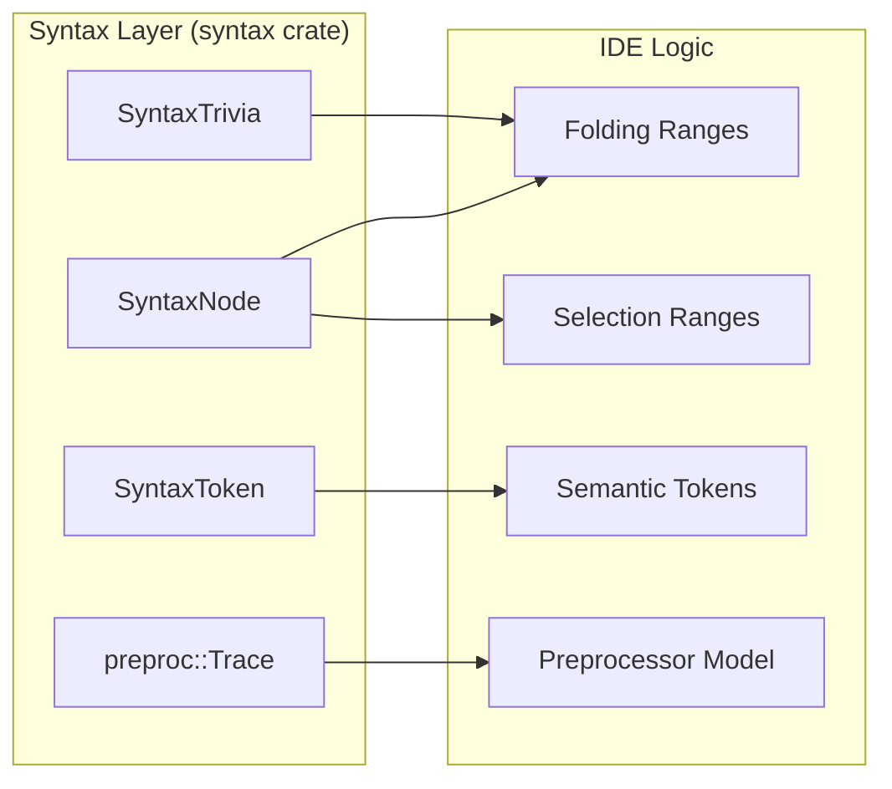
Sources: [crates/slang/bindings/rust/syntax_tree.rs:98-112](), [crates/slang/bindings/rust/syntax_tree.rs:164-168](), [crates/preproc/src/source/model/tests.rs:41-43]()

## Child Pages
*   [Slang Rust Bindings](#3.1) — Technical details of the FFI layer, `cxx` bridge, and C++ integration.
*   [Syntax Extensions and Utilities](#3.2) — Deep dive into `slang_ext`, trivia handling, `SyntaxNodePtr`, and the AST matching macros.

---

# Page: Slang Rust Bindings

# Slang Rust Bindings

<details>
<summary>Relevant source files</summary>

The following files were used as context for generating this wiki page:

- [.github/actions/setup-rust/action.yml](.github/actions/setup-rust/action.yml)
- [.github/actions/setup-sccache/action.yml](.github/actions/setup-sccache/action.yml)
- [crates/preproc/src/source/model/tests.rs](crates/preproc/src/source/model/tests.rs)
- [crates/slang/Cargo.toml](crates/slang/Cargo.toml)
- [crates/slang/bindings/rust/build.rs](crates/slang/bindings/rust/build.rs)
- [crates/slang/bindings/rust/ffi.rs](crates/slang/bindings/rust/ffi.rs)
- [crates/slang/bindings/rust/ffi/wrapper.cc](crates/slang/bindings/rust/ffi/wrapper.cc)
- [crates/slang/bindings/rust/ffi/wrapper.h](crates/slang/bindings/rust/ffi/wrapper.h)
- [crates/slang/bindings/rust/lib.rs](crates/slang/bindings/rust/lib.rs)
- [crates/slang/bindings/rust/sourcegen.rs](crates/slang/bindings/rust/sourcegen.rs)
- [crates/slang/bindings/rust/syntax_tree.rs](crates/slang/bindings/rust/syntax_tree.rs)
- [crates/slang/bindings/rust/tests.rs](crates/slang/bindings/rust/tests.rs)
- [crates/slang/include/slang/parsing/Preprocessor.h](crates/slang/include/slang/parsing/Preprocessor.h)
- [crates/slang/include/slang/parsing/PreprocessorTrace.h](crates/slang/include/slang/parsing/PreprocessorTrace.h)
- [crates/slang/include/slang/syntax/SyntaxTree.h](crates/slang/include/slang/syntax/SyntaxTree.h)
- [crates/slang/source/CMakeLists.txt](crates/slang/source/CMakeLists.txt)
- [crates/slang/source/parsing/Preprocessor.cpp](crates/slang/source/parsing/Preprocessor.cpp)
- [crates/slang/source/parsing/PreprocessorTrace.cpp](crates/slang/source/parsing/PreprocessorTrace.cpp)
- [crates/slang/source/parsing/Preprocessor_macros.cpp](crates/slang/source/parsing/Preprocessor_macros.cpp)
- [crates/slang/source/syntax/SyntaxTree.cpp](crates/slang/source/syntax/SyntaxTree.cpp)
- [rust-toolchain.toml](rust-toolchain.toml)

</details>


The Slang Rust Bindings provide a high-performance FFI (Foreign Function Interface) wrapper around the [Slang](https://github.com/MikePopoloski/slang) C++ SystemVerilog compiler. This layer is responsible for bridging the memory-managed world of Rust with the pointer-heavy C++ implementation of Slang's lexer, preprocessor, and parser. It enables Vide to leverage Slang's industry-standard SystemVerilog compliance while maintaining an idiomatic Rust interface for higher-level IDE features.

## Build System Integration

The integration between Rust and the Slang C++ library is managed via `build.rs` in the `slang` crate. This script coordinates several complex steps to ensure the native library is correctly compiled and linked.

### Compilation Pipeline
The build process uses `cmake-rs` to trigger a native build of Slang. It specifically configures Slang with `SLANG_INCLUDE_RUSTLIB=ON` and `SLANG_INCLUDE_INSTALL=ON` to prepare the bridge components [crates/slang/bindings/rust/build.rs:31-43]().

Key features of the build system include:
*   **CXX Bridge Generation**: Uses the `cxx` crate to generate C++ headers and Rust bindings from `ffi.rs` and `cxx_sv.rs` [crates/slang/bindings/rust/build.rs:17-24]().
*   **Conditional WASM Support**: If the target OS is `emscripten`, the build system switches to a static library target with specific flags (`-fwasm-exceptions`) and utilizes the Emscripten toolchain file [crates/slang/bindings/rust/build.rs:49-59]().
*   **Caching**: Integrates with `sccache` via the `VIDE_USE_SCCACHE_CMAKE` environment variable to speed up native C++ compilation in CI environments [crates/slang/bindings/rust/build.rs:61-66]().
*   **Source Generation**: Automatically generates Rust code for `SyntaxKind` and AST node structures based on Slang's metadata [crates/slang/bindings/rust/build.rs:142-150]().

### Build and Linking Flow
The following diagram illustrates how the build system bridges the two languages:

**Slang Build Artifact Flow**
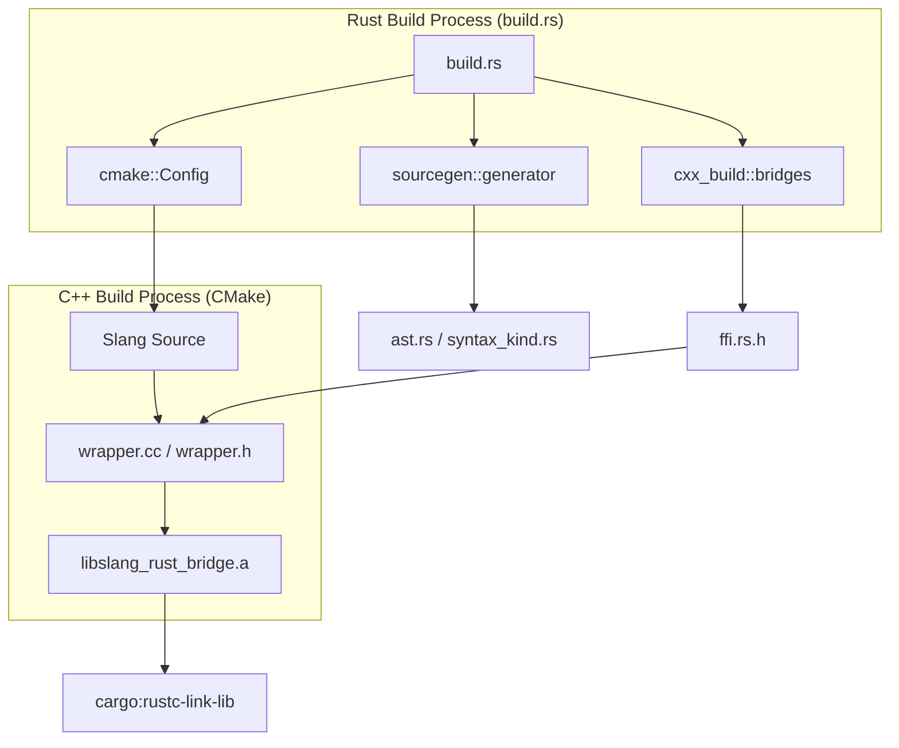
Sources: [crates/slang/bindings/rust/build.rs:8-15](), [crates/slang/bindings/rust/build.rs:142-150](), [crates/slang/bindings/rust/ffi/wrapper.h:1-31]()

## FFI Architecture

The bindings utilize the `cxx` crate to provide safe transfers of opaque pointers and structured data between Rust and C++.

### Core FFI Entities
The `ffi.rs` file defines the bridge boundary. It includes raw representations of Slang's internal structures that are passed by value or reference.

| Rust Type | C++ Equivalent | Description |
| :--- | :--- | :--- |
| `RawSyntaxDiagnostic` | `slang::Diagnostic` | Flattened diagnostic data for transfer [crates/slang/bindings/rust/ffi.rs:16-33](). |
| `RawSourceBuffer` | `slang::SourceBuffer` | Represents file content and paths [crates/slang/bindings/rust/ffi.rs:36-39](). |
| `SyntaxNode` | `slang::syntax::SyntaxNode` | Opaque C++ pointer to an AST node [crates/slang/bindings/rust/syntax_tree.rs:25-27](). |
| `SyntaxToken` | `slang::parsing::Token` | Opaque C++ pointer to a lexed token [crates/slang/bindings/rust/syntax_tree.rs:29-32](). |

### Memory Management
Rust-side wrappers like `SyntaxTree` and `SyntaxNode` hold pointers to C++ memory. `SyntaxTree` uses a `SharedPtr<ffi::SyntaxTree>` to ensure the underlying Slang `SourceManager` and allocated nodes remain valid as long as the tree is alive [crates/slang/bindings/rust/syntax_tree.rs:35-37](). `SyntaxNode` and `SyntaxToken` are lightweight wrappers around pinned references (`Pin<&'a ffi::SyntaxNode>`), allowing them to be treated as copyable references with a lifetime tied to the tree [crates/slang/bindings/rust/syntax_tree.rs:25-32]().

## Syntax Tree Integration

The `SyntaxTree` is the primary entry point for parsing SystemVerilog source code. It wraps the Slang `SourceSession`, which manages the `SourceManager` and `BumpAllocator` for a specific compilation unit.

### Parsing and Buffer Management
Parsing is initiated via `SyntaxTree::from_text` or through the `Compilation` interface.
*   **Buffer IDs**: Slang identifies files using a `u32` buffer ID. The Rust bindings expose these via `RawSourceBufferId` and `RawSyntaxTreeBufferIds` to allow Vide to map Slang's internal locations back to its own `FileId` [crates/slang/bindings/rust/ffi.rs:42-54]().
*   **Options**: `SyntaxTreeOptions` allows configuring predefines, include paths, and whether to expand includes during parsing [crates/slang/bindings/rust/syntax_tree.rs:45-51]().

**Data Flow: Source to Syntax Tree**
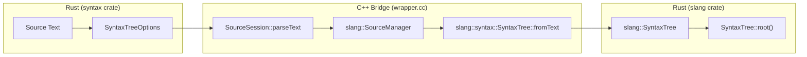
Sources: [crates/slang/bindings/rust/syntax_tree.rs:35-37](), [crates/slang/bindings/rust/ffi/wrapper.h:89-98](), [crates/slang/bindings/rust/ffi/wrapper.cc:102-143]()

## Preprocessor and Preproc Trace

The bindings provide deep access to Slang's preprocessor, which is critical for Vide's "Preproc Index" and macro expansion visualization.

### Preprocessor Trace
The `Trace` structure (aliased from `preproc::Trace`) provides a detailed history of macro expansions and file inclusions [crates/slang/bindings/rust/syntax_tree.rs:9]().
*   **Events**: Captured via `RawPreprocessorTraceEvent`, which includes macro definitions, calls, and expansions [crates/slang/bindings/rust/ffi.rs:111-131]().
*   **Emitted Tokens**: Individual tokens resulting from preprocessing, including their origin (source, macro body, argument, etc.) [crates/slang/bindings/rust/ffi.rs:134-161]().
*   **Include Edges**: Relationships between files captured in `RawPreprocessorTraceIncludeEdge` [crates/slang/bindings/rust/ffi.rs:164-167]().

### Lexed Token at Offset
For IDE features like autocompletion, Vide uses `lex_token_at_offset` to determine the context at the cursor. This calls into the C++ `Lexer` directly to find the token kind and any active preprocessor directives at a specific byte offset [crates/slang/bindings/rust/ffi/wrapper.cc:102-143]().

## Syntax Traversal and Utilities

The `slang` crate provides higher-level Rust abstractions over the raw Slang pointers.

### Traversal Utilities
The bindings implement standard tree traversal patterns:
*   **Cursors**: `SyntaxCursor` for navigating the tree relative to positions [crates/slang/bindings/rust/lib.rs:21]().
*   **Iterators**: `SyntaxChildren`, `SyntaxAncestors`, and `SyntaxNodePreorder` for efficient tree walking [crates/slang/bindings/rust/lib.rs:22-25]().
*   **Trivia**: Tokens carry `SyntaxTrivia` (comments, whitespace), which can be accessed with their physical locations via `trivias_with_loc` [crates/slang/bindings/rust/syntax_tree.rs:214-241]().

### Numeric and Logic Types
Slang's semantic types are exposed to Rust for constant evaluation and literal rendering:
*   **SVInt**: Arbitrary-precision integers [crates/slang/bindings/rust/ffi.rs:225]().
*   **SVLogic**: Four-valued logic (0, 1, X, Z) [crates/slang/bindings/rust/ffi.rs:216]().
*   **LiteralBase**: Support for Binary, Octal, Decimal, and Hexadecimal representations [crates/slang/bindings/rust/syntax_tree.rs:7]().

## Implementation Details: `wrapper.h` and `wrapper.cc`

The C++ side of the bridge (`wrapper.h`/`wrapper.cc`) performs the translation of Slang's complex internal types into the simplified `Raw` structs defined in `ffi.rs`.

*   **SourceSession**: A wrapper around `slang::SourceManager` that maintains a cache of `assignedBuffers` to ensure consistent `BufferId` mapping across multiple parse calls [crates/slang/bindings/rust/ffi/wrapper.h:85-114]().
*   **Diagnostic Mapping**: Translates Slang's internal `Diagnostic` objects into `RawSyntaxDiagnostic`, capturing the error code, severity, message, and source ranges [crates/slang/bindings/rust/ffi/wrapper.cc:43-63]().
*   **Numeric Types**: Provides access to Slang's `SVInt` and `logic_t` types, including conversion to strings in various bases [crates/slang/bindings/rust/ffi/wrapper.h:199-209]().

Sources: [crates/slang/bindings/rust/ffi/wrapper.h:43-83](), [crates/slang/bindings/rust/ffi/wrapper.cc:17-41](), [crates/slang/bindings/rust/ffi/wrapper.cc:154-168]()

---

# Page: Syntax Extensions and Utilities

# Syntax Extensions and Utilities

<details>
<summary>Relevant source files</summary>

The following files were used as context for generating this wiki page:

- [crates/hir/src/region_tree.rs](crates/hir/src/region_tree.rs)
- [crates/ide/src/folding_ranges.rs](crates/ide/src/folding_ranges.rs)
- [crates/ide/src/formatting.rs](crates/ide/src/formatting.rs)
- [crates/ide/src/selection_ranges.rs](crates/ide/src/selection_ranges.rs)
- [crates/syntax/src/has_text_range.rs](crates/syntax/src/has_text_range.rs)
- [crates/syntax/src/ptr.rs](crates/syntax/src/ptr.rs)
- [crates/syntax/src/slang_ext.rs](crates/syntax/src/slang_ext.rs)
- [crates/syntax/src/slang_ext/token.rs](crates/syntax/src/slang_ext/token.rs)
- [crates/syntax/src/slang_ext/trivia.rs](crates/syntax/src/slang_ext/trivia.rs)

</details>


The `slang_ext` module provides a rich set of extensions and utility traits for the raw syntax types provided by the Slang Rust bindings. It bridges the gap between raw C++-derived syntax trees and the high-level requirements of an IDE, such as offset-based lookups, trivia (comment/whitespace) analysis, and stable node referencing via pointers.

## SyntaxNode and Token Extensions

The core of the utility layer is the `SyntaxNodeExt` trait, which extends Slang's `SyntaxNode` with methods for spatial queries. These methods are essential for features like "Go to Definition" or "Hover", where the IDE must map a cursor position (byte offset) to a specific syntax element.

### Offset-Based Lookups
- `token_at_offset`: Returns a `TokenAtOffset` enum which can represent a single token, or the two tokens on either side of an offset (e.g., when the cursor is between two words) [crates/syntax/src/slang_ext/token_at_offset.rs:11-39]().
- `covering_element`: Finds the smallest `SyntaxElement` (Node or Token) that fully contains a given `TextRange` [crates/syntax/src/slang_ext/node.rs:60-81]().
- `find_node_at_offset`: A generic helper to find the first ancestor of a token at a specific offset that matches a specific AST type `N` [crates/syntax/src/slang_ext/node.rs:25-25]().

### Token Utilities
The `TokenKindExt` and `SyntaxTokenWithParentExt` traits categorize tokens for IDE logic:
- `is_pair_token`: Identifies keywords that form blocks (e.g., `begin`/`end`, `module`/`endmodule`) [crates/syntax/src/slang_ext/token.rs:19-34]().
- `is_word_like`: Determines if a token text follows identifier rules, including system identifiers starting with `$` [crates/syntax/src/slang_ext/token.rs:64-69]().
- `pair_token`: Given a keyword like `module` or `begin`, this function finds its matching partner (e.g., `endmodule` or `end`) within the syntax tree [crates/syntax/src/slang_ext/token.rs:127-179]().

### Trivia Handling
Slang represents comments, whitespace, and directives as "trivia" attached to tokens. Vide extends this with `TriviaExt` and `TriviaKindExt` to support structured comment features:
- `is_region_begin` / `is_region_end`: Detects custom IDE regions marked with `// region` or `// endregion` [crates/syntax/src/slang_ext/trivia.rs:47-80]().
- `as_comment`: Strips comment delimiters (`//` or `/* */`) to return the raw text content [crates/syntax/src/slang_ext/trivia.rs:83-94]().

Sources: [crates/syntax/src/slang_ext/token.rs:11-53](), [crates/syntax/src/slang_ext/trivia.rs:6-34](), [crates/syntax/src/slang_ext/node.rs:1-100]().

## Syntax Pointers (`SyntaxNodePtr`)

Because `SyntaxNode` handles are tied to the lifetime of a specific `SyntaxTree`, they cannot be easily stored in long-lived caches or cross-thread data structures. `SyntaxNodePtr` provides a "stable" reference to a node by storing its `SyntaxKind` and `TextRange`.

| Type | Purpose | Implementation |
| :--- | :--- | :--- |
| `SyntaxNodePtr` | Stable reference to a node. | Stores `SyntaxKind` and `TextRange` [crates/syntax/src/ptr.rs:10-13](). |
| `SyntaxTokenPtr` | Stable reference to a token. | Stores `TokenKind` and `TextRange` [crates/syntax/src/ptr.rs:39-42](). |
| `SyntaxElementPtr` | Variant for either Node or Token. | Enum of the above two [crates/syntax/src/ptr.rs:69-72](). |

These pointers can be "resolved" back into real nodes by calling `.to_node(&tree)`, which performs an exact range lookup on the provided tree [crates/syntax/src/ptr.rs:22-25]().

Sources: [crates/syntax/src/ptr.rs:1-102]().

## Text Range Traits

The `HasTextRange` trait provides a unified way to get the `TextRange` of various syntax entities, abstracting over the underlying Slang `SourceRange` and handling buffer-to-offset conversions.

**Data Flow: From Slang SourceRange to Vide TextRange**

Title: Text Range Resolution Flow
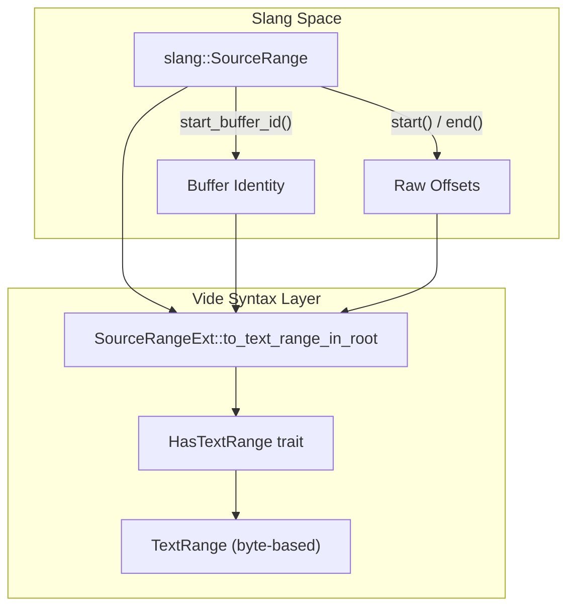
Sources: [crates/syntax/src/has_text_range.rs:7-26](), [crates/syntax/src/has_text_range.rs:35-37]()

## IDE Feature Support

The syntax layer directly powers several IDE features through specialized collectors and traversals.

### Folding Ranges
The `folding_ranges` module uses the syntax tree and trivia to identify collapsible blocks. It categorizes folds into `FoldKind` such as `Module`, `Comment`, or `Region` [crates/ide/src/folding_ranges.rs:35-53]().

- **Comment Folding**: `collect_line_comments` groups consecutive line comments (`//`) into a single foldable block [crates/ide/src/folding_ranges.rs:164-232]().
- **Region Folding**: Uses `TriviaExt::is_region_begin` and `RegionTree` to support user-defined `#region`-style blocks [crates/ide/src/folding_ranges.rs:131-131](), [crates/hir/src/region_tree.rs:15-17]().
- **Syntax Folding**: Folds are generated for modules, generate blocks, and statement blocks by mapping HIR source ranges back to the syntax tree [crates/ide/src/folding_ranges.rs:132-141]().

### Selection Ranges
The `selection_ranges` feature allows users to expand/shrink text selection based on the syntax hierarchy.

**Process: Selection Range Expansion**

Title: Selection Range Calculation
```mermaid
graph TD
    Step1["Caret Offset"] --> Step2["token_at_offset()"]
    Step2 --> Step3["Add Token Range"]
    Step3 --> Step4["Walk Parent Nodes"]
    Step4 --> Step5["Add SyntaxNode::text_range()"]
    Step5 --> Step6["Filter Duplicate Ranges"]
    Step6 --> Result["Vec<TextRange>"]

    subgraph "Functions Involved"
        Step2 --- f1["slang_ext::SyntaxNodeExt"]
        Step4 --- f2["slang::SyntaxCursor"]
    end
```
Sources: [crates/ide/src/selection_ranges.rs:12-90](), [crates/syntax/src/slang_ext/node.rs:132-142]()

### On-Type Formatting
The formatting logic in `crates/ide/src/formatting.rs` uses `trivias_with_range` to detect if the user is typing inside a comment block to provide automatic indentation or comment leader insertion (`*` or `//`) when pressing Enter [crates/ide/src/formatting.rs:167-225](). It utilizes `SyntaxCursor` to navigate to the token after the caret offset [crates/ide/src/formatting.rs:185-187]().

Sources:
- `crates/syntax/src/slang_ext/node.rs`
- `crates/syntax/src/slang_ext/token.rs`
- `crates/syntax/src/slang_ext/trivia.rs`
- `crates/syntax/src/ptr.rs`
- `crates/syntax/src/has_text_range.rs`
- `crates/ide/src/folding_ranges.rs`
- `crates/ide/src/selection_ranges.rs`
- `crates/ide/src/formatting.rs`
- `crates/hir/src/region_tree.rs`

---

# Page: HIR (High-level Intermediate Representation)

# HIR (High-level Intermediate Representation)

<details>
<summary>Relevant source files</summary>

The following files were used as context for generating this wiki page:

- [crates/hir/src/container.rs](crates/hir/src/container.rs)
- [crates/hir/src/db.rs](crates/hir/src/db.rs)
- [crates/hir/src/hir_def.rs](crates/hir/src/hir_def.rs)
- [crates/hir/src/hir_def/block.rs](crates/hir/src/hir_def/block.rs)
- [crates/hir/src/hir_def/expr.rs](crates/hir/src/hir_def/expr.rs)
- [crates/hir/src/hir_def/file.rs](crates/hir/src/hir_def/file.rs)
- [crates/hir/src/hir_def/module.rs](crates/hir/src/hir_def/module.rs)
- [crates/hir/src/hir_def/module/port.rs](crates/hir/src/hir_def/module/port.rs)
- [crates/hir/src/hir_def/stmt.rs](crates/hir/src/hir_def/stmt.rs)
- [crates/hir/src/hir_def/subroutine.rs](crates/hir/src/hir_def/subroutine.rs)
- [crates/hir/src/semantics/hir_to_def.rs](crates/hir/src/semantics/hir_to_def.rs)
- [crates/hir/src/semantics/source_to_def.rs](crates/hir/src/semantics/source_to_def.rs)

</details>


The HIR (High-level Intermediate Representation) layer is the semantic heart of Vide. It transforms the concrete syntax trees (CST) produced by Slang into arena-allocated, queryable structures that represent the semantic meaning of SystemVerilog code. While the syntax layer deals with tokens and grammar, the HIR layer understands modules, ports, scopes, and types.

## Overview of the HIR Layer

The HIR layer abstracts away the complexities of the SystemVerilog grammar into a set of stable identifiers and data structures. It provides the foundation for all IDE intelligence, including name resolution, type inference, and cross-reference searching.

Key responsibilities of the HIR layer include:
- **Lowering**: Converting `Slang` syntax nodes into `HIR` structures using contexts like `LowerModuleCtx` [crates/hir/src/hir_def/module.rs:53-53]() and `LowerBlockCtx` [crates/hir/src/hir_def/block.rs:219-219]().
- **Semantic Analysis**: Building symbol tables and resolving hierarchical paths through `NameScope` queries [crates/hir/src/db.rs:117-142]().
- **Incremental Computation**: Using `Salsa` queries via `HirDb` and `InternDb` to ensure that semantic information is updated efficiently as files change [crates/hir/src/db.rs:41-79]().
- **Source Mapping**: Maintaining a bidirectional link between HIR entities and their original syntax nodes via `SourceMap<Src, Hir>` [crates/hir/src/hir_def/module.rs:67-70]().

### HIR System Architecture

The following diagram illustrates how the HIR layer bridges the gap between raw syntax and semantic queries.

**HIR Semantic Bridge**
```mermaid
graph TD
    subgraph "Natural Language Space (User Intent)"
        "ModuleDefinition"
        "VariableReference"
        "PortConnection"
    end

    subgraph "Code Entity Space (Implementation)"
        SyntaxNode["syntax::ast::ModuleDeclaration"]
        HirEntity["hir_def::module::Module"]
        SourceMap["hir::source_map::SourceMap"]
        HirDb["hir::db::HirDb (Salsa)"]
        ModuleId["hir_def::module::ModuleId"]
    end

    SyntaxNode -- "Lowering" --> HirEntity
    HirEntity -- "Interned as" --> ModuleId
    ModuleId -- "Stored in" --> HirDb
    HirEntity -- "Mapped via" --> SourceMap
    SourceMap -- "Points to" --> SyntaxNode
    
    "ModuleDefinition" -.-> HirEntity
    "VariableReference" -.-> HirEntity
```
Sources: [crates/hir/src/hir_def/module.rs:82-126](), [crates/hir/src/db.rs:78-100](), [crates/hir/src/container.rs:36-48]()

## HIR Lowering: Modules and Expressions

Lowering is the process of traversing the CST and populating HIR arenas. This is handled by specialized contexts like `LowerModuleCtx` and `LowerBlockCtx` [crates/hir/src/hir_def/block.rs:219-219](). SystemVerilog's complex port systems (both ANSI and Non-ANSI styles) are unified into a consistent `Ports` HIR representation [crates/hir/src/hir_def/module/port.rs:168-171](). Expressions are lowered into an `Expr` enum and stored in central arenas to facilitate type inference [crates/hir/src/hir_def/expr.rs:168-231]().

For details, see [HIR Lowering: Modules, Blocks, and Expressions](#4.1).

## HIR Containers

Beyond modules, SystemVerilog contains various structural units such as `Subroutine` (functions and tasks) [crates/hir/src/hir_def/subroutine.rs:44-63](), `GenerateBlock` [crates/hir/src/db.rs:109-115](), and `SpecifyBlock`. These are treated as "containers" in HIR, often identified by a `ScopeId` [crates/hir/src/container.rs:36-48](). The `HirFile` serves as the top-level container for all members found within a single source file [crates/hir/src/hir_def/file.rs:58-86]().

For details, see [HIR Containers: Files, Subroutines, and Generate Blocks](#4.2).

## Scope Resolution and Semantics

The HIR layer implements a sophisticated scope system to handle SystemVerilog's name resolution rules. This includes `ModuleScope`, `BlockScope`, and `SubroutineScope`, all computed via `Salsa` queries [crates/hir/src/db.rs:124-142](). The `Source2DefCache` helps map source-level syntax pointers back to their semantic definitions [crates/hir/src/semantics/source_to_def.rs:27-29]().

For details, see [Scope Resolution and Semantics](#4.3).

## Source Maps and Navigation

To support IDE features, every HIR entity must be traceable back to its origin in the source code. The `SourceMap` infrastructure provides a bidirectional mapping between HIR IDs (like `ExprId` or `StmtId`) and source pointers (like `ExprSrc` or `StmtSrc`) [crates/hir/src/hir_def/module.rs:128-171](). This is implemented using the `alloc_idx_and_src!` macro during the lowering phase [crates/hir/src/hir_def.rs:66-75]().

For details, see [Source Maps and Navigation Targets](#4.4).

### HIR Data Flow

This diagram shows how data flows from the base database through the HIR queries to produce semantic results.

**HIR Query Pipeline**
```mermaid
graph LR
    subgraph "Base Layer"
        VFS["vfs::FileId"]
        Parse["HirDb::parse"]
    end

    subgraph "HIR Database (HirDb)"
        Lowering["hir_file_with_source_map"]
        Scopes["NameScope::module_scope_query"]
        Inference["type_of_expr_query"]
    end

    subgraph "Output"
        Sema["hir::semantics::Source2DefCtx"]
        PathRes["hir::semantics::pathres::PathResolution"]
    end

    VFS --> Parse
    Parse --> Lowering
    Lowering --> Scopes
    Scopes --> Inference
    Inference --> PathRes
    Lowering --> Sema
```
Sources: [crates/hir/src/db.rs:78-164](), [crates/hir/src/semantics/source_to_def.rs:31-35](), [crates/hir/src/semantics/hir_to_def.rs:16-19]()

---
**Child Pages:**
- [HIR Lowering: Modules, Blocks, and Expressions](#4.1)
- [HIR Containers: Files, Subroutines, and Generate Blocks](#4.2)
- [Scope Resolution and Semantics](#4.3)
- [Source Maps and Navigation Targets](#4.4)

---

# Page: HIR Lowering: Modules, Blocks, and Expressions

# HIR Lowering: Modules, Blocks, and Expressions

<details>
<summary>Relevant source files</summary>

The following files were used as context for generating this wiki page:

- [crates/hir/src/hir_def.rs](crates/hir/src/hir_def.rs)
- [crates/hir/src/hir_def/aggregate.rs](crates/hir/src/hir_def/aggregate.rs)
- [crates/hir/src/hir_def/block.rs](crates/hir/src/hir_def/block.rs)
- [crates/hir/src/hir_def/expr.rs](crates/hir/src/hir_def/expr.rs)
- [crates/hir/src/hir_def/file.rs](crates/hir/src/hir_def/file.rs)
- [crates/hir/src/hir_def/literal.rs](crates/hir/src/hir_def/literal.rs)
- [crates/hir/src/hir_def/module.rs](crates/hir/src/hir_def/module.rs)
- [crates/hir/src/hir_def/module/port.rs](crates/hir/src/hir_def/module/port.rs)
- [crates/hir/src/hir_def/stmt.rs](crates/hir/src/hir_def/stmt.rs)
- [crates/hir/src/hir_def/typedef.rs](crates/hir/src/hir_def/typedef.rs)

</details>


The HIR (High-level Intermediate Representation) lowering phase transforms the concrete Syntax Tree produced by Slang into a structured, arena-allocated representation suitable for semantic analysis. This process strips away syntactic noise (like punctuation and keywords) while preserving the hierarchical relationships and source locations of the original code.

## Lowering Contexts and Infrastructure

Lowering is driven by "Context" structs that maintain the state of the current container being lowered. These contexts hold references to the database, the arena for the HIR nodes, and a `SourceMap` to maintain bidirectional mapping between HIR and AST.

### Key Lowering Macros

To reduce boilerplate and ensure consistency, Vide uses several procedural and declarative macros:

*   **`define_container!`**: Generates the structure of HIR containers (like `Module` or `Block`), including their internal arenas for various items (expressions, statements, etc.) [crates/hir/src/hir_def/module.rs:82-126](), [crates/hir/src/hir_def/block.rs:43-60]().
*   **`alloc_idx_and_src!`**: A central macro that allocates a HIR node in its arena and simultaneously records its source mapping in the corresponding `SourceMap`. It handles the conversion of AST nodes to `SourceAst` to ensure only valid, non-expanded locations are mapped [crates/hir/src/hir_def.rs:66-75]().
*   **`impl_lower_...`**: A family of macros (e.g., `impl_lower_expr!`, `impl_lower_stmt!`) that automatically implement the context-switching traits for specific contexts, allowing a `LowerBlockCtx` to reuse logic for lowering expressions or declarations [crates/hir/src/hir_def/expr.rs:278-291](), [crates/hir/src/hir_def/stmt.rs:158-178]().

### Lowering Architecture

The following diagram illustrates how the `LowerModuleCtx` and `LowerBlockCtx` coordinate the lowering of different SystemVerilog constructs.

**HIR Lowering Context Relationship**
```mermaid
graph TD
    subgraph "Context Space"
        LMC["LowerModuleCtx"]
        LBC["LowerBlockCtx"]
        LEC["LowerExprCtx"]
        LSC["LowerStmtCtx"]
        LDC["LowerDeclCtx"]
    end

    subgraph "Entity Space (hir_def)"
        MOD["Module"]
        BLK["Block"]
        EXPR["Expr"]
        STMT["Stmt"]
        DECL["Declarator"]
    end

    LMC -- "lowers to" --> MOD
    LBC -- "lowers to" --> BLK
    
    LMC -- "uses" --> LEC
    LMC -- "uses" --> LDC
    LBC -- "uses" --> LSC
    LSC -- "uses" --> LEC
    
    LEC -- "allocates in" --> EXPR
    LSC -- "allocates in" --> STMT
    LDC -- "allocates in" --> DECL

    Sources: ["crates/hir/src/hir_def/module.rs:82-126", "crates/hir/src/hir_def/block.rs:219-235", "crates/hir/src/hir_def/stmt.rs:180-196"]
```

Sources: [crates/hir/src/hir_def/module.rs:82-126](), [crates/hir/src/hir_def.rs:66-75](), [crates/hir/src/hir_def/expr.rs:278-291](), [crates/hir/src/hir_def/stmt.rs:158-178]()

---

## Module Lowering

`Module` lowering is the entry point for most SystemVerilog designs. The `LowerModuleCtx` processes the module's name, parameters, ports, and internal items (instantiations, procedural blocks, etc.).

### Port Systems (ANSI vs Non-ANSI)

Vide distinguishes between ANSI and Non-ANSI port styles, as they result in different internal HIR structures [crates/hir/src/hir_def/module/port.rs:28-40]().

*   **ANSI Ports**: Defined directly in the port list. These are lowered into `PortDecl` nodes [crates/hir/src/hir_def/module/port.rs:171]().
*   **Non-ANSI Ports**: Defined as a list of names/expressions in the port list, with actual declarations (input/output/wire) occurring inside the module body. These involve `NonAnsiPort` labels and `PortRef` identifiers [crates/hir/src/hir_def/module/port.rs:169]().

| Feature | ANSI Implementation | Non-ANSI Implementation |
| :--- | :--- | :--- |
| **Storage** | `Arena<PortDecl>` | `Arena<NonAnsiPort>`, `Arena<PortRef>`, `Arena<PortDecl>` |
| **Mapping** | `PortSrcs` (Ansi variant) | `PortSrcs` (NonAnsi variant) |
| **Access** | `Ports::Ansi` | `Ports::NonAnsi` |

Sources: [crates/hir/src/hir_def/module/port.rs:28-171](), [crates/hir/src/hir_def/module.rs:88-92]()

---

## Block and Statement Lowering

Procedural code within `always` or `initial` blocks is lowered via `LowerBlockCtx` and `LowerStmtCtx`.

### Sequential and Parallel Blocks

SystemVerilog blocks (`begin...end` and `fork...join`) are captured in the `Block` HIR.
*   **Sequential**: `BlockKind::Sequential` [crates/hir/src/hir_def/block.rs:96]().
*   **Parallel**: `BlockKind::Parallel` with sub-kinds `Join`, `JoinAny`, or `JoinNone` [crates/hir/src/hir_def/block.rs:97-105]().

### Statements (`Stmt`)

Statements are lowered recursively. Complex statements like `if` (Cond), `case`, and `for` loops store their sub-statements as `StmtId` references within the same arena [crates/hir/src/hir_def/stmt.rs:31-76]().

**Statement Lowering Data Flow**
```mermaid
graph LR
    AST["ast::Statement"] -- "lower_stmt()" --> LSC["LowerStmtCtx"]
    LSC -- "alloc_idx_and_src!" --> Arena["Arena<Stmt>"]
    LSC -- "maps to" --> SM["SourceMap<StmtSrc, Stmt>"]
    
    subgraph "StmtKind Variants"
        Empty["Empty"]
        ExprS["Expr(ExprId)"]
        Ctrl["TimingCtrl(TimingControl, StmtId)"]
        Cond["Cond { pred, then_stmt, else_stmt }"]
    end
    
    Arena -.-> Empty
    Arena -.-> ExprS
    Arena -.-> Ctrl
    Arena -.-> Cond

    Sources: ["crates/hir/src/hir_def/stmt.rs:31-76", "crates/hir/src/hir_def/stmt.rs:207-214"]
```

Sources: [crates/hir/src/hir_def/block.rs:94-105](), [crates/hir/src/hir_def/stmt.rs:31-76]()

---

## Expression Lowering

Expressions are the most frequent nodes in the HIR. `LowerExprCtx` handles everything from simple literals to complex function calls and concatenations.

### Expression Types

Expressions are represented by the `Expr` enum [crates/hir/src/hir_def/expr.rs:168-231](). Key variants include:
*   **Literal**: Integer, string, or time literals [crates/hir/src/hir_def/literal.rs:6-12]().
*   **Binary/Unary**: Standard operators (e.g., `+`, `-`, `&&`, `~`) [crates/hir/src/hir_def/expr.rs:24-109]().
*   **Selects**: `ElementSelect` (bit/range selects) and `Field` (member access) [crates/hir/src/hir_def/expr.rs:187-221]().
*   **Calls**: Subroutine or system function calls [crates/hir/src/hir_def/expr.rs:177-180]().

### Data Types (`DataTy`)

Every expression or declaration is associated with a `DataTy`. Vide interns complex types like structs and typedefs.
*   **Builtin**: Primitive types and vectors [crates/hir/src/hir_def/expr/data_ty.rs:22-28]().
*   **Struct**: Anonymous or explicit struct definitions [crates/hir/src/hir_def/aggregate.rs:30-37]().
*   **Typedef**: Named type definitions [crates/hir/src/hir_def/typedef.rs:17-20]().

Sources: [crates/hir/src/hir_def/expr.rs:168-231](), [crates/hir/src/hir_def/literal.rs:6-12](), [crates/hir/src/hir_def/aggregate.rs:30-37]()

---

## Procedural Blocks

Procedural blocks (e.g., `always_ff`, `initial`) are represented by the `Proc` struct. These are collected within modules or files [crates/hir/src/hir_def/module.rs:116](), [crates/hir/src/hir_def/file.rs:62](). Lowering a procedural block involves:
1.  Identifying the `ProcKind` (Initial, Always, AlwaysFF, AlwaysComb, AlwaysLatch, Final).
2.  Lowering the body statement via `LowerStmtCtx` [crates/hir/src/hir_def/stmt.rs:207-214]().
3.  Mapping the `Proc` to its source location in the container's `SourceMap`.

Sources: [crates/hir/src/hir_def/module.rs:116](), [crates/hir/src/hir_def/file.rs:62](), [crates/hir/src/hir_def/stmt.rs:207-214]()

---

# Page: HIR Containers: Files, Subroutines, and Generate Blocks

# HIR Containers: Files, Subroutines, and Generate Blocks

<details>
<summary>Relevant source files</summary>

The following files were used as context for generating this wiki page:

- [crates/hir/src/container.rs](crates/hir/src/container.rs)
- [crates/hir/src/db.rs](crates/hir/src/db.rs)
- [crates/hir/src/hir_def/checker.rs](crates/hir/src/hir_def/checker.rs)
- [crates/hir/src/hir_def/file/config.rs](crates/hir/src/hir_def/file/config.rs)
- [crates/hir/src/hir_def/file/library.rs](crates/hir/src/hir_def/file/library.rs)
- [crates/hir/src/hir_def/file/udp.rs](crates/hir/src/hir_def/file/udp.rs)
- [crates/hir/src/hir_def/module/defparam.rs](crates/hir/src/hir_def/module/defparam.rs)
- [crates/hir/src/hir_def/module/generate.rs](crates/hir/src/hir_def/module/generate.rs)
- [crates/hir/src/hir_def/subroutine.rs](crates/hir/src/hir_def/subroutine.rs)
- [crates/hir/src/semantics/hir_to_def.rs](crates/hir/src/semantics/hir_to_def.rs)
- [crates/hir/src/semantics/source_to_def.rs](crates/hir/src/semantics/source_to_def.rs)

</details>


HIR containers represent the semantic nesting structures in SystemVerilog that hold declarations, statements, and other logic. While modules are the most common container, Vide treats top-level files, subroutines (functions/tasks), and generate blocks as first-class `ScopeId` types. These containers are interned in the `HirDb` and lowered lazily to maintain incremental performance.

## HIR Container Identity

The `ScopeId` enum is the central union for all semantic scopes that can contain HIR elements like expressions, statements, or local declarations.

| Container Type | ID Type | Description |
| :--- | :--- | :--- |
| **HirFile** | `HirFileId` | Top-level members of a source file (modules, UDPs, global subroutines). |
| **Module** | `ModuleId` | Logic contained within a `module` or `interface`. |
| **Generate Block** | `GenerateBlockId` | Scopes created by `generate`, `if`, or `for` loops. |
| **Block** | `BlockId` | Procedural blocks (e.g., `begin...end` with labels). |
| **Subroutine** | `SubroutineScope` | Logic within a `function` or `task`, tracking its parent container. |
| **Specify Block** | `SpecifyBlockId` | Logic within a `specify...endspecify` block. |

**Sources:** [crates/hir/src/container.rs:36-48](), [crates/hir/src/container.rs:126-136]()

### Container Hierarchy and Resolution
Containers often nest (e.g., a `Subroutine` inside a `Module`). The `Source2DefCtx` is responsible for traversing the syntax tree to find the correct `ScopeId` for a given `SyntaxNode`.

Title: Resolution of AST Nodes to HIR Scopes
```mermaid
graph TD
    subgraph "Code Entity Space (syntax::ast)"
        A["ast::ModuleDeclaration"]
        C["ast::FunctionDeclaration"]
        E["ast::GenerateBlock"]
        G["ast::BlockStatement"]
        I["ast::CompilationUnit"]
    end

    subgraph "HIR Entity Space (ScopeId)"
        B["ModuleId"]
        D["SubroutineScope"]
        F["GenerateBlockId"]
        H["BlockId"]
        J["HirFileId"]
    end

    A --> |"module_to_def"| B
    C --> |"subroutine_to_def_inner"| D
    E --> |"container_to_def"| F
    G --> |"block_to_def_inner"| H
    I --> |"container_to_def"| J

    style B stroke-dasharray: 5 5
    style D stroke-dasharray: 5 5
    style F stroke-dasharray: 5 5
```
**Sources:** [crates/hir/src/semantics/source_to_def.rs:110-148](), [crates/hir/src/semantics/source_to_def.rs:150-166]()

---

## HirFile: Top-Level Containers

A `HirFile` represents the semantic contents of a single source file. It acts as the root container for items defined outside of modules.

### Implementation
The `HirFile` struct is defined using the `define_container!` macro, which creates an arena-based storage for various SystemVerilog entities.

- **Members:** Includes `modules`, `typedefs`, `structs`, `config_decls` [crates/hir/src/hir_def/file/config.rs:10-13](), `udp_decls` [crates/hir/src/hir_def/file/udp.rs:9-12](), and global `subroutines`.
- **Lowering:** The `hir_file_with_source_map` query triggers the lowering of a file. [crates/hir/src/db.rs:86-87]()
- **Source Mapping:** `FileSourceMap` maintains a bidirectional mapping between the arena indices and `SyntaxNodePtr`. [crates/hir/src/db.rs:18-18]()

**Sources:** [crates/hir/src/db.rs:86-90](), [crates/hir/src/hir_def/file/config.rs:1-23](), [crates/hir/src/hir_def/file/udp.rs:1-24]()

---

## Subroutines (Functions and Tasks)

Subroutines are specialized containers that can appear in files, modules, or generate blocks. They are identified by `SubroutineScope` which tracks their `SubroutineParent` (File, Module, or GenerateBlock) and their `LocalSubroutineId`.

### Subroutine Structure
A `Subroutine` container holds:
- **Signature:** Name, kind (Task vs Function), and a list of `SubroutinePort`. [crates/hir/src/hir_def/subroutine.rs:47-49]()
- **Body Logic:** Arenas for `stmts`, `exprs`, `decls`, `typedefs`, and `structs`. [crates/hir/src/hir_def/subroutine.rs:51-57]()

### Subroutine Lowering Flow
Lowering is split into two phases:
1. **Header Lowering:** `lower_subroutine` parses the prototype and ports, determining directions like `Input`, `Output`, or `Ref`. [crates/hir/src/hir_def/subroutine.rs:142-181]()
2. **Body Lowering:** `lower_subroutine_body` (invoked via `LowerSubroutineBodyCtx`) lowers the procedural statements within the function/task. [crates/hir/src/hir_def/subroutine.rs:206-218]()

Title: Subroutine Lowering Sequence
```mermaid
sequenceDiagram
    participant S as Source2DefCtx
    participant D as HirDb
    participant L as lower_subroutine
    
    S->>D: subroutine_to_def(InFile<SubroutineSrc>)
    D->>L: lower_subroutine(ast::FunctionDeclaration)
    L->>L: Map SubroutinePort (direction, ty, name)
    Note over L: Determine SubroutineKind (Task vs Function)
    L-->>D: Return Subroutine HIR
    D->>D: subroutine_scope(InContainer<LocalSubroutineId>)
```
**Sources:** [crates/hir/src/hir_def/subroutine.rs:142-181](), [crates/hir/src/db.rs:101-107](), [crates/hir/src/semantics/source_to_def.rs:55-62]()

---

## Generate Blocks and Regions

Generate blocks (`generate...endgenerate`, `if`, `for`) create conditional or iterative scopes. Vide distinguishes between a `GenerateRegion` (the syntactic wrapper) and a `GenerateBlock` (the actual semantic scope).

### Generate Entities
- **GenerateRegion:** A collection of `GenerateItem`s. [crates/hir/src/hir_def/module/generate.rs:59-61]()
- **GenerateBlock:** Represents the actual scope created by a loop iteration or a conditional branch. It is interned via `GenerateBlockLoc`. [crates/hir/src/db.rs:49-50]()

### Source Representation
Generate blocks use `GenerateBlockSrc` to handle three distinct syntactic origins:
1. `GenerateBlock`: A standard named or unnamed `begin...end` inside a generate region.
2. `LoopGenerate`: The block created by a `for` loop.
3. `SingleMember`: A single statement or declaration inside an `if` or `for` that isn't wrapped in `begin...end`.

**Sources:** [crates/hir/src/hir_def/module/generate.rs:146-150](), [crates/hir/src/semantics/source_to_def.rs:120-135]()

---

## Checker and Other Specialized Containers

SystemVerilog includes specialized blocks like `checker` and `defparam` which are handled as distinct HIR definitions.

- **CheckerDef:** Contains ports and local declarations (data or net). [crates/hir/src/hir_def/checker.rs:31-35]()
- **DefParam:** Contains assignments mapping a target `ExprId` to a value `ExprId`. [crates/hir/src/hir_def/module/defparam.rs:16-24]()

| Component | Role | Code Pointer |
| :--- | :--- | :--- |
| `InContainer<T>` | Wraps a value with its parent `ScopeId`. | [crates/hir/src/container.rs:202-205]() |
| `InSubroutine<T>` | Specialized wrapper for items inside a subroutine. | [crates/hir/src/container.rs:222-225]() |
| `InternDb` | Salsa query group for interning container locations. | [crates/hir/src/db.rs:41-42]() |
| `HirDb` | Salsa query group for retrieving lowered HIR structures. | [crates/hir/src/db.rs:78-79]() |

**Sources:** [crates/hir/src/container.rs:202-225](), [crates/hir/src/db.rs:41-79](), [crates/hir/src/hir_def/checker.rs:31-35]()

---

# Page: Scope Resolution and Semantics

# Scope Resolution and Semantics

<details>
<summary>Relevant source files</summary>

The following files were used as context for generating this wiki page:

- [crates/hir/src/def_id.rs](crates/hir/src/def_id.rs)
- [crates/hir/src/display.rs](crates/hir/src/display.rs)
- [crates/hir/src/hir_def/expr/data_ty.rs](crates/hir/src/hir_def/expr/data_ty.rs)
- [crates/hir/src/scope.rs](crates/hir/src/scope.rs)
- [crates/hir/src/semantics.rs](crates/hir/src/semantics.rs)
- [crates/hir/src/semantics/pathres.rs](crates/hir/src/semantics/pathres.rs)
- [crates/hir/src/symbol.rs](crates/hir/src/symbol.rs)
- [crates/hir/src/type_infer.rs](crates/hir/src/type_infer.rs)
- [crates/ide/src/code_action/handlers/extract_variable.rs](crates/ide/src/code_action/handlers/extract_variable.rs)
- [crates/ide/src/completion/engine/expr.rs](crates/ide/src/completion/engine/expr.rs)
- [crates/ide/src/completion/engine/member.rs](crates/ide/src/completion/engine/member.rs)
- [crates/ide/src/completion/engine/named.rs](crates/ide/src/completion/engine/named.rs)
- [crates/ide/src/completion/engine/typed_filter.rs](crates/ide/src/completion/engine/typed_filter.rs)
- [crates/ide/src/render.rs](crates/ide/src/render.rs)

</details>


This page details how Vide implements symbol table construction, name resolution, and semantic analysis for SystemVerilog. The system is built on a hierarchy of scopes that mirror the language's lexical structure, managed via the Salsa incremental framework to ensure efficient recomputation.

## Overview of Semantic Analysis

Semantic analysis in Vide is centered around the `Semantics` facade, which provides a high-level API for querying the properties of syntax nodes and resolving identifiers to their high-level definitions (HIR).

### Key Components

| Component | Role |
| :--- | :--- |
| `Semantics` | The primary entry point for IDE features to query semantic information [crates/hir/src/semantics.rs:33-36](). |
| `NameScope` | A container storing definitions for specific namespaces (types, values) [crates/hir/src/scope.rs:33-37](). |
| `PathResolution` | A wrapper around one or more `DefId`s representing the result of a name resolution [crates/hir/src/semantics/pathres.rs:37-43](). |
| `Source2DefCache` | A cache used by `Semantics` to map syntax pointers to HIR IDs [crates/hir/src/semantics.rs:99-102](). |

**Sources:** [crates/hir/src/semantics.rs:33-102](), [crates/hir/src/scope.rs:33-37](), [crates/hir/src/semantics/pathres.rs:37-43]()

## Scope Hierarchy and Resolution

Vide defines several scope types corresponding to SystemVerilog language constructs. These scopes are computed as Salsa queries, allowing them to be cached and incrementally updated.

### Scope Types

1.  **UnitScope**: The global/compilation unit scope. It aggregates definitions from all files in the project, providing a project-wide view of modules and packages [crates/hir/src/scope.rs:77-87]().
2.  **FileScope**: Contains items defined at the top level of a file, such as modules, interfaces, and package imports [crates/hir/src/scope.rs:122-195]().
3.  **ModuleScope**: Contains items defined within a module, including ports, parameters, nets, variables, and subroutines [crates/hir/src/scope.rs:197-210]().
4.  **SubroutineScope**: Specific to functions and tasks, including arguments and local declarations [crates/hir/src/scope.rs:240-255]().
5.  **BlockScope**: Used for procedural `begin...end` blocks, containing local variables [crates/hir/src/scope.rs:226-238]().

### Name Resolution Data Flow

Resolution starts by finding the `ScopeId` (container) of a syntax node and then walking up the lexical hierarchy via `ScopeParent`.

**Identifier Resolution Pipeline**
```mermaid
graph TD
    A["SyntaxToken (Ident)"] --> B["Semantics::nameres_ident"]
    B --> C["find_container(SyntaxNode)"]
    C --> D["ScopeId (e.g., BlockId)"]
    D --> E["resolve_name"]
    E --> F["ScopeParent::start_from(db, ScopeId)"]
    F --> G["Iterate Scopes"]
    G -- "Lookup Ident" --> H{"Found?"}
    H -- "No" --> I["Check Package Imports"]
    I -- "No" --> J["Check UnitScope"]
    H -- "Yes" --> K["PathResolution"]
    J --> K
```
**Sources:** [crates/hir/src/semantics/pathres.rs:32-83](), [crates/hir/src/container.rs:1-50]()

## The Semantics Facade

The `Semantics` struct acts as a bridge between the "Natural Language Space" (Syntax Trees) and the "Code Entity Space" (HIR Definitions).

### Source to Definition Mapping

The mapping uses `Source2DefCtx` and a bidirectional `SourceMap`. It allows the IDE to ask "What HIR entity does this specific `ast::ModuleDeclaration` represent?".

**Source to Definition Resolution**
```mermaid
graph LR
    subgraph "Natural Language Space (Syntax)"
        ast_mod["ast::ModuleDeclaration"]
        ast_func["ast::FunctionDeclaration"]
    end

    subgraph "Semantics Implementation"
        s2d["Source2DefCtx"]
        s2d_cache["Source2DefCache"]
        h2d_cache["Hir2DefCache"]
    end

    subgraph "Code Entity Space (HIR)"
        hir_mod["ModuleId"]
        hir_sub["LocalSubroutineId"]
    end

    ast_mod --> s2d
    ast_func --> s2d
    s2d -- "Check" --> s2d_cache
    s2d -- "Lower/Map" --> hir_mod
    s2d -- "Lower/Map" --> hir_sub
```
**Sources:** [crates/hir/src/semantics.rs:118-163](), [crates/hir/src/semantics/source_to_def.rs:1-100]()

## Implementation Details

### Hierarchical Path Resolution

Resolution of hierarchical names (e.g., `top.u1.sig`) is handled by `resolve_path`. It resolves the first segment and then iteratively calls `resolve_child_name`, which descends into the scope of the previous segment [crates/hir/src/semantics/pathres.rs:85-101]().

### Scope Descent

The `descend_scope` function is critical for hierarchical resolution. It maps a `DefId` (like a Module or Instance) to its internal `ScopeId` so the resolver can look inside it [crates/hir/src/semantics/pathres.rs:148-170](). For instances, it resolves the target module definition to find the correct scope [crates/hir/src/semantics/pathres.rs:172-186]().

### Namespace Handling

Vide respects SystemVerilog namespaces (types vs. values) using `NameContext`.
- **Type Context**: Used for module names, typedefs, and package names [crates/hir/src/symbol.rs:250-255]().
- **Value Context**: Used for nets, variables, parameters, and instances [crates/hir/src/symbol.rs:256-261]().

**Sources:** [crates/hir/src/semantics/pathres.rs:85-186](), [crates/hir/src/symbol.rs:250-261]()

## Type Inference Integration

Scope resolution is tightly coupled with type inference. Once a name is resolved to a `PathResolution`, the system can query its type via `db.type_of_path_resolution(res)` [crates/hir/src/type_infer.rs:110-112]().

1.  **Decl Type**: Resolves the type of a variable or net declaration [crates/hir/src/type_infer.rs:106-108]().
2.  **Typedef Resolution**: Follows typedef chains to the underlying base type, handling potential cycles [crates/hir/src/type_infer.rs:99-104]().
3.  **Expression Typing**: Infers the type of complex expressions by resolving their constituent identifiers and applying operator rules [crates/hir/src/type_infer.rs:114-116]().

**Sources:** [crates/hir/src/type_infer.rs:99-155](), [crates/ide/src/completion/engine/expr.rs:196-201]()

## Key Functions Summary

| Function | File | Description |
| :--- | :--- | :--- |
| `resolve_name` | [crates/hir/src/semantics/pathres.rs:59]() | Resolves a single `Ident` by walking up the lexical scope chain. |
| `resolve_path` | [crates/hir/src/semantics/pathres.rs:85]() | Resolves a multi-segment hierarchical name. |
| `insert_decls_and_typedefs` | [crates/hir/src/scope.rs:48]() | Common logic for populating scopes with declarations and types. |
| `type_of_def_id` | [crates/hir/src/type_infer.rs:157]() | Determines the `Ty` of a given `DefId`. |
| `container_for_node` | [crates/hir/src/semantics.rs:118]() | Finds the `ScopeId` containing a specific `SyntaxNode`. |

**Sources:**
- `crates/hir/src/semantics/pathres.rs`
- `crates/hir/src/scope.rs`
- `crates/hir/src/type_infer.rs`
- `crates/hir/src/semantics.rs`
- `crates/hir/src/symbol.rs`

---

# Page: Source Maps and Navigation Targets

# Source Maps and Navigation Targets

<details>
<summary>Relevant source files</summary>

The following files were used as context for generating this wiki page:

- [crates/hir/src/has_source.rs](crates/hir/src/has_source.rs)
- [crates/hir/src/hir_def/declaration.rs](crates/hir/src/hir_def/declaration.rs)
- [crates/hir/src/hir_def/expr/declarator.rs](crates/hir/src/hir_def/expr/declarator.rs)
- [crates/hir/src/hir_def/expr/timing_control.rs](crates/hir/src/hir_def/expr/timing_control.rs)
- [crates/hir/src/hir_def/macro_file.rs](crates/hir/src/hir_def/macro_file.rs)
- [crates/hir/src/hir_def/macro_file/source_map.rs](crates/hir/src/hir_def/macro_file/source_map.rs)
- [crates/hir/src/hir_def/macro_file/tests.rs](crates/hir/src/hir_def/macro_file/tests.rs)
- [crates/hir/src/hir_def/module/continuous_assgin.rs](crates/hir/src/hir_def/module/continuous_assgin.rs)
- [crates/hir/src/hir_def/module/instantiation.rs](crates/hir/src/hir_def/module/instantiation.rs)
- [crates/hir/src/hir_def/proc.rs](crates/hir/src/hir_def/proc.rs)
- [crates/hir/src/source_map.rs](crates/hir/src/source_map.rs)
- [crates/ide/src/source_targets.rs](crates/ide/src/source_targets.rs)
- [crates/ide/src/source_targets/preproc.rs](crates/ide/src/source_targets/preproc.rs)
- [crates/ide/src/source_targets/tests.rs](crates/ide/src/source_targets/tests.rs)
- [crates/preproc/src/source/model/tests/definition_trace.rs](crates/preproc/src/source/model/tests/definition_trace.rs)
- [crates/slang/bindings/rust/preproc.rs](crates/slang/bindings/rust/preproc.rs)
- [crates/slang/bindings/rust/preproc/origin/raw.rs](crates/slang/bindings/rust/preproc/origin/raw.rs)

</details>


This page describes the infrastructure used to bridge the gap between the High-level Intermediate Representation (HIR) and the concrete syntax trees (CST) provided by Slang. This bidirectional mapping is essential for IDE features like Go-to-Definition, Hover, and Diagnostics, where the system must translate semantic entities back to their original source locations.

## Source Mapping Infrastructure

The `SourceMap<Src, Hir>` structure is a bidirectional mapping between source-map keys (typically wrapping `SyntaxNodePtr`) and HIR indices (`Idx<Hir>`). This allows the compiler to find the HIR representation of a specific syntax node and, conversely, find the source location of a semantic entity [crates/hir/src/source_map.rs:56-59]().

### Key Traits and Types

*   **`IsSrc`**: The base trait for any type that can act as a source-map key. It provides methods to retrieve the `SyntaxKind` and the full `TextRange` of the node [crates/hir/src/source_map.rs:16-38]().
*   **`IsNamedSrc`**: An extension of `IsSrc` for entities that have a specific "focus" range (usually an identifier). This is used for navigation targets and rename operations to ensure the cursor lands on the name rather than the start of the entire block [crates/hir/src/source_map.rs:40-53]().
*   **`SourceMap<Src, Hir>`**: Contains a `FxHashMap` for `Src -> Hir` lookups and an `ArenaMap` for `Hir -> Src` lookups [crates/hir/src/source_map.rs:56-59]().
*   **`SourceAst<Ast>`**: A wrapper used during lowering to ensure that only AST nodes with a valid text range in the root buffer (i.e., not inside a macro expansion or include file) are used as source-map keys [crates/hir/src/source_map.rs:122-139]().
*   **`AstId<Kind>`**: A stable identifier for an AST node within a specific file, combining a `SyntaxNodePtr` and a `HirFileId` [crates/hir/src/source_map.rs:219-221]().

### The `alloc_idx_and_src!` Macro

To maintain the source map during lowering, Vide uses the `alloc_idx_and_src!` macro. This macro handles the simultaneous allocation of a HIR entity in its arena and the insertion of the mapping into the corresponding `SourceMap` [crates/hir/src/hir_def/declaration.rs:14](), [crates/hir/src/hir_def/expr/declarator.rs:206-216]().

**Data Flow: Syntax to HIR Mapping**

The following diagram illustrates how a syntax node is lowered and tracked via the source map.

Title: Source Map Lowering Flow
```mermaid
graph TD
    subgraph "Natural Language Space"
        A["Verilog Source Code"]
    end

    subgraph "Code Entity Space"
        B["ast::Declarator"]
        C["SourceAst<ast::Declarator>"]
        D["DeclaratorSrc (NamedAstId)"]
        E["DeclId (Idx<Declarator>)"]
        F["SourceMap<DeclaratorSrc, Declarator>"]
    end

    A -->|"Slang Parser"| B
    B -->|"SourceAst::new"| C
    C -->|"Lowering Logic"| E
    C -->|"from_source_ast"| D
    D -->|"SourceMap::insert"| F
    E -->|"SourceMap::insert"| F
```

Sources: [crates/hir/src/source_map.rs:56-85](), [crates/hir/src/source_map.rs:122-148](), [crates/hir/src/hir_def/expr/declarator.rs:193-217]()

## Macro Expansion and Source Targets

SystemVerilog's heavy use of macros requires sophisticated mapping to resolve navigation targets within expanded code.

### Expansion Source Maps

When a macro is expanded, Vide generates an `ExpansionSourceMap` [crates/hir/src/hir_def/macro_file/source_map.rs:29-32](). This map tracks the `Origin` of every token in the expansion:
*   **`Origin::File`**: Token came directly from a source file [crates/hir/src/hir_def/macro_file/source_map.rs:21]().
*   **`Origin::MacroBody`**: Token originated from the macro definition body [crates/hir/src/hir_def/macro_file/source_map.rs:22]().
*   **`Origin::MacroArg`**: Token was passed as an argument to the macro [crates/hir/src/hir_def/macro_file/source_map.rs:23]().

### Source Target Resolution

The `source_target_at_offset` function determines what a user is pointing at in the editor [crates/ide/src/source_targets.rs:184-196](). It first attempts to resolve the target through the preprocessor layer using `preproc_source_target_at_offset` [crates/ide/src/source_targets/preproc.rs:17-24]().

If the offset falls within a macro expansion, the system uses `ExpansionSourceMap::source_hits` to find the original tokens [crates/hir/src/hir_def/macro_file/source_map.rs:80-95](). If multiple expansions overlap the same offset, the resolution may become `SourceTargetResolution::Ambiguous` [crates/ide/src/source_targets.rs:25]().

Sources: [crates/hir/src/hir_def/macro_file/source_map.rs:19-53](), [crates/ide/src/source_targets/preproc.rs:17-58](), [crates/ide/src/source_targets.rs:22-44]()

## Navigation Targets

A `NavTarget` is the IDE-layer representation of a destination for "Go to Definition". It contains the file identity, the full range of the code block, and the specific "focus range" (the identifier) [crates/ide/src/source_targets.rs:40-44]().

### The `HasSource` Trait

The `HasSource` trait is implemented for HIR IDs to retrieve their original source location from the database [crates/hir/src/has_source.rs:14-18](). For example, `ModuleId::source` lookups the `ModuleSrc` from the file's source map [crates/hir/src/has_source.rs:20-28]().

**Bridge: Navigation Resolution**

Title: Navigation Target Construction
```mermaid
graph LR
    subgraph "Natural Language Space"
        User["User clicks 'Go to Definition'"]
    end

    subgraph "Code Entity Space"
        Sema["source_target_at_offset"]
        Preproc["preproc_source_target_at_offset"]
        Hit["PreprocTokenHit"]
        NT["SourceTarget"]
        LSP["LSP Location"]
    end

    User --> Sema
    Sema --> Preproc
    Preproc --> Hit
    Hit --> NT
    NT -->|"to_proto"| LSP
```

### Mapping Logic for Specific Declarations

Different HIR entities implement their own source mapping logic via `SourceMap` fields in their respective context structures:

| Context | Source Map Field | HIR Arena |
| :--- | :--- | :--- |
| `LowerDeclCtx` | `decl_srcs` [crates/hir/src/hir_def/expr/declarator.rs:150]() | `decls` [crates/hir/src/hir_def/expr/declarator.rs:149]() |
| `LowerInstantiationCtx` | `instantiation_srcs` [crates/hir/src/hir_def/module/instantiation.rs:177]() | `instantiations` [crates/hir/src/hir_def/module/instantiation.rs:176]() |
| `LowerProcCtx` | `proc_srcs` [crates/hir/src/hir_def/proc.rs:68]() | `procs` [crates/hir/src/hir_def/proc.rs:67]() |

Sources: [crates/hir/src/hir_def/expr/declarator.rs:146-158](), [crates/hir/src/hir_def/module/instantiation.rs:172-190](), [crates/hir/src/hir_def/proc.rs:62-81](), [crates/hir/src/has_source.rs:1-37]()

---

# Page: IDE Features

# IDE Features

<details>
<summary>Relevant source files</summary>

The following files were used as context for generating this wiki page:

- [crates/ide/src/analysis.rs](crates/ide/src/analysis.rs)
- [crates/ide/src/definitions.rs](crates/ide/src/definitions.rs)
- [crates/ide/src/document_symbols.rs](crates/ide/src/document_symbols.rs)
- [crates/ide/src/lib.rs](crates/ide/src/lib.rs)
- [crates/ide/src/navigation_target.rs](crates/ide/src/navigation_target.rs)
- [crates/ide/src/verilog_2005.rs](crates/ide/src/verilog_2005.rs)
- [src/config/caps.rs](src/config/caps.rs)
- [src/config/user_config.rs](src/config/user_config.rs)
- [src/global_state/handlers/request.rs](src/global_state/handlers/request.rs)
- [src/lsp_ext/ext.rs](src/lsp_ext/ext.rs)
- [src/lsp_ext/to_proto.rs](src/lsp_ext/to_proto.rs)

</details>


The `ide` crate provides the high-level intelligence layer for SystemVerilog support in Vide. It abstracts the complexities of the [HIR (High-level Intermediate Representation)](#4) and [Incremental Database (Salsa / RootDb)](#2.2) into a consumer-friendly `Analysis` API [crates/ide/src/analysis.rs:57-58]().

This layer is responsible for transforming raw semantic data into editor-facing features such as completions, diagnostics, and navigation targets.

### The Analysis API

The primary entry point for all IDE features is the `AnalysisSnapshot` (aliased as `Analysis`) [crates/ide/src/analysis.rs:51-58](). It provides a thread-safe snapshot of the `RootDb` and handles cancellation via `Cancellable<T>` [crates/ide/src/lib.rs:10-12](). Most methods take a `FileId` or `FilePosition` [crates/ide/src/lib.rs:8]() and return structured data that is later translated to LSP types in the `lsp_server` crate [src/lsp_ext/to_proto.rs:48-52]().

#### Data Flow: From Code to IDE Intelligence

The following diagram illustrates how a user action (like hovering over a module instance) flows through the system to return an IDE feature response.

**IDE Feature Resolution Flow**
```mermaid
graph TD
    subgraph "Natural Language Space"
        "UserHover"["User hovers over 'u_child'"]
    end

    subgraph "Code Entity Space"
        "LSP"["LSP RequestHandler"]
        "Analysis"["ide::Analysis::hover"]
        "Sema"["hir::semantics::Semantics"]
        "DefClass"["ide::definitions::DefinitionClass::resolve"]
        "Markup"["ide::markup::Markup"]
    end

    "UserHover" --> "LSP"
    "LSP" -- "FilePosition" --> "Analysis"
    "Analysis" --> "Sema"
    "Sema" -- "SyntaxToken" --> "DefClass"
    "DefClass" -- "ModuleId/InstanceId" --> "Markup"
    "Markup" -- "Markdown/PlainText" --> "LSP"
```
Sources: [crates/ide/src/analysis.rs:223-228](), [crates/ide/src/definitions.rs:39-44](), [src/global_state/handlers/request.rs:22-26]().

### Supported Features

Vide supports a wide array of SystemVerilog-specific IDE features, categorized below.

#### [Diagnostics](#5.1)
Diagnostics are aggregated from multiple sources: `SlangParse` (syntax errors), `SlangSemantic` (compiler-level semantic checks), and `Vide` (IDE-specific lints like ambiguous module instantiations) [src/lsp_ext/to_proto.rs:146-153](). They are filtered and configured via `DiagnosticSelector` and `DiagnosticsConfig` [src/config/user_config.rs:3-6]().

#### [Completion Engine](#5.2)
The completion system uses a `CompletionContext` to detect if the caret is in a port list, expression, or directive [crates/ide/src/analysis.rs:25-28](). It provides snippets for complex structures like `module` or `generate` blocks, and handles trigger characters like `.` or `` ` `` [crates/ide/src/analysis.rs:211-216]().

#### [Navigation: Go-to-Definition, References, and Rename](#5.3)
Vide implements cross-file navigation using `NavTarget` [crates/ide/src/navigation_target.rs:34-44](). It supports `goto_definition`, `goto_declaration` [crates/ide/src/analysis.rs:160-172](), and a robust `rename` engine that handles SystemVerilog-specific syntax like `PortConnShorthand` transformation [crates/ide/src/definitions.rs:29-31]().

#### [Hover, Inlay Hints, and Semantic Tokens](#5.4)
*   **Hover**: Renders signatures and documentation for symbols, supporting both Markdown and PlainText formats [crates/ide/src/analysis.rs:223-228]().
*   **Inlay Hints**: Displays parameter names and port names inline, controlled by `InlayHintConfig` [crates/ide/src/analysis.rs:229-234]().
*   **Semantic Tokens**: Provides high-fidelity syntax highlighting, distinguishing between clock/reset ports and standard nets via custom token types like `port_clock` and `port_reset` [src/lsp_ext/ext.rs:75-77]().

#### [Code Actions and Signature Help](#5.5)
Code actions provide "Quick Fixes" such as adding missing port connections or converting ordered connections to named ones [crates/ide/src/analysis.rs:23-24](). `SignatureHelp` provides real-time guidance during module instantiation and function calls [crates/ide/src/analysis.rs:260-265]().

#### [Document Symbols, Folding, and Formatting](#5.6)
*   **Document Symbols**: Generates a hierarchical outline of the file (modules, tasks, generate blocks) using a `SymbolCollecter` [crates/ide/src/document_symbols.rs:56-70]().
*   **Folding**: Provides folding ranges for blocks, specify sections, and regions [crates/ide/src/analysis.rs:191-193]().
*   **Formatting**: Integrates with the `Verible` formatter for document, range, and on-type formatting [crates/ide/src/analysis.rs:200-210]().

### Symbol Classification
The IDE layer classifies syntax into `SymbolKind` to drive consistent icons and behavior across features [crates/ide/src/lib.rs:51-74]().

**Symbol Mapping: Syntax to IDE Kind**
```mermaid
graph LR
    subgraph "Syntax Space"
        "ast::ModuleDeclaration"
        "ast::UdpDeclaration"
        "ast::HierarchicalInstance"
        "ast::FunctionDeclaration"
    end

    subgraph "IDE SymbolKind"
        "Module"["SymbolKind::Module"]
        "Primitive"["SymbolKind::Primitive"]
        "Instance"["SymbolKind::Instance"]
        "Fn"["SymbolKind::Fn"]
    end

    "ast::ModuleDeclaration" --> "Module"
    "ast::UdpDeclaration" --> "Primitive"
    "ast::HierarchicalInstance" --> "Instance"
    "ast::FunctionDeclaration" --> "Fn"
```
Sources: [crates/ide/src/lib.rs:77-102](), [crates/ide/src/navigation_target.rs:34-44]().

---

### Child Pages
*   [Diagnostics](#5.1) — Diagnostic sources and filtering.
*   [Completion Engine](#5.2) — Two-phase completion and snippet building.
*   [Navigation: Go-to-Definition, References, and Rename](#5.3) — Symbol resolution and refactoring.
*   [Hover, Inlay Hints, and Semantic Tokens](#5.4) — Rich text rendering and inline metadata.
*   [Code Actions and Signature Help](#5.5) — Quick fixes and parameter guidance.
*   [Document Symbols, Folding, and Formatting](#5.6) — Structural analysis and code styling.

Sources: [crates/ide/src/lib.rs:12-49](), [crates/ide/src/analysis.rs:59-157](), [src/lsp_ext/to_proto.rs:1-34]().

---

# Page: Diagnostics

# Diagnostics

<details>
<summary>Relevant source files</summary>

The following files were used as context for generating this wiki page:

- [crates/hir/src/base_db/diagnostics_config.rs](crates/hir/src/base_db/diagnostics_config.rs)
- [crates/ide/src/code_action/action.rs](crates/ide/src/code_action/action.rs)
- [crates/ide/src/code_action/context.rs](crates/ide/src/code_action/context.rs)
- [crates/ide/src/code_action/diagnostics.rs](crates/ide/src/code_action/diagnostics.rs)
- [crates/ide/src/code_action/handlers/insert_expected_token.rs](crates/ide/src/code_action/handlers/insert_expected_token.rs)
- [crates/ide/src/code_lens.rs](crates/ide/src/code_lens.rs)
- [crates/ide/src/diagnostics.rs](crates/ide/src/diagnostics.rs)
- [crates/ide/src/inlay_hint.rs](crates/ide/src/inlay_hint.rs)
- [crates/ide/src/module_resolution.rs](crates/ide/src/module_resolution.rs)
- [crates/ide/src/semantic_index.rs](crates/ide/src/semantic_index.rs)
- [crates/ide/src/semantic_tokens.rs](crates/ide/src/semantic_tokens.rs)
- [crates/project-model/src/lib.rs](crates/project-model/src/lib.rs)
- [crates/project-model/src/toml_workspace.rs](crates/project-model/src/toml_workspace.rs)
- [src/tests.rs](src/tests.rs)

</details>


The diagnostics system in Vide is responsible for collecting, filtering, and attributing errors and warnings from multiple sources—including the Slang compiler (for both parsing and semantic analysis) and Vide's own internal analysis engine. Diagnostics are managed incrementally via Salsa queries and are ultimately published to the IDE via the Language Server Protocol (LSP).

## Diagnostic Sources

Diagnostics originate from three primary subsystems, categorized by the `DiagnosticSource` enum [crates/ide/src/diagnostics.rs:33-37]():

1.  **SlangParse**: Syntax errors produced during the initial parsing of a file by the Slang library [crates/ide/src/diagnostics.rs:34-34]().
2.  **SlangSemantic**: Semantic errors (e.g., type mismatches, missing ports) produced during the compilation of a `CompilationPlan` [crates/ide/src/diagnostics.rs:35-35]().
3.  **Vide**: Custom diagnostics implemented within Vide, such as ambiguity in module resolution or identifying inactive preprocessor branches [crates/ide/src/diagnostics.rs:36-36]().

### Data Flow and Attribution

Because Slang operates on its own internal buffer system, Vide must map Slang's buffer IDs back to the VFS `FileId` to correctly attribute diagnostics in the IDE.

**Diagnostic Attribution Flow:**
1.  **Parsing/Compilation**: Slang processes text and produces `SyntaxDiagnostic` objects [crates/ide/src/diagnostics.rs:12-12]().
2.  **Mapping**: The `slang_diagnostic` function converts the raw Slang output into Vide's internal `Diagnostic` struct, translating ranges and severities [crates/ide/src/diagnostics.rs:190-214]().
3.  **Collection**: The `diagnostics` query in the `RootDb` aggregates these results for a given `FileId` [crates/ide/src/diagnostics.rs:216-230]().

**Entity Association Diagram:**

```mermaid
graph TD
    subgraph "Natural Language Space"
        Error["Source Code Error"]
        Warning["Compiler Warning"]
        Hint["IDE Hint"]
    end

    subgraph "Code Entity Space"
        SD["syntax::SyntaxDiagnostic"]
        ID["ide::diagnostics::Diagnostic"]
        LSPD["lsp_types::Diagnostic"]
        DS["ide::diagnostics::DiagnosticSource"]
    end

    Error --> SD
    SD -- "Converted by slang_diagnostic()" --> ID
    ID -- "Source tagged as" --> DS
    ID -- "Mapped to LSP via to_proto" --> LSPD
```
Sources: [crates/ide/src/diagnostics.rs:33-55](), [crates/ide/src/diagnostics.rs:190-214](), [src/tests.rs:18-21]()

## CompilationPlan and Scoping

Diagnostics are not always computed for a single file in isolation. The `CompilationPlan` (retrieved via `db.compilation_plan_for_profile`) defines the scope of analysis [crates/ide/src/diagnostics.rs:176-176]():

*   **File Scoped**: Diagnostics are computed for specific files using `parse_diagnostics` (syntax) and `compilation_diagnostics` (semantic) [crates/ide/src/diagnostics.rs:142-154]().
*   **Profile Scoped**: In a fully configured project (via `vide.toml`), a `CompilationProfileId` defines a set of root files. The `compilation_profile_diagnostics` function collects diagnostics for all files within that profile's plan [crates/ide/src/diagnostics.rs:156-173]().

The `SourceRootRole` determines if diagnostics should even be reported. For example, if a root's diagnostic scope is `Disabled` and the project has compilation profiles, diagnostics are suppressed [crates/ide/src/diagnostics.rs:221-226]().

Sources: [crates/ide/src/diagnostics.rs:156-182](), [crates/ide/src/diagnostics.rs:216-230](), [crates/project-model/src/lib.rs:53-70]()

## Diagnostic Filtering and Selection

Vide provides a mechanism to filter or promote diagnostics via the `DiagnosticsConfig`. Users can configure rules in their IDE settings to ignore specific warnings or turn them into errors.

### DiagnosticSelector
The `DiagnosticSelector` allows rules to target diagnostics based on several criteria:
*   **Code**: Specific subsystem and error code [crates/ide/src/code_action/diagnostics.rs:25-29]().
*   **Name**: The mnemonic name of the diagnostic (e.g., `ambiguous-module-instantiation`) [crates/ide/src/diagnostics.rs:24-25]().
*   **Source**: The entire phase (e.g., `SlangParse` vs `SlangSemantic`) [crates/ide/src/diagnostics.rs:33-37]().

Sources: [crates/ide/src/diagnostics.rs:39-55](), [crates/ide/src/code_action/diagnostics.rs:8-16]()

## IDE-Specific Diagnostics

Beyond the compiler, the `ide` crate generates "Vide" diagnostics for higher-level semantic issues [crates/ide/src/diagnostics.rs:130-130]():

| Diagnostic Name | Code | Description |
| :--- | :--- | :--- |
| `ambiguous-module-instantiation` | 1 | Triggered when a module name resolves to multiple definitions in the workspace [crates/ide/src/diagnostics.rs:24-25](). |
| `inactive-preprocessor-branch` | 2 | Marks code inside `#ifdef` branches that are not active based on current defines [crates/ide/src/diagnostics.rs:26-27](). |

### Ambiguous Module Instantiation
When the IDE encounters a module instantiation, it calls `resolve_module_name` [crates/ide/src/module_resolution.rs:72-76](). If the resolution policy (either `Strict` or `BestEffortProximity`) cannot resolve to a unique candidate, an `Ambiguous` result is returned [crates/ide/src/module_resolution.rs:33-33](). This triggers a diagnostic at the instantiation site [crates/ide/src/diagnostics.rs:24-25]().

Sources: [crates/ide/src/diagnostics.rs:24-31](), [crates/ide/src/module_resolution.rs:29-41](), [crates/ide/src/module_resolution.rs:72-80]()

## Quick Fixes and Repair Actions

Diagnostics are often associated with `CodeAction` repairs [crates/ide/src/code_action/action.rs:40-41](). The `RepairKind` enum defines which actions can satisfy a diagnostic [crates/ide/src/code_action/diagnostics.rs:31-40]():

*   **MissingConnection**: Satisfies `unconnected-port` or specific Slang semantic codes [crates/ide/src/code_action/diagnostics.rs:51-58]().
*   **MissingParameter**: Satisfies `ParamHasNoValue` [crates/ide/src/code_action/diagnostics.rs:59-62]().
*   **InsertExpectedToken**: Satisfies `SlangParse` errors where a specific token is expected [crates/ide/src/code_action/diagnostics.rs:83-86]().

**System Architecture Diagram:**

```mermaid
graph LR
    subgraph "hir / base-db (Salsa)"
        Parse["db.parse_diagnostics"]
        Comp["db.file_compilation_diagnostics"]
    end

    subgraph "ide (Analysis)"
        DiagQuery["diagnostics(db, file_id)"]
        VideDiag["vide_diagnostics(db, file_id)"]
        SlangMap["slang_diagnostic()"]
    end

    subgraph "lsp (Server)"
        LSPReq["DocumentDiagnosticRequest"]
        GlobalState["GlobalState::publish_diagnostics"]
    end

    Parse --> SlangMap
    Comp --> SlangMap
    SlangMap --> DiagQuery
    VideDiag --> DiagQuery
    DiagQuery --> LSPReq
    LSPReq --> GlobalState
```
Sources: [crates/ide/src/diagnostics.rs:142-154](), [crates/ide/src/diagnostics.rs:216-230](), [src/tests.rs:27-34]()

---

# Page: Completion Engine

# Completion Engine

<details>
<summary>Relevant source files</summary>

The following files were used as context for generating this wiki page:

- [crates/ide/src/completion.rs](crates/ide/src/completion.rs)
- [crates/ide/src/completion/context.rs](crates/ide/src/completion/context.rs)
- [crates/ide/src/completion/context/decl_name.rs](crates/ide/src/completion/context/decl_name.rs)
- [crates/ide/src/completion/context/expected.rs](crates/ide/src/completion/context/expected.rs)
- [crates/ide/src/completion/context/lex.rs](crates/ide/src/completion/context/lex.rs)
- [crates/ide/src/completion/context/resolve.rs](crates/ide/src/completion/context/resolve.rs)
- [crates/ide/src/completion/engine.rs](crates/ide/src/completion/engine.rs)
- [crates/ide/src/completion/engine/keywords.rs](crates/ide/src/completion/engine/keywords.rs)
- [crates/ide/src/completion/engine/literal.rs](crates/ide/src/completion/engine/literal.rs)
- [crates/ide/src/completion/engine/paren_list.rs](crates/ide/src/completion/engine/paren_list.rs)
- [crates/ide/src/completion/engine/plan.rs](crates/ide/src/completion/engine/plan.rs)
- [crates/ide/src/completion/engine/port_list.rs](crates/ide/src/completion/engine/port_list.rs)
- [crates/ide/src/completion/engine/preproc.rs](crates/ide/src/completion/engine/preproc.rs)
- [crates/ide/src/completion/engine/sensitivity_list.rs](crates/ide/src/completion/engine/sensitivity_list.rs)
- [crates/ide/src/completion/engine/snippets.rs](crates/ide/src/completion/engine/snippets.rs)
- [crates/ide/src/completion/engine/snippets.toml](crates/ide/src/completion/engine/snippets.toml)
- [crates/ide/src/completion/engine/tests.rs](crates/ide/src/completion/engine/tests.rs)
- [crates/ide/src/completion/request.rs](crates/ide/src/completion/request.rs)
- [crates/ide/src/completion/snapshots/ide__completion__request__tests__request_planning_matrix.snap](crates/ide/src/completion/snapshots/ide__completion__request__tests__request_planning_matrix.snap)
- [crates/ide/src/completion/syntax_keywords.rs](crates/ide/src/completion/syntax_keywords.rs)
- [crates/utils/src/uniq_vec.rs](crates/utils/src/uniq_vec.rs)

</details>


The Completion Engine in Vide is a high-performance, context-aware system designed to provide intelligent code suggestions for SystemVerilog. It employs a two-phase architecture: first, it analyzes the source code to determine the semantic and syntactic requirements at the cursor; second, it generates and filters candidates based on those requirements.

## Architecture Overview

The completion process is triggered by the `completions` function [crates/ide/src/completion/engine.rs:31-35](). It follows a linear data flow from a raw file position to a list of `CompletionItem` objects.

### Data Flow Diagram: Completion Request Lifecycle

This diagram shows how a user's request at a specific `FilePosition` is transformed into completion candidates by the internal engine components.

```mermaid
graph TD
    subgraph "Natural Language Space (LSP Request)"
        A["LSP Completion Request"]
    end

    subgraph "Code Entity Space (ide::completion)"
        B["completion_context()"]
        C["CompletionContext"]
        D["CompletionRequest::from_context()"]
        E["plan::complete_request()"]
        F["CompletionItem"]
    end

    A -->|"FilePosition + TriggerChar"| B
    B --> C
    C --> D
    D -->|"Request Strategy"| E
    E -->|"Candidates"| F
```
**Sources:** [crates/ide/src/completion/engine.rs:31-50](), [crates/ide/src/completion/context.rs:102-133]()

---

## Phase 1: Context Detection

The `CompletionContext` is the core structure representing the state of the editor at the caret [crates/ide/src/completion/context.rs:88-95](). It is built using three primary sub-components:

### 1. Lexical Context (LexContext)
The engine first determines if the caret is inside a comment, a string literal, or a preprocessor directive [crates/ide/src/completion/context/lex.rs:7-34](). This prevents the engine from suggesting code keywords inside comments or strings. Specific logic handles boundaries, such as being immediately after an apostrophe in an integer literal [crates/ide/src/completion/context/lex.rs:58-83]().

### 2. Caret Snapshot
The `CaretSnapshot` captures the `SyntaxNode` at the offset and identifies the "replacement range" (the text that will be replaced by the completion) and the "prefix" (the text already typed by the user) [crates/ide/src/completion/context.rs:173-174]().

### 3. Expected Syntax
The engine identifies what SystemVerilog construct is expected next. This is determined through:
- **Parser Expectations:** Querying the `RootDb` for what the grammar allows at this offset via `db.parser_expected_syntax` [crates/ide/src/completion/context.rs:120]().
- **Local Heuristics:** Detecting specific triggers like `.` (Member/Port), `::` (Scope Resolution), or `#` (Parameters) [crates/ide/src/completion/context/expected.rs:67-75]().

| ExpectedSyntax Variant | Trigger / Location | Implementation Detail |
| :--- | :--- | :--- |
| `PortConnectionName` | After `.` in instance | `expectation_after_dot` [crates/ide/src/completion/context/expected.rs:77-84]() |
| `MemberName` | After `.` or `::` | `expectation_after_scope_resolution` [crates/ide/src/completion/context/expected.rs:97-110]() |
| `DirectiveName` | After `` ` `` or trigger | `detect_completion_context_impl` [crates/ide/src/completion/context.rs:236-248]() |
| `EventControl` | After `@` | `expectation_after_at` [crates/ide/src/completion/context/expected.rs:158-162]() |
| `IntegerLiteralBase` | After `'` | `detect_completion_context_impl` [crates/ide/src/completion/context.rs:177-193]() |

**Sources:** [crates/ide/src/completion/context.rs:26-70](), [crates/ide/src/completion/context/lex.rs:7-34](), [crates/ide/src/completion/context/expected.rs:40-44]()

---

## Phase 2: Candidate Generation

Once the `CompletionContext` is established, it is converted into a `CompletionRequest` [crates/ide/src/completion/engine.rs:45-47](). The `plan::complete_request` function then dispatches this to specific generators.

### Keyword and Snippet Generation
Keywords are generated based on the `SyntaxKeywordContext` provided by the parser [crates/ide/src/completion/engine/keywords.rs:15-34](). 
- **Static Keywords:** Derived from `syntax_keywords` which uses Slang's keyword tables for specific language versions (e.g., "1364-2005") [crates/ide/src/completion/syntax_keywords.rs:7-32]().
- **Snippets:** Context-sensitive templates (e.g., `always_ff`, `module`) defined in `snippets.toml` and filtered by the current `KeywordSnippetScope` [crates/ide/src/completion/engine/keywords.rs:79-102]().

### Module Instantiation Snippets
If a user types a module name in a context where a module member is expected, the engine suggests instantiation templates [crates/ide/src/completion/engine/keywords.rs:36-77]():
1. **Plain:** `module_name u0();`
2. **Snippet:** `module_name ${1:u0}(${2});`
3. **Parameterized:** `module_name #(${1}) ${2:u0}(${3});`

The engine fetches all available module names from the `unit_scope` in the HIR database [crates/ide/src/completion/engine/keywords.rs:46-51]().

**Sources:** [crates/ide/src/completion/engine/keywords.rs:15-77](), [crates/ide/src/completion/syntax_keywords.rs:100-102]()

### Port and Parameter Completion
The engine performs semantic analysis to resolve hierarchical references:
- **Port Connections:** Resolves the target module of an instantiation and suggests available ports [crates/ide/src/completion/engine/paren_list.rs:112-175]().
- **Typed Filtering:** For ordered port connections, it calculates the `expected_port_ty` and filters candidates in the current module scope to match the type [crates/ide/src/completion/engine/paren_list.rs:183-193]().
- **Preprocessor Directives:** Suggests standard directives and currently visible macros using `visible_macro_names_at` [crates/ide/src/completion/engine/preproc.rs:12-43]().

---

## Implementation Detail: Port List Completion

The completion of ports involves resolving the hierarchy. The engine uses `Semantics` to find the `ModuleId` of the target being instantiated.

### Component Interaction for Port Completion

```mermaid
graph LR
    subgraph "ide::completion::engine::paren_list"
        A["complete_port_connections()"]
    end

    subgraph "hir::semantics"
        B["resolve_instantiation()"]
    end

    subgraph "ide::module_resolution"
        C["resolve_instantiation_target()"]
    end

    subgraph "hir::db"
        D["ports_of_module_sorted()"]
    end

    A --> B
    A --> C
    C -->|"Target ModuleId"| D
    D -->|"Port Names"| A
```

**Implementation Steps:**
1. Find the `ast::HierarchicalInstance` at the caret [crates/ide/src/completion/engine/paren_list.rs:130-134]().
2. Resolve the `target_module_id` using the `resolve_target_module_id` helper [crates/ide/src/completion/engine/paren_list.rs:144-148]().
3. Filter out ports already used in the current instance by tracking `used_named_ports` in a `FxHashSet` [crates/ide/src/completion/engine/paren_list.rs:152-161]().
4. Generate snippets for the remaining ports: `.port_name(${1:expr})` [crates/ide/src/completion/engine/paren_list.rs:163-174]().

**Sources:** [crates/ide/src/completion/engine/paren_list.rs:112-194](), [crates/ide/src/completion/engine/port_list.rs:17-29]()

---

## Testing the Engine

The completion engine is heavily tested using fixture-based tests with `/*caret*/` markers [crates/ide/src/completion/engine/tests.rs:15-18](). These tests verify that completions are offered correctly for hierarchical access, sensitive lists, and trigger characters.

**Example Test Case:**
```rust
#[test]
fn completes_hierarchical_module_root_member_access() {
    let text = r#"
module leaf;
  wire leaf_wire;
endmodule

module top;
  leaf u0();
  initial begin
    top.u0./*caret*/
  end
endmodule
"#;
    let items = completions_in_text(text, Some(TriggerChar::Dot));
    assert!(labels(&items).contains(&"leaf_wire"));
}
```
**Sources:** [crates/ide/src/completion/engine/tests.rs:129-148](), [crates/ide/src/completion/engine/tests.rs:151-157]()

---

# Page: Navigation: Go-to-Definition, References, and Rename

# Navigation: Go-to-Definition, References, and Rename

<details>
<summary>Relevant source files</summary>

The following files were used as context for generating this wiki page:

- [crates/ide/src/definitions.rs](crates/ide/src/definitions.rs)
- [crates/ide/src/document_highlight.rs](crates/ide/src/document_highlight.rs)
- [crates/ide/src/document_symbols.rs](crates/ide/src/document_symbols.rs)
- [crates/ide/src/goto_declaration.rs](crates/ide/src/goto_declaration.rs)
- [crates/ide/src/goto_definition.rs](crates/ide/src/goto_definition.rs)
- [crates/ide/src/hover.rs](crates/ide/src/hover.rs)
- [crates/ide/src/navigation_target.rs](crates/ide/src/navigation_target.rs)
- [crates/ide/src/references.rs](crates/ide/src/references.rs)
- [crates/ide/src/references/search.rs](crates/ide/src/references/search.rs)
- [crates/ide/src/rename.rs](crates/ide/src/rename.rs)
- [crates/ide/src/semantic_target.rs](crates/ide/src/semantic_target.rs)
- [crates/ide/src/verilog_2005.rs](crates/ide/src/verilog_2005.rs)

</details>


This page details the implementation of symbol-based navigation features in Vide. These features rely on the interaction between the `ide` crate's high-level logic, the `hir` layer's semantic resolution, and a specialized fast-search engine for cross-file reference discovery.

## Symbol Resolution and Definition

The core of all navigation features is the `DefinitionClass`. It acts as a bridge between a raw `SyntaxToken` at a cursor position and the semantic `Definition` it represents.

### DefinitionClass Resolution
When a user triggers a navigation command, Vide first identifies the token at the offset using `token_precedence` [crates/ide/src/goto_definition.rs:199-205](). It then attempts to resolve this token into a `DefinitionClass` [crates/ide/src/definitions.rs:40-103]().

The resolution handles several cases:
1.  **Definition**: A standard semantic entity (Module, Variable, Subroutine) [crates/ide/src/definitions.rs:28]().
2.  **PortConnShorthand**: A special case for SystemVerilog `.name` connections where a single token represents both a local signal and a remote port [crates/ide/src/definitions.rs:29]().
3.  **Ambiguous**: Cases where a name might refer to multiple entities, such as overloaded identifiers [crates/ide/src/definitions.rs:30]().

The resolution logic prioritizes specific contexts like member access (`a.b`), scoped names (`pkg::item`), and declaration names [crates/ide/src/definitions.rs:49-67]().

### Definition Origins
A `DefinitionClass` can be traced back to its underlying `DefId` origins using the `origins()` method [crates/ide/src/definitions.rs:105-115](). This allows the IDE to handle multi-definition scenarios (like partial modules or ambiguous resolutions) by returning a collection of source locations.

**Sources:** [crates/ide/src/definitions.rs:26-116](), [crates/ide/src/goto_definition.rs:199-205]()

---

## Go-to-Definition and Declaration

The `goto_definition` feature maps a source position to a `NavTarget`.

### Implementation Flow
1.  **Target Resolution**: Vide uses `resolve_semantic_target` to identify the intent and the underlying syntax [crates/ide/src/goto_definition.rs:33]().
2.  **Semantic Mapping**: Calls `nav_targets_for_token` which utilizes `DefinitionClass::resolve` to get the underlying `Definition` [crates/ide/src/goto_definition.rs:86-101]().
3.  **Navigation Target Construction**: The `ToNav` trait is implemented for various HIR IDs (e.g., `ModuleId`, `DefId`, `BlockId`). It converts internal IDs into `NavTarget` structs containing `file_id`, `full_range` (the whole declaration), and `focus_range` (the identifier name) [crates/ide/src/navigation_target.rs:52-79]().

### Go-to-Declaration
`goto_declaration` specifically attempts to find the declaration site rather than the definition (if they differ). It uses `definition.declaration_origin(db)` to resolve the target [crates/ide/src/goto_declaration.rs:69-81]().

### Control Flow Pairs
Vide supports navigation for keyword pairs like `begin`/`end` or `module`/`endmodule`. The `handle_ctrl_flow_kw` function identifies these `pair_token` matches and returns the opposite keyword as a navigation target [crates/ide/src/goto_definition.rs:183-197]().

### Navigation Target Data Flow
The following diagram illustrates how a syntax token is resolved into a navigable location.

**Diagram: Token to NavTarget Resolution**
```mermaid
graph TD
    subgraph "Natural Language Space (LSP)"
        LSP_Pos["FilePosition { file_id, offset }"]
    end

    subgraph "Code Entity Space (IDE/HIR)"
        Sema["Semantics::new(db)"]
        TargetRes["TargetResolution"]
        DefClass["DefinitionClass::resolve()"]
        ToNav["ToNav::to_nav()"]
        NavTarget["NavTarget"]
    end

    LSP_Pos --> Sema
    Sema --> TargetRes
    TargetRes -->|"nav_targets_for_token"| DefClass
    DefClass -->|"origins()"| ToNav
    ToNav --> NavTarget
    NavTarget -->|"LSP Translation"| LSP_Pos
```
**Sources:** [crates/ide/src/goto_definition.rs:27-101](), [crates/ide/src/navigation_target.rs:33-79](), [crates/ide/src/semantic_target.rs:53-80]()

---

## Find References (ReferencesCtx)

Finding references across a project is implemented in `ReferencesCtx`. It uses a two-phase search strategy to maintain performance.

### 1. Search Scope Determination
The `SearchScope` determines which files and ranges should be searched [crates/ide/src/references/search.rs:29-30](). 
*   **Public**: Searches the whole project [crates/ide/src/references/search.rs:44]().
*   **Private**: Limits the search to the current container (e.g., a local variable inside a `Subroutine` or `Block`) [crates/ide/src/references/search.rs:45-61]().

### 2. Fast Search and Verification
Vide utilizes the `ReferencesCtx` to perform the search [crates/ide/src/references.rs:184-191]().
*   **Semantic Indexing**: The search leverages `source_root_semantic_index_for_root` to quickly find files containing potential references [crates/ide/src/references/search.rs:23]().
*   **Verification**: For each candidate found, Vide verifies the semantic resolution to ensure it matches the target definition [crates/ide/src/references/search.rs:184-195]().

**Sources:** [crates/ide/src/references.rs:88-147](), [crates/ide/src/references/search.rs:29-128]()

---

## Document Highlight

Document highlighting (highlighting all occurrences of a symbol in the *current* file) is a specialized version of the reference search.

1.  It resolves the token at the cursor to a `DefinitionClass` [crates/ide/src/document_highlight.rs:80-84]().
2.  It uses `ReferencesCtx` with a `SearchScope` restricted to `single_file(file_id)` [crates/ide/src/document_highlight.rs:105-106]().
3.  It combines the definition sites (if in the same file) with all discovered reference ranges [crates/ide/src/document_highlight.rs:95-113]().

**Sources:** [crates/ide/src/document_highlight.rs:28-47](), [crates/ide/src/document_highlight.rs:89-114]()

---

## Rename and PortConnShorthand

Renaming in SystemVerilog is complicated by **Port Connection Shorthands** (`.name`).

### Transformation Logic
When renaming a signal, Vide must handle shorthand connections. If a signal is renamed such that it no longer matches the port name, the shorthand connection must be expanded into an explicit connection (e.g., `.clk` becomes `.clk(new_clk_name)`).

This logic is encapsulated in `DefinitionClass::PortConnShorthand`, which tracks both the `port` definition and the `local` signal definition [crates/ide/src/definitions.rs:29](). During a rename, the `local` signal is updated [crates/ide/src/rename.rs:141-143]().

### Rename Workflow
1.  **Prepare**: `prepare_rename` verifies the target is renameable and returns the valid range [crates/ide/src/rename.rs:104-113]().
2.  **Conflict Check**: `rename_conflict_info` checks if the `new_name` would collide with existing symbols in the same scope [crates/ide/src/rename.rs:173-208]().
3.  **Recursive Rename**: If a symbol is part of an interface or hierarchy, `recursive_rename_targets` finds all related symbols that must be renamed together [crates/ide/src/rename.rs:133-135]().

**Sources:** [crates/ide/src/rename.rs:104-171](), [crates/ide/src/definitions.rs:78-95]()

---

## Summary of Key Components

| Component | Responsibility | Location |
| :--- | :--- | :--- |
| `DefinitionClass` | Classifies what kind of entity a syntax token refers to. | [crates/ide/src/definitions.rs:27]() |
| `ReferencesCtx` | Executes searches across files for symbol references. | [crates/ide/src/references/search.rs:175]() |
| `NavTarget` | Data structure for LSP-compatible navigation results. | [crates/ide/src/navigation_target.rs:34]() |
| `ToNav` | Trait for converting HIR IDs to `NavTarget`. | [crates/ide/src/navigation_target.rs:52]() |
| `SemanticTarget` | Identifies the type of entity (Source, Macro, Include) for IDE features. | [crates/ide/src/semantic_target.rs:219]() |

**Diagram: Navigation Subsystem Interaction**
```mermaid
graph LR
    subgraph "IDE Feature Handlers"
        GDef["goto_definition.rs"]
        Ref["references.rs"]
        Ren["rename.rs"]
    end

    subgraph "Search Engine"
        RCtx["ReferencesCtx"]
        Scope["SearchScope"]
    end

    subgraph "Semantic Layer"
        Sema["Semantics"]
        DefC["DefinitionClass"]
        NavT["NavTarget"]
    end

    GDef --> Sema
    Ref --> RCtx
    Ren --> RCtx
    RCtx --> Scope
    RCtx --> Sema
    Sema --> DefC
    DefC --> NavT
```
**Sources:** [crates/ide/src/references/search.rs:175-180](), [crates/ide/src/definitions.rs:40-44](), [crates/ide/src/goto_definition.rs:27-35]()

---

# Page: Hover, Inlay Hints, and Semantic Tokens

# Hover, Inlay Hints, and Semantic Tokens

<details>
<summary>Relevant source files</summary>

The following files were used as context for generating this wiki page:

- [crates/hir/src/def_id.rs](crates/hir/src/def_id.rs)
- [crates/hir/src/scope.rs](crates/hir/src/scope.rs)
- [crates/hir/src/semantics/pathres.rs](crates/hir/src/semantics/pathres.rs)
- [crates/hir/src/symbol.rs](crates/hir/src/symbol.rs)
- [crates/hir/src/type_infer.rs](crates/hir/src/type_infer.rs)
- [crates/ide/src/code_lens.rs](crates/ide/src/code_lens.rs)
- [crates/ide/src/hover/include.rs](crates/ide/src/hover/include.rs)
- [crates/ide/src/hover/macro_hover.rs](crates/ide/src/hover/macro_hover.rs)
- [crates/ide/src/hover/macro_hover/expansion.rs](crates/ide/src/hover/macro_hover/expansion.rs)
- [crates/ide/src/hover/macro_hover/markup.rs](crates/ide/src/hover/macro_hover/markup.rs)
- [crates/ide/src/inlay_hint.rs](crates/ide/src/inlay_hint.rs)
- [crates/ide/src/markup.rs](crates/ide/src/markup.rs)
- [crates/ide/src/module_resolution.rs](crates/ide/src/module_resolution.rs)
- [crates/ide/src/references/preproc.rs](crates/ide/src/references/preproc.rs)
- [crates/ide/src/render.rs](crates/ide/src/render.rs)
- [crates/ide/src/semantic_index.rs](crates/ide/src/semantic_index.rs)
- [crates/ide/src/semantic_tokens.rs](crates/ide/src/semantic_tokens.rs)

</details>


This page details the implementation of Vide's secondary IDE intelligence features: interactive tooltips (Hover), inline source decorations (Inlay Hints), and semantic syntax highlighting. These features rely on the `Analysis` query layer to resolve symbols and the `render` module to produce user-friendly representations.

## Hover Tooltips

The Hover feature provides detailed information about symbols and literals when a user pauses their cursor over a text range.

### Implementation Flow

1.  **Request Handling**: The LSP server receives a `textDocument/hover` request and calls `Analysis::hover`.
2.  **Token Resolution**: The system identifies the `SyntaxToken` at the cursor and determines its precedence (e.g., identifiers have higher precedence than literals).
3.  **Dispatch**:
    *   **Literals**: If the token is a literal, `handle_literal` resolves it to a HIR `Literal` and calls `render_literal` [crates/ide/src/render.rs:42-80]().
    *   **Definitions**: For identifiers, the system uses `DefinitionClass::resolve` to find the underlying semantic entity (Module, Net, Port, etc.).
4.  **Rendering**: The `render` module converts the HIR entity into a `Markup` object (Markdown or PlainText) [crates/ide/src/render.rs:138-153]().

### Literal Rendering
`render_literal` provides context-specific conversions for numeric constants [crates/ide/src/render.rs:42-80](). For `SVInt` (SystemVerilog Integers), it displays the value in binary, octal, decimal, and hexadecimal radices using `render_svint` [crates/ide/src/render.rs:82-119](), along with bit-width and IEEE754 floating-point interpretations via `render_svint_as_ieee754` if applicable [crates/ide/src/render.rs:121-136]().

### Definition Rendering
The `render_definition` function constructs a signature for the symbol [crates/ide/src/render.rs:138-153](). It fetches the source location and generates a "code fence" containing the declaration syntax. It also provides source line links using `source_line_link` which generates markdown links to the specific file and line [crates/ide/src/render.rs:203-211]().

**Sources:** [crates/ide/src/render.rs:42-153](), [crates/ide/src/render.rs:203-211](), [crates/hir/src/hir_def/literal.rs]().

---

## Inlay Hints

Inlay hints provide inline decorations to improve code readability, specifically for module instantiations, macro arguments, and structure boundaries.

### Hint Types
Vide supports several categories of inlay hints, configurable via `InlayHintConfig` [crates/ide/src/inlay_hint.rs:32-38]():
*   **Port Connections**: Shows the formal port name for ordered port connections [crates/ide/src/inlay_hint.rs:49]().
*   **Parameter Assignments**: Shows the parameter name for ordered parameter overrides [crates/ide/src/inlay_hint.rs:48]().
*   **Macro Arguments**: Displays the formal argument name at the call site [crates/ide/src/inlay_hint.rs:50]().
*   **End Structures**: Appends the module name after `endmodule` [crates/ide/src/inlay_hint.rs:51]().

### Collection Logic
The `InlayHintCollector` traverses the HIR of a file [crates/ide/src/inlay_hint.rs:121-125](). For every `Instantiation`, it resolves the target module. It then iterates through the connections:
*   **Ordered Connections**: It matches the index of the connection against the target module's port list to retrieve the formal port name.
*   **Target Location**: Hints include a `target_location`, allowing users to jump to the definition of the port or parameter [crates/ide/src/inlay_hint.rs:58]().

### Data Flow: Inlay Hint Generation

| Component | Role |
| :--- | :--- |
| `InlayHintConfig` | User settings for enabling/disabling specific hint types [crates/ide/src/inlay_hint.rs:32-38](). |
| `InlayHintCollector` | Internal accumulator that filters hints by the requested `TextRange` [crates/ide/src/inlay_hint.rs:121-130](). |
| `HintAnchor` | Determines the exact `TextSize` position and padding for the hint [crates/ide/src/inlay_hint.rs:67-74](). |

**Sources:** [crates/ide/src/inlay_hint.rs:32-74](), [crates/ide/src/inlay_hint.rs:121-160]().

---

## Semantic Tokens

Semantic tokens provide high-granularity syntax highlighting by using the semantic database to categorize tokens beyond simple Lexer-based regex.

### Token Encoding
Vide implements the LSP semantic tokens protocol by mapping HIR entities to a set of predefined `SemaTokenTag` and `SemaTokenModifier` values [crates/ide/src/semantic_tokens.rs:65-96]().

| Tag | Usage |
| :--- | :--- |
| `Port(SemaTokenPort)` | Distinguished as `Clk`, `Rst`, or `Others` [crates/ide/src/semantic_tokens.rs:81-85](). |
| `Instance` | Applied to module instantiation names [crates/ide/src/semantic_tokens.rs:74](). |
| `Type` | Applied to typedefs and user-defined types [crates/ide/src/semantic_tokens.rs:76](). |
| `Macro` | Applied to preprocessor macro references [crates/ide/src/semantic_tokens.rs:75](). |

### Modifier Set
Modifiers provide additional state information [crates/ide/src/semantic_tokens.rs:87-96]():
*   `DECL` / `DEF`: Marks the declaration or definition site.
*   `READ` / `WRITE`: Indicates the data flow direction for nets and variables.
*   `REF`: Indicates a reference to a symbol.

### The Collector Tree
Because semantic tokens must be returned as a non-overlapping, sorted list, Vide uses a `SemaTokenCollectorTree` [crates/ide/src/semantic_tokens.rs:100](). The `semantic_tokens` function orchestrates the collection by calling `collect_file` and `collect_preproc_macro_references` [crates/ide/src/semantic_tokens.rs:137-164]().

### Semantic Analysis to Token Space

```mermaid
graph TD
    "DefId" -- "DefKind" --> "SemaTokenTag"
    "DefKind::Module" --> "SemaTokenTag::Instance"
    "DefKind::Port" -- "check_port_type" --> "SemaTokenPort::Clk"
    "DefKind::Typedef" --> "SemaTokenTag::Type"
    "Expr::Ident" -- "Semantics::resolve" --> "SemaTokenModifier::READ/WRITE"
    "MacroCallResolution" --> "SemaTokenTag::Macro"
```

**Sources:** [crates/ide/src/semantic_tokens.rs:65-96](), [crates/ide/src/semantic_tokens.rs:137-186](), [crates/hir/src/symbol.rs:228-260]().

---

## Architecture Diagram: IDE Intelligence Layer

The following diagram illustrates how natural language requests from the editor are translated into semantic entities and then rendered back as IDE features using `Semantics` and `HirDb`.

```mermaid
sequenceDiagram
    participant LSP as "LSP Server"
    participant IDE as "ide::Analysis"
    participant SEM as "hir::Semantics"
    participant PATH as "pathres::resolve_name"
    participant DB as "HirDb (Salsa)"

    LSP->>IDE: hover(FileId, Position)
    IDE->>SEM: new(db)
    IDE->>SEM: nameres_ident(FileId, Token)
    SEM->>PATH: resolve_name(ScopeId, Ident)
    PATH->>DB: module_scope(ModuleId)
    DB-->>PATH: NameScope
    PATH-->>SEM: PathResolution
    SEM-->>IDE: PathResolution
    IDE->>IDE: render_definition(PathResolution)
    IDE-->>LSP: Markup
```

**Sources:** [crates/hir/src/semantics/pathres.rs:32-57](), [crates/ide/src/render.rs:138-153](), [crates/hir/src/scope.rs:197-200]().

---

# Page: Code Actions and Signature Help

# Code Actions and Signature Help

<details>
<summary>Relevant source files</summary>

The following files were used as context for generating this wiki page:

- [crates/hir/src/semantics/resolver.rs](crates/hir/src/semantics/resolver.rs)
- [crates/ide/src/code_action.rs](crates/ide/src/code_action.rs)
- [crates/ide/src/code_action/collector.rs](crates/ide/src/code_action/collector.rs)
- [crates/ide/src/code_action/edits.rs](crates/ide/src/code_action/edits.rs)
- [crates/ide/src/code_action/handlers.rs](crates/ide/src/code_action/handlers.rs)
- [crates/ide/src/code_action/handlers/add_default_case_item.rs](crates/ide/src/code_action/handlers/add_default_case_item.rs)
- [crates/ide/src/code_action/handlers/add_implicit_named_port_parens.rs](crates/ide/src/code_action/handlers/add_implicit_named_port_parens.rs)
- [crates/ide/src/code_action/handlers/add_instance_parens.rs](crates/ide/src/code_action/handlers/add_instance_parens.rs)
- [crates/ide/src/code_action/handlers/add_missing_connections.rs](crates/ide/src/code_action/handlers/add_missing_connections.rs)
- [crates/ide/src/code_action/handlers/add_missing_parameters.rs](crates/ide/src/code_action/handlers/add_missing_parameters.rs)
- [crates/ide/src/code_action/handlers/apply_de_morgan.rs](crates/ide/src/code_action/handlers/apply_de_morgan.rs)
- [crates/ide/src/code_action/handlers/convert_literal_base.rs](crates/ide/src/code_action/handlers/convert_literal_base.rs)
- [crates/ide/src/code_action/handlers/convert_ordered_connections.rs](crates/ide/src/code_action/handlers/convert_ordered_connections.rs)
- [crates/ide/src/code_action/handlers/expand_compound_assignment.rs](crates/ide/src/code_action/handlers/expand_compound_assignment.rs)
- [crates/ide/src/code_action/handlers/expand_postfix_inc_dec.rs](crates/ide/src/code_action/handlers/expand_postfix_inc_dec.rs)
- [crates/ide/src/code_action/handlers/invert_if_else.rs](crates/ide/src/code_action/handlers/invert_if_else.rs)
- [crates/ide/src/code_action/handlers/remove_empty_port_connections.rs](crates/ide/src/code_action/handlers/remove_empty_port_connections.rs)
- [crates/ide/src/code_action/handlers/sort_named_instantiation_items.rs](crates/ide/src/code_action/handlers/sort_named_instantiation_items.rs)
- [crates/ide/src/code_action/handlers/split_declaration_declarators.rs](crates/ide/src/code_action/handlers/split_declaration_declarators.rs)
- [crates/ide/src/code_action/handlers/wrap_statement_in_begin_end.rs](crates/ide/src/code_action/handlers/wrap_statement_in_begin_end.rs)
- [crates/ide/src/code_action/tests.rs](crates/ide/src/code_action/tests.rs)
- [crates/ide/src/signature_help.rs](crates/ide/src/signature_help.rs)

</details>


This page details the implementation of IDE assistance features in Vide, specifically focusing on **Code Actions** (quick-fixes and refactorings) and **Signature Help** (parameter/port information during instantiation). These features bridge the gap between static analysis (HIR/Diagnostics) and user-driven edits.

## Code Actions

Code actions provide automated edits to resolve diagnostics or perform common refactoring tasks. They are managed by the `CodeActionCollector` which gathers potential actions based on the current cursor position and active diagnostics.

### Architecture and Data Flow

The code action system operates in two phases: collection and resolution.

1.  **Context Detection**: `CodeActionCtx` captures the current `FileId`, cursor `TextRange`, and any `CodeActionDiagnostics` reported at that location [crates/ide/src/code_action/context.rs]().
2.  **Collection**: The `code_action` engine iterates through registered handlers (e.g., `add_missing_connections`, `convert_literal_base`) [crates/ide/src/code_action/engine.rs]().
3.  **Resolution**: Depending on the `CodeActionResolveStrategy`, the system either returns just the metadata (label/ID) or computes the full `SourceChange` (text edits) [crates/ide/src/code_action/action.rs:10-15]().

### Component Interaction Diagram

The following diagram illustrates how the `CodeActionCollector` interacts with the `Semantics` layer and `RepairKind` diagnostics to generate edits.

**Code Action Generation Flow**
```mermaid
graph TD
    subgraph "LSP Request Layer"
        LSP["textDocument/codeAction"] --> Handler["LSP Handler"]
    end

    subgraph "IDE Engine (ide crate)"
        Handler --> Engine["code_action()"]
        Engine --> Ctx["CodeActionCtx"]
        Engine --> Collector["CodeActionCollector"]
        
        Ctx --> Sema["Semantics Facade"]
        Sema --> DB["RootDb / HirDb"]
        
        Collector --> H1["add_missing_connections"]
        Collector --> H2["convert_literal_base"]
        Collector --> H3["add_missing_parameters"]
        Collector --> H4["add_implicit_named_port_parens"]
    end

    subgraph "Refactoring Logic"
        H1 --> PortLogic["module_members::port_names"]
        H3 --> ParamLogic["module_members::all_overridable_parameter_names"]
        H2 --> SVInt["SVInt Serialization"]
        H4 --> SyntaxLogic["NamedPortConnection::name"]
    end

    H1 -- "adds to" --> Collector
    H2 -- "adds to" --> Collector
    H3 -- "adds to" --> Collector
    H4 -- "adds to" --> Collector
    Collector --> Final["Vec<CodeAction>"]
```
Sources: [crates/ide/src/code_action.rs:1-21](), [crates/ide/src/code_action/handlers.rs:30-61](), [crates/ide/src/code_action/handlers/add_missing_connections.rs:12-19](), [crates/ide/src/code_action/handlers/add_missing_parameters.rs:12-19]()

### Key Handlers

| Action ID | Purpose | Implementation File |
| :--- | :--- | :--- |
| `add_missing_connections` | Fills in unconnected ports for a module instance. | [crates/ide/src/code_action/handlers/add_missing_connections.rs:21-26]() |
| `add_missing_parameters` | Fills in missing parameter assignments in an instantiation. | [crates/ide/src/code_action/handlers/add_missing_parameters.rs:21-26]() |
| `convert_ordered_ports` | Converts `child(a, b)` to `.port_a(a), .port_b(b)`. | [crates/ide/src/code_action/handlers/convert_ordered_connections.rs:22-27]() |
| `convert_ordered_params` | Converts `child #(1, 2)` to `child #(.A(1), .B(2))`. | [crates/ide/src/code_action/handlers/convert_ordered_connections.rs:29-34]() |
| `convert_literal_base` | Cycles an integer literal between Bin, Oct, Dec, and Hex. | [crates/ide/src/code_action/handlers/convert_literal_base.rs:10-14]() |
| `add_implicit_named_port_parens` | Converts `.port` to `.port()`. | [crates/ide/src/code_action/handlers/add_implicit_named_port_parens.rs:10-15]() |
| `apply_de_morgan` | Applies or factors De Morgan's law for boolean expressions. | [crates/ide/src/code_action/handlers/apply_de_morgan.rs:12-18]() |
| `expand_postfix_inc_dec` | Expands `i++` to `i = i + 1`. | [crates/ide/src/code_action/handlers/expand_postfix_inc_dec.rs:11-16]() |

### Implementation Detail: Port and Parameter Filling
The handlers for `add_missing_connections` and `add_missing_parameters` utilize `resolve_hir_instantiation_target` to find the definition of the module being instantiated [crates/ide/src/code_action/handlers/add_missing_connections.rs:57-58](). They compare existing assignments in the HIR with the total set of ports/parameters defined in the target module to calculate the "delta" [crates/ide/src/code_action/handlers/add_missing_connections.rs:66-84](). Edits are applied using `apply_missing_list_edit` which handles comma placement and indentation [crates/ide/src/code_action/handlers/add_missing_connections.rs:90-101]().

Sources: [crates/ide/src/code_action/handlers/add_missing_connections.rs:40-105](), [crates/ide/src/code_action/handlers/add_missing_parameters.rs:40-109](), [crates/ide/src/code_action/edits.rs]()

---

## Signature Help

Signature help provides a tooltip showing the port or parameter list of a module while the user is typing inside the parentheses of an instantiation.

### Data Flow: From Offset to Signature
The feature triggers on the `textDocument/signatureHelp` request.

1.  **Node Identification**: The system finds the `ast::HierarchicalInstance` or `ast::HierarchyInstantiation` at the cursor offset [crates/ide/src/signature_help.rs:76-102]().
2.  **Target Resolution**: `resolve_instantiation_target` identifies the `ModuleId` of the module being instantiated [crates/ide/src/signature_help.rs:141-143]().
3.  **Active Parameter Calculation**: The engine determines which port/parameter the cursor is currently "in" by comparing the cursor offset against the source ranges of existing connections in the `module_src_map` [crates/ide/src/signature_help.rs:125-138]().
4.  **Label Rendering**: The `HirDisplay` trait is used to render the types and names of the target ports/parameters into a string label [crates/ide/src/signature_help.rs:195-200]().

### Signature Help Entity Mapping
This diagram maps the natural language concepts of "Signature Help" to the specific code entities in the `ide` and `hir` crates.

**Signature Help Entity Map**
```mermaid
graph LR
    UserOffset["Cursor Offset"] --> Token["syntax::SyntaxToken"]
    Token --> Ancestor["ast::HierarchicalInstance"]
    
    subgraph "HIR Resolution"
        Ancestor --> Sema["Semantics::resolve_instance"]
        Sema --> InstID["instantiation::InstanceId"]
        InstID --> TargetMod["hir::ModuleId"]
    end
    
    subgraph "Signature Construction"
        TargetMod --> Ports["hir_def::module::port::Ports"]
        Ports --> Display["HirDisplay::display_signature"]
        Display --> SigHelp["SignatureHelp Struct"]
    end
    
    SigHelp --> Label["label: String"]
    SigHelp --> Active["active_parameter: Option<usize>"]
```
Sources: [crates/ide/src/signature_help.rs:65-105](), [crates/ide/src/signature_help.rs:107-147](), [crates/ide/src/signature_help.rs:191-205](), [crates/hir/src/semantics/resolver.rs:19-35]()

### SignatureHelp Structure
The `SignatureHelp` struct contains the rendered label, documentation, and the range of each parameter within that label to allow the IDE to highlight the current parameter [crates/ide/src/signature_help.rs:41-47]().

```rust
pub struct SignatureHelp {
    pub doc: Option<Markup>,
    pub label: String,
    pub active_parameter: Option<usize>,
    pub param_ranges: Vec<TextRange>,
    config: SignatureHelpConfig,
}
```
Sources: [crates/ide/src/signature_help.rs:41-47]()

---

## Testing Infrastructure

Code actions and signature help are tested using a "caret marker" system. A string containing `/*caret*/` is passed to `db_with_file`, which strips the marker and returns the `TextSize` offset for the test [crates/ide/src/code_action/tests.rs:103-109]().

-   **`apply_action`**: Verifies that a specific `RepairKind` diagnostic triggers the expected code action and results in the correct text edit [crates/ide/src/code_action/tests.rs:125-151]().
-   **`apply_action_without_diagnostics`**: Tests refactorings (like `convert_literal_base` or `apply_de_morgan`) that do not require an active diagnostic to be available [crates/ide/src/code_action/tests.rs:153-155]().
-   **Fixture Parsing**: The `CodeActionFixture` struct parses metadata (e.g., `//- action: convert_literal_base`) to drive automated tests [crates/ide/src/code_action/tests.rs:10-64]().

Sources: [crates/ide/src/code_action/tests.rs:1-184]()

---

# Page: Document Symbols, Folding, and Formatting

# Document Symbols, Folding, and Formatting

<details>
<summary>Relevant source files</summary>

The following files were used as context for generating this wiki page:

- [crates/hir/src/region_tree.rs](crates/hir/src/region_tree.rs)
- [crates/ide/src/definitions.rs](crates/ide/src/definitions.rs)
- [crates/ide/src/document_symbols.rs](crates/ide/src/document_symbols.rs)
- [crates/ide/src/folding_ranges.rs](crates/ide/src/folding_ranges.rs)
- [crates/ide/src/formatting.rs](crates/ide/src/formatting.rs)
- [crates/ide/src/navigation_target.rs](crates/ide/src/navigation_target.rs)
- [crates/ide/src/selection_ranges.rs](crates/ide/src/selection_ranges.rs)
- [crates/ide/src/verilog_2005.rs](crates/ide/src/verilog_2005.rs)
- [crates/syntax/src/has_text_range.rs](crates/syntax/src/has_text_range.rs)
- [crates/syntax/src/slang_ext.rs](crates/syntax/src/slang_ext.rs)
- [crates/syntax/src/slang_ext/token.rs](crates/syntax/src/slang_ext/token.rs)

</details>


This section details how Vide provides structural navigation and code organization features. It covers the generation of document outlines (symbols), hierarchical folding of code blocks, selection range expansion, and integration with external formatters like Verible.

## Document Symbols

Vide generates a hierarchical document outline by traversing the High-level Intermediate Representation (HIR) and the `RegionTree`. This allows users to navigate complex SystemVerilog files via the editor's "Outline" view or "Go to Symbol in Editor" command.

### Symbol Collection Process

The collection is managed by the `SymbolCollecter` struct [crates/ide/src/document_symbols.rs:67-70](). It uses a stack-based approach to build a nested tree of `DocumentSymbol` objects [crates/ide/src/document_symbols.rs:56-64]().

1.  **HIR Traversal**: The function `document_symbols` queries the `RootDb` for the HIR and source map of a file [crates/ide/src/document_symbols.rs:198-201](). It iterates through `FileItem` entries, such as modules, procedures, and declarations [crates/ide/src/document_symbols.rs:208-220]().
2.  **Region Integration**: Simultaneously, it traverses the `RegionTree` (which contains `pragma protect` regions and pseudo-regions created from groups of declarations) [crates/ide/src/document_symbols.rs:202-205]().
3.  **Symbol Mapping**: For each entity, Vide determines:
    *   **Name**: Extracted via `IsNamedSrc` or `RegionNode::name` [crates/ide/src/document_symbols.rs:77-80]().
    *   **Focus Range**: The specific range of the identifier (e.g., the module name) via `name_or_full_range` [crates/ide/src/document_symbols.rs:81]().
    *   **Full Range**: The entire span of the construct via `range` [crates/ide/src/document_symbols.rs:82]().
    *   **Kind**: Mapped to LSP-compatible `SymbolKind` (e.g., Module, Function, Variable) [crates/ide/src/document_symbols.rs:83]().

### Symbol Data Flow

The following diagram illustrates how raw syntax nodes and HIR items are transformed into structured document symbols.

**Title: Document Symbol Generation Flow**
```mermaid
graph TD
    subgraph "Natural Language Space (LSP)"
        LSP_SYM["DocumentSymbol (Outline)"]
    end

    subgraph "Code Entity Space (ide/hir)"
        AN["document_symbols()"]
        SC["SymbolCollecter"]
        RT["RegionTree"]
        SM["SourceMap"]
        FI["FileItem"]
    end

    AN -->|Iterates| SM
    AN -->|Traverses| RT
    SM -->|Provides| FI
    FI -->|Processed by| SC
    RT -->|Injected by| SC
    SC -->|Produces| LSP_SYM
```
Sources: [crates/ide/src/document_symbols.rs:67-162](), [crates/ide/src/document_symbols.rs:198-212](), [crates/hir/src/region_tree.rs:20-31]()

## Folding Ranges

Folding ranges allow users to collapse sections of code. Vide identifies these ranges by combining syntactic information with HIR-based structural boundaries.

### Folding Logic
The `folding_ranges` function [crates/ide/src/folding_ranges.rs:120-145]() aggregates ranges from multiple sources:
*   **Comments**: `collect_comments` uses a `Finder` to locate `//` and `/* */` blocks [crates/ide/src/folding_ranges.rs:147-162](). Consecutive line comments are merged into a single fold [crates/ide/src/folding_ranges.rs:164-232]().
*   **HIR Structures**: Modules, blocks, and statements are folded based on their `SourceMap` ranges [crates/ide/src/folding_ranges.rs:133-142]().
*   **Regions**: Custom user regions (e.g., `// region`) stored in the `RegionTree` are collected via `collect_docs` [crates/ide/src/folding_ranges.rs:111-118]().

Vide uses `Fold::try_build` to ensure that only ranges spanning multiple lines are emitted, avoiding redundant single-line folds [crates/ide/src/folding_ranges.rs:69-75]().

Sources: [crates/ide/src/folding_ranges.rs:37-61](), [crates/ide/src/folding_ranges.rs:120-145]()

## Selection Ranges

Selection range expansion (e.g., "Expand Selection" in VS Code) allows users to incrementally select larger syntactic units. Vide implements this in `selection_ranges.rs`.

The algorithm starts at the cursor `offset` and moves upward through the syntax tree:
1.  **Trivia/Token Detection**: It first identifies if the cursor is on a comment (trivia) or a token [crates/ide/src/selection_ranges.rs:28-59]().
2.  **Parent Traversal**: It then uses `cursor.goto_parent()` to find encompassing `SyntaxNode` ranges [crates/ide/src/selection_ranges.rs:80-87]().
3.  **Precedence**: Tokens like identifiers and literals are prioritized using `token_precedence` to provide more intuitive expansion steps [crates/ide/src/selection_ranges.rs:92-98]().

Sources: [crates/ide/src/selection_ranges.rs:12-90]()

## Formatting

Vide does not implement a native formatter. Instead, it acts as a bridge to external tools, primarily the **Verible** SystemVerilog formatter.

### Verible Integration
The `format_verible` function [crates/ide/src/formatting.rs:93-126]() executes the `verible-verilog-format` binary:
*   **Input**: The current file text is passed via `stdin` [crates/ide/src/formatting.rs:114-118]().
*   **Arguments**: Includes `--indentation_spaces` derived from `FmtConfig` and `--lines` for range-based formatting [crates/ide/src/formatting.rs:107-110]().
*   **Diffing**: After receiving the formatted output, Vide uses the `dissimilar` crate to calculate a minimal `TextEdit` [crates/ide/src/formatting.rs:128-151]().

### On-Type Formatting
Vide supports `format_on_type` specifically for the `\n` character [crates/ide/src/formatting.rs:166-177]().
*   **Comment Continuation**: If the user presses Enter inside a block comment (`/* ... */`), Vide handles the insertion of leading characters via `format_in_bc` [crates/ide/src/formatting.rs:195-201]().
*   **Contextual Formatting**: It can trigger a range format for the preceding block when a new line is started if `config.on_enter` is enabled [crates/ide/src/formatting.rs:212-221]().

**Title: Formatting Implementation Architecture**
```mermaid
graph LR
    subgraph "IDE Layer"
        FMT["formatting::format"]
        OTF["formatting::format_on_type"]
        DIFF["formatting::diff"]
    end

    subgraph "External Process"
        VER["verible-verilog-format"]
    end

    subgraph "Utils"
        PROC["wait_with_input_and_output_and_cancellation"]
    end

    FMT -->|Spawns| VER
    OTF -->|Analyzes Context| FMT
    VER -->|Stdout| PROC
    PROC -->|New Text| DIFF
    DIFF -->|Produces| TE["TextEdit"]
```
Sources: [crates/ide/src/formatting.rs:56-91](), [crates/ide/src/formatting.rs:93-126](), [crates/ide/src/formatting.rs:166-224]()

---

# Page: LSP Server

# LSP Server

<details>
<summary>Relevant source files</summary>

The following files were used as context for generating this wiki page:

- [src/config.rs](src/config.rs)
- [src/global_state.rs](src/global_state.rs)
- [src/global_state/handlers/notification.rs](src/global_state/handlers/notification.rs)
- [src/global_state/main_loop.rs](src/global_state/main_loop.rs)
- [src/global_state/mem_docs.rs](src/global_state/mem_docs.rs)
- [src/global_state/process_changes.rs](src/global_state/process_changes.rs)
- [src/global_state/reload.rs](src/global_state/reload.rs)
- [src/global_state/snapshot.rs](src/global_state/snapshot.rs)
- [src/main.rs](src/main.rs)

</details>


The LSP Server is the entry point for the Vide language server. It manages the lifecycle of the server process, coordinates between the Virtual File System (VFS) and the incremental analysis engine, and translates between internal compiler representations and the Language Server Protocol (LSP) wire format.

The server is built on a multi-threaded architecture using a central `GlobalState` to manage synchronization and snapshot isolation, ensuring that long-running analysis tasks do not block the main responsive loop.

## Architecture Overview

The server operates as a state machine driven by an event loop. It handles three primary types of events:
1.  **LSP Messages**: Requests, notifications, and responses from the client [src/global_state/event_loop.rs:1-50]().
2.  **Task Results**: Completed background work from the `TaskPool` [src/global_state.rs:86-88]().
3.  **VFS Events**: File system changes or file loading progress [src/global_state.rs:114-122]().

### System Flow: Request to Response
The following diagram illustrates how an LSP request flows through the server components.

**LSP Request Lifecycle**
```mermaid
graph TD
    subgraph "LSP Client (VS Code)"
        [Client]
    end

    subgraph "LSP Server (src/)"
        [main_loop] -- "Event::Lsp" --> [ReqDispatcher]
        [ReqDispatcher] -- "Dispatch" --> [Handlers]
        [Handlers] -- "from_proto" --> [InternalTypes]
        [InternalTypes] -- "Query" --> [GlobalStateSnapshot]
        [GlobalStateSnapshot] -- "ide::Analysis" --> [SalsaDB]
        [SalsaDB] -- "Result" --> [Handlers]
        [Handlers] -- "to_proto" --> [LSPTypes]
        [LSPTypes] -- "Response" --> [main_loop]
    end

    [Client] -- "JSON-RPC Request" --> [main_loop]
    [main_loop] -- "JSON-RPC Response" --> [Client]

    style [GlobalStateSnapshot] stroke-dasharray: 5 5
```
Sources: [src/global_state/main_loop.rs:47-53](), [src/global_state/event_loop.rs:1-100](), [src/global_state/snapshot.rs:65-79]()

## Key Components

### GlobalState and Main Loop
The `GlobalState` struct [src/global_state.rs:67-77]() is the central repository of server state. It owns the `AnalysisHost` (interface to Salsa), the `Vfs`, and the `TaskPool`. The `main_loop` [src/global_state/main_loop.rs:5]() continuously polls for events and dispatches them.

Crucially, the server uses **snapshot isolation**: when a request starts, it takes a `GlobalStateSnapshot` [src/global_state.rs:160-191](), which provides a consistent, immutable view of the database. This allows the main loop to process new changes (like `didChange` notifications) while background threads compute responses for older snapshots.

For details, see [GlobalState and Main Loop](#6.1).

### LSP Request and Notification Handlers
LSP messages are routed via dispatchers [src/global_state.rs:2-3]().
- **Requests**: Handlers perform read-only queries against a snapshot.
- **Notifications**: Handlers like `handle_did_open_text_document` [src/global_state/handlers/notification.rs:7-10]() update the `GlobalState` (e.g., updating `MemDocs` [src/global_state/mem_docs.rs:43-46]() and the `Vfs`).

For details, see [LSP Request and Notification Handlers](#6.2).

### Protocol Translation
The `lsp_ext` module handles the mapping between Vide's internal logic (using `FileId`, `TextRange`, and `AbsPathBuf`) and the LSP's URI and Position-based protocol. This layer also handles `PositionEncoding` [src/config.rs:195-197]() to ensure compatibility with different editors.

For details, see [Protocol Translation (to_proto / from_proto)](#6.3).

### Diagnostic Publishing
Vide supports both "push" and "pull" diagnostics. The `GlobalState` tracks `published_diagnostics` [src/global_state.rs:104]() to avoid redundant updates and manages `DiagnosticFileRevision` [src/global_state.rs:111]() to ensure diagnostics stay in sync with the `MemDocs` [src/global_state/mem_docs.rs:18-21]().

For details, see [Diagnostic Publishing and Snapshot](#6.4).

### Qihe Analysis Integration
The server includes a specialized sub-system for "Qihe Analysis" [src/global_state.rs:73](), which provides deep semantic checks. This integration includes custom LSP extensions for progress reporting and log streaming [src/global_state.rs:54-57]().

For details, see [Qihe Analysis Integration](#6.5).

## Data Mapping: LSP to Internal

The server bridges the gap between the editor's view of a project and the compiler's view.

| LSP Concept | Internal Entity | Mapping Logic |
| :--- | :--- | :--- |
| `lsp_types::Url` | `vfs::VfsPath` | `from_proto::vfs_path` [src/global_state/snapshot.rs:105]() |
| `lsp_types::Position` | `ByteOffset` | `LineIndex::offset()` [src/global_state/snapshot.rs:134]() |
| `lsp_types::Diagnostic` | `ide::diagnostics::Diagnostic` | `to_proto::diagnostic` [src/global_state/snapshot.rs:184]() |
| `lsp_types::TextDocumentVersion` | `MemDocs::version` | `MemDocs::version_for_path` [src/global_state/mem_docs.rs:172-174]() |

**Code Entity Mapping Diagram**
```mermaid
graph LR
    subgraph "LSP Protocol Space"
        [Url]
        [LspPos] -- "Line/Col" --> [LspRange]
    end

    subgraph "Internal Code Space (src/)"
        [VfsPath]
        [FileId]
        [LineInfo]
        [MemDocs]
    end

    [Url] <== "from_proto::vfs_path" ==> [VfsPath]
    [VfsPath] <== "GlobalStateSnapshot::file_id" ==> [FileId]
    [LspPos] <== "LineInfo::index" ==> [LineInfo]
    [FileId] -- "lookup" --> [MemDocs]
```
Sources: [src/global_state/snapshot.rs:104-110](), [src/global_state/snapshot.rs:129-138](), [src/global_state/mem_docs.rs:176-178]()

## Server Entry Point

The server is started via `run_server` in `src/lib.rs`, which is called by the `main` function [src/main.rs:114-125](). It initializes logging [src/main.rs:47-112](), parses command-line `Opt` arguments, and establishes the `lsp_server::Connection`.

```rust
// src/main.rs
fn main() -> anyhow::Result<()> {
    let opt = Opt::parse();
    let _profile_guard = setup_logging(&opt)?;
    run_server(opt)?;
    Ok(())
}
```
Sources: [src/main.rs:114-125]()

### Sources:
- [src/main.rs:1-126]()
- [src/global_state.rs:1-191]()
- [src/global_state/main_loop.rs:1-54]()
- [src/global_state/snapshot.rs:65-188]()
- [src/global_state/mem_docs.rs:1-46]()
- [src/config.rs:1-212]()
- [src/global_state/handlers/notification.rs:1-15]()

---

# Page: GlobalState and Main Loop

# GlobalState and Main Loop

<details>
<summary>Relevant source files</summary>

The following files were used as context for generating this wiki page:

- [crates/vfs/Cargo.toml](crates/vfs/Cargo.toml)
- [crates/vfs/src/dummy.rs](crates/vfs/src/dummy.rs)
- [crates/vfs/src/file_set.rs](crates/vfs/src/file_set.rs)
- [crates/vfs/src/lib.rs](crates/vfs/src/lib.rs)
- [crates/vfs/src/loader.rs](crates/vfs/src/loader.rs)
- [crates/vfs/src/notify.rs](crates/vfs/src/notify.rs)
- [crates/vfs/src/vfs_path.rs](crates/vfs/src/vfs_path.rs)
- [src/global_state.rs](src/global_state.rs)
- [src/global_state/event_loop.rs](src/global_state/event_loop.rs)
- [src/global_state/handlers/notification.rs](src/global_state/handlers/notification.rs)
- [src/global_state/main_loop.rs](src/global_state/main_loop.rs)
- [src/global_state/mem_docs.rs](src/global_state/mem_docs.rs)
- [src/global_state/process_changes.rs](src/global_state/process_changes.rs)
- [src/global_state/reload.rs](src/global_state/reload.rs)
- [src/global_state/snapshot.rs](src/global_state/snapshot.rs)
- [src/global_state/task.rs](src/global_state/task.rs)
- [src/global_state/workspace_state.rs](src/global_state/workspace_state.rs)

</details>


The `GlobalState` is the central coordinator of the Vide language server. It manages the server's internal state, orchestrates communication between the LSP client and background workers, and maintains the integrity of the incremental computation database (Salsa). The main loop acts as the heartbeat of the server, dispatching events from the LSP inbox, the task pool, and the virtual file system (VFS).

## GlobalState Architecture

`GlobalState` acts as a mutable container for all long-lived server components. It is designed to provide "Snapshot Isolation": while the main loop can mutate the state, background tasks work on an immutable `GlobalStateSnapshot` to ensure consistency without blocking the main thread.

### Key Components

| Component | Type | Role |
| :--- | :--- | :--- |
| `analysis_host` | `AnalysisHost` | The entry point to the Salsa database; handles `Change` applications [src/global_state.rs:98](). |
| `vfs` | `Arc<RwLock<(Vfs, ...)>` | Manages the mapping between file paths and `FileId`s [src/global_state.rs:116](). |
| `task_pool` | `TaskPool<Task>` | A thread pool for executing CPU-bound IDE requests and background IO [src/global_state.rs:87](). |
| `mem_docs` | `MemDocs` | Tracks in-memory document versions and content for unsaved changes [src/global_state.rs:99](). |
| `config` | `Arc<Config>` | Holds server settings, client capabilities, and workspace roots [src/global_state.rs:91](). |
| `vfs_loader` | `Handle` | Interface for reading and watching files on the filesystem [src/global_state.rs:115](). |

### Snapshot Isolation
To handle requests concurrently, `GlobalState` provides a `make_snapshot()` method [src/global_state.rs:160-191](). This creates a `GlobalStateSnapshot` [src/global_state/snapshot.rs:65-79]() which contains a snapshot of the `analysis_host`. This allows background threads to perform complex queries (like go-to-definition or completions) on a point-in-time view of the code while the main loop continues to process new LSP messages.

Sources: [src/global_state.rs:67-123](), [src/global_state/snapshot.rs:65-98]()

## The Main Loop

The main loop is implemented in `GlobalState::run` [src/global_state/event_loop.rs:90-113](). It uses `crossbeam_channel::select!` in `next_event` [src/global_state/event_loop.rs:135-141]() to poll for events from three primary sources:
1.  **LSP Inbox**: Requests and notifications from the editor via `client_receiver`.
2.  **Task Pool**: Results from background tasks (e.g., completed analysis or workspace fetching) [src/global_state.rs:87]().
3.  **VFS Loader**: Notifications about file system changes or file loading progress [src/global_state.rs:115]().

### Event Dispatching Pipeline

```mermaid
graph TD
    subgraph "Event Sources"
        LSP["LSP Message Inbox (client_receiver)"]
        TP["TaskPool Results (tasks.task_pool.receiver)"]
        VFS["VFS Loader Events (workspace.vfs_loader.receiver)"]
    end

    MainLoop["GlobalState::run"]
    NextEvent["GlobalState::next_event"]
    HandleEvent["GlobalState::handle_event"]
    
    LSP --> NextEvent
    TP --> NextEvent
    VFS --> NextEvent
    
    NextEvent --> MainLoop
    MainLoop --> HandleEvent
    
    subgraph "Dispatch Logic"
        ReqD["handle_request"]
        NotifD["handle_notification"]
        RespD["handle_response"]
        ProcChanges["process_changes"]
    end
    
    HandleEvent --> ReqD
    HandleEvent --> NotifD
    HandleEvent --> RespD
    HandleEvent --> ProcChanges
```
Sources: [src/global_state/event_loop.rs:100-141](), [src/global_state/event_loop.rs:168-183]()

## Process Changes Pipeline

When the VFS detects file changes or the client sends `didChange` notifications, `GlobalState::process_changes` [src/global_state/process_changes.rs:27]() is invoked. This is the critical pipeline that synchronizes the external world with the internal Salsa database.

1.  **Collect Changes**: The pipeline takes changes from the VFS [src/global_state/process_changes.rs:32]().
2.  **VFS to Salsa Mapping**: The pipeline converts `vfs::ChangedFile` events into a `hir::base_db::change::Change` object [src/global_state/process_changes.rs:82]().
3.  **Database Application**: `analysis_host.apply_change(change)` is called, which increments the Salsa database revision [src/global_state/process_changes.rs:86]().
4.  **Diagnostic Invalidation**: Based on the changes, the server determines which files need new diagnostic runs via `invalidate_diagnostics` [src/global_state/process_changes.rs:131-164]().
5.  **Workspace Reload**: If structure changes are detected, it triggers a workspace-wide invalidation [src/global_state/process_changes.rs:100]().

Sources: [src/global_state/process_changes.rs:27-125]()

## Task Management and Cancellation

Vide uses a `TaskPool` to manage background execution. 

*   **Task Types**: Tasks include `FetchWorkspace`, `SemanticCompiler`, and `QiheTask` [src/global_state/task.rs:16-25]().
*   **Execution**: Tasks are spawned using `spawn_and_send_cps` on the `TaskPool` [src/global_state/reload.rs:47]().
*   **Cancellation**: When the server shuts down or an exit notification is received, `cancel_all_tasks` is called [src/global_state/event_loop.rs:104](). The `GlobalStateSnapshot` carries a `CancellationToken` [src/global_state/snapshot.rs:73]() that handlers check to abort stale work.

### Request Dispatching Flow

```mermaid
sequenceDiagram
    participant C as LSP Client
    participant M as GlobalState::run
    participant H as Request Handlers
    participant T as TaskPool (Worker)

    C->>M: Message::Request (e.g., gotoDefinition)
    M->>H: handle_request(req)
    Note over H: Creates Snapshot & CancellationToken
    H->>T: tasks.task_pool.handle.spawn(...)
    T->>T: Background Analysis
    Note over T: checks cancellation.is_cancelled()
    T->>M: Event::Task(Task::Response)
    M->>C: sender.send(Message::Response)
```
Sources: [src/global_state/event_loop.rs:168-179](), [src/global_state/task.rs:45-60]()

## Workspace Reloading

Workspace loading is managed via `fetch_workspaces` [src/global_state/reload.rs:43](). When a reload is requested:
1.  The server spawns a background worker to run `ProjectModel::load` [src/global_state/reload.rs:62]().
2.  Progress is reported via `FetchWorkspaceProgress::Begin` and `End` [src/global_state/reload.rs:26-30]().
3.  Once finished, `switch_workspaces` [src/global_state/reload.rs:140]() updates `GlobalState.workspace.workspaces` [src/global_state/reload.rs:152]().
4.  The VFS is re-partitioned into new source roots [src/global_state/reload.rs:168]().
5.  A `Change` is applied to the `analysis_host` to reset the project structure in Salsa [src/global_state/reload.rs:172]().

Sources: [src/global_state/reload.rs:43-109](), [src/global_state/reload.rs:140-188]()

---

# Page: LSP Request and Notification Handlers

# LSP Request and Notification Handlers

<details>
<summary>Relevant source files</summary>

The following files were used as context for generating this wiki page:

- [crates/ide/src/analysis.rs](crates/ide/src/analysis.rs)
- [crates/ide/src/db.rs](crates/ide/src/db.rs)
- [crates/ide/src/db/workspace_symbol_index_db.rs](crates/ide/src/db/workspace_symbol_index_db.rs)
- [crates/ide/src/lib.rs](crates/ide/src/lib.rs)
- [crates/ide/src/workspace_symbols.rs](crates/ide/src/workspace_symbols.rs)
- [src/config/caps.rs](src/config/caps.rs)
- [src/config/user_config.rs](src/config/user_config.rs)
- [src/global_state/diagnostics/publisher.rs](src/global_state/diagnostics/publisher.rs)
- [src/global_state/dispatch.rs](src/global_state/dispatch.rs)
- [src/global_state/dispatch/notification.rs](src/global_state/dispatch/notification.rs)
- [src/global_state/dispatch/request.rs](src/global_state/dispatch/request.rs)
- [src/global_state/handlers/notification/lifecycle.rs](src/global_state/handlers/notification/lifecycle.rs)
- [src/global_state/handlers/notification/text_changes.rs](src/global_state/handlers/notification/text_changes.rs)
- [src/global_state/handlers/notification/text_document.rs](src/global_state/handlers/notification/text_document.rs)
- [src/global_state/handlers/notification/workspace.rs](src/global_state/handlers/notification/workspace.rs)
- [src/global_state/handlers/request.rs](src/global_state/handlers/request.rs)
- [src/global_state/handlers/request/commands.rs](src/global_state/handlers/request/commands.rs)
- [src/global_state/handlers/request/diagnostics.rs](src/global_state/handlers/request/diagnostics.rs)
- [src/global_state/handlers/request/navigation.rs](src/global_state/handlers/request/navigation.rs)
- [src/global_state/qihe/tests.rs](src/global_state/qihe/tests.rs)
- [src/lsp_ext/ext.rs](src/lsp_ext/ext.rs)
- [src/lsp_ext/to_proto.rs](src/lsp_ext/to_proto.rs)
- [src/tests/navigation.rs](src/tests/navigation.rs)

</details>


The LSP server implementation in Vide relies on a structured dispatching mechanism to handle incoming messages from the client. This process involves routing requests and notifications through specialized dispatchers that interact with the `GlobalState` and the underlying `Analysis` engine.

## Message Dispatching Architecture

Incoming LSP messages are received by the main loop and categorized as either `Request` or `Notification`. Vide uses two primary dispatcher classes to route these messages to their respective handlers: `ReqDispatcher` and `NotifDispatcher`.

### Dispatcher Flow
The `ReqDispatcher` handles synchronous requests that require a response. It checks if the request method matches a registered handler and, if so, executes it against a `GlobalStateSnapshot`. This ensures that request handling is thread-safe and isolated from concurrent state changes. Requests are dispatched using several modes:
*   `on_sync_mut`: Executed immediately on the main thread (requires mutable access to `GlobalState`).
*   `on_no_retry`: Executed in the `TaskPool`; if the request is cancelled, it is not retried.
*   `on_latency_sensitive`: Prioritized tasks like semantic tokens.
*   `on_fmt_thread`: Specialized thread for formatting tasks to avoid blocking analysis.

The `NotifDispatcher` handles asynchronous notifications that typically update the server's internal state (e.g., file changes, configuration updates).

**LSP Message Routing Logic**
```mermaid
graph TD
    subgraph "GlobalState Dispatch [src/global_state/dispatch/request.rs]"
        [handle_request] --> [ReqDispatcher]
        [handle_notification] --> [NotifDispatcher]
    end

    subgraph "ReqDispatcher Routing [src/global_state/dispatch/request.rs]"
        [ReqDispatcher] --> |"textDocument/completion"| [handle_completion]
        [ReqDispatcher] --> |"textDocument/definition"| [handle_goto_definition]
        [ReqDispatcher] --> |"textDocument/diagnostic"| [handle_document_diagnostic]
        [ReqDispatcher] --> |"workspace/executeCommand"| [handle_execute_command]
    end

    subgraph "Execution Layer [crates/ide/src/analysis.rs]"
        [handle_goto_definition] --> |"AnalysisSnapshot::goto_definition"| [Analysis]
        [handle_completion] --> |"AnalysisSnapshot::completion"| [Analysis]
    end

    subgraph "Code Entity Space"
        [Analysis] --> [RootDb]
        [ReqDispatcher] --> [GlobalState]
    end
```
Sources: [src/global_state/dispatch/request.rs:14-105](), [src/global_state/dispatch/notification.rs:1-20](), [crates/ide/src/analysis.rs:59-70]()

## Request Handlers

Request handlers are located primarily in `src/global_state/handlers/request/`. They translate LSP types into internal Vide types using `from_proto`, invoke queries on the `ide` layer via `snap.analysis`, and convert the results back using `to_proto`.

### Key Request Handlers

| Handler | LSP Method | Description |
| :--- | :--- | :--- |
| `handle_goto_definition` | `textDocument/definition` | Resolves the symbol at the caret and returns its definition location. [src/global_state/handlers/request/navigation.rs:12-24]() |
| `handle_completion` | `textDocument/completion` | Provides context-aware code completion candidates, including snippets and keywords. [src/global_state/handlers/request/completion.rs:1-10]() |
| `handle_document_diagnostic` | `textDocument/diagnostic` | Implements the LSP pull diagnostics model for a specific file. [src/global_state/handlers/request/diagnostics.rs:8-16]() |
| `handle_code_action` | `textDocument/codeAction` | Returns available quick-fixes and refactorings for a range. [src/global_state/handlers/request/code_action.rs:1-12]() |
| `handle_execute_command` | `workspace/executeCommand` | Executes server-side commands like `vide.server.runQiheAnalysis`. [src/global_state/handlers/request/commands.rs:1-13]() |
| `handle_semantic_tokens_full` | `textDocument/semanticTokens/full` | Computes semantic highlighting for the entire file. [src/global_state/handlers/request/semantic_tokens.rs:1-10]() |

### Navigation and Definition Logic
The `handle_goto_definition` function uses `from_proto::file_position` to convert LSP coordinates into a `FilePosition` [src/global_state/handlers/request/navigation.rs:16](). It then queries `snap.analysis.goto_definition(position)` [src/global_state/handlers/request/navigation.rs:17](). The resulting `NavTarget` is converted to an LSP `GotoDefinitionResponse` using `to_proto::goto_definition_response`, which handles `LocationLink` support if the client supports it [src/lsp_ext/to_proto.rs:48-72]().

Sources: [src/global_state/handlers/request/navigation.rs:12-24](), [src/lsp_ext/to_proto.rs:48-72]()

## Notification Handlers

Notification handlers update the `GlobalState` and are defined in `src/global_state/handlers/notification/`. These handlers are the primary entry point for mutations to the Virtual File System (VFS) and the `MemDocs`.

### Document Lifecycle Handlers

1.  **`handle_did_open_text_document`**: Triggered when a file is opened. It adds the document to `MemDocs` and triggers a VFS update. [src/global_state/handlers/notification/text_document.rs:1-20]()
2.  **`handle_did_change_text_document`**: Handles incremental or full text updates by applying `TextDocumentContentChangeEvent` to the in-memory buffer. [src/global_state/handlers/notification/text_changes.rs:1-20]()
3.  **`handle_did_close_text_document`**: Removes the file from `MemDocs` and cleans up associated state. [src/global_state/handlers/notification/text_document.rs:21-35]()

### Workspace and File Watching
*   **`handle_did_change_watched_files`**: Processes file system events (Created, Changed, Deleted). If a `vide.toml` is changed, it triggers a workspace reload. [src/global_state/handlers/notification/workspace.rs:1-20]()
*   **`handle_did_change_configuration`**: Updates the server's `Config` based on client settings. [src/global_state/handlers/notification/lifecycle.rs:1-15]()

Sources: [src/global_state/handlers/notification/text_document.rs:1-35](), [src/global_state/handlers/notification/workspace.rs:1-20]()

## Capability Negotiation

Vide negotiates capabilities during initialization. The `Config` struct determines which LSP features to enable based on the intersection of client support and server implementation.

**Capability and Config Relationship**
```mermaid
classDiagram
    class Config {
        +client_caps: ClientCapabilities
        +user_config: UserConfig
        +location_link() bool
        +hierarchical_symbols() bool
        +negotiated_encoding() PositionEncoding
    }
    class UserConfig {
        +qihe: QiheUserConfig
        +diagnostics: DiagnosticsUserConfig
    }
    Config "1" *-- "1" UserConfig : contains
    Config ..> PositionEncoding : determines
```
Sources: [src/config/caps.rs:30-221](), [src/config/user_config.rs:121-135]()

### Key Capabilities
*   **Position Encoding**: Negotiated in `negotiated_encoding`. Vide prefers `UTF-8` or `UTF-32` if the client lists them in `general.position_encodings`, otherwise defaulting to the LSP standard. [src/config/caps.rs:221-235]()
*   **Pull vs Push Diagnostics**: If `cli_pull_diagnostics_support` returns true, the server skips the proactive `publishDiagnostics` notifications and waits for the client to request them via `handle_document_diagnostic`. [src/config/caps.rs:167-176](), [src/global_state/diagnostics/publisher.rs:136-139]()
*   **Hierarchical Symbols**: Enabled if the client supports `hierarchical_document_symbol_support`. [src/config/caps.rs:76-85]()

## Diagnostic Handling

Diagnostics can be "pushed" (via `DiagnosticsPublisher`) or "pulled" (via `handle_document_diagnostic`). 
*   **Pull Model**: The client calls `textDocument/diagnostic`. Vide uses `snap.lsp_diagnostics(file_id)` to fetch results from the Salsa database. [src/global_state/handlers/request/diagnostics.rs:8-16]()
*   **Push Model**: The server calculates diagnostics in the background and uses `DiagnosticsPublisher::publish` to send `PublishDiagnosticsParams` to the client. It tracks `published_diagnostics` to avoid sending redundant data. [src/global_state/diagnostics/publisher.rs:111-150]()

Sources: [src/global_state/handlers/request/diagnostics.rs:8-16](), [src/global_state/diagnostics/publisher.rs:111-200]()

---

# Page: Protocol Translation (to_proto / from_proto)

# Protocol Translation (to_proto / from_proto)

<details>
<summary>Relevant source files</summary>

The following files were used as context for generating this wiki page:

- [crates/ide/src/analysis.rs](crates/ide/src/analysis.rs)
- [crates/ide/src/lib.rs](crates/ide/src/lib.rs)
- [src/config/caps.rs](src/config/caps.rs)
- [src/config/user_config.rs](src/config/user_config.rs)
- [src/global_state/handlers/request.rs](src/global_state/handlers/request.rs)
- [src/lsp_ext.rs](src/lsp_ext.rs)
- [src/lsp_ext/ext.rs](src/lsp_ext/ext.rs)
- [src/lsp_ext/from_proto.rs](src/lsp_ext/from_proto.rs)
- [src/lsp_ext/to_proto.rs](src/lsp_ext/to_proto.rs)

</details>


Protocol translation is the boundary layer between Vide's internal semantic representations and the Language Server Protocol (LSP) wire format. This logic is primarily housed in the `src/lsp_ext` module [src/lsp_ext.rs:1-5](), split between `to_proto.rs` (internal to LSP) [src/lsp_ext/to_proto.rs:1-47]() and `from_proto.rs` (LSP to internal) [src/lsp_ext/from_proto.rs:1-11]().

## Overview of Data Flow

The translation layer acts as a pure transformation stage that consumes a `GlobalStateSnapshot` to resolve file identifiers and line information. It ensures that internal types like `NavTarget`, `SemaToken`, and `SourceChange` are correctly serialized into `lsp_types` while respecting client-specific configurations like UTF-16 vs UTF-8 position encoding [src/lsp_ext/to_proto.rs:48-72]().

### Position and Range Encoding
Vide internally uses byte-based offsets (`TextSize`). The LSP requires line/column positions, often encoded in UTF-16 for compatibility with editors like VS Code.

*   **From Proto:** `from_proto::offset` converts an `lsp_types::Position` into a `TextSize` by checking the `PositionEncoding` (UTF-8 or Wide UTF-16/UTF-32) and utilizing the `LineIndex` [src/lsp_ext/from_proto.rs:26-41]().
*   **To Proto:** `to_proto::range` maps an internal `TextRange` to an `lsp_types::Range` using `LineInfo` to calculate the correct line and column for the target editor [src/lsp_ext/to_proto.rs:328-331]().

**Sources:** [src/lsp_ext/from_proto.rs:26-55](), [src/lsp_ext/to_proto.rs:328-341]()

## Navigation and Symbols

Converting internal navigation targets to LSP responses involves mapping `NavTarget` structures to `Location` or `LocationLink` objects.

### Go-to-Definition
The `goto_definition_response` function handles the conversion. If the client supports `LocationLink` (determined via `snap.config.location_link()`), it provides a richer response including the `origin_selection_range` (the source token) and the `target_range` (the definition's full span) vs the `target_selection_range` (the specific identifier) [src/lsp_ext/to_proto.rs:48-72]().

### Document Symbols
Internal `DocumentSymbol` trees are recursively transformed into `lsp_types::DocumentSymbol` [src/lsp_ext/to_proto.rs:75-92](). The `SymbolKind` from the IDE layer is mapped to LSP-standard kinds via `symbol_kind()` [src/lsp_ext/to_proto.rs:272-300]().

| Internal `ide::SymbolKind` | LSP `SymbolKind` | Code Reference |
| :--- | :--- | :--- |
| `Module` | `Class` | [src/lsp_ext/to_proto.rs:274]() |
| `Fn` | `Function` | [src/lsp_ext/to_proto.rs:289]() |
| `ParamDecl` | `Constant` | [src/lsp_ext/to_proto.rs:279]() |
| `Instance` | `Object` | [src/lsp_ext/to_proto.rs:286]() |
| `Typedef` | `TypeParameter` | [src/lsp_ext/to_proto.rs:284]() |

**Sources:** [src/lsp_ext/to_proto.rs:48-114](), [crates/ide/src/lib.rs:50-74](), [src/config/caps.rs:87-95]()

## Semantic Tokens

Vide provides high-fidelity syntax highlighting via semantic tokens. The internal `SemaToken` contains a `TextRange`, a `type_id`, and a `modifier_set`.

1.  **Relative Encoding:** The `to_proto::semantic_tokens` function takes a list of `SemaToken` and converts absolute ranges into the delta-encoded integer array required by the LSP `SemanticTokens` response [src/lsp_ext/to_proto.rs:228-246]().
2.  **Mapping:** Custom types like `SemaTokenPort` (e.g., `CLK_PORT`, `RST_PORT`) are mapped to custom strings in the legend defined in `SEMA_TOKENS_TYPES` [src/lsp_ext/ext.rs:50-82]().

### Semantic Token Encoding Flow
Title: Semantic Token Encoding Flow
```mermaid
graph TD
    "ide::semantic_tokens::SemaToken"["ide::semantic_tokens::SemaToken"] --> "to_proto::semantic_tokens"["to_proto::semantic_tokens"]
    "to_proto::semantic_tokens" --> "DeltaEncoding"["Delta Encoding (Line/Char Diff)"]
    "DeltaEncoding" --> "lsp_types::SemanticTokens"["lsp_types::SemanticTokens"]
    
    subgraph "Mapping Table"
        "SemaTokenPort::Clk"["SemaTokenPort::Clk"] --> "sema_token_types::CLK_PORT"["sema_token_types::CLK_PORT ('port_clock')"]
        "SemaTokenModifier::Readonly"["SemaTokenModifier::Readonly"] --> "sema_token_modifiers::READONLY"["sema_token_modifiers::READONLY"]
    end
```
**Sources:** [src/lsp_ext/to_proto.rs:228-270](), [src/lsp_ext/ext.rs:50-112]()

## Diagnostics and Selector Hints

Diagnostics in Vide are enriched with "Selector Hints" to allow fine-grained suppression.

*   **Conversion:** `to_proto::diagnostic` converts an `ide::diagnostics::Diagnostic` into `lsp_types::Diagnostic` [src/lsp_ext/to_proto.rs:148-174]().
*   **Selector Hints:** The `diagnostic_selector_hints` function generates strings like `code:subsystem:id`, `name:diagnostic_name`, and `option:option_name` [src/lsp_ext/to_proto.rs:202-214](). These are embedded in the `data` field of the LSP diagnostic [src/lsp_ext/to_proto.rs:185-200]().

**Sources:** [src/lsp_ext/to_proto.rs:148-214](), [crates/ide/src/diagnostics.rs:1-10]()

## Workspace Edits and Code Actions

The translation of code modifications follows a multi-step process:

1.  **SourceChange to WorkspaceEdit:** An internal `SourceChange` (containing multiple `FileId` edits) is converted to an `lsp_types::WorkspaceEdit`. This requires looking up the `Url` for every `FileId` via the `GlobalStateSnapshot` [src/lsp_ext/to_proto.rs:388-410]().
2.  **Deferred Resolution:** For complex code actions, Vide uses the `data` field in `lsp_types::CodeAction` to store a `CodeActionData` blob [src/lsp_ext/to_proto.rs:444-455](). This allows the server to defer the expensive calculation of the `WorkspaceEdit` until the user actually selects the action in the UI.

### Code Action Data Flow
Title: Code Action Request and Resolution
```mermaid
sequenceDiagram
    participant Client
    participant ReqDispatcher as GlobalState::on_request
    participant ToProto as lsp_ext::to_proto
    participant Analysis as ide::analysis::Analysis
    
    Client->>ReqDispatcher: textDocument/codeAction
    ReqDispatcher->>Analysis: handle_code_action
    Analysis-->>ReqDispatcher: Vec<ide::code_action::CodeAction>
    ReqDispatcher->>ToProto: to_proto::code_action
    ToProto-->>Client: Vec<lsp_types::CodeAction> (with 'data' blob)
    
    Note over Client, Analysis: User selects a Code Action
    
    Client->>ReqDispatcher: codeAction/resolve
    ReqDispatcher->>ToProto: from_proto::code_action_data
    ReqDispatcher->>Analysis: handle_code_action_resolve
    Analysis-->>ToProto: ide::source_change::SourceChange
    ToProto-->>Client: lsp_types::CodeAction (with 'edit')
```
**Sources:** [src/lsp_ext/to_proto.rs:412-460](), [src/lsp_ext/from_proto.rs:98-101](), [src/global_state/handlers/request.rs:12-12]()

## Formatting

The formatting translation bridges Vide's internal `TextEdit` and the LSP `TextEdit` format. The `to_proto::text_edit` function maps internal offsets to line/column positions using the file's `LineInfo` [src/lsp_ext/to_proto.rs:364-375](). This supports `handle_formatting`, `handle_on_type_formatting`, and `handle_range_formatting` [src/global_state/handlers/request.rs:16-18]().

**Sources:** [src/lsp_ext/to_proto.rs:364-386](), [src/global_state/handlers/request.rs:16-18]()

---

# Page: Diagnostic Publishing and Snapshot

# Diagnostic Publishing and Snapshot

<details>
<summary>Relevant source files</summary>

The following files were used as context for generating this wiki page:

- [src/global_state.rs](src/global_state.rs)
- [src/global_state/diagnostics.rs](src/global_state/diagnostics.rs)
- [src/global_state/dispatcher.rs](src/global_state/dispatcher.rs)
- [src/global_state/handlers/notification.rs](src/global_state/handlers/notification.rs)
- [src/global_state/handlers/request/code_action.rs](src/global_state/handlers/request/code_action.rs)
- [src/global_state/main_loop.rs](src/global_state/main_loop.rs)
- [src/global_state/mem_docs.rs](src/global_state/mem_docs.rs)
- [src/global_state/process_changes.rs](src/global_state/process_changes.rs)
- [src/global_state/qihe.rs](src/global_state/qihe.rs)
- [src/global_state/reload.rs](src/global_state/reload.rs)
- [src/global_state/respond.rs](src/global_state/respond.rs)
- [src/global_state/semantic_compiler.rs](src/global_state/semantic_compiler.rs)
- [src/global_state/snapshot.rs](src/global_state/snapshot.rs)
- [src/global_state/trace.rs](src/global_state/trace.rs)
- [src/tests/code_actions.rs](src/tests/code_actions.rs)
- [src/tests/diagnostics.rs](src/tests/diagnostics.rs)
- [src/tests/workspace_symbols.rs](src/tests/workspace_symbols.rs)

</details>


The diagnostic system in Vide manages the computation and reporting of SystemVerilog errors and warnings. It supports both the "Push" model (server sends notifications) and the "Pull" model (client requests diagnostics), utilizing a snapshot and caching mechanism to ensure consistency across incremental changes.

## GlobalStateSnapshot API

The `GlobalStateSnapshot` represents an immutable, point-in-time view of the server state. It is used by background tasks to perform analysis without blocking the main event loop, ensuring that diagnostic computation happens on a consistent version of the source code.

### Key Responsibilities
*   **Isolation**: Provides a consistent view of the `AnalysisSnapshot`, `Vfs`, and `MemDocs` [src/global_state/snapshot.rs:65-79]().
*   **LSP Translation**: Converts internal IDE diagnostics into LSP-compliant types using `LineInfo` for coordinate mapping [src/global_state/snapshot.rs:167-188]().
*   **External Source Integration**: Merges diagnostics from internal analysis with those from `external_sources` like Qihe [src/global_state/snapshot.rs:190-200]().
*   **Cancellability**: Holds a `CancellationToken` to abort diagnostic computation if a newer change arrives [src/global_state/snapshot.rs:73-73]().

### Data Flow: Snapshot Creation
```mermaid
graph TD
    subgraph "GlobalState (Main Thread)"
        GS["GlobalState"] -- "make_snapshot()" --> GSS["GlobalStateSnapshot"]
        AH["AnalysisHost"] -- "make_analysis()" --> AS["AnalysisSnapshot"]
    end
    
    subgraph "TaskPool (Background Thread)"
        GSS -- "analysis.diagnostics(FileId)" --> IDE["ide::diagnostics"]
        IDE -- "Vec<ide::Diagnostic>" --> GSS
        GSS -- "to_proto::diagnostic" --> LSP["lsp_types::Diagnostic"]
    end
```
Sources: [src/global_state.rs:160-191](), [src/global_state/snapshot.rs:145-165](), [src/global_state/snapshot.rs:167-188]().

## Diagnostic Ownership and Caching

Vide uses a structured ownership model to track which component produced a diagnostic and whether it is still valid after a code change.

### DiagnosticOwner
Diagnostics are categorized by their `DiagnosticOwner`, which determines their lifecycle and how they are identified in pull requests:
*   **File(FileId)**: Diagnostics tied to a specific file [src/global_state/diagnostics.rs:104-104]().
*   **SourceRoot(SourceRootId)**: Diagnostics scoped to a group of files [src/global_state/diagnostics.rs:105-105]().
*   **CompilationProfile(CompilationProfileId)**: Diagnostics originating from the project model or `vide.toml` [src/global_state/diagnostics.rs:106-106]().
*   **External**: Diagnostics produced by external tools (e.g., `source: "qihe"`) [src/global_state/diagnostics.rs:107-107]().

### Result ID Caching
To support LSP 3.17+ diagnostic pull requests, `GlobalStateSnapshot` generates a `result_id` via `DiagnosticSnapshotKey`. This key ensures that the client only downloads new data when the underlying state changes. It incorporates:
1.  The `AnalysisSnapshotId` [src/global_state/diagnostics.rs:184-184]().
2.  `readiness_revision`: Tracks if the workspace is fully loaded [src/global_state/diagnostics.rs:186-186]().
3.  `dependency_revisions`: A list of `DiagnosticFileRevision` for all files that could affect the target [src/global_state/diagnostics.rs:189-189]().
4.  `external_revisions`: Versions of external diagnostic sets [src/global_state/diagnostics.rs:190-190]().

Sources: [src/global_state/diagnostics.rs:103-125](), [src/global_state/diagnostics.rs:183-216](), [src/global_state/diagnostics.rs:218-235]().

## Push vs. Pull Diagnostic Models

Vide dynamically selects the diagnostic delivery method based on client capabilities and user configuration.

| Feature | Push Model | Pull Model |
| :--- | :--- | :--- |
| **Trigger** | Server-side `process_changes` [src/global_state/process_changes.rs:27-27]() | Client sends `DocumentDiagnosticRequest` [src/tests/diagnostics.rs:98-98]() |
| **LSP Method** | `textDocument/publishDiagnostics` [src/global_state/main_loop.rs:133-133]() | `textDocument/diagnostic` |
| **Efficiency** | Sends updates for all open files | Only computes for requested/visible files |
| **Invalidation** | Server clears via empty list [src/global_state/process_changes.rs:98-98]() | Server sends `workspace/diagnostic/refresh` [src/global_state/process_changes.rs:151-151]() |

### Implementation in `process_changes`
When changes are applied in `GlobalState::process_changes`:
1.  **Pull Model**: If the client supports it, Vide calls `WorkspaceDiagnosticRefresh` to notify the client that existing pulled diagnostics may be stale [src/global_state/process_changes.rs:144-153]().
2.  **Push Model**: Vide identifies affected `FileId`s and calls `request_diagnostics`, which eventually triggers the `DiagnosticsPublisher` to send notifications [src/global_state/process_changes.rs:155-164]().

Sources: [src/global_state/process_changes.rs:131-164](), [src/global_state/main_loop.rs:128-135](), [src/tests/diagnostics.rs:71-160]().

## Version Tracking with MemDocs

The server reconciles file versions between the disk (VFS) and the editor's memory.

*   **`MemDocs`**: Tracks the `version` and content of files currently open in the editor [src/global_state/mem_docs.rs:11-14]().
*   **`DiagnosticPublishTarget`**: Pairs a `FileId` with its current LSP `Url` and `version` [src/global_state/snapshot.rs:33-44](). This ensures that diagnostics published to the client are attributed to the correct document version, preventing "flicker" during typing.
*   **`DiagnosticFileRevision`**: A monotonic counter per file, incremented in `process_changes` whenever a file's content is modified [src/global_state/process_changes.rs:88-91]().

### System Entity Map: Diagnostic Lifecycle
```mermaid
graph LR
    subgraph "VFS & Editor"
        MD["MemDocs (versioning)"]
        VFS["Vfs (content)"]
    end

    subgraph "GlobalState Management"
        PC["process_changes()"]
        ID["invalidate_diagnostics()"]
        DFR["diagnostic_file_revisions"]
    end

    subgraph "Publishing & Retrieval"
        DPT["DiagnosticPublishTarget"]
        DSK["DiagnosticSnapshotKey"]
        LSPD["lsp_types::Diagnostic"]
    end

    VFS --> PC
    MD --> DPT
    PC --> ID
    ID --> DFR
    DFR --> DSK
    DSK -- "result_id" --> LSPD
    DPT -- "version" --> LSPD
```
Sources: [src/global_state/snapshot.rs:33-62](), [src/global_state/process_changes.rs:87-91](), [src/global_state/diagnostics.rs:183-191]().

## Diagnostic Invalidation Logic

The `invalidate_diagnostics` function coordinates re-analysis based on the `DiagnosticInvalidation` type:
*   **FileChanges(FxHashSet<FileId>)**: Triggered by edits. If `DiagnosticsUpdateUserConfig` is `OnType`, it invalidates diagnostics for the changed files and their dependents [src/global_state/process_changes.rs:103-107]().
*   **WorkspaceChanged**: Triggered by structural changes (e.g., `vide.toml` edits). This invalidates all diagnostics across the workspace [src/global_state/process_changes.rs:99-100]().
*   **Semantic Compiler Integration**: Invalidation also schedules the `SemanticCompiler` to run full-project analysis for affected `CompilationProfileId`s [src/global_state/process_changes.rs:141-142]().

Sources: [src/global_state/process_changes.rs:20-23](), [src/global_state/process_changes.rs:131-164](), [src/global_state/semantic_compiler.rs:74-90]().

---

# Page: Qihe Analysis Integration

# Qihe Analysis Integration

<details>
<summary>Relevant source files</summary>

The following files were used as context for generating this wiki page:

- [crates/ide/src/analysis.rs](crates/ide/src/analysis.rs)
- [crates/ide/src/lib.rs](crates/ide/src/lib.rs)
- [src/config/caps.rs](src/config/caps.rs)
- [src/config/user_config.rs](src/config/user_config.rs)
- [src/global_state/diagnostics.rs](src/global_state/diagnostics.rs)
- [src/global_state/handlers/request.rs](src/global_state/handlers/request.rs)
- [src/global_state/handlers/request/code_action.rs](src/global_state/handlers/request/code_action.rs)
- [src/global_state/qihe.rs](src/global_state/qihe.rs)
- [src/global_state/semantic_compiler.rs](src/global_state/semantic_compiler.rs)
- [src/lsp_ext/ext.rs](src/lsp_ext/ext.rs)
- [src/lsp_ext/to_proto.rs](src/lsp_ext/to_proto.rs)
- [src/tests/code_actions.rs](src/tests/code_actions.rs)
- [src/tests/diagnostics.rs](src/tests/diagnostics.rs)
- [src/tests/workspace_symbols.rs](src/tests/workspace_symbols.rs)

</details>


The Qihe sub-system provides a mechanism for integrating external Verilog/SystemVerilog analysis tools (such as linting or synthesis-style checkers) into the Vide environment. It manages server-side state, handles custom LSP extensions for execution and logging, and provides rich progress reporting and diagnostic feedback within the VS Code client.

## Overview and Implementation

Qihe operates as an asynchronous task managed by the `GlobalState`. It allows users to trigger deep analysis that might be too computationally expensive for the primary incremental diagnostic pipeline.

### Server-Side State Management

The server tracks Qihe runs using a monotonic `QiheRunId` [src/global_state/qihe.rs:132-134](). This ensures that if multiple analysis requests are sent, only the results and logs from the latest run are processed, effectively ignoring stale data from superseded processes [src/global_state/qihe.rs:226-228]().

Key structures in `qihe.rs`:
- `QiheRunId`: A unique identifier for a specific analysis session [src/global_state/qihe.rs:133]().
- `QiheUpdate`: Encapsulates the diagnostics and summary produced by a completed run [src/global_state/qihe.rs:61-65]().
- `QiheLogSink`: A handle used by the worker thread to stream logs back to the main loop via `Task::Qihe(QiheTask::Log)` [src/global_state/qihe.rs:151-172]().
- `QiheDiagnostics`: Thread-safe storage for external diagnostics, implementing the `DiagnosticSource` trait [src/global_state/qihe.rs:76-126]().

### Data Flow: Analysis Execution

The following diagram illustrates the lifecycle of a Qihe analysis request from the VS Code client to the internal worker thread.

**Qihe Analysis Execution Flow**
```mermaid
sequenceDiagram
    participant Client as "VS Code (extension.ts)"
    participant Server as "GlobalState (main_loop.rs)"
    participant Qihe as "Qihe Worker (qihe.rs)"

    Client->>Server: Request: vide.server.runQiheAnalysis
    Server->>Server: Qihe::start(params)
    Note over Server: Increments QiheRunId
    Server->>Client: Notification: vide/qiheStatus (State: "begin")
    Server->>Qihe: spawn_qihe_analysis_task()
    
    loop Progress & Logging
        Qihe->>Server: Task::Qihe(QiheTask::Log)
        Server->>Client: Notification: vide/qiheLog
    end

    Qihe->>Server: Task::Qihe(QiheTask::Finished)
    Server->>Server: Qihe::handle(QiheTask::Finished)
    Server->>Client: Notification: vide/qiheStatus (State: "end")
    Server->>Server: DiagnosticsPublisher::publish()
```
Sources: [src/global_state/qihe.rs:225-250](), [src/lsp_ext/ext.rs:143-155](), [src/global_state/qihe.rs:157-172]()

## Custom LSP Extensions

Vide extends the standard Language Server Protocol to support the Qihe workflow. These extensions are defined in `src/lsp_ext/ext.rs`.

### Extension Types and Methods

| Name | Type | Method | Description |
| :--- | :--- | :--- | :--- |
| `RunQiheAnalysisParams` | Request | `vide.server.runQiheAnalysis` | Triggers analysis for a specific URI [src/lsp_ext/ext.rs:143-155](). |
| `QiheStatusNotification` | Notification | `vide/qiheStatus` | Reports analysis lifecycle (begin/end/failed) [src/lsp_ext/ext.rs:200-206](). |
| `QiheLogNotification` | Notification | `vide/qiheLog` | Streams stdout/stderr from the analysis tool [src/lsp_ext/ext.rs:215-221](). |

Sources: [src/lsp_ext/ext.rs:143-221](), [src/config/caps.rs:15-21]()

## Client-Side Integration (VS Code)

The VS Code extension handles the UI representation of Qihe's state, including a dedicated status bar item and output channel.

### Progress Reporting and Logging
The extension listens for `vide/qiheLog` to populate the "Vide Qihe" output channel. It uses `vscode.window.withProgress` to show a notification spinner while the analysis is active, keyed by the token provided by the server.

### Configuration
Qihe behavior is controlled via `QiheConfig` [src/config/user_config.rs:103-108](), which includes:
- `command`: The executable to run (default `qihe` or `qihe.bat`) [src/config/user_config.rs:27-29]().
- `run_args`: Arguments passed to the tool [src/config/user_config.rs:30]().

**Qihe System Mapping**
```mermaid
graph TD
    subgraph "Natural Language Space"
        A["Qihe Progress UI"]
        B["Qihe Output Logs"]
        C["Qihe External Tool"]
    end

    subgraph "Code Entity Space"
        A --- D["QiheStatusNotification"]
        B --- E["QiheLogNotification"]
        C --- F["QiheConfig.command"]
        D --- G["src/lsp_ext/ext.rs"]
        E --- G
        F --- H["src/config/user_config.rs"]
    end
```
Sources: [src/lsp_ext/ext.rs:191-221](), [src/config/user_config.rs:103-108]()

## The Qihe Diagnostic Pipeline

Diagnostics produced by Qihe are integrated into the standard LSP `PublishDiagnostics` flow but are managed as a separate `DiagnosticSource` [src/global_state/qihe.rs:90-126]() to prevent them from being cleared by regular incremental checks.

### Diagnostic Conversion
When the external tool finishes, `QiheUpdate::from_json_diagnostics` is called [src/global_state/qihe.rs:174-201](). It uses a `DiagnosticConverter` to map external file paths and line/column information to internal `FileId` and `TextRange` types [src/global_state/qihe.rs:187-191]().

### Publication
Once processed, diagnostics are stored in the `QiheDiagnostics` state [src/global_state/qihe.rs:76-83](). When the server publishes diagnostics to the client:
1. The `DiagnosticsPublisher` [src/global_state/diagnostics/publisher.rs]() iterates through all `DiagnosticSource` implementations.
2. It calls `QiheDiagnostics::lsp_diagnostics` to retrieve the latest results for a `FileId` [src/global_state/qihe.rs:91-101]().
3. These are merged with standard IDE diagnostics produced by `AnalysisSnapshot::diagnostics` [crates/ide/src/analysis.rs:84-86]() and sent via the LSP protocol.

**Diagnostic Pipeline Mapping**
```mermaid
graph LR
    subgraph "External Tool"
        JSON["JSON Diagnostics"]
    end

    subgraph "qihe.rs"
        UC["QiheUpdate"]
        QD["QiheDiagnostics"]
    end

    subgraph "LSP Publication"
        GS["GlobalStateSnapshot"]
        TP["to_proto::diagnostic"]
    end

    JSON --> UC
    UC --> QD
    QD --> GS
    GS --> TP
```
Sources: [src/global_state/qihe.rs:61-65](), [src/global_state/qihe.rs:174-201](), [src/lsp_ext/to_proto.rs:148-174](), [crates/ide/src/analysis.rs:84-86]()

---

# Page: Editor Integrations

# Editor Integrations

<details>
<summary>Relevant source files</summary>

The following files were used as context for generating this wiki page:

- [Cargo.toml](Cargo.toml)
- [editors/vscode/LICENSE](editors/vscode/LICENSE)
- [editors/vscode/package-lock.json](editors/vscode/package-lock.json)
- [editors/vscode/package.json](editors/vscode/package.json)
- [editors/vscode/src/extension.ts](editors/vscode/src/extension.ts)
- [editors/vscode/src/projectConfig.ts](editors/vscode/src/projectConfig.ts)
- [editors/vscode/test/projectConfig.test.ts](editors/vscode/test/projectConfig.test.ts)

</details>


The Vide project provides native support for multiple code editors, primarily focusing on VS Code and Zed. These integrations handle the lifecycle of the `vide` language server, manage workspace configurations, and provide editor-specific UI elements like status bars and custom commands. While the core analysis logic resides in the Rust-based language server, these client-side extensions are responsible for binary resolution, protocol translation, and providing immediate feedback via TextMate or Tree-sitter grammars.

### Architecture Overview

The editor clients act as orchestration layers. They resolve the appropriate server binary for the host platform, manage the `LanguageClient` (LSP) instance, and handle custom notifications that fall outside the standard LSP specification.

**Diagram: Editor-to-Server System Mapping**
This diagram maps editor-side TypeScript/Rust entities to the core server components they interact with.

```mermaid
graph LR
    subgraph "Editor Client (VS Code / Zed)"
        A["Extension Entry"] -- "spawn" --> B["Server Process"]
        C["vide.toml Manager"] -- "config" --> B
        D["LSP Client Middleware"] -- "requests" --> E["JSON-RPC"]
    end

    subgraph "Language Server (vide binary)"
        E -- "dispatch" --> F["GlobalState"]
        F -- "query" --> G["Analysis (ide crate)"]
        F -- "load" --> H["ProjectModel"]
    end

    subgraph "Entities"
        A -->|"vscode.ExtensionContext"| I["extension.ts"]
        B -->|"vide-lsp"| J["main.rs"]
        C -->|"getProjectConfigPath"| K["projectConfig.ts"]
    end
```
Sources: [editors/vscode/src/extension.ts:35-52](), [editors/vscode/src/projectConfig.ts:7-12](), [Cargo.toml:1-11]()

### VS Code Extension

The VS Code extension (`vide-ide`) is the reference implementation. It is written in TypeScript and uses the `vscode-languageclient` library. It manages server activation based on file extensions (`.v`, `.sv`, `.svh`, etc.) and provides a rich set of commands for HDL-specific workflows.

*   **Lifecycle Management**: The extension activates on `verilog` or `systemverilog` language IDs [editors/vscode/package.json:34-58]().
*   **Binary Resolution**: It locates the bundled server binary using platform-specific logic or respects the `vide.server.command` user setting [editors/vscode/package.json:105-112]().
*   **Custom Features**: Includes specialized support for "Qihe" analysis and manual workspace reloading [editors/vscode/src/extension.ts:43-52]().

For details, see [Extension Activation and Commands](#7.1) and [Extension Configuration and Localization](#7.2).

### Zed Extension

The Zed extension provides a high-performance alternative for users of the Zed editor. Unlike the VS Code extension, it is implemented in Rust and leverages Zed's native extension API.

*   **Binary Management**: Automatically downloads pre-compiled `vide` binaries from GitHub releases based on the user's architecture.
*   **Syntax Support**: Uses Tree-sitter for SystemVerilog instead of TextMate grammars, providing faster initial highlighting and better structural awareness within Zed.

For details, see [Zed Editor Extension](#7.4).

### Cross-Editor Syntax Support

To ensure a consistent experience before the language server fully indexes a project, Vide provides static syntax highlighting definitions for both editors.

**Diagram: Syntax Highlighting Hierarchy**
```mermaid
graph TD
    subgraph "Static Layer (Immediate)"
        A["TextMate Grammars (.json)"] -->|"VS Code"| B["Regex-based Scopes"]
        C["Tree-sitter (.scm)"] -->|"Zed"| D["AST-based Scopes"]
    end

    subgraph "Dynamic Layer (Post-Index)"
        E["LSP Semantic Tokens"] -->|"vide server"| F["Precision Highlighting"]
    end

    F -.->|"Overrides"| B
    F -.->|"Overrides"| D
```
Sources: [editors/vscode/package.json:59-70](), [editors/vscode/package.json:71-91]()

### Custom Protocol Extensions

Vide implements several non-standard LSP features to support specialized hardware development workflows:

| Feature | Description | Code Symbol |
| :--- | :--- | :--- |
| **Qihe Analysis** | Integration with the Qihe verification toolchain. | `runQiheAnalysisCommand` [editors/vscode/src/extension.ts:46]() |
| **Workspace Reload** | Forces the server to re-read `vide.toml` and re-index. | `reloadWorkspaceRequest` [editors/vscode/src/extension.ts:29]() |
| **Status Reporting** | Custom status bar updates for server indexing and analysis. | `VideStatusController` [editors/vscode/src/extension.ts:32]() |
| **Diagnostic Actions** | Custom code actions for specific HDL diagnostic rules. | `registerDiagnosticActions` [editors/vscode/src/extension.ts:15]() |

### Child Pages

*   **[Extension Activation and Commands](#7.1)**: Detailed look at the VS Code `activate()` entrypoint, server binary resolution, and automated `vide.toml` onboarding.
*   **[Extension Configuration and Localization](#7.2)**: Exploration of VS Code settings schema, i18n support (English/Chinese), and initialization options.
*   **[TextMate Grammars and Syntax Highlighting](#7.3)**: Technical details of the bundled grammars for Verilog and SystemVerilog.
*   **[Zed Editor Extension](#7.4)**: Overview of the Rust-based Zed integration and its Tree-sitter implementation.

Sources: [editors/vscode/src/extension.ts:1-58](), [editors/vscode/package.json:1-100]()

---

# Page: Extension Activation and Commands

# Extension Activation and Commands

<details>
<summary>Relevant source files</summary>

The following files were used as context for generating this wiki page:

- [editors/vscode/src/extension.ts](editors/vscode/src/extension.ts)
- [editors/vscode/src/projectConfig.ts](editors/vscode/src/projectConfig.ts)
- [editors/vscode/test/projectConfig.test.ts](editors/vscode/test/projectConfig.test.ts)
- [src/i18n.rs](src/i18n.rs)
- [src/i18n/en.toml](src/i18n/en.toml)
- [src/i18n/zh-CN.toml](src/i18n/zh-CN.toml)

</details>


The Vide VS Code extension serves as the primary client interface for the Vide language server. Its lifecycle is managed through the `activate()` entrypoint, which handles server binary resolution, command registration, and the onboarding flow for unconfigured projects.

## Extension Lifecycle and Activation

The extension activates when a Verilog or SystemVerilog file is opened, or when specific Vide commands are invoked. The `activate()` function initializes the `LanguageClient`, sets up the output channels, and registers a variety of commands and notification handlers.

### Activation Sequence

1.  **Output Channel Initialization**: Creates the "Vide Language Server" and "Vide Qihe" output channels for logging [editors/vscode/src/extension.ts:55-56]().
2.  **Server Path Resolution**: Determines the path to the language server binary using platform-specific logic [editors/vscode/src/extension.ts:14]().
3.  **Client Configuration**: Sets up `LanguageClientOptions`, including middleware for document synchronization and initialization options [editors/vscode/src/extension.ts:17]().
4.  **Command Registration**: Binds VS Code command IDs to internal TypeScript functions [editors/vscode/src/extension.ts:43-46]().
5.  **Status Monitoring**: Initializes the `VideStatusController` to provide feedback in the Language Status bar [editors/vscode/src/extension.ts:31-33]().

### Code Entity Mapping: Activation Flow

The following diagram maps the natural language activation steps to the specific code entities in the `editors/vscode/src` directory.

Title: Extension Activation Logic
```mermaid
graph TD
    subgraph "VS Code Entry"
        A["extension.ts: activate(context)"] --> B["platform.ts: getBundledServerPath()"]
    end

    subgraph "Initialization"
        B --> C["extension.ts: create LanguageClient"]
        C --> D["initializationOptions.ts: serverInitializationOptions()"]
    end

    subgraph "Command & UI Setup"
        D --> E["extension.ts: registerCommands()"]
        E --> F["videStatus.ts: VideStatusController"]
        E --> G["diagnosticActions.ts: registerDiagnosticActions()"]
    end

    subgraph "Lifecycle State"
        F --> H["status.ts: ServerStatus ('starting' | 'ready')"]
    end
```
Sources: [editors/vscode/src/extension.ts:241-260](), [editors/vscode/src/platform.ts:14](), [editors/vscode/src/videStatus.ts:32-33]()

## Server Binary Resolution

The extension must locate a compatible `vide` server binary. It uses a prioritized search strategy:

1.  **User Configuration**: If a specific path is provided in VS Code settings.
2.  **Bundled Binary**: The extension checks its own `bin/` directory, which is populated during the packaging process based on the `getPlatformFolder()` result (e.g., `win32-x64`, `linux-x64`) [editors/vscode/src/platform.ts:14]().
3.  **System PATH**: As a fallback, it attempts to find `vide` in the environment's executable path.

Sources: [editors/vscode/src/extension.ts:14](), [editors/vscode/src/platform.ts:1-20]()

## Command Registration

The extension registers several commands to facilitate server management and advanced analysis.

| Command ID | Function | Description |
| :--- | :--- | :--- |
| `vide.restartServer` | `restartServer()` | Disposes of the current `LanguageClient` and creates a new one [editors/vscode/src/extension.ts:43](). |
| `vide.reloadWorkspace` | `reloadWorkspace()` | Sends a custom `vide/reloadWorkspace` request to the server [editors/vscode/src/videStatus.ts:28-29](). |
| `vide.runQiheAnalysis` | `runQiheAnalysis()` | Triggers the server-side Qihe analysis engine [editors/vscode/src/extension.ts:46-47](). |
| `vide.showServerVersion` | `showServerVersion()` | Executes `vide --version` and displays the output in a message [editors/vscode/src/extension.ts:44](). |
| `vide.profileDiagnostics` | `registerProfilingCommand()` | Launches a profiling session to analyze server performance [editors/vscode/src/profiling.ts:16](). |

Sources: [editors/vscode/src/extension.ts:43-50](), [editors/vscode/src/videStatus.ts:28-31](), [editors/vscode/src/profiling.ts:16]()

## Automated vide.toml Onboarding

When the server detects a Verilog file that is not part of a configured project (missing `vide.toml`), it sends a `vide/projectStatus` notification [editors/vscode/src/extension.ts:27-33](). The extension handles this via the `VideStatusController`:

1.  **Detection**: The `projectStatusNotification` handler identifies unconfigured roots [editors/vscode/src/videStatus.ts:27]().
2.  **User Prompt**: If a workspace is unconfigured, the extension can suggest creating a default `vide.toml`.
3.  **Template Generation**: The `DEFAULT_PROJECT_CONFIG_TEXT` provides a commented-out template including `sources`, `include_dirs`, and `top_modules` [editors/vscode/src/projectConfig.ts:19]().
4.  **Path Resolution**: `getProjectConfigPath` ensures the file is created at the workspace root [editors/vscode/src/projectConfig.ts:7-12]().

Sources: [editors/vscode/src/extension.ts:23-24](), [editors/vscode/src/projectConfig.ts:7-12](), [editors/vscode/test/projectConfig.test.ts:42-57]()

## LanguageClient Middleware and Communication

The `LanguageClient` uses middleware to intercept and augment communication between VS Code and the server.

### Qihe Analysis Integration
The Qihe subsystem uses custom LSP notifications to report progress and logs:
- `vide/qiheStatus`: Updates the status bar with a "beaker" icon [editors/vscode/src/extension.ts:51-53]().
- `vide/qiheLog`: Redirects server-side analysis logs to the "Vide Qihe" output channel [editors/vscode/src/extension.ts:52]().
- **Progress Reporting**: Uses `vscode.window.withProgress` to show a notification spinner during long-running analyses [editors/vscode/src/extension.ts:204-215]().

### Code Entity Mapping: Qihe Notification Flow

Title: Qihe Analysis Data Flow
```mermaid
graph LR
    subgraph "Language Server (Rust)"
        LS["qihe.rs"] -- "vide/qiheLog" --> NT1["Notification"]
        LS -- "vide/qiheStatus" --> NT2["Notification"]
    end

    subgraph "VS Code Extension (TS)"
        NT1 --> H1["extension.ts: logQihe()"]
        NT2 --> H2["extension.ts: updateQiheStatus()"]
        H1 --> OC["OutputChannel: 'Vide Qihe'"]
        H2 --> SB["StatusBarItem: '$(beaker) Qihe'"]
    end
```
Sources: [editors/vscode/src/extension.ts:74-76](), [editors/vscode/src/extension.ts:159-182](), [editors/vscode/src/extension.ts:51-52]()

### Localization (i18n)
The server supports multiple locales (English and Chinese) for diagnostic messages and progress reporting [src/i18n.rs:4-8]().
- **Locale Detection**: The server determines the locale from LSP initialization options using `Locale::from_lsp` [src/i18n.rs:11-19]().
- **Translation Keys**: Keys like `qihe.finished` or `rename.project_scope_required` are resolved against `en.toml` or `zh-CN.toml` [src/i18n/en.toml:7](), [src/i18n/zh-CN.toml:96]().

Sources: [src/i18n.rs:1-46](), [src/i18n/en.toml:1-102](), [src/i18n/zh-CN.toml:1-102]()

---

# Page: Extension Configuration and Localization

# Extension Configuration and Localization

<details>
<summary>Relevant source files</summary>

The following files were used as context for generating this wiki page:

- [editors/vscode/l10n/bundle.l10n.zh-cn.json](editors/vscode/l10n/bundle.l10n.zh-cn.json)
- [editors/vscode/package.nls.json](editors/vscode/package.nls.json)
- [editors/vscode/package.nls.zh-cn.json](editors/vscode/package.nls.zh-cn.json)
- [editors/vscode/src/diagnosticActions.ts](editors/vscode/src/diagnosticActions.ts)
- [editors/vscode/src/diagnosticRules.ts](editors/vscode/src/diagnosticRules.ts)
- [editors/vscode/src/generated/configuration.ts](editors/vscode/src/generated/configuration.ts)
- [editors/vscode/src/initializationOptions.ts](editors/vscode/src/initializationOptions.ts)
- [editors/vscode/src/qiheCommand.ts](editors/vscode/src/qiheCommand.ts)
- [editors/vscode/test/configuration.test.ts](editors/vscode/test/configuration.test.ts)
- [editors/vscode/test/diagnosticRules.test.ts](editors/vscode/test/diagnosticRules.test.ts)
- [editors/vscode/test/initializationOptions.test.ts](editors/vscode/test/initializationOptions.test.ts)
- [schemas/v1/user-config.schema.json](schemas/v1/user-config.schema.json)

</details>


This page details the mechanisms Vide uses to manage VS Code extension settings, communicate those configurations to the language server, and provide internationalization (i18n) support for both the client and server components.

## VS Code Settings Schema

Vide defines its configuration surface within the `package.json` file of the VS Code extension. These settings are namespaced under `vide.*` and control behaviors ranging from server initialization to specific IDE feature toggles.

### Key Configuration Categories

| Category | Purpose | Key Settings |
| :--- | :--- | :--- |
| **Server** | Controls how the LSP binary is launched. | `vide.server.command`, `vide.server.args`, `vide.trace.server` |
| **Qihe** | Integration with the Qihe analysis tool. | `vide.qihe.command`, `vide.qihe.compileArgs` |
| **Diagnostics** | Filtering and update frequency of errors. | `vide.diagnostics.update`, `vide.diagnostics.slang.rules` |
| **IDE Features** | Toggles for UI-specific intelligence. | `vide.inlayHints.*`, `vide.lens.instantiations.enable` |

### Diagnostic Rule Configuration
The `vide.diagnostics.slang.rules` setting allows users to override diagnostic severities using selectors such as `code:<subsystem>:<code>`, `option:<name>`, or `group:<name>` [editors/vscode/package.nls.json:39-41](). The function `diagnosticCodeSelector` extracts these selectors from `slang` diagnostic codes [editors/vscode/src/diagnosticRules.ts:19-26]().

Users can apply these rules via Quick Fix actions provided by the `DiagnosticRuleCodeActionProvider` [editors/vscode/src/diagnosticActions.ts:39-79](). These actions invoke the `vide.configureDiagnosticRule` command, which uses `upsertDiagnosticRule` to update the user's `settings.json` [editors/vscode/src/diagnosticActions.ts:113-132]().

**Sources:** [editors/vscode/test/configuration.test.ts:78-113](), [editors/vscode/package.nls.json:3-52](), [editors/vscode/src/diagnosticRules.ts:3-7](), [editors/vscode/src/diagnosticActions.ts:11-23]()

---

## Initialization and Data Flow

When the extension activates, it collects VS Code settings and passes them to the language server during the `initialize` and `didChangeConfiguration` cycles.

### Configuration Sync Diagram
This diagram illustrates how settings move from the VS Code UI into the Rust server's internal state.

```mermaid
graph TD
    subgraph "VS Code Space (TypeScript)"
        VS_UI["VS Code Settings UI"] -->|Edit| SET_JSON["settings.json"]
        SET_JSON -->|Trigger| ON_CHANGE["vscode.workspace.onDidChangeConfiguration"]
        ON_CHANGE -->|Fetch| GET_CFG["vscode.workspace.getConfiguration('vide')"]
        GET_CFG -->|Map| INIT_OPTS["serverInitializationOptions()"]
    end

    subgraph "LSP Communication"
        INIT_OPTS -->|InitializeParams.initializationOptions| INIT["LSP: initialize"]
        GET_CFG -->|DidChangeConfigurationParams| NOTIFY["LSP: workspace/didChangeConfiguration"]
    end

    subgraph "Server Space (Rust)"
        INIT -->|Parse| G_STATE["GlobalState"]
        NOTIFY -->|Update| G_STATE
        G_STATE -->|Extract| CFG_OBJ["Config Struct"]
    end

    [editors/vscode/src/initializationOptions.ts:8-10] --> INIT_OPTS
    [editors/vscode/src/generated/configuration.ts:13-15] --> INIT_OPTS
```
**Sources:** [editors/vscode/src/initializationOptions.ts:8-20](), [editors/vscode/src/generated/configuration.ts:13-211](), [editors/vscode/src/diagnosticActions.ts:113-123]()

---

## Localization (i18n)

Vide provides full localization for English (`en`) and Simplified Chinese (`zh-CN`). This is implemented across two distinct layers: the VS Code extension contribution and the extension runtime.

### 1. Extension Contribution (Static)
The `package.json` uses placeholders (e.g., `%extension.description%`) which are resolved using:
- `package.nls.json`: Default English strings [editors/vscode/package.nls.json:1-52]().
- `package.nls.zh-cn.json`: Simplified Chinese translations [editors/vscode/package.nls.zh-cn.json:1-52]().

### 2. Extension Runtime (Dynamic)
For strings generated during runtime (e.g., status bar messages, progress reports), Vide uses the `vscode.l10n` API.
- **Message Storage**: Runtime translations are stored in `editors/vscode/l10n/bundle.l10n.zh-cn.json` [editors/vscode/l10n/bundle.l10n.zh-cn.json:1-95]().
- **Action Labels**: Diagnostic actions use localized titles like "Ignore this diagnostic type in user settings" [editors/vscode/src/diagnosticActions.ts:98-111]().

### Translation Association Diagram
The following diagram maps how code entities associate with localized bundles.

```mermaid
classDiagram
    class vscode_l10n {
        <<API>>
        +t(message, ...args) String
    }

    class bundle_l10n_zh_cn_json {
        "Vide language server is starting.": "Vide 语言服务器正在启动。"
        "Created {0}.": "已创建 {0}。"
    }

    class diagnosticActions_ts {
        +diagnosticRuleActionTitle()
    }

    class package_nls_zh_cn_json {
        "command.restartServer.title": "Vide：重启语言服务器"
    }

    diagnosticActions_ts ..> vscode_l10n : "calls t()"
    vscode_l10n ..> bundle_l10n_zh_cn_json : "loads at runtime"
    
    note for package_nls_zh_cn_json "Used by VS Code for package.json contributions"
```
**Sources:** [editors/vscode/l10n/bundle.l10n.zh-cn.json:4-31](), [editors/vscode/src/diagnosticActions.ts:103-110](), [editors/vscode/package.nls.zh-cn.json:45-51]()

---

## Implementation Details

### Configuration Artifacts
To maintain consistency between the extension and the server, configuration metadata is generated. The `USER_CONFIG_SETTINGS` array contains the mapping between VS Code sections and internal server paths [editors/vscode/src/generated/configuration.ts:13-211]().

### Qihe Command Resolution
The extension handles platform-specific defaults for the Qihe analysis tool. If `vide.qihe.command` is null, it resolves to `qihe.bat` on Windows and `qihe` on other platforms [editors/vscode/src/qiheCommand.ts:5-19]().

### Testing Configuration and i18n
The extension includes a comprehensive test suite:
- **Settings Coverage**: Verifies that all 34+ settings (e.g., `vide.diagnostics.slang.rules`, `vide.inlayHints.*`) are present [editors/vscode/test/configuration.test.ts:77-117]().
- **NLS Matching**: Ensures placeholders in `package.json` have corresponding entries in both English and Chinese NLS files [editors/vscode/test/configuration.test.ts:136-144]().
- **Runtime l10n**: Validates that the `l10n` bundle contains all strings extracted from the TypeScript source [editors/vscode/test/configuration.test.ts:146-156]().
- **Initialization Options**: Tests that `serverInitializationOptions` correctly nests flat VS Code settings into the hierarchical structure expected by the server [editors/vscode/test/initializationOptions.test.ts:19-50]().

**Sources:** [editors/vscode/test/configuration.test.ts:77-156](), [editors/vscode/test/initializationOptions.test.ts:19-65](), [editors/vscode/src/initializationOptions.ts:36-58]()

---

# Page: TextMate Grammars and Syntax Highlighting

# TextMate Grammars and Syntax Highlighting

<details>
<summary>Relevant source files</summary>

The following files were used as context for generating this wiki page:

- [editors/vscode/THIRD_PARTY_NOTICES.md](editors/vscode/THIRD_PARTY_NOTICES.md)
- [editors/vscode/scripts/copy-speedscope-assets.ts](editors/vscode/scripts/copy-speedscope-assets.ts)
- [editors/vscode/syntaxes/systemverilog.tmLanguage.json](editors/vscode/syntaxes/systemverilog.tmLanguage.json)
- [editors/vscode/syntaxes/verilog.tmLanguage.json](editors/vscode/syntaxes/verilog.tmLanguage.json)
- [editors/vscode/test/grammar.test.ts](editors/vscode/test/grammar.test.ts)

</details>


Vide provides syntax highlighting through a hybrid approach: fast, regex-based **TextMate grammars** for immediate feedback during typing, and server-side **Semantic Tokens** for high-precision coloring based on full language analysis.

## Overview of Bundled Grammars

Vide bundles two primary TextMate grammar files within the VS Code extension to support Verilog and SystemVerilog files. These grammars are derived from the `vscode-verilog-hdl-support` project and are licensed under MIT [editors/vscode/THIRD_PARTY_NOTICES.md:3-31]().

### File Associations
The grammars are associated with the following file extensions:
*   **Verilog**: `.v`, `.vh` [editors/vscode/syntaxes/verilog.tmLanguage.json:2-5]()
*   **SystemVerilog**: `.sv`, `.svh`, `.svi` [editors/vscode/syntaxes/systemverilog.tmLanguage.json:4-8]()

## Grammar Structure and Token Scopes

The grammars use nested patterns and repository references to break down source code into tokens. This "Code Entity Space" mapping allows the editor to apply themes to specific language constructs.

### Verilog Grammar Logic
The Verilog grammar (`verilog.tmLanguage.json`) prioritizes patterns to ensure declarations are captured before generic keywords [editors/vscode/syntaxes/verilog.tmLanguage.json:8-30]().

| Scope Name | Description | Pattern Example |
| :--- | :--- | :--- |
| `comment.line.double-slash.verilog` | Single-line comments | `// comment` [editors/vscode/syntaxes/verilog.tmLanguage.json:51-51]() |
| `storage.type.net.verilog` | Net types | `wire`, `tri`, `wand` [editors/vscode/syntaxes/verilog.tmLanguage.json:140-140]() |
| `entity.name.tag.module.reference.verilog` | Module instantiation type | `MyModule u_top (...);` [editors/vscode/syntaxes/verilog.tmLanguage.json:231-231]() |
| `constant.numeric.sized_integer.verilog` | Sized literals | `8'hFF` [editors/vscode/syntaxes/verilog.tmLanguage.json:70-70]() |
| `variable.other.constant.verilog` | Preprocessor macros | \``MY_MACRO` [editors/vscode/syntaxes/verilog.tmLanguage.json:65-66]() |

### SystemVerilog Grammar Logic
The SystemVerilog grammar (`systemverilog.tmLanguage.json`) extends the base Verilog logic to include complex constructs like classes, packages, and assertions [editors/vscode/syntaxes/systemverilog.tmLanguage.json:9-97]().

| Feature | Scope / Pattern |
| :--- | :--- |
| **Functions/Tasks** | `meta.function.systemverilog` handles `virtual`, `static`, and `automatic` modifiers [editors/vscode/syntaxes/systemverilog.tmLanguage.json:100-172](). |
| **Typedefs** | `meta.typedef-enum-struct-union.systemverilog` captures complex user-defined types [editors/vscode/syntaxes/systemverilog.tmLanguage.json:221-279](). |
| **Directives** | Support for `bind`, `import`, and `assertion` blocks [editors/vscode/syntaxes/systemverilog.tmLanguage.json:68-84](). |

### Data Flow: TextMate Tokenization
The following diagram illustrates how raw text is transformed into scoped tokens via the TextMate engine.

**TextMate Tokenization Pipeline**
```mermaid
graph TD
    subgraph "Natural Language Space"
        A["Raw Source Code (Text)"]
    end

    subgraph "Code Entity Space"
        B["verilog.tmLanguage.json"]
        C["systemverilog.tmLanguage.json"]
        D["TextMate Engine (VS Code)"]
        E["Scoped Tokens (e.g., storage.type.net.verilog)"]
    end

    A --> D
    B -.->|"Regex Rules"| D
    C -.->|"Regex Rules"| D
    D --> E
    E -->|"Theme Mapping"| F["Rendered Syntax Highlighting"]
```
Sources: [editors/vscode/syntaxes/verilog.tmLanguage.json:8-30](), [editors/vscode/syntaxes/systemverilog.tmLanguage.json:9-97]()

## Grammar Test Infrastructure

Vide includes a specialized test suite for the TextMate grammars to prevent regressions in highlighting logic, particularly for complex declaration patterns.

### Key Test Utilities
The testing framework in `editors/vscode/test/grammar.test.ts` provides functions to validate the JSON grammar structure:
*   `readGrammar(fileName)`: Loads the grammar file from the `syntaxes` directory [editors/vscode/test/grammar.test.ts:19-21]().
*   `assertIncludesBefore(rule, before, after, message)`: Ensures that one pattern (e.g., `#declarations`) is evaluated before another (e.g., `#keywords`) to prevent keyword shadowing [editors/vscode/test/grammar.test.ts:32-40]().
*   `collectDeclarationNames(grammar, text)`: Uses the `declaration_names` regex from the grammar to simulate how identifiers are extracted from comma-separated lists [editors/vscode/test/grammar.test.ts:42-47]().

### Test Scenarios
1.  **Declaration Priority**: Verifies that `input`, `output`, and `wire` are handled by declaration rules rather than generic keyword rules [editors/vscode/test/grammar.test.ts:49-58]().
2.  **Instantiation Isolation**: Ensures that internal declaration rules do not leak into module instantiation bodies [editors/vscode/test/grammar.test.ts:60-70]().
3.  **Multi-line Declarations**: Validates that the `declaration_names` pattern correctly captures identifiers in split-line or comma-separated lists like `[15:0] x, y, z;` [editors/vscode/test/grammar.test.ts:72-90]().

**Grammar Validation Flow**
```mermaid
graph LR
    subgraph "Natural Language Space"
        SNIP["Verilog Code Snippet"]
    end

    subgraph "Code Entity Space"
        T1["grammar.test.ts"]
        G["verilog.tmLanguage.json"]
        REG["declaration_names.match"]
    end

    T1 -->|"readGrammar()"| G
    G -->|"extract regex"| REG
    SNIP -->|"collectDeclarationNames()"| REG
    REG -->|"results"| T1
    T1 -->|"assert.deepEqual()"| RES["Test Success/Failure"]
```
Sources: [editors/vscode/test/grammar.test.ts:42-90]()

## Complementing Semantic Tokens

While TextMate grammars provide immediate coloring, they lack semantic context (e.g., they cannot distinguish between a local variable and a global net if the declaration is in another file). Vide's LSP server provides **Semantic Tokens** to enhance this:

1.  **Initial Load**: VS Code applies the TextMate grammar (`verilog.tmLanguage.json`) [editors/vscode/syntaxes/verilog.tmLanguage.json:1-30]().
2.  **Analysis**: The LSP server processes the workspace using Slang and HIR.
3.  **Refinement**: The server sends semantic tokens that override TextMate scopes with precise information (e.g., distinguishing a `parameter` from a `localparam`).

Sources: [editors/vscode/syntaxes/verilog.tmLanguage.json:1-30](), [editors/vscode/test/grammar.test.ts:49-51]()

---

# Page: Zed Editor Extension

# Zed Editor Extension

<details>
<summary>Relevant source files</summary>

The following files were used as context for generating this wiki page:

- [Cargo.toml](Cargo.toml)
- [editors/vscode/LICENSE](editors/vscode/LICENSE)
- [editors/vscode/THIRD_PARTY_NOTICES.md](editors/vscode/THIRD_PARTY_NOTICES.md)
- [editors/vscode/package-lock.json](editors/vscode/package-lock.json)
- [editors/vscode/package.json](editors/vscode/package.json)
- [editors/vscode/scripts/copy-speedscope-assets.ts](editors/vscode/scripts/copy-speedscope-assets.ts)
- [editors/vscode/syntaxes/systemverilog.tmLanguage.json](editors/vscode/syntaxes/systemverilog.tmLanguage.json)
- [editors/vscode/syntaxes/verilog.tmLanguage.json](editors/vscode/syntaxes/verilog.tmLanguage.json)
- [editors/vscode/test/grammar.test.ts](editors/vscode/test/grammar.test.ts)

</details>


The Zed editor integration for Vide provides a high-performance, native editing experience for Verilog and SystemVerilog by leveraging Zed's extension system. Unlike the VS Code extension which is written in TypeScript, the Zed extension is implemented in Rust and integrates directly with Zed's language-specific features like Tree-sitter for local syntax highlighting and the Language Server Protocol (LSP) for semantic intelligence.

## Extension Implementation

The core of the integration is the `VideExtension` struct, which implements the Zed Extension API in Rust. This implementation handles the lifecycle of the language server, including downloading the appropriate binary for the host platform and configuring the LSP client.

### Automatic Binary Management
To ensure a seamless user experience, the extension automatically resolves and downloads the `vide` language server binary from GitHub releases. 

1.  **Platform Detection**: The extension identifies the host operating system and architecture (e.g., `x86_64-unknown-linux-gnu`, `aarch64-apple-darwin`).
2.  **Download Logic**: It queries the Vide repository releases and downloads the pre-compiled binary matching the extension's version.
3.  **Caching**: Binaries are stored locally in the Zed extension's storage directory to avoid redundant downloads.

### Data Flow: Extension Initialization
The following diagram illustrates how the `VideExtension` prepares the environment and starts the language server.

**Zed Extension Startup Sequence**
```mermaid
sequenceDiagram
    participant Z as Zed Editor
    participant E as VideExtension (Rust)
    participant GH as GitHub Releases
    participant S as Vide LSP Server

    Z->>E: "language_server_command()"
    E->>E: "check_local_cache()"
    alt Binary Not Found
        E->>GH: "download_binary(platform_triple)"
        GH-->>E: "vide-lsp-binary"
    end
    E->>Z: "Command { command: 'path/to/vide', args: ['--stdio'] }"
    Z->>S: "spawn(vide --stdio)"
    S-->>Z: "initialize_request"
```
Sources: [Cargo.toml:1-11](), [editors/vscode/package.json:105-136]()

## Language Configuration

The Zed extension utilizes several configuration files to define how Verilog and SystemVerilog files are handled within the editor.

### Tree-sitter and Syntax Highlighting
While the Vide LSP server provides semantic tokens for advanced highlighting (e.g., distinguishing between a wire and a reg), Zed uses Tree-sitter for immediate, flicker-free syntax highlighting.

*   **Grammar**: The extension bundles a Tree-sitter SystemVerilog grammar.
*   **Highlights (`highlights.scm`)**: Maps Tree-sitter nodes to Zed's theme tokens.
*   **Indents (`indents.scm`)**: Defines indentation rules for blocks (e.g., `begin`/`end`, `module`/`endmodule`).
*   **Outline (`outline.scm`)**: Configures the "Symbol Tree" or "Outline" view in Zed by identifying module declarations, functions, and tasks.

### LSP Settings
The extension passes `LspSettings` during the initialization phase, which allows users to customize Vide's behavior via Zed's `settings.json`. These settings mirror the configuration available in VS Code.

| Setting | Type | Description |
| :--- | :--- | :--- |
| `vide.trace.server` | `string` | Sets the verbosity of LSP logs (`off`, `messages`, `verbose`). |
| `vide.formatter.provider` | `string` | Currently supports `verible`. |
| `vide.references.includeDeclaration` | `boolean` | Whether to include the definition in "Find All References". |

Sources: [editors/vscode/package.json:95-104](), [editors/vscode/package.json:206-210](), [editors/vscode/package.json:211-221]()

## Comparison with VS Code Extension

The Zed extension differs from the VS Code extension primarily in its execution environment and syntax engine.

| Feature | VS Code Extension | Zed Extension |
| :--- | :--- | :--- |
| **Language** | TypeScript / Node.js | Rust (WASM) |
| **Syntax Highlighting** | TextMate Grammars (`.tmLanguage.json`) | Tree-sitter (`.scm` queries) |
| **LSP Client** | `vscode-languageclient` | Zed Native LSP |
| **Binary Download** | Handled via TypeScript scripts | Handled via `VideExtension` Rust code |
| **Semantic Tokens** | Supported | Supported |

### Code Entity Mapping
This diagram bridges the conceptual "Editor Extension" to the specific entities in the codebase.

**Extension Entity Mapping**
```mermaid
graph TD
    subgraph "Natural Language Space"
        A["Extension Lifecycle"]
        B["Syntax Rules"]
        C["LSP Integration"]
    end

    subgraph "Code Entity Space"
        A1["VideExtension (Rust Impl)"]
        A2["language_server_command()"]
        B1["highlights.scm"]
        B2["indents.scm"]
        C1["LspSettings"]
        C2["vide-lsp (Server Binary)"]
    end

    A --> A1
    A1 --> A2
    B --> B1
    B --> B2
    C --> C1
    C1 --> C2
```
Sources: [editors/vscode/package.json:33-70](), [editors/vscode/package.json:92-136]()

## Configuration and Defaults

The extension contributes default settings that align with the Vide ecosystem. For example, it configures semantic token rules to highlight read/write access differently in Verilog and SystemVerilog.

**Semantic Token Customizations**
```json
"editor.semanticTokenColorCustomizations": {
  "rules": {
    "*.read:verilog": { "bold": true },
    "*.write:verilog": { "bold": true, "underline": true }
  }
}
```
Sources: [editors/vscode/package.json:71-91]()

### Third-Party Grammars
The extension's TextMate grammars (used for fallback or comparison) are derived from the `vscode-verilog-hdl-support` project and are licensed under MIT.

Sources: [editors/vscode/THIRD_PARTY_NOTICES.md:3-31](), [editors/vscode/syntaxes/verilog.tmLanguage.json:1-30]()

---

# Page: Browser / WASM Support

# Browser / WASM Support

<details>
<summary>Relevant source files</summary>

The following files were used as context for generating this wiki page:

- [.github/ci-modules.yml](.github/ci-modules.yml)
- [Cargo.toml](Cargo.toml)
- [editors/vscode/LICENSE](editors/vscode/LICENSE)
- [editors/vscode/package-lock.json](editors/vscode/package-lock.json)
- [editors/vscode/package.json](editors/vscode/package.json)
- [editors/vscode/scripts/copy-web-assets.ts](editors/vscode/scripts/copy-web-assets.ts)
- [editors/vscode/src/browser/client.ts](editors/vscode/src/browser/client.ts)
- [editors/vscode/src/browser/worker.ts](editors/vscode/src/browser/worker.ts)
- [editors/vscode/src/browser/workspaceSnapshot.ts](editors/vscode/src/browser/workspaceSnapshot.ts)
- [editors/vscode/tsconfig.browser.json](editors/vscode/tsconfig.browser.json)
- [editors/vscode/tsconfig.json](editors/vscode/tsconfig.json)

</details>


The Vide language server is designed to run natively in the browser via WebAssembly (WASM). This capability enables the **Vide Playground**, an interactive online IDE, and allows the Vide VS Code extension to function in web environments (like github.dev) without a remote backend. The architecture leverages Emscripten to compile the Rust-based server and the C++ Slang parser into a single WASM module.

## High-Level Architecture

The browser integration consists of a specialized server wrapper, a Web Worker to ensure UI responsiveness, and a TypeScript client that communicates via the Language Server Protocol (LSP).

### Browser / WASM Component Overview
| Component | Responsibility | Implementation |
| :--- | :--- | :--- |
| **`vide-lsp-wasm`** | Rust crate providing C FFI exports for the WASM module. | [Cargo.toml:14-14]() |
| **`BrowserServer`** | Manages the `GlobalState` and LSP session within the WASM environment. | [editors/vscode/src/browser/client.ts:60-63]() |
| **`vide-lsp.worker.ts`** | A Web Worker that hosts the WASM module and runs the polling loop. | [editors/vscode/src/browser/client.ts:50-52]() |
| **`VideBrowserClient`** | TypeScript facade for managing worker lifecycle and LSP communication. | [editors/vscode/src/browser/client.ts:30-30]() |
| **`BrowserWorkspaceSnapshot`** | Captures the state of the browser filesystem to initialize the WASM VFS. | [editors/vscode/src/browser/workspaceSnapshot.ts:17-21]() |

### System Data Flow
The following diagram illustrates how an LSP request from the VS Code Browser UI reaches the Rust logic in the WASM module.

**LSP Message Flow (UI to WASM)**
```mermaid
graph TD
    subgraph "Main Thread (VS Code Browser)"
        A["Monaco/VSCode Editor"] -- "LSP Request" --> B["VideBrowserClient"]
        B -- "Snapshot" --> SNAP["buildBrowserWorkspaceSnapshot"]
    end

    subgraph "Web Worker (vide-lsp.worker.js)"
        B -- "postMessage(boot)" --> C["vide-lsp.worker.ts"]
        C -- "FFI Call" --> D["vide_lsp_message()"]
        
        subgraph "WASM / Rust Space"
            D --> E["BrowserServer"]
            E --> F["GlobalState"]
            F -- "Salsa Query" --> G["RootDb"]
        end
    end

    G -- "Result" --> F
    F -- "lsp_server::Message" --> E
    E -- "JSON String" --> C
    C -- "postMessage(response)" --> B
    B -- "Callback" --> A
```
Sources: [editors/vscode/src/browser/client.ts:42-56](), [editors/vscode/src/browser/client.ts:58-80](), [editors/vscode/src/browser/workspaceSnapshot.ts:23-25]()

## WASM Server Entry Points
The core of the browser support is the `vide-lsp-wasm` crate, which adapts the standard Vide server logic for a single-threaded environment.

- **FFI Interface**: The crate exports C-compatible functions such as `vide_lsp_message`, `vide_lsp_poll`, and `vide_lsp_write_file`. These allow the JavaScript worker to push LSP messages into the server and synchronize virtual file contents [editors/vscode/src/browser/client.ts:73-75]().
- **Worker Lifecycle**: The `vide-lsp.worker.ts` script initializes the WASM runtime and enters a polling loop, checking for server responses to send back to the main thread [editors/vscode/src/browser/worker.ts:1-4]().
- **Resource Management**: String memory shared across the FFI boundary is managed via `vide_free_string` to prevent leaks in the WASM heap.

For details, see [WASM Server Entry Points](#8.1).

## Playground and Online Experience
The Vide online experience is powered by the same WASM core used in the VS Code browser extension.

- **Workspace Mirroring**: The `BrowserWorkspaceSnapshot` utility scans the browser's virtual filesystem to create a `WorkerWorkspaceFile` manifest, ensuring the WASM server has access to all project files [editors/vscode/src/browser/workspaceSnapshot.ts:26-52]().
- **Build Pipeline**: A custom build script `copy-web-assets.ts` orchestrates the movement of compiled WASM binaries (`vide-core.wasm`) and their JS glue code into the extension's distribution folder [editors/vscode/scripts/copy-web-assets.ts:6-8]().
- **Client Middleware**: The `VideBrowserClient` includes middleware to handle browser-specific behaviors, such as confirming renames that might collide across the virtual filesystem [editors/vscode/src/browser/client.ts:153-177]().

For details, see [Playground and Online Experience](#8.2).

### Component Association Map

**Code Entity Mapping**
```mermaid
graph LR
    subgraph "TypeScript (editors/vscode/src/browser/)"
        CLIENT["VideBrowserClient"]
        WORKER["worker.ts"]
        SNAP["workspaceSnapshot.ts"]
    end

    subgraph "WASM / Rust (crates/vide-lsp-wasm/)"
        FFI["lib.rs (FFI Exports)"]
        BS["BrowserServer"]
        VFS["BrowserLoader"]
    end

    CLIENT -- "spawns" --> WORKER
    CLIENT -- "provides files via" --> SNAP
    WORKER -- "calls" --> FFI
    FFI -- "updates" --> BS
    BS -- "reads via" --> VFS
```
Sources: [editors/vscode/src/browser/client.ts:30-56](), [editors/vscode/src/browser/workspaceSnapshot.ts:23-25](), [editors/vscode/scripts/copy-web-assets.ts:8-9]()

## Build Configuration
The WASM build is integrated into the workspace and CI/CD pipelines:
1.  **Target**: Compiles to `wasm32-unknown-emscripten` to leverage the Slang C++ parser.
2.  **Asset Distribution**: Web assets are staged in `dist/browser/wasm` [editors/vscode/scripts/copy-web-assets.ts:7-7]().
3.  **Feature Flags**: The `server-file-watcher` feature is explicitly disabled for WASM builds, as the browser environment uses a push-based VFS model rather than OS-level notifications [Cargo.toml:141-142]().

Sources: [Cargo.toml:139-142](), [editors/vscode/package.json:31-31](), [editors/vscode/scripts/copy-web-assets.ts:1-30]()

---

# Page: WASM Server Entry Points

# WASM Server Entry Points

<details>
<summary>Relevant source files</summary>

The following files were used as context for generating this wiki page:

- [.github/actions/setup-rust/action.yml](.github/actions/setup-rust/action.yml)
- [.github/actions/setup-sccache/action.yml](.github/actions/setup-sccache/action.yml)
- [.github/ci-modules.yml](.github/ci-modules.yml)
- [crates/slang/Cargo.toml](crates/slang/Cargo.toml)
- [crates/slang/bindings/rust/build.rs](crates/slang/bindings/rust/build.rs)
- [crates/slang/bindings/rust/sourcegen.rs](crates/slang/bindings/rust/sourcegen.rs)
- [editors/vscode/scripts/copy-web-assets.ts](editors/vscode/scripts/copy-web-assets.ts)
- [editors/vscode/src/browser/client.ts](editors/vscode/src/browser/client.ts)
- [editors/vscode/src/browser/worker.ts](editors/vscode/src/browser/worker.ts)
- [editors/vscode/src/browser/workspaceSnapshot.ts](editors/vscode/src/browser/workspaceSnapshot.ts)
- [editors/vscode/tsconfig.browser.json](editors/vscode/tsconfig.browser.json)
- [editors/vscode/tsconfig.json](editors/vscode/tsconfig.json)
- [rust-toolchain.toml](rust-toolchain.toml)

</details>


The `vide-lsp-wasm` crate provides the necessary infrastructure to run the Vide Language Server within a WebAssembly (WASM) environment, specifically targeting the browser via Emscripten. This allows Vide to power IDE features in web-based editors and the Vide Playground without a backend server.

## Overview

The WASM server operates by exposing a C-compatible FFI (Foreign Function Interface) that a JavaScript host can call. Unlike the native server which uses standard I/O and threading, the WASM version uses a synchronous request-response model managed by a `BrowserServer` session.

### Data Flow: Host to WASM
The following diagram illustrates how an LSP message travels from the Browser host into the Rust core.

**WASM Message Pipeline**
```mermaid
graph TD
    subgraph "Browser Host (JS/TS)"
        A["vide-lsp.worker.js"] -- "JSON String" --> B["Module._vide_lsp_message"]
    end

    subgraph "vide-lsp-wasm (Rust FFI)"
        B -- "unsafe C string" --> C["vide_lsp_message"]
        C -- "serde_json" --> D["BrowserServer::handle_message_json"]
    end

    subgraph "vide-lsp (Core)"
        D -- "LSP Message" --> E["BrowserSession"]
        E -- "GlobalState" --> F["handle_lsp_message_for_browser"]
        F -- "Salsa DB" --> G["IDE Features"]
    end

    G -- "Response" --> E
    E -- "JSON String" --> B
```
Sources: [editors/vscode/src/browser/client.ts:46-56](), [website/playground/scripts/build-vide-wasm.mjs:46-46]()

---

## BrowserServer and Session Management

The `BrowserServer` struct acts as the top-level container for the WASM execution context. It manages a `BrowserSession`, which encapsulates the `GlobalState` and an outgoing message channel.

### Key Components
| Entity | Description |
| :--- | :--- |
| `BrowserServer` | High-level API for the JS host. Handles initialization and polling. |
| `BrowserSession` | Represents an active LSP session. Contains the `GlobalState`. |
| `InitializeOutput` | Internal structure used during the `initialize` handshake to return both the session and initial messages. |

### Lifecycle Management
1.  **Initialization**: The session is created only after receiving an `initialize` request.
2.  **State Persistence**: The `BrowserServer` persists between calls, allowing the `GlobalState` to maintain the incremental Salsa database in memory.
3.  **Reset**: The `reset` function clears the current session, effectively restarting the server.

Sources: [editors/vscode/src/browser/client.ts:58-80](), [editors/vscode/src/browser/workspaceSnapshot.ts:14-21]()

---

## Exported C FFI Functions

The crate exports several functions decorated with `#[no_mangle]` to allow Emscripten to link them to the JavaScript environment. These are defined in the WASM crate and consumed by the `VideBrowserClient`.

### Primary Entry Points
*   **`vide_lsp_message(json_ptr)`**: The main entry point for LSP requests and notifications. It deserializes the JSON, processes it through `GlobalState`, and returns a JSON string containing any immediate responses.
*   **`vide_lsp_poll()`**: Since WASM is single-threaded in this context, background tasks (like workspace loading or diagnostics) are progressed by "polling".
*   **`vide_lsp_write_file(path_ptr, content_ptr)`**: Injects file content directly into the VFS. This is used by the playground and the VS Code browser extension to sync editor state [editors/vscode/src/browser/workspaceSnapshot.ts:23-52]().
*   **`vide_lsp_reset()`**: Destroys the current `BrowserSession`.
*   **`vide_free_string(ptr)`**: A utility to safely deallocate strings that were allocated by Rust and passed to JavaScript.

**Entity Mapping: FFI to Internal Logic**
```mermaid
graph LR
    subgraph "FFI Layer (C Exports)"
        F1["_vide_lsp_message"]
        F2["_vide_lsp_poll"]
        F3["_vide_lsp_reset"]
    end

    subgraph "Server Logic (Rust)"
        S1["BrowserServer::handle_message_json"]
        S2["BrowserServer::poll_json"]
        S3["BrowserServer::reset"]
    end

    subgraph "State Management"
        G1["GlobalState"]
        G2["BrowserSession"]
    end

    F1 --> S1
    F2 --> S2
    F3 --> S3
    S1 --> G2
    S2 --> G2
    G2 --> G1
```
Sources: [editors/vscode/src/browser/client.ts:113-118](), [website/playground/scripts/build-vide-wasm.mjs:46-46]()

---

## Emscripten Build Configuration

Building the WASM server requires a specialized toolchain configuration to handle the C++ dependencies (specifically the Slang library) and the Rust-to-WASM compilation.

### Slang FFI Build (`build.rs`)
The `slang` crate's build script handles the complex task of compiling the Slang C++ library for Emscripten:
*   **`emscripten` check**: Detects if the target OS is `emscripten` [crates/slang/bindings/rust/build.rs:28-28]().
*   **CMake Configuration**: Sets specific flags like `-fwasm-exceptions` to support C++ exceptions in WASM [crates/slang/bindings/rust/build.rs:54-54]().
*   **Static Linking**: Links `slang_rust_bridge` and `svlang` as static libraries [crates/slang/bindings/rust/build.rs:117-118]().
*   **Optimization**: Forces `-O2` for release builds to ensure performance in the browser [crates/slang/bindings/rust/build.rs:55-56]().

### Asset Deployment
The VS Code extension includes a script `copy-web-assets.ts` to move the compiled WASM binaries from the playground build directory to the extension's distribution folder:
*   **Files**: `vide-lsp.js`, `vide-core.js`, and `vide-core.wasm` [editors/vscode/scripts/copy-web-assets.ts:8-8]().
*   **Destination**: `dist/browser/wasm` [editors/vscode/scripts/copy-web-assets.ts:7-7]().

Sources: [crates/slang/bindings/rust/build.rs:50-60](), [editors/vscode/scripts/copy-web-assets.ts:1-30]()

---

## Platform Differences

When running in the browser, certain server capabilities are modified compared to the native desktop version.

### Capability Negotiation
The `VideBrowserClient` in VS Code configures specific `initializationOptions` and handles specialized middleware for features like rename:
*   **Rename Expansion**: Uses `vide.server.renameExpansionInfo` to provide intelligent rename across connected ports in the browser [editors/vscode/src/browser/client.ts:25-27]().
*   **VFS Root**: The browser environment uses a synthetic root `file:///workspace` [editors/vscode/src/browser/workspaceSnapshot.ts:14-14]().
*   **Worker Runtime**: The server logic is executed inside a Web Worker via `installVideWorkerRuntime` to keep the UI thread responsive [editors/vscode/src/browser/worker.ts:1-3]().

Sources: [editors/vscode/src/browser/client.ts:138-140](), [editors/vscode/src/browser/workspaceSnapshot.ts:80-84](), [editors/vscode/src/browser/worker.ts:1-4]()

---

# Page: Playground and Online Experience

# Playground and Online Experience

<details>
<summary>Relevant source files</summary>

The following files were used as context for generating this wiki page:

- [.github/ci-modules.yml](.github/ci-modules.yml)
- [editors/vscode/scripts/copy-web-assets.ts](editors/vscode/scripts/copy-web-assets.ts)
- [editors/vscode/src/browser/client.ts](editors/vscode/src/browser/client.ts)
- [editors/vscode/src/browser/shared/document-selector.ts](editors/vscode/src/browser/shared/document-selector.ts)
- [editors/vscode/src/browser/shared/initialization-options.ts](editors/vscode/src/browser/shared/initialization-options.ts)
- [editors/vscode/src/browser/shared/lsp-protocol.ts](editors/vscode/src/browser/shared/lsp-protocol.ts)
- [editors/vscode/src/browser/shared/types.ts](editors/vscode/src/browser/shared/types.ts)
- [editors/vscode/src/browser/shared/worker-runtime.ts](editors/vscode/src/browser/shared/worker-runtime.ts)
- [editors/vscode/src/browser/worker.ts](editors/vscode/src/browser/worker.ts)
- [editors/vscode/src/browser/workspaceSnapshot.ts](editors/vscode/src/browser/workspaceSnapshot.ts)
- [editors/vscode/tsconfig.browser.json](editors/vscode/tsconfig.browser.json)
- [editors/vscode/tsconfig.json](editors/vscode/tsconfig.json)

</details>


The Vide Playground and Online Experience provide a zero-install, browser-based environment for exploring Vide's RTL IDE features. This system leverages WebAssembly (WASM) to run the Vide Language Server directly in a web worker, providing high-fidelity features like Go-to-Definition, Precise Completion, and Automatic Refactoring without a backend server.

## System Architecture

The online experience is built on a decoupled architecture where the UI (VS Code Browser or Astro/Monaco) communicates with a background Language Server via a message-passing bridge. The server runs as a Web Worker using a WASM-compiled version of the `vide-lsp` crate.

### Data Flow Diagram

The following diagram illustrates how a user interaction in the browser travels to the WASM-based language server and back, specifically focusing on the VS Code Browser implementation.

**Browser-to-WASM Data Flow (VS Code Extension)**
```mermaid
graph TD
    subgraph "Main Thread (VS Code Browser)"
        A["vscode.workspace"] -- "File Events" --> B["BrowserWorkspaceSnapshot"]
        C["VideBrowserClient"] -- "LSP Request" --> D["VideLanguageClient"]
        D -- "postMessage" --> E["MessageChannel (Port1)"]
    end

    subgraph "Web Worker Thread (vide-lsp.worker.js)"
        F["installVideWorkerRuntime"] -- "onmessage" --> G["MessageChannel (Port2)"]
        G -- "LSP Message" --> H["WasmEngine (engine.send)"]
        I["Polling Loop (schedulePump)"] -- "engine.poll()" --> H
        H -- "Salsa/RootDb" --> J["Incremental Analysis"]
    end

    E <--> G
    B -- "WorkerRequest (boot)" --> C
    C -- "Worker.postMessage" --> F
```
Sources: [editors/vscode/src/browser/client.ts:30-56](), [editors/vscode/src/browser/shared/worker-runtime.ts:88-91](), [editors/vscode/src/browser/shared/worker-runtime.ts:144-169]()

### Code Entity Mapping

This table bridges the conceptual "Online Experience" names to their specific implementations in the codebase.

| System Name | Code Entity | File Path |
| :--- | :--- | :--- |
| **Playground Client** | `VideBrowserClient` | [editors/vscode/src/browser/client.ts:30-30]() |
| **LSP Worker Runtime** | `installVideWorkerRuntime` | [editors/vscode/src/browser/shared/worker-runtime.ts:29-29]() |
| **WASM Engine Interface** | `WasmEngine` | [editors/vscode/src/browser/shared/lsp-protocol.ts:1-6]() |
| **Workspace Mirroring** | `BrowserWorkspaceSnapshot` | [editors/vscode/src/browser/workspaceSnapshot.ts:17-21]() |
| **Asset Builder** | `copy-web-assets.ts` | [editors/vscode/scripts/copy-web-assets.ts:1-10]() |

Sources: [editors/vscode/src/browser/client.ts:30-30](), [editors/vscode/src/browser/shared/worker-runtime.ts:29-29](), [editors/vscode/src/browser/shared/lsp-protocol.ts:1-6](), [editors/vscode/src/browser/workspaceSnapshot.ts:17-21]()

## VideBrowserClient

The `VideBrowserClient` is the primary orchestrator on the main thread for the VS Code browser extension. It manages the lifecycle of the Web Worker and provides a `BaseLanguageClient` compatible interface.

### Key Responsibilities
- **Worker Initialization**: Spawns the `vide-lsp.worker.js` and establishes communication via `Worker.postMessage` [editors/vscode/src/browser/client.ts:42-56]().
- **Bootstrapping**: Sends the `boot` command containing the WASM base URL, workspace root URIs, and the initial `workspaceFiles` snapshot [editors/vscode/src/browser/client.ts:64-79]().
- **LSP Transport**: Creates a `MessageChannel` and passes `port2` to the worker to handle low-latency LSP traffic via `BrowserMessageReader` and `BrowserMessageWriter` [editors/vscode/src/browser/client.ts:58-63]().
- **Middleware Logic**: Implements specialized browser-side logic for features like "Rename Connected Ports/Signals" [editors/vscode/src/browser/client.ts:153-218]().

Sources: [editors/vscode/src/browser/client.ts:30-111](), [editors/vscode/src/browser/client.ts:153-218]()

## vide-lsp.worker.ts Polling Loop

The worker runtime operates as an event-driven loop that interacts with the synchronous WASM exports.

### The Polling Mechanism
Because the WASM engine (compiled from Rust) cannot push messages asynchronously to the JS main thread in all environments, the worker implements a polling loop:
- **`schedulePump`**: Triggered after receiving an LSP message or when pending requests exist [editors/vscode/src/browser/shared/worker-runtime.ts:221-224]().
- **`pollLsp`**: Calls `engine.poll()` to retrieve any pending notifications or responses generated by the server's internal background tasks (like diagnostic computation) [editors/vscode/src/browser/shared/worker-runtime.ts:214-219]().
- **Interval**: Typically runs at a 16ms interval (`POLL_INTERVAL_MS`) to ensure UI responsiveness [editors/vscode/src/browser/shared/worker-runtime.ts:5-5]().

### URI Translation
Since the browser environment uses synthetic URIs (e.g., `file:///workspace`), the worker performs bidirectional translation:
- **Client to Synthetic**: Maps local browser URIs to the internal virtual filesystem paths [editors/vscode/src/browser/shared/worker-runtime.ts:145-148]().
- **Synthetic to Client**: Converts internal server paths back to URIs the VS Code client understands [editors/vscode/src/browser/shared/worker-runtime.ts:174-177]().

Sources: [editors/vscode/src/browser/shared/worker-runtime.ts:1-224]()

## Workspace Mirroring

The `BrowserWorkspaceSnapshot` utility ensures the WASM server has a consistent view of the files available in the browser's virtual file system.

### Snapshot Generation
The `buildBrowserWorkspaceSnapshot` function performs the following:
1. Iterates through all `workspaceFolders` [editors/vscode/src/browser/workspaceSnapshot.ts:29-29]().
2. Uses `vscode.workspace.findFiles` to locate Verilog/SystemVerilog sources and `vide.toml` files [editors/vscode/src/browser/workspaceSnapshot.ts:30-36]().
3. Reads file contents into memory as `WorkerWorkspaceFile` objects [editors/vscode/src/browser/workspaceSnapshot.ts:44-50]().
4. Includes currently open `textDocuments` to ensure unsaved changes are reflected in the server's state [editors/vscode/src/browser/workspaceSnapshot.ts:54-73]().

Sources: [editors/vscode/src/browser/workspaceSnapshot.ts:23-84]()

## Build and Asset Management

The online experience requires a specific build pipeline to bundle the WASM binaries and the worker scripts.

### WASM Asset Build Scripts
1. **`build:wasm`**: A workspace-level command that triggers the Emscripten build for the `vide-lsp-wasm` crate [website/playground/package.json:46-46]().
2. **`copy-web-assets.ts`**: A VS Code specific script that moves the compiled `vide-lsp.js`, `vide-core.js`, and `vide-core.wasm` into the extension's `dist/browser/wasm` directory [editors/vscode/scripts/copy-web-assets.ts:1-29]().
3. **`tsconfig.browser.json`**: Configures the TypeScript compiler for the browser environment, excluding Node.js-specific modules and including browser-compatible shared logic [editors/vscode/tsconfig.browser.json:1-18]().

**Asset Build Flow**
```mermaid
graph LR
    subgraph "Rust Workspace"
        A["vide-lsp-wasm crate"] -- "emcc / cargo build" --> B["website/playground/public/wasm/"]
    end

    subgraph "VS Code Extension"
        B -- "copy-web-assets.ts" --> C["dist/browser/wasm/"]
        D["src/browser/worker.ts"] -- "esbuild" --> E["dist/browser/vide-lsp.worker.js"]
    end

    C --> F["VideBrowserClient (boot)"]
    E --> F
```
Sources: [editors/vscode/scripts/copy-web-assets.ts:1-29](), [website/playground/scripts/build-vide-wasm.mjs:1-10](), [editors/vscode/tsconfig.browser.json:1-18]()

## Online Experience Configuration

The browser-based server is initialized with a subset of the standard IDE configuration, tailored for the web environment.

### Initialization Options
The `videInitializationOptions` function maps VS Code settings to the server's `InitializationOptions`. Key browser adjustments include:
- **Watcher**: Defaults to `"client"` since the WASM environment cannot use native OS file watching [editors/vscode/src/browser/shared/initialization-options.ts:19-19]().
- **Unsupported Features**: The worker runtime explicitly strips capabilities that are not yet supported in the browser, such as `documentFormattingProvider` (which requires the Verible binary) and the `runQiheAnalysis` command [editors/vscode/src/browser/shared/worker-runtime.ts:184-202]().

Sources: [editors/vscode/src/browser/shared/initialization-options.ts:13-119](), [editors/vscode/src/browser/shared/worker-runtime.ts:184-202]()

---

# Page: Build, CI/CD, and Release

# Build, CI/CD, and Release

<details>
<summary>Relevant source files</summary>

The following files were used as context for generating this wiki page:

- [.github/workflows/build-artifacts.yml](.github/workflows/build-artifacts.yml)
- [.github/workflows/ci.yml](.github/workflows/ci.yml)
- [.github/workflows/deploy-docs.yml](.github/workflows/deploy-docs.yml)
- [.github/workflows/docs-preview.yml](.github/workflows/docs-preview.yml)
- [.github/workflows/publish-vsix.yml](.github/workflows/publish-vsix.yml)
- [.github/workflows/release.yml](.github/workflows/release.yml)
- [README.md](README.md)
- [README.zh-CN.md](README.zh-CN.md)
- [build.rs](build.rs)
- [docs/website.md](docs/website.md)
- [editors/vscode/.gitignore](editors/vscode/.gitignore)
- [editors/vscode/.vscodeignore](editors/vscode/.vscodeignore)
- [editors/vscode/language-configuration.json](editors/vscode/language-configuration.json)
- [editors/vscode/scripts/package.ts](editors/vscode/scripts/package.ts)
- [editors/vscode/src/platform.ts](editors/vscode/src/platform.ts)
- [editors/vscode/test/platform.test.ts](editors/vscode/test/platform.test.ts)
- [website/package.json](website/package.json)
- [website/site/scripts/release-body-from-changelog.mjs](website/site/scripts/release-body-from-changelog.mjs)
- [website/site/src/content/docs/advanced-guide/advanced-installation.md](website/site/src/content/docs/advanced-guide/advanced-installation.md)

</details>


This section provides an overview of the infrastructure used to build, test, and distribute Vide. The project utilizes a sophisticated CI/CD pipeline that handles multi-platform native builds, WebAssembly (WASM) compilation for browser support, and automated documentation deployment.

## Build Infrastructure Overview

The Vide codebase is a multi-crate Rust workspace that requires several external dependencies for building, most notably the Slang C++ library (integrated via FFI) and the Emscripten SDK for WASM targets.

### Key Build Components
*   **Rust Workspace**: Managed via `Cargo.toml`. The build process uses `sccache` to speed up compilation across CI runs [.github/workflows/ci.yml:74-77]().
*   **Slang Integration**: Handled in `build.rs`, which manages the compilation of the C++ backend and passes metadata to the Rust compiler [build.rs:1-13]().
*   **VS Code Extension**: Built using Node.js and TypeScript, located in `editors/vscode`. It bundles the platform-specific language server binary during the packaging phase [.github/workflows/build-artifacts.yml:118-124]().

### Code-to-System Mapping: Build Flow
The following diagram illustrates how the build scripts and configurations interact to produce the final artifacts.

```mermaid
graph TD
  subgraph "Source_Space"
    RS["Rust Source (src/, crates/)"]
    TS["TypeScript Source (editors/vscode/src/)"]
    SL["Slang C++ (via FFI)"]
  end

  subgraph "Build_Logic"
    BRS["build.rs"]
    PKGS["package.ts"]
    SH["scripts/build-artifact.sh"]
  end

  subgraph "Output_Artifacts"
    VSIX["vide-vscode.vsix"]
    WASM["vide-lsp.wasm"]
    BIN["vide (Native Binary)"]
  end

  RS --> BRS
  SL --> BRS
  BRS --> BIN
  BIN --> SH
  SH --> PKGS
  TS --> PKGS
  PKGS --> VSIX
  RS --> WASM
```
Sources: [build.rs:1-13](), [.github/workflows/build-artifacts.yml:118-124](), [editors/vscode/scripts/package.ts:1-11]()

## CI Pipeline and Dynamic Job Planning

Vide uses GitHub Actions for Continuous Integration. To optimize resource usage, the pipeline employs a dynamic planning script that determines which jobs to run based on the files changed in a Pull Request.

*   **Path Filtering**: Defined in `.github/ci-modules.yml`, mapping file patterns to functional modules like `rust`, `vscode`, or `package` [.github/workflows/ci.yml:31-36]().
*   **Dynamic Planning**: The `ci-plan.mjs` script analyzes these filters to generate an execution matrix, determining whether to run Rust tests, VS Code checks, or documentation builds [.github/workflows/ci.yml:37-61]().
*   **Job Types**: Includes Rust linting (clippy/fmt), cross-platform tests (Linux, Windows, macOS), and VS Code smoke tests [.github/workflows/ci.yml:63-140]().

For details, see [CI Pipeline and Dynamic Job Planning](#9.1).

Sources: [.github/workflows/ci.yml:24-61](), [.github/workflows/ci.yml:93-118]()

## Release and Extension Packaging

The release process is triggered by version tags (e.g., `1.0.0`). It involves a complex packaging script that prepares the VS Code extension for multiple platforms.

*   **Packaging Script**: `package.ts` handles the orchestration of the VSIX generation, supporting different `BuildProfile` and `ServerMode` configurations [editors/vscode/scripts/package.ts:1-11]().
*   **Platform Matrix**: Supports `linux-x64`, `linux-arm64`, `win32-x64`, `darwin-arm64`, and Alpine Linux (musl) targets [.github/workflows/build-artifacts.yml:34-65]().
*   **Metadata Injection**: Build information such as `VIDE_EXTENSION_COMMIT_HASH` and `VIDE_EXTENSION_BUILD_DATE` are injected into the environment during the build process [.github/workflows/build-artifacts.yml:111-117]().

For details, see [Release and Extension Packaging](#9.2).

### Code-to-System Mapping: Release Targets
```mermaid
graph LR
  subgraph "PlatformFolder_in_platform.ts"
    L64["linux-x64"]
    AA64["alpine-arm64"]
    W64["win32-x64"]
    D64["darwin-arm64"]
  end

  subgraph "GitHub_Actions_build-artifacts.yml"
    U22["ubuntu-22.04"]
    MA["macos-15"]
    WIN["windows-latest"]
  end

  U22 --> L64
  MA --> D64
  WIN --> W64
  U22 --> AA64
```
Sources: [editors/vscode/src/platform.ts:3-12](), [.github/workflows/build-artifacts.yml:34-65]()

## Documentation Site and Deployment

The project documentation is built using Astro and Starlight. It includes an interactive playground that runs the Vide language server in the browser via WASM.

*   **Documentation Pipeline**: The `docs-preview.yml` workflow builds the Astro site and the playground WASM components [.github/workflows/docs-preview.yml:71-156]().
*   **Deployment**: Documentation is deployed to Aliyun OSS via `ossutil`. The system supports "Preview Deploys" for Pull Requests, allowing reviewers to see documentation changes live [.github/workflows/deploy-docs.yml:27-112]().
*   **WASM Caching**: To speed up doc builds, the playground WASM assets are cached based on the hash of the Rust source files and the Emscripten version [.github/workflows/docs-preview.yml:79-92]().

For details, see [Documentation Site and Deployment](#9.3).

Sources: [.github/workflows/docs-preview.yml:1-35](), [.github/workflows/deploy-docs.yml:1-25](), [website/package.json:7-11]()

---

# Page: CI Pipeline and Dynamic Job Planning

# CI Pipeline and Dynamic Job Planning

<details>
<summary>Relevant source files</summary>

The following files were used as context for generating this wiki page:

- [.github/scripts/ci-plan.mjs](.github/scripts/ci-plan.mjs)
- [.github/workflows/build-artifacts.yml](.github/workflows/build-artifacts.yml)
- [.github/workflows/ci.yml](.github/workflows/ci.yml)
- [.github/workflows/deploy-docs.yml](.github/workflows/deploy-docs.yml)
- [.github/workflows/docs-preview.yml](.github/workflows/docs-preview.yml)
- [README.md](README.md)
- [README.zh-CN.md](README.zh-CN.md)
- [dist-workspace.toml](dist-workspace.toml)
- [docs/website.md](docs/website.md)
- [scripts/build-artifact.sh](scripts/build-artifact.sh)
- [website/package.json](website/package.json)
- [website/site/scripts/release-body-from-changelog.mjs](website/site/scripts/release-body-from-changelog.mjs)
- [website/site/src/content/docs/advanced-guide/advanced-installation.md](website/site/src/content/docs/advanced-guide/advanced-installation.md)

</details>


The Vide CI pipeline is designed for high-efficiency, multi-platform validation of a hybrid Rust and TypeScript codebase. It utilizes a dynamic planning phase to minimize redundant compute by analyzing changed paths and historical job failures. The pipeline integrates `sccache` for C++ and Rust compilation and executes specialized smoke tests for both native and WebAssembly (WASM) targets.

## Pipeline Architecture and Data Flow

The CI process is split into two primary stages: **Detection** and **Execution**. The detection stage produces a JSON "plan" that determines which downstream jobs should run and what their configuration (e.g., OS matrix) should be.

### CI Orchestration Diagram

The following diagram illustrates how the GitHub Actions workflow coordinates between file-based filters and the JavaScript planning script.

**Diagram: CI Orchestration and Planning Flow**
```mermaid
graph TD
    subgraph "Detection Phase"
        TRIGGER["GitHub Event (Push/PR)"] --> CHECKOUT[".github/workflows/ci.yml"]
        CHECKOUT --> FILTER["dorny/paths-filter"]
        FILTER -- "Reads" --> MODULES_YML[".github/ci-modules.yml"]
        FILTER -- "Outputs" --> PLAN_MJS[".github/scripts/ci-plan.mjs"]
        PLAN_MJS -- "Calls planCi()" --> RESULT_JSON["CI Plan (JSON String)"]
    end

    subgraph "Execution Phase"
        RESULT_JSON --> LINT["rust-lint"]
        RESULT_JSON --> TEST["rust-test (Matrix)"]
        RESULT_JSON --> VSCODE["vscode-extension"]
        RESULT_JSON --> SMOKE["vscode-web-smoke"]
    end
```
Sources: [.github/workflows/ci.yml:24-62](), [.github/scripts/ci-plan.mjs:8-69]()

## Dynamic Job Planning (`ci-plan.mjs`)

The `planCi` function in `.github/scripts/ci-plan.mjs` is the core logic for the pipeline's dynamism. It accepts filters derived from path changes and calculates the execution requirements.

### Path Filtering
The system uses `.github/ci-modules.yml` to define glob patterns for different components. The `dorny/paths-filter` action outputs boolean flags (e.g., `steps.filter.outputs.rust`) based on these definitions [.github/workflows/ci.yml:31-43]().

### Failure Persistence
The planner calls `getPreviousFailedJobNames` to inspect the conclusion of the most recent completed run [.github/scripts/ci-plan.mjs:71-105](). 
- It identifies jobs with conclusions like `failure`, `timed_out`, or `startup_failure` [.github/scripts/ci-plan.mjs:1]().
- If a job failed previously (e.g., `Rust Tests (macos-latest)`), the planner ensures that specific job is retried even if no relevant files changed, preventing intermittent failures from being ignored [.github/scripts/ci-plan.mjs:34-37]().

### Matrix Generation
The planner dynamically constructs the `rust_test_matrix`. 
- **Default**: Tests on `ubuntu-latest`, `windows-latest`, and `macos-latest` [.github/scripts/ci-plan.mjs:3-5]().
- **Narrowed**: If only a subset of OS targets failed previously, it narrows the matrix to just those specific operating systems [.github/scripts/ci-plan.mjs:36]().

**Diagram: Planning Logic Entity Mapping**
```mermaid
graph LR
    subgraph "JS Space (ci-plan.mjs)"
        PLAN_FUNC["planCi()"]
        PREV_RUN["getPreviousRun()"]
        FAILED_NAMES["getPreviousFailedJobNames()"]
    end

    subgraph "GHA Space (ci.yml)"
        DETECT_JOB["changes job"]
        PLAN_STEP["Plan CI jobs step"]
        FILTER_STEP["Detect changed paths step"]
    end

    PLAN_STEP -- "calls" --> PLAN_FUNC
    FILTER_STEP -- "provides filters to" --> PLAN_FUNC
    PLAN_FUNC -- "uses" --> FAILED_NAMES
    FAILED_NAMES -- "queries API for" --> PREV_RUN
    DETECT_JOB -- "outputs plan to" --> RUST_TEST_JOB["rust-test job"]
```
Sources: [.github/scripts/ci-plan.mjs:8-69](), [.github/scripts/ci-plan.mjs:71-105](), [.github/scripts/ci-plan.mjs:107-140](), [.github/workflows/ci.yml:31-61]()

## Build Infrastructure and Caching

Vide relies heavily on external C++ libraries (Slang), making build times a critical concern.

### sccache Integration
The pipeline uses a custom action `.github/actions/setup-sccache` which is invoked in Rust-related jobs [.github/workflows/ci.yml:75](), [.github/workflows/ci.yml:105](). 
- The `setup-sccache` action is configured with `cmake-launcher: "true"` to ensure C++ dependencies are cached [.github/workflows/ci.yml:77]().

### Rust and WASM Caching
- **`rust-cache`**: Uses `Swatinem/rust-cache@v2` with a shared key based on the runner OS and a specific key hashing `Cargo.lock`, `rust-toolchain.toml`, and source directories [.github/workflows/ci.yml:79-85]().
- **Playground WASM Cache**: The `vscode-web-smoke` job and documentation build workflows attempt to restore a specialized cache for the WASM artifacts in `website/playground/public/wasm` [.github/workflows/ci.yml:150-155](), [.github/workflows/docs-preview.yml:79-83](). This avoids expensive Emscripten builds if the underlying Rust source or build scripts haven't changed.

Sources: [.github/workflows/ci.yml:74-85](), [.github/workflows/ci.yml:150-162](), [.github/workflows/docs-preview.yml:78-111]()

## Test Suites

The CI pipeline executes several distinct categories of tests:

| Job | Description | Environment |
| :--- | :--- | :--- |
| `rust-lint` | Checks formatting via `cargo fmt` and runs `clippy` with `-D warnings` [.github/workflows/ci.yml:86-91](). | Linux |
| `rust-test` | Executes the workspace-wide test suite via `cargo test --workspace` [.github/workflows/ci.yml:117](). | Multi-OS Matrix |
| `vscode-extension` | Runs extension tests using `npm test` inside `editors/vscode` [.github/workflows/ci.yml:124-138](). | Linux |
| `vscode-web-smoke` | Verifies WASM builds by running `npm --workspace playground run build:wasm` [.github/workflows/ci.yml:200](). | Linux (Emscripten) |

### VS Code Web Smoke Test
This job specifically validates Browser/WASM compatibility. It requires the Emscripten SDK (defined by `EMSDK_VERSION`: 5.0.2) [.github/workflows/ci.yml:21](). It verifies the existence of `vide-lsp.js`, `vide-core.js`, and `vide-core.wasm` [.github/workflows/ci.yml:160-162]().

Sources: [.github/workflows/ci.yml:63-200]()

## Artifact and Documentation Deployment

### Build Artifacts Workflow
The `build-artifacts.yml` workflow is a reusable workflow that handles cross-compilation for multiple targets, including `x86_64-unknown-linux-gnu`, `aarch64-apple-darwin`, and `x86_64-pc-windows-msvc` [.github/workflows/build-artifacts.yml:29-65](). It uses `cargo-zigbuild` for Linux targets to ensure specific GLIBC version contracts (e.g., 2.17) [.github/workflows/build-artifacts.yml:77-84](), [.scripts/build-artifact.sh:24-33]().

### Documentation Previews
The `docs-preview.yml` workflow builds the Astro-based documentation site [.github/workflows/docs-preview.yml:147-149]().
- It uploads a `vide-docs-preview` artifact for pull requests [.github/workflows/docs-preview.yml:157-163]().
- The `deploy-docs.yml` workflow then synchronizes these artifacts to Aliyun OSS using `ossutil` [.github/workflows/deploy-docs.yml:123-148](), creating a preview URL for each PR [.github/workflows/deploy-docs.yml:106-112]().

Sources: [.github/workflows/build-artifacts.yml:29-65](), [.github/workflows/docs-preview.yml:147-163](), [.github/workflows/deploy-docs.yml:106-175](), [.scripts/build-artifact.sh:23-53]()

---

# Page: Release and Extension Packaging

# Release and Extension Packaging

<details>
<summary>Relevant source files</summary>

The following files were used as context for generating this wiki page:

- [.github/workflows/publish-vsix.yml](.github/workflows/publish-vsix.yml)
- [.github/workflows/release.yml](.github/workflows/release.yml)
- [build.rs](build.rs)
- [editors/vscode/.gitignore](editors/vscode/.gitignore)
- [editors/vscode/.vscodeignore](editors/vscode/.vscodeignore)
- [editors/vscode/language-configuration.json](editors/vscode/language-configuration.json)
- [editors/vscode/scripts/package.ts](editors/vscode/scripts/package.ts)
- [editors/vscode/scripts/package/manifest.ts](editors/vscode/scripts/package/manifest.ts)
- [editors/vscode/scripts/package/packageExtension.ts](editors/vscode/scripts/package/packageExtension.ts)
- [editors/vscode/scripts/package/server.ts](editors/vscode/scripts/package/server.ts)
- [editors/vscode/src/generated/projectConfigSchema.ts](editors/vscode/src/generated/projectConfigSchema.ts)
- [editors/vscode/src/platform.ts](editors/vscode/src/platform.ts)
- [editors/vscode/test/package.test.ts](editors/vscode/test/package.test.ts)
- [editors/vscode/test/platform.test.ts](editors/vscode/test/platform.test.ts)
- [schemas/v1/vide.schema.json](schemas/v1/vide.schema.json)
- [src/lib.rs](src/lib.rs)
- [xtask/Cargo.toml](xtask/Cargo.toml)
- [xtask/src/main.rs](xtask/src/main.rs)

</details>


This section describes the infrastructure and processes used to build, package, and distribute the Vide VS Code extension and its associated language server binaries. The system supports multiple native platforms and a specialized WebAssembly (WASM) target for web-based editors.

## Release Orchestration

The release process is driven by GitHub Actions and a custom TypeScript packaging script. The primary workflow, `release.yml`, manages the lifecycle from plan generation to artifact publishing.

### Workflow: release.yml
The `release.yml` workflow is triggered by version tags (e.g., `1.2.3`) or manual dispatch [ .github/workflows/release.yml:41-45](). It utilizes `cargo-dist` to plan and execute the release [ .github/workflows/release.yml:63-83]().

1.  **Planning**: The `plan` job runs `dist plan` to determine the required build tasks and outputs a manifest [ .github/workflows/release.yml:49-83]().
2.  **Custom Artifacts**: The `custom-build-artifacts` job invokes `build-artifacts.yml`, which handles the creation of platform-specific VSIX files [ .github/workflows/release.yml:90-97]().
3.  **Global Artifacts**: Standard archives, installers, and checksums are generated in the `build-global-artifacts` job [ .github/workflows/release.yml:100-144]().
4.  **Publishing**: On success, artifacts are uploaded to a GitHub Release, and the `publish-vsix.yml` workflow is called to distribute to marketplaces [ .github/workflows/publish-vsix.yml:1-114]().

### Build Metadata Injection
Vide uses a `build.rs` script to bake metadata into the Rust language server binary. It specifically looks for the `VIDE_BUILD_METADATA` environment variable to append versioning information to the version string [ build.rs:4-12](). This metadata is combined with the package version and build profile (DEBUG/RELEASE) in the core library [ src/lib.rs:34-37]().

**Sources:** [ .github/workflows/release.yml:41-144](), [ .github/workflows/publish-vsix.yml:1-114](), [ build.rs:1-13](), [ src/lib.rs:33-37]()

---

## Packaging Script: package.ts

The `package.ts` script is the entry point for assembling the VS Code extension [ editors/vscode/scripts/package.ts:5-11](). It coordinates the interaction between the TypeScript extension code and the Rust `xtask` build system.

### Key Concepts
*   **PlatformFolder**: Identifiers for target environments, such as `win32-x64`, `linux-arm64`, and `darwin-arm64` [ editors/vscode/src/platform.ts:3-12]().
*   **ServerMode**: `build` (compiles from source) or `prebuilt` (uses existing binary) [ xtask/src/main.rs:107-111]().
*   **BuildProfile**: `debug` or `release` [ xtask/src/main.rs:101-105]().

### Execution Flow
The packaging process follows this logic:
1.  **CLI Parsing**: `parsePackageCliArgs` processes target and profile flags [ editors/vscode/test/package.test.ts:17-47]().
2.  **Binary Preparation**: The script calls `ensureTargetServerBinary`, which executes `cargo xtask vscode prepare-server` [ editors/vscode/scripts/package/server.ts:8-31]().
3.  **Xtask Build**: The `xtask` binary handles the actual `cargo build` for the requested target and copies the resulting binary to the `server/` directory [ xtask/src/main.rs:173-212]().
4.  **Staging**: `stagePackageJsonForTarget` modifies `package.json` based on the target (e.g., removing `main` for web builds or `browser` for native builds) [ editors/vscode/test/package.test.ts:92-134]().
5.  **VSIX Generation**: The final package is produced using the `@vscode/vsce` tool.

### Code Entity Relationship: Packaging
The following diagram illustrates how the packaging script interacts with the repository structure.

Title: Packaging Data Flow and Code Entities
```mermaid
graph TD
    subgraph "xtask (Rust)"
        X_MAIN["xtask/src/main.rs"]
        X_PREP["prepare_vscode_server()"]
        X_BUILD["build_server()"]
    end

    subgraph "Extension Scripts (TS)"
        P_MAIN["package.ts"]
        P_SRV["ensureTargetServerBinary()"]
        P_MAN["stagePackageJsonForTarget()"]
    end

    subgraph "Artifacts"
        SVR_BIN["server/vide"]
        VSIX[".vsix Package"]
    end

    P_MAIN --> P_SRV
    P_SRV -- "exec cargo xtask" --> X_MAIN
    X_MAIN --> X_PREP
    X_PREP --> X_BUILD
    X_BUILD -- "cargo build" --> SVR_BIN
    P_MAIN --> P_MAN
    P_MAN -- "modifies" --> PJ["package.json"]
    PJ --> VSIX
    SVR_BIN --> VSIX
```
**Sources:** [ editors/vscode/scripts/package.ts:1-11](), [ editors/vscode/scripts/package/server.ts:8-55](), [ xtask/src/main.rs:145-227](), [ editors/vscode/test/package.test.ts:49-174]()

---

## Native and Web Targets

Vide supports multiple deployment targets, managed through the `VscodeServerTarget` enum and the `PlatformFolder` type.

### Native Targets
Native VSIX packages include a platform-specific binary. Supported folders include `alpine-arm64`, `alpine-x64`, `darwin-arm64`, `linux-arm64`, `linux-x64`, and `win32-x64` [ editors/vscode/src/platform.ts:3-10](). The `xtask` system ensures the correct executable name (e.g., `vide.exe` for Windows) [ xtask/src/main.rs:136-143]().

### Web Target (WASM)
When packaging for the web (`--target web`):
1.  **Manifest Staging**: The `main` entry point is removed from `package.json`, leaving only the `browser` entry point [ editors/vscode/test/package.test.ts:112-128]().
2.  **Asset Cleanup**: Stale native bundles and binaries are removed from the `dist/` and `server/` directories to keep the VSIX lightweight [ editors/vscode/test/package.test.ts:136-154]().
3.  **WASM Bundle**: The extension relies on the `vide-lsp-wasm` components loaded via the browser-specific logic.

**Sources:** [ editors/vscode/src/platform.ts:3-30](), [ xtask/src/main.rs:113-143](), [ editors/vscode/test/package.test.ts:92-174]()

---

## Marketplace Distribution

Once `.vsix` files are generated, they are published to two major registries.

1.  **VS Code Marketplace**: Handled via `@vscode/vsce publish` using the `VSCE_PAT` secret [ .github/workflows/publish-vsix.yml:71-91]().
2.  **Open VSX**: Handled via `ovsx publish` using the `OPEN_VSX_TOKEN` secret [ .github/workflows/publish-vsix.yml:93-113]().

The publishing job is skipped for pre-releases to ensure only stable versions reach the main marketplace channels [ .github/workflows/publish-vsix.yml:44]().

Title: Distribution Flow
```mermaid
graph LR
    subgraph "Release Workflow"
        V_GEN["VSIX Generation"]
    end

    subgraph "Marketplaces"
        MKT["VS Code Marketplace"]
        OVSX["Open VSX"]
    end

    V_GEN -- "vsce publish" --> MKT
    V_GEN -- "ovsx publish" --> OVSX
    V_GEN -- "gh release upload" --> GH["GitHub Release"]
```
**Sources:** [ .github/workflows/publish-vsix.yml:42-114]()

---

## Build Metadata and Versioning

The `src/lib.rs` file defines the canonical `VERSION` string for the server. It incorporates:
*   `CARGO_PKG_VERSION`: The version from `Cargo.toml` [ src/lib.rs:37]().
*   `BUILD_PROFILE`: Either `DEBUG` or `RELEASE` [ src/lib.rs:35]().
*   `VIDE_BUILD_METADATA`: Injected by `build.rs` [ src/lib.rs:37]().

This version is reported during LSP initialization in the `InitializeResult` [ src/lib.rs:142]().

**Sources:** [ src/lib.rs:33-38, 138-144](), [ build.rs:1-13]()

---

# Page: Documentation Site and Deployment

# Documentation Site and Deployment

<details>
<summary>Relevant source files</summary>

The following files were used as context for generating this wiki page:

- [.github/workflows/build-artifacts.yml](.github/workflows/build-artifacts.yml)
- [.github/workflows/ci.yml](.github/workflows/ci.yml)
- [.github/workflows/deploy-docs.yml](.github/workflows/deploy-docs.yml)
- [.github/workflows/docs-preview.yml](.github/workflows/docs-preview.yml)
- [README.md](README.md)
- [README.zh-CN.md](README.zh-CN.md)
- [docs/website.md](docs/website.md)
- [website/package.json](website/package.json)
- [website/site/scripts/release-body-from-changelog.mjs](website/site/scripts/release-body-from-changelog.mjs)
- [website/site/src/content/docs/advanced-guide/advanced-installation.md](website/site/src/content/docs/advanced-guide/advanced-installation.md)
- [website/site/src/content/docs/en/advanced-guide/advanced-installation.md](website/site/src/content/docs/en/advanced-guide/advanced-installation.md)

</details>


The Vide documentation site is a multi-lingual, high-performance static site built with [Astro](https://astro.build/) and the [Starlight](https://starlight.astro.build/) documentation framework. It serves as the central hub for user manuals, advanced guides, changelogs, and the interactive web playground.

## Documentation Architecture

The documentation site is primarily located in the `website/` directory, specifically within the `website/site` workspace. It leverages Starlight for its content-centric structure and navigation features.

### Content Structure
The documentation is organized into several key areas defined in the Starlight configuration:
- **User Guide (`user-guide`)**: Comprehensive manuals for installation, first project setup, and feature walkthroughs [README.md:22-22]().
- **Advanced Guide (`advanced-guide`)**: Technical details on advanced installation and troubleshooting [website/site/src/content/docs/en/advanced-guide/advanced-installation.md:1-4]().
- **Changelog (`changelog`)**: Version-specific release notes, processed by scripts to generate release bodies [website/site/scripts/release-body-from-changelog.mjs:17-17]().
- **Playground**: Integration with the WASM-based online IDE, located in `website/playground` [website/package.json:5-5]().

### Configuration and Internationalization
The site supports English and Simplified Chinese through Starlight's localization system. The root `README.md` and `README.zh-CN.md` provide entry points to these localized versions [README.md:14-14](), [README.zh-CN.md:14-14]().

| Feature | Implementation |
| :--- | :--- |
| **Framework** | Astro with Starlight integration [website/site/scripts/release-body-from-changelog.mjs:16-16]() |
| **Base URL** | Configurable via `ASTRO_BASE` environment variable [ .github/workflows/docs-preview.yml:30-30]() |
| **Workspaces** | Managed via NPM workspaces (`site`, `playground`) [website/package.json:3-6]() |
| **Asset Management** | Uses `gray-matter` and `unified` for markdown processing [website/site/scripts/release-body-from-changelog.mjs:6-13]() |

**Sources:** [website/package.json:1-12](), [website/site/scripts/release-body-from-changelog.mjs:1-107](), [README.md:1-33]()

---

## Build Pipeline

The documentation build process is integrated with the playground's WASM artifacts. Because the documentation includes an "Online Experience," it requires the latest `vide-lsp` WASM binaries to be present before the Astro build begins.

### Build Sequence
1. **WASM Compilation**: The `vide-lsp-wasm` crate is compiled using the Emscripten SDK [ .github/workflows/docs-preview.yml:132-137]().
2. **Playground Setup**: WASM assets are placed in `website/playground/public/wasm` [ .github/workflows/docs-preview.yml:82-82]().
3. **Astro Build**: The `npm run build` command is executed in the `website` directory, which triggers the site build [website/package.json:10-10]().

"Documentation Build Data Flow"
```mermaid
graph TD
    subgraph "RustWorkspace"
        "vide-lsp-wasm"["vide-lsp-wasm (Crate)"]
    end

    subgraph "PlaygroundBuild"
        "build-wasm"["npm run build:wasm"]
        "wasm-assets"["website/playground/public/wasm/vide-lsp.js"]
    end

    subgraph "AstroBuild"
        "site-workspace"["website/site"]
        "content"["website/site/src/content/docs/**/*.mdx"]
        "dist"["website/site/dist/ (Static Assets)"]
    end

    "vide-lsp-wasm" --> "build-wasm"
    "build-wasm" --> "wasm-assets"
    "wasm-assets" -- "Included in Site" --> "dist"
    "content" --> "dist"
    "site-workspace" --> "dist"
```

**Sources:** [.github/workflows/docs-preview.yml:78-150](), [website/package.json:7-11](), [website/site/src/content/docs/en/advanced-guide/advanced-installation.md:38-43]()

---

## Deployment and CI/CD

Vide uses GitHub Actions to automate documentation deployment to Aliyun OSS (Object Storage Service).

### Deployment Workflows
1.  **`docs-preview.yml`**: Triggered on PRs and pushes to `master`. It builds the Starlight site and uploads the resulting `dist` folder as a GitHub artifact [ .github/workflows/docs-preview.yml:1-24]().
2.  **`deploy-docs.yml`**: Triggered upon completion of the "Build docs" workflow. It uses `ossutil` to sync the artifacts to Aliyun OSS [ .github/workflows/deploy-docs.yml:1-10]().

### PR Preview Workflow
For every Pull Request, a unique preview environment is created.
- **Pathing**: Previews are deployed to `https://vide.pascal-lab.net/preview/pr-<number>/` [.github/workflows/docs-preview.yml:30-31]().
- **Metadata**: The `metadata` job in `docs-preview.yml` saves the PR number and action (opened/closed) to assist the deployment job [.github/workflows/docs-preview.yml:36-69]().
- **Cleanup**: When a PR is closed, the `deploy-preview` job in `deploy-docs.yml` executes an `ossutil rm` command to remove the preview files [.github/workflows/deploy-docs.yml:177-203]().

### Logic Entity Association

"Deployment Entity Mapping"
```mermaid
graph LR
    subgraph "GitHubActionLogic"
        "WorkflowRun"["workflow_run (deploy-docs.yml)"]
        "PreviewResolver"["Resolve preview target (Step)"]
        "OSS_Sync"["Deploy preview to OSS (Step)"]
    end

    subgraph "CodeEntities"
        "ossutil"["ossutil-v1.7.18"]
        "dist_dir"["website/site/dist"]
        "bucket"["OSS_BUCKET_NAME (Secret)"]
    end

    "WorkflowRun" --> "PreviewResolver"
    "PreviewResolver" -- "Extracts PR ID" --> "dist_dir"
    "OSS_Sync" -- "Syncs" --> "dist_dir"
    "OSS_Sync" -- "Authenticates" --> "bucket"
    "OSS_Sync" -- "Executes" --> "ossutil"
```

**Sources:** [.github/workflows/deploy-docs.yml:27-112](), [.github/workflows/deploy-docs.yml:149-175](), [.github/workflows/docs-preview.yml:158-178]()

---

## Release Integration

The documentation deployment is tightly coupled with the software release cycle.

### Changelog Extraction
The script `website/site/scripts/release-body-from-changelog.mjs` is used to extract release notes from the documentation's changelog MDX files. It converts internal documentation links to absolute URLs pointing to the documentation site or GitHub raw assets [website/site/scripts/release-body-from-changelog.mjs:52-61]().

### Build Metadata Injection
During the release process, environment variables are used to identify the build kind (stable vs beta) and commit hash. This information is injected into the extension and is reflected in the documentation site's versioning [ .github/workflows/build-artifacts.yml:111-116]().

- `VIDE_EXTENSION_BUILD_KIND`: Determines if the build is `stable` or `beta` [ .github/workflows/build-artifacts.yml:114-114]().
- `VIDE_EXTENSION_COMMIT_HASH`: The short SHA of the current commit [ .github/workflows/build-artifacts.yml:115-115]().

**Sources:** [website/site/scripts/release-body-from-changelog.mjs:1-107](), [.github/workflows/build-artifacts.yml:111-117]()

---

# Page: Utilities and Shared Infrastructure

# Utilities and Shared Infrastructure

<details>
<summary>Relevant source files</summary>

The following files were used as context for generating this wiki page:

- [crates/utils/Cargo.toml](crates/utils/Cargo.toml)
- [crates/utils/src/lib.rs](crates/utils/src/lib.rs)
- [crates/utils/src/lines.rs](crates/utils/src/lines.rs)
- [crates/utils/src/path_identity.rs](crates/utils/src/path_identity.rs)
- [crates/utils/src/paths.rs](crates/utils/src/paths.rs)
- [crates/utils/src/test_support.rs](crates/utils/src/test_support.rs)
- [crates/utils/src/text_edit.rs](crates/utils/src/text_edit.rs)
- [crates/utils/src/thread.rs](crates/utils/src/thread.rs)
- [crates/utils/src/utry.rs](crates/utils/src/utry.rs)

</details>


The `utils` crate provides cross-cutting infrastructure used throughout the Vide codebase. It abstracts common concerns such as filesystem path handling, text coordinate mapping, and concurrency primitives to ensure consistency across the LSP server, VFS, and IDE layers.

## Data Flow and Entity Mapping

The following diagram illustrates how raw text from the filesystem or LSP is transformed into structured utility types used for analysis.

### Text and Path Transformation
```mermaid
graph TD
    subgraph "Natural Language / OS Space"
        OS_Path["OS Path String"]
        RawText["Raw File Content (Bytes)"]
    end

    subgraph "Code Entity Space (utils crate)"
        AbsPathBuf["AbsPathBuf / AbsPath"]
        LineIndex["LineIndex"]
        LineEnding["LineEnding"]
        TextEdit["TextEdit / TextEditItem"]
    end

    OS_Path -->|"TryFrom"| AbsPathBuf
    RawText -->|"LineEnding::normalize"| LineEnding
    RawText -->|"LineIndex::new"| LineIndex
    TextEdit -->|"apply_on"| RawText
```
**Sources:** [crates/utils/src/paths.rs:13-168](), [crates/utils/src/lines.rs:11-26](), [crates/utils/src/text_edit.rs:36-77]()

---

## Key Components

### Path and Text Utilities
Vide uses specialized path wrappers to distinguish between absolute (`AbsPathBuf`) and relative (`RelPathBuf`) paths at the type level [crates/utils/src/paths.rs:13-239](). This prevents common errors when resolving file locations in the VFS. It leverages the `camino` crate for UTF-8 path safety [crates/utils/src/paths.rs:11]().

Text handling is managed via the `LineIndex`, which provides efficient mapping between byte offsets (`TextSize`) and `(line, column)` coordinates. It supports both UTF-8 and wide encodings (UTF-16/UTF-32) required by the LSP protocol [crates/utils/src/lines.rs:5-9]().

For details, see [Path and Text Utilities](#10.1).

### Concurrency and Task Utilities
The codebase employs a custom `thread::Pool` for managing background work, distinguishing between standard `Worker` tasks and `LatencySensitive` tasks (e.g., typing-responsive features) [crates/utils/src/thread.rs:7-32](). The pool uses a `latency_budget` mechanism to ensure high-priority tasks are not starved by heavy background computation [crates/utils/src/thread.rs:125-173]().

To manage exclusive long-running operations, such as workspace reloading, Vide uses `ExclTask`. This structure ensures that only one instance of a task is active and tracks whether new requests have arrived while a task is in progress.

For details, see [Concurrency and Task Utilities](#10.2).

### Shared Infrastructure Mapping
```mermaid
graph LR
    subgraph "Concurrency Management"
        Pool["thread::Pool"]
        ExclTask["ExclTask"]
        CToken["CancellationToken"]
    end

    subgraph "Filesystem & Identity"
        AbsPath["AbsPath"]
        PInt["PathIdentityIndex"]
        FKey["FileIdentityKey"]
    end

    Pool -->|"spawns"| CToken
    PInt -->|"uses"| FKey
    FKey -->|"derived from"| AbsPath
```
**Sources:** [crates/utils/src/thread.rs:7-32](), [crates/utils/src/path_identity.rs:59-109](), [crates/utils/src/paths.rs:126-128]()

---

## Specialized Infrastructure

### Path Identity and Deduplication
The `PathIdentityIndex` and `PathIdentitySet` provide a way to deduplicate files based on filesystem identity (inodes on Unix, file indices on Windows) rather than just path strings [crates/utils/src/path_identity.rs:59-165](). This is critical for handling symbolic links and case-insensitive filesystems correctly by mapping multiple path aliases to a single value [crates/utils/src/path_identity.rs:87-90]().

### Panic Context
The `panic_context` module allows the server to push and pop string contexts onto a thread-local stack [crates/utils/src/panic_context.rs](). If a thread panics, these contexts are gathered to provide better diagnostic information (e.g., "panicked while processing file X") [crates/utils/src/lib.rs:7]().

### Fallible Operations and Macros
The codebase provides the `check_or_throw!` macro to facilitate cleaner error propagation in complex logic by early-returning `None` if a condition is not met [crates/utils/src/utry.rs:1-8]().

### Test Support
The `test_support` module provides a `TestDir` utility for managing temporary directories during integration and unit tests [crates/utils/src/test_support.rs:6-9](). It ensures that test artifacts are cleaned up automatically upon drop unless explicitly kept [crates/utils/src/test_support.rs:43-47]().

---

## Child Pages
- [Path and Text Utilities](#10.1) — Detailed breakdown of `AbsPathBuf`, `PathKey`, `LineIndex`, and `TextEdit`.
- [Concurrency and Task Utilities](#10.2) — Deep dive into the `thread::Pool`, `ExclTask`, `CancellationToken`, and panic handling.

---

# Page: Path and Text Utilities

# Path and Text Utilities

<details>
<summary>Relevant source files</summary>

The following files were used as context for generating this wiki page:

- [crates/utils/Cargo.toml](crates/utils/Cargo.toml)
- [crates/utils/src/lib.rs](crates/utils/src/lib.rs)
- [crates/utils/src/line_index.rs](crates/utils/src/line_index.rs)
- [crates/utils/src/lines.rs](crates/utils/src/lines.rs)
- [crates/utils/src/path_identity.rs](crates/utils/src/path_identity.rs)
- [crates/utils/src/paths.rs](crates/utils/src/paths.rs)
- [crates/utils/src/test_support.rs](crates/utils/src/test_support.rs)
- [crates/utils/src/text_edit.rs](crates/utils/src/text_edit.rs)
- [crates/utils/src/thread.rs](crates/utils/src/thread.rs)

</details>


The `utils` crate provides the foundational types and logic for path manipulation, text coordinate mapping, and structured text editing. These utilities ensure consistency across the Vide workspace, particularly when handling cross-platform path differences and mapping between byte-level offsets and line/column coordinates required by the Language Server Protocol (LSP).

## Path Management

Vide utilizes thin wrappers around the `camino` crate to distinguish between absolute and relative paths at the type level. This prevents logic errors where a relative path is accidentally used in a context requiring an absolute one.

### Absolute and Relative Paths
*   **`AbsPathBuf` / `AbsPath`**: Represents an absolute, UTF-8 encoded path. Construction via `try_from` or `assert` ensures the path is absolute [crates/utils/src/paths.rs:13-118]().
*   **`RelPathBuf` / `RelPath`**: Represents a relative path. Used for sub-paths within a project or library [crates/utils/src/paths.rs:238-281]().

### Path Identity and Deduplication
Because the same file can be referred to by multiple path "spellings" (e.g., symlinks, case-insensitive filesystems, or Windows extended-length paths), Vide implements an identity system based on filesystem inodes/metadata.

*   **`PathKey`**: A normalized string representation of a path used for stable identification before I/O is performed. It replaces backslashes with forward slashes and handles Windows prefix normalization [crates/utils/src/path_identity.rs:8-24](), [crates/utils/src/path_identity.rs:198-212]().
*   **`FileIdentityKey`**: A platform-specific unique identifier. On Unix, this uses `dev` and `ino` from `std::os::unix::fs::MetadataExt` [crates/utils/src/path_identity.rs:175-181](). On Windows, it uses the volume serial number and file index via `winapi-util` [crates/utils/src/path_identity.rs:183-191]().
*   **`PathIdentityIndex<T>`**: A specialized map that associates both path aliases (spellings) and physical file identities with a value (e.g., a `FileId`). This ensures that opening a symlink or a path with different casing resolves to the same internal entity [crates/utils/src/path_identity.rs:87-141]().
*   **`PathIdentitySet`**: A set-based version of the identity index used to deduplicate paths based on both spelling and OS evidence [crates/utils/src/path_identity.rs:145-166]().

### Path Utility Flow
The following diagram illustrates how a raw path string is transformed into a stable identity.

**Path Normalization and Identity Mapping**
```mermaid
graph TD
    A["Raw Path String"] --> B["normalize_path_key()"]
    B --> C["PathKey (Spelling Identity)"]
    A --> D["dunce::canonicalize()"]
    D --> E["AbsPathBuf"]
    E --> F["FileIdentityKey (OS Metadata)"]
    C --> G["PathIdentityIndex::insert_path()"]
    F --> G
    G --> H["VFS FileId / Value T"]
```
Sources: [crates/utils/src/path_identity.rs:8-141](), [crates/utils/src/paths.rs:13-118]()

## Text Utilities

Text in Vide is handled using `text_size` types (`TextSize`, `TextRange`) which represent 0-indexed byte offsets. Mapping these to the `(line, column)` format expected by editors is handled by the `LineIndex`.

### LineIndex and Coordinate Mapping
`LineIndex` caches the positions of newlines to allow $O(\log N)$ lookups of line numbers from byte offsets via binary search [crates/utils/src/line_index.rs:78-107]().

*   **`LineCol`**: Native UTF-8 based line and column (0-indexed) [crates/utils/src/line_index.rs:15-21]().
*   **`WideLineCol`**: Line and column calculated using UTF-16 or UTF-32 encoding, required for LSP compatibility [crates/utils/src/line_index.rs:40-46]().
*   **`WideEncoding`**: Enum specifying `Utf16` (where surrogate pairs count as 2 units) or `Utf32` (where each char is 1 unit) [crates/utils/src/line_index.rs:23-37]().

Key methods in `LineIndex`:
| Method | Description |
| :--- | :--- |
| `new(text: &str)` | Analyzes text to find newlines and non-ASCII characters [crates/utils/src/line_index.rs:90-97](). |
| `try_line_col(offset)` | Converts byte `TextSize` to `LineCol`, checking for multi-byte character boundaries [crates/utils/src/line_index.rs:103-117](). |
| `to_wide(enc, line_col)` | Adjusts a UTF-8 `LineCol` to a `WideLineCol` by subtracting byte-width differences of non-ASCII characters [crates/utils/src/line_index.rs:133-147](). |
| `to_utf8(enc, wide_line_col)` | Inverse of `to_wide`; converts LSP coordinates back to internal byte offsets [crates/utils/src/line_index.rs:151-165](). |
| `lines(range)` | Returns an iterator of `TextRange` for each line within the given range [crates/utils/src/line_index.rs:187-199](). |

### Line Endings
The `LineEnding` enum handles normalization between Unix (`\n`) and Dos (`\r\n`) formats. The `normalize` function converts text to Unix format in-place while recording the original ending style to allow round-tripping [crates/utils/src/lines.rs:12-26]().

Sources: [crates/utils/src/line_index.rs:1-165](), [crates/utils/src/lines.rs:12-32]()

## Text Editing

Atomic changes to source code are represented by `TextEdit`. This structure ensures that multiple changes can be applied safely without overlapping.

### TextEdit Structures
*   **`TextEditItem`**: A single replacement operation consisting of a `TextRange` (the area to delete) and a `String` (the text to insert). Insertions are replacements with an empty range [crates/utils/src/text_edit.rs:10-19]().
*   **`TextEdit`**: A collection of `TextEditItem`s. It maintains an invariant that all changes are disjoint and sorted by their deletion range [crates/utils/src/text_edit.rs:37-40]().
*   **`TextEditBuilder`**: A helper to accumulate changes. When `finish()` is called, it sorts and coalesces adjacent changes into a single atomic `TextEdit` [crates/utils/src/text_edit.rs:166-201]().

### SourceChange and Application
While `TextEdit` handles changes within a single buffer, higher layers (like the IDE crate) use `SourceChange` to group edits across multiple files.

**Text Edit Application Logic**
```mermaid
graph LR
    subgraph "TextEdit Composition"
        TEB["TextEditBuilder"] -- "change()" --> ITEMS["Vec<TextEditItem>"]
        ITEMS -- "finish()" --> SORT["sort_and_check_disjoint()"]
        SORT -- "valid" --> COAL["coalesce_changes()"]
        COAL --> TE["TextEdit"]
    end
    subgraph "Application"
        TE -- "apply(&mut String)" --> REV["Iterate rev()"]
        REV -- "atomic replace" --> APPLY["TextEditItem::apply_on()"]
    end
```
Sources: [crates/utils/src/text_edit.rs:77-107](), [crates/utils/src/text_edit.rs:166-201](), [crates/utils/src/text_edit.rs:215-228]()

## Summary of Key Entities

| Entity | File Path | Purpose |
| :--- | :--- | :--- |
| `AbsPathBuf` | [crates/utils/src/paths.rs:14]() | Type-safe absolute UTF-8 path wrapper. |
| `PathIdentityIndex` | [crates/utils/src/path_identity.rs:87]() | Maps physical file identity (inodes) to internal IDs. |
| `LineIndex` | [crates/utils/src/line_index.rs:78]() | Maps byte offsets to line/column coordinates. |
| `TextEdit` | [crates/utils/src/text_edit.rs:37]() | Represents a set of disjoint text replacements. |
| `LineEnding` | [crates/utils/src/lines.rs:12]() | Normalizes `\r\n` to `\n` and tracks original format. |
| `TestDir` | [crates/utils/src/test_support.rs:6]() | RAII-based temporary directory for unit testing. |
| `Pool` | [crates/utils/src/thread.rs:7]() | Thread pool with latency-sensitive and worker priorities. |

Sources: [crates/utils/src/lib.rs:1-17](), [crates/utils/src/paths.rs:1-281](), [crates/utils/src/line_index.rs:1-206](), [crates/utils/src/thread.rs:7-104]()

---

# Page: Concurrency and Task Utilities

# Concurrency and Task Utilities

<details>
<summary>Relevant source files</summary>

The following files were used as context for generating this wiki page:

- [crates/utils/Cargo.toml](crates/utils/Cargo.toml)
- [crates/utils/src/excl_task.rs](crates/utils/src/excl_task.rs)
- [crates/utils/src/lib.rs](crates/utils/src/lib.rs)
- [crates/utils/src/lines.rs](crates/utils/src/lines.rs)
- [crates/utils/src/panic_context.rs](crates/utils/src/panic_context.rs)
- [crates/utils/src/path_identity.rs](crates/utils/src/path_identity.rs)
- [crates/utils/src/paths.rs](crates/utils/src/paths.rs)
- [crates/utils/src/test_support.rs](crates/utils/src/test_support.rs)
- [crates/utils/src/text_edit.rs](crates/utils/src/text_edit.rs)
- [crates/utils/src/thread.rs](crates/utils/src/thread.rs)
- [crates/utils/src/utry.rs](crates/utils/src/utry.rs)

</details>


The Vide codebase utilizes a suite of utilities to manage asynchronous execution, thread safety, and fallible operations. These tools are primarily located in the `utils` crate and provide standardized patterns for task cancellation, exclusive execution, thread pool management, and enhanced error reporting during panics.

## Threading and Task Pools

Vide manages concurrency through a custom `thread::Pool` and specialized thread builders. These utilities ensure consistent thread naming, stack sizes, and priority handling (intents).

### Thread Intents and Naming
The `ThreadIntent` enum (defined in `thread.rs`) distinguishes between standard background tasks and latency-sensitive operations [crates/utils/src/thread.rs:108-112](). 

*   **`Pool`**: A multi-priority thread pool that manages a set of worker threads [crates/utils/src/thread.rs:7-15](). It uses `crossbeam_channel` to dispatch jobs. The pool maintains two separate channels: `worker` and `latency_sensitive` [crates/utils/src/thread.rs:18-21]().
*   **Latency Budget**: To prevent starvation of background tasks while prioritizing UI-responsive tasks, the pool implements a `latency_budget` (defaulting to 3) [crates/utils/src/thread.rs:175](). This allows a burst of latency-sensitive jobs before checking the standard worker queue [crates/utils/src/thread.rs:126-172]().
*   **`JoinHandle`**: A wrapper around `jod_thread::JoinHandle` that ensures threads are joined on drop unless `allow_leak` is set [crates/utils/src/thread.rs:225-235]().

**Task Pool Dispatch Logic**
```mermaid
graph TD
    subgraph "Client Code"
        S["pool.spawn(intent, closure)"]
    end

    subgraph "thread::Pool"
        JS["JobSenders"]
        W_CH["Worker Channel"]
        LS_CH["LatencySensitive Channel"]
    end

    subgraph "Worker Threads"
        JR["JobReceivers"]
        EXEC["Execute closure"]
    end

    S --> JS
    JS -- "ThreadIntent::Worker" --> W_CH
    JS -- "ThreadIntent::LatencySensitive" --> LS_CH
    W_CH --> JR
    LS_CH --> JR
    JR --> EXEC
```
Sources: [crates/utils/src/thread.rs:7-47](), [crates/utils/src/thread.rs:125-172](), [crates/utils/src/thread.rs:178-185]()

## Task Cancellation and Process Management

Vide implements a hierarchical cancellation system using `CancellationToken`. This allows the server to abort long-running operations (like background diagnostics or workspace loading) when a newer request arrives or the user closes a file.

### CancellationToken
The `CancellationToken` [crates/utils/src/cancellation.rs:11-13]() uses an `AtomicBool` wrapped in an `Arc` to signal cancellation across thread boundaries. It supports a parent-child relationship where cancelling a parent automatically propagates to all children [crates/utils/src/cancellation.rs:37-52]().

### Process Execution with Cancellation
The `process.rs` module provides wrappers for executing external commands (like the Verible formatter or Slang compiler) while respecting cancellation signals.

*   **`wait_with_cancellation`**: Polls a child process and kills it if the token is cancelled [crates/utils/src/process.rs:16-31]().
*   **Cross-Platform Killing**: On Windows, it uses Job Objects via `winapi` to ensure the entire process tree is terminated [crates/utils/src/process.rs:65-81](). On Unix, it uses process groups (`libc::kill`) [crates/utils/src/process.rs:149-161]().

**Process Cancellation Data Flow**
```mermaid
graph TD
    subgraph "Thread A (Controller)"
        CT["CancellationToken"]
    end

    subgraph "Thread B (Worker)"
        P["std::process::Child"]
        WWC["wait_with_cancellation"]
    end

    CT -- "cancel()" --> WWC
    WWC -- "is_cancelled() == true" --> PK["ProcessTree::kill()"]
    PK -- "SIGKILL / TerminateJobObject" --> P
```
Sources: [crates/utils/src/cancellation.rs:11-86](), [crates/utils/src/process.rs:16-31](), [crates/utils/src/process.rs:59-81](), [crates/utils/src/process.rs:147-161]()

## Exclusive Task Execution (ExclTask)

The `ExclTask` utility ensures that only one instance of a specific long-running operation is active at a time. It is frequently used in the LSP server to manage workspace fetching and VFS loading.

### Implementation Details
`ExclTask` tracks whether a task is currently `in_process` and if a new execution has been `requested` [crates/utils/src/excl_task.rs:4-8]().

| Method | Description |
| :--- | :--- |
| `request(reason)` | Marks the task as needing execution with a specific cause [crates/utils/src/excl_task.rs:17-19](). |
| `should_start()` | Returns the cause if no task is running, and sets `in_process` to true [crates/utils/src/excl_task.rs:21-27](). |
| `complete(result)` | Resets `in_process` and stores the output of the operation [crates/utils/src/excl_task.rs:29-33](). |

**Exclusive Task Lifecycle**
```mermaid
stateDiagram-v2
    [*] --> Idle
    Idle --> Requested : request(Cause)
    Requested --> InProcess : should_start()
    InProcess --> Idle : complete(Result)
    InProcess --> InProcess : request(NewCause) \n (Queues next run)
```
Sources: [crates/utils/src/excl_task.rs:4-46]()

## Panic Context and Error Reporting

To improve the debuggability of crashes in a highly concurrent environment, Vide uses a `PanicContext`. This utility allows developers to attach string metadata to the current thread's stack, which is then printed if a panic occurs.

### Usage and Mechanics
The `enter(context)` function [crates/utils/src/panic_context.rs:3-9]() pushes a string onto a thread-local vector. It returns a `PanicContext` guard that pops the string when dropped [crates/utils/src/panic_context.rs:34-38]().

The utility overrides the default panic hook [crates/utils/src/panic_context.rs:18-31](). When a panic happens, it iterates through the thread-local "context stack" and prints the frames to stderr before calling the original hook [crates/utils/src/panic_context.rs:20-28]().

**Entity Mapping: Panic Context**
```mermaid
graph LR
    subgraph "User Code"
        E["panic_context::enter('resolving module')"]
    end

    subgraph "crates/utils/src/panic_context.rs"
        PC["struct PanicContext"]
        TLS["thread_local! CTX: RefCell<Vec<String>>"]
        HOOK["panic::set_hook"]
    end

    E --> PC
    PC -- "push" --> TLS
    TLS -- "read on panic" --> HOOK
```
Sources: [crates/utils/src/panic_context.rs:3-45]()

## Fallible Operations: utry! and check_or_throw!

Vide provides macros to simplify working with `Option` and `Result` types in logic that requires early exits without excessive boilerplate.

*   **`check_or_throw!`**: Evaluates a boolean expression; if false, it immediately returns `None` from the current scope using the `?` operator on a `None` value [crates/utils/src/utry.rs:2-8]().
*   **`utry!` (Deprecated/Legacy)**: The codebase previously utilized a `utry!` macro for fallible blocks; modern implementations typically favor direct `Option` chaining or the `check_or_throw!` utility.

These utilities are essential for keeping IDE feature logic (like completion or navigation) concise when navigating complex HIR/AST structures where many properties might be optional.

Sources: [crates/utils/src/utry.rs:1-9]()

---

# Page: Testing Infrastructure

# Testing Infrastructure

<details>
<summary>Relevant source files</summary>

The following files were used as context for generating this wiki page:

- [crates/ide/src/definitions.rs](crates/ide/src/definitions.rs)
- [crates/ide/src/diagnostics.rs](crates/ide/src/diagnostics.rs)
- [crates/ide/src/document_symbols.rs](crates/ide/src/document_symbols.rs)
- [crates/ide/src/navigation_target.rs](crates/ide/src/navigation_target.rs)
- [crates/ide/src/verilog_2005.rs](crates/ide/src/verilog_2005.rs)
- [crates/project-model/src/lib.rs](crates/project-model/src/lib.rs)
- [crates/project-model/src/toml_workspace.rs](crates/project-model/src/toml_workspace.rs)
- [src/tests.rs](src/tests.rs)

</details>


The Vide testing infrastructure is designed to validate correctness across multiple layers of the system, from low-level IDE logic to high-level Language Server Protocol (LSP) interactions. The strategy relies on a combination of simulated LSP environments, snapshot-based unit testing, and specialized test utilities.

### Testing Architecture Overview

The testing stack mirrors the system architecture, providing hooks at the `ide` crate level for logic verification and at the `src` (LSP server) level for integration verification.

| Test Type | Location | Scope | Primary Tools |
| :--- | :--- | :--- | :--- |
| **Integration** | `src/tests.rs` | Full LSP lifecycle, VFS, and multi-file projects | `spawn_test_workspace`, `Connection::memory()` |
| **IDE Unit** | `crates/ide/src/` | Specific features (Completion, Goto, etc.) | Caret markers, `insta` snapshots |
| **Infrastructure** | `crates/utils/src/test_support.rs` | Filesystem mocking and temp directories | `TestDir` |

### Code Entity Mapping: Test Environment

The following diagram illustrates how the testing infrastructure simulates a real editor environment to exercise the `GlobalState` and `Analysis` engines.

**Test Simulation Flow**
```mermaid
graph TD
    subgraph "Test_Space"
        A["spawn_test_workspace()"] --> B["Connection::memory()"]
        B --> C["Simulated_LSP_Client"]
        B --> D["LSP_Server_Thread"]
    end

    subgraph "Code_Entity_Space"
        D --> E["main_loop::main_loop()"]
        E --> F["GlobalState"]
        F --> G["GlobalStateSnapshot"]
        G --> H["ide::Analysis"]
    end

    C -- "Request/Notification" --> B
    B -- "Message" --> E
```
Sources: [src/tests.rs:140-149](), [src/tests.rs:102-107]()

---

### LSP Integration Tests

Integration tests reside in `src/tests.rs` and verify the server's behavior as a black box. These tests use an in-memory connection to simulate a client-server handshake.

*   **Workspace Lifecycle**: Initialization, configuration changes via `DidChangeConfiguration`, and file watching using `DidChangeWatchedFiles` [src/tests.rs:23-26]().
*   **Diagnostic Pipeline**: Validating both "Push" (via `PublishDiagnostics`) and "Pull" (via `DocumentDiagnosticRequest`) diagnostic models [src/tests.rs:13-22]().
*   **Project Modeling**: Testing how the server handles "best-effort" (unconfigured) vs "configured" (with `vide.toml`) workspaces [src/tests.rs:168-190]().

For details, see [LSP Integration Tests](#11.1).

### IDE Unit Tests and Snapshot Testing

The `ide` crate uses a data-driven testing approach. Instead of writing verbose assertions, developers use **Caret Markers** and **Snapshots**.

*   **Caret Markers**: Fixtures use `/*marker:name*/` or `/*caret*/` to indicate the simulated cursor position for features like completion, rename, or document highlighting [crates/ide/src/verilog_2005.rs:43-92]().
*   **Snapshot Files (`.snap`)**: Vide uses the `insta` crate for snapshot testing. The output of IDE queries (e.g., semantic tokens or symbols) is serialized and stored in `.snap` files [crates/ide/src/verilog_2005.rs:20-20]().
*   **Functional Specification**: `verilog_2005.rs` serves as a large functional test suite, verifying navigation across modules, tasks, generate blocks, and specify blocks [crates/ide/src/verilog_2005.rs:43-92]().

**IDE Test Data Flow**
```mermaid
graph LR
    subgraph "Input_Fixture"
        A["Verilog_Source"] -- "contains" --> B["/*marker:sig_def*/"]
    end

    subgraph "Test_Execution"
        C["setup_marked()"] -- "parses" --> A
        C -- "triggers" --> D["ide::Analysis_Query"]
    end

    subgraph "Persistence"
        D -- "produces" --> E["Serialized_Output"]
        E -- "assert_snapshot!" --> F[".snap_file"]
    end
```
Sources: [crates/ide/src/verilog_2005.rs:166-178](), [crates/ide/src/verilog_2005.rs:134-164]()

For details, see [IDE Unit Tests and Snapshot Testing](#11.2).

### Test Support Utilities

Vide provides several utilities to manage the environment during testing:
*   **`TestDir`**: A wrapper for temporary directories that ensures cleanup and provides `AbsPathBuf` compatibility [src/tests.rs:57-57]().
*   **`setup_marked_files`**: Utility to initialize a virtual workspace with multiple files containing caret markers for cross-file navigation testing [crates/ide/src/verilog_2005.rs:182-201]().
*   **`normalize_fixture_text`**: Ensures cross-platform consistency by handling line endings and indentation in test strings [crates/ide/src/verilog_2005.rs:99-99]().

Sources: [src/tests.rs:57-57](), [crates/ide/src/verilog_2005.rs:182-201]()

---

## Child Pages
*   [LSP Integration Tests](#11.1) — Detailed guide on `src/tests.rs`, simulated clients, and workspace configuration testing.
*   [IDE Unit Tests and Snapshot Testing](#11.2) — Deep dive into caret fixtures, the snapshot workflow, and functional specifications for Verilog features.

---

# Page: LSP Integration Tests

# LSP Integration Tests

<details>
<summary>Relevant source files</summary>

The following files were used as context for generating this wiki page:

- [crates/ide/src/diagnostics.rs](crates/ide/src/diagnostics.rs)
- [crates/project-model/src/lib.rs](crates/project-model/src/lib.rs)
- [crates/project-model/src/toml_workspace.rs](crates/project-model/src/toml_workspace.rs)
- [src/global_state/diagnostics.rs](src/global_state/diagnostics.rs)
- [src/global_state/handlers/request/code_action.rs](src/global_state/handlers/request/code_action.rs)
- [src/global_state/qihe.rs](src/global_state/qihe.rs)
- [src/global_state/semantic_compiler.rs](src/global_state/semantic_compiler.rs)
- [src/tests.rs](src/tests.rs)
- [src/tests/code_actions.rs](src/tests/code_actions.rs)
- [src/tests/diagnostics.rs](src/tests/diagnostics.rs)
- [src/tests/workspace_symbols.rs](src/tests/workspace_symbols.rs)

</details>


The LSP integration test suite, located in `src/tests.rs`, provides end-to-end validation of the Vide language server. These tests simulate an LSP client by spawning the server's main loop in a separate thread and communicating via memory-based channels. This allows for testing complex interactions like cross-file navigation, workspace configuration changes, and the diagnostic lifecycle without requiring a physical editor.

### Test Infrastructure and Lifecycle

The testing framework relies on `spawn_test_workspace` to initialize a server instance. It utilizes `lsp_server::Connection::memory()` to create a bidirectional communication pipe between the "client" (the test runner) and the server [src/tests.rs:146-149]().

#### Key Components
*   **`spawn_test_workspace`**: Sets up the `config::Config`, initializes the `main_loop`, and returns the client-side connection [src/tests.rs:140-149]().
*   **`recv_lsp_message_until`**: A helper function that polls the client receiver for a specific message within a 30-second timeout (`LSP_TEST_TIMEOUT`), ensuring tests do not hang indefinitely [src/tests.rs:68-86]().
*   **`TempDir`**: Alias for `utils::test_support::TestDir`, providing isolated file system environments for each test case [src/tests.rs:57]().
*   **`open_test_document`**: Simulates a `DidOpenTextDocument` notification, marking a file as "open" in the server's memory [src/tests.rs:151-166]().

#### Simulated Client-Server Data Flow
The following diagram illustrates how the test suite bridges the LSP protocol with the internal server state.

**LSP Test Communication Flow**
```mermaid
graph TD
    subgraph "Test Runner (Client Space)"
        A["Test Function"] -- "lsp_types::Request" --> B["client.sender"]
        C["client.receiver"] -- "lsp_types::Notification" --> A
    end

    subgraph "Vide Server (Server Space)"
        B -- "crossbeam_channel" --> D["main_loop::main_loop"]
        D -- "GlobalState" --> E["GlobalState::handle_event"]
        E -- "ide::Analysis" --> F["RootDb"]
        D -- "lsp_server::Message" --> C
    end

    A -- "fs::write" --> G["TempDir (Disk)"]
    D -- "Vfs::NotifyActor" --> G
```
Sources: [src/tests.rs:102-107](), [src/tests.rs:140-149](), [src/tests.rs:151-166]()

---

### Diagnostic Models: Push vs. Pull

Vide supports both the traditional "Push" model (server sends `textDocument/publishDiagnostics`) and the LSP 3.17 "Pull" model (`textDocument/diagnostic` and `workspace/diagnostic`).

#### Push Diagnostics
In push mode, the server automatically broadcasts diagnostics when files change. Tests like `pull_capable_client_does_not_receive_duplicate_publish_diagnostics` verify that the server respects client capabilities; if a client supports pull diagnostics, the server should suppress unsolicited push notifications [src/tests/diagnostics.rs:71-181]().

#### Pull Diagnostics
Pull diagnostics are tested via `DocumentDiagnosticRequest` and `WorkspaceDiagnosticRequest`. The server returns a `DocumentDiagnosticReportResult`, which can be "Full" or "Unchanged" based on the `previous_result_id` [src/tests/diagnostics.rs:95-130]().

| Feature | LSP Request/Notification | Handler in Tests |
| :--- | :--- | :--- |
| **Push** | `textDocument/publishDiagnostics` | `PublishDiagnostics::METHOD` [src/tests/diagnostics.rs:133]() |
| **Pull (Doc)** | `textDocument/diagnostic` | `DocumentDiagnosticRequest` [src/tests/diagnostics.rs:98]() |
| **Pull (WS)** | `workspace/diagnostic` | `WorkspaceDiagnosticRequest` [src/tests.rs:32]() |

Sources: [src/tests/diagnostics.rs:71-181](), [crates/ide/src/diagnostics.rs:33-55](), [src/global_state/diagnostics.rs:127-131]()

---

### Workspace Configuration Modes

The test suite validates Vide's behavior across different project states, particularly how it handles `vide.toml` through the `project-model` crate.

1.  **Configured Mode**: Tests use `setup_configured_diagnostics_test`, which writes a `DEFAULT_TEST_CONFIG` (`sources = ["**"]`). This enables full semantic analysis [src/tests.rs:177-182]().
2.  **Best-Effort (Unconfigured) Mode**: When `vide.toml` is missing, Vide uses `ManifestSourcePolicy::DefaultIndex`, scanning the root for indexing but disabling heavy semantic diagnostics [crates/project-model/src/lib.rs:135-142]().
3.  **Syntax-Only Mode**: A specific configuration (`SYNTAX_ONLY_TEST_CONFIG`) sets `sources = []`, which prevents the server from scanning the workspace for semantic analysis while maintaining syntax checks [src/tests.rs:61-66]().

**Configuration Impact on Analysis**
```mermaid
graph LR
    subgraph "ProjectModel / vide.toml"
        C1["Explicit sources"] --> S1["Full Semantic Analysis"]
        C2["sources = []"] --> S2["Syntax-Only Analysis"]
        C3["DefaultIndex"] --> S3["Best-Effort (Syntax)"]
    end

    S1 -- "ide::Analysis" --> D1["Cross-file References / Rename"]
    S2 -- "ide::Analysis" --> D2["Local Diagnostics"]
    S3 -- "ide::Analysis" --> D3["Single-file Diagnostics"]
```
Sources: [src/tests.rs:60-66](), [crates/project-model/src/lib.rs:135-161](), [crates/project-model/src/toml_workspace.rs:71-84]()

---

### Navigation and Refactoring Tests

Integration tests ensure that `ide` layer features work correctly when exposed through the LSP protocol.

*   **Goto Definition**: Tests verify that a `GotoDefinition` request on a module instantiation returns the correct `GotoDefinitionResponse` pointing to the module definition in another file [src/tests.rs:17-31]().
*   **Rename**: Validates the `textDocument/rename` request and custom extensions like `EXPANDED_RENAME_COMMAND`. These tests ensure that renaming a signal or module generates a `WorkspaceEdit` that correctly updates all references [src/tests.rs:48-52]().
*   **Workspace Symbols**: `workspace_symbol_finds_symbols_across_files` confirms that the server can find symbols across multiple files using fuzzy queries (e.g., searching for "top shared") [src/tests/workspace_symbols.rs:3-95]().
*   **Code Actions**: Tests in `src/tests/code_actions.rs` verify that the server provides relevant quick-fixes (like "Insert missing ';'") and refactors (like "Extract into variable") based on the `CodeActionContext` and current diagnostics [src/tests/code_actions.rs:174-209]().

Sources: [src/tests/workspace_symbols.rs:3-95](), [src/tests/code_actions.rs:4-53](), [crates/ide/src/diagnostics.rs:216-235]()

---

### File Watching and VFS Synchronization

Vide relies on `DidChangeWatchedFiles` to detect external changes (e.g., `git checkout` or external editor edits).

The test logic for watched files typically involves:
1.  Writing a file to disk using `fs::write` to simulate an external change.
2.  Sending a `DidChangeWatchedFiles` notification to the server containing `FileEvent` items with `FileChangeType::Created`, `Changed`, or `Deleted` [src/tests.rs:16-25]().
3.  Verifying that the server updates its internal `Vfs` and triggers a re-analysis, advancing the `DiagnosticCommitFreshness` [src/global_state/diagnostics.rs:10-15]().

This confirms the integration between the LSP protocol layer and the `vfs` crate's notification logic.

Sources: [src/tests.rs:24-26](), [src/global_state/diagnostics.rs:66-78](), [crates/project-model/src/lib.rs:48-51]()

---

# Page: IDE Unit Tests and Snapshot Testing

# IDE Unit Tests and Snapshot Testing

<details>
<summary>Relevant source files</summary>

The following files were used as context for generating this wiki page:

- [crates/ide/src/completion.rs](crates/ide/src/completion.rs)
- [crates/ide/src/completion/context.rs](crates/ide/src/completion/context.rs)
- [crates/ide/src/completion/context/decl_name.rs](crates/ide/src/completion/context/decl_name.rs)
- [crates/ide/src/completion/context/expected.rs](crates/ide/src/completion/context/expected.rs)
- [crates/ide/src/completion/context/lex.rs](crates/ide/src/completion/context/lex.rs)
- [crates/ide/src/completion/engine.rs](crates/ide/src/completion/engine.rs)
- [crates/ide/src/completion/engine/keywords.rs](crates/ide/src/completion/engine/keywords.rs)
- [crates/ide/src/completion/engine/preproc.rs](crates/ide/src/completion/engine/preproc.rs)
- [crates/ide/src/completion/engine/sensitivity_list.rs](crates/ide/src/completion/engine/sensitivity_list.rs)
- [crates/ide/src/completion/engine/tests.rs](crates/ide/src/completion/engine/tests.rs)
- [crates/ide/src/definitions.rs](crates/ide/src/definitions.rs)
- [crates/ide/src/document_symbols.rs](crates/ide/src/document_symbols.rs)
- [crates/ide/src/navigation_target.rs](crates/ide/src/navigation_target.rs)
- [crates/ide/src/snapshots/ide__verilog_2005__verilog_2005_lsp_snapshots.snap](crates/ide/src/snapshots/ide__verilog_2005__verilog_2005_lsp_snapshots.snap)
- [crates/ide/src/verilog_2005.rs](crates/ide/src/verilog_2005.rs)
- [crates/syntax/src/has_name.rs](crates/syntax/src/has_name.rs)
- [crates/utils/src/uniq_vec.rs](crates/utils/src/uniq_vec.rs)

</details>


This page describes the infrastructure used to test IDE features within the `ide` crate. The testing strategy relies on marker-based fixtures to simulate user interaction (like cursor placement) and snapshot testing to verify complex outputs like completion lists, semantic tokens, and document symbols.

## Overview of Testing Strategy

The `ide` crate uses several mechanisms to ensure feature correctness:
1.  **Caret Markers**: Using `/*caret*/` strings in source fixtures to define `FilePosition` for requests [crates/ide/src/completion/engine/tests.rs:15-16]().
2.  **Named Markers**: Using `/*marker:name*/` to identify specific syntax nodes for navigation and reference testing [crates/ide/src/verilog_2005.rs:43-92]().
3.  **Snapshot Testing**: Utilizing the `insta` crate to compare current IDE output against stored `.snap` files [crates/ide/src/verilog_2005.rs:20-20]().
4.  **Functional Specifications**: Large-scale tests like `verilog_2005.rs` that exercise multiple IDE features (Go-to-Definition, Symbols, Semantic Tokens) on a single complex Verilog file [crates/ide/src/verilog_2005.rs:43-92]().

### Data Flow: From Fixture to Assertion

The following diagram illustrates how a test fixture is processed into a testable state and eventually verified against a snapshot.

**Figure 1: IDE Test Execution Pipeline**
```mermaid
graph TD
    subgraph "Natural Language Space (Fixture)"
        A["Fixture Text (with /*caret*/)"]
    end

    subgraph "Code Entity Space"
        B["normalize_fixture_text()"]
        C["AnalysisHost"]
        D["FilePosition"]
        E["RootDb"]
        F["completions() / hover() / goto_definition()"]
        G["insta::assert_snapshot!()"]
    end

    A --> B
    B --> C
    B --> D
    C --> E
    E & D --> F
    F --> G
```
Sources: [crates/ide/src/completion/engine/tests.rs:13-48](), [crates/ide/src/verilog_2005.rs:94-114]()

## Caret Markers and Fixtures

For features requiring a specific offset (like completion or hover), tests use the `/*caret*/` marker.

### Implementation in Completion Tests
The `setup_with_path` function in the completion engine tests performs the following steps:
1.  Locates the `/*caret*/` string in the input text [crates/ide/src/completion/engine/tests.rs:16-16]().
2.  Removes the marker to restore valid Verilog syntax [crates/ide/src/completion/engine/tests.rs:18-18]().
3.  Calculates the `TextSize` offset at the marker's location [crates/ide/src/completion/engine/tests.rs:33-33]().
4.  Initializes an `AnalysisHost` and applies a `Change` containing the cleaned text [crates/ide/src/completion/engine/tests.rs:27-32]().

### Marker Mapping for Navigation
For navigation tests (references, rename, definition), the `setup_marked` function extracts multiple named markers using the `strip_markers` utility [crates/ide/src/verilog_2005.rs:174-174](). These are stored in a `HashMap<String, TextSize>` for easy lookup during test assertions [crates/ide/src/verilog_2005.rs:173-177]().

Sources: [crates/ide/src/completion/engine/tests.rs:13-35](), [crates/ide/src/verilog_2005.rs:166-178]()

## Snapshot Testing (.snap)

Vide heavily uses snapshot testing for features with voluminous or structured output. Snapshots are stored in `crates/ide/src/snapshots/`.

### Verilog 2005 Functional Spec
The `verilog_2005.rs` file contains a comprehensive test suite that generates a single "report" snapshot covering:
*   **Document Symbols**: Hierarchical view of the file generated via `document_symbols` [crates/ide/src/snapshots/ide__verilog_2005__verilog_2005_lsp_snapshots.snap:5-24]().
*   **Semantic Tokens**: Token ranges and their assigned modifiers (e.g., `READ`, `WRITE`, `Clk`) [crates/ide/src/snapshots/ide__verilog_2005__verilog_2005_lsp_snapshots.snap:26-37]().
*   **Navigation Targets**: Verification that `module_ref` correctly points to a `Module` definition [crates/ide/src/snapshots/ide__verilog_2005__verilog_2005_lsp_snapshots.snap:39-50]().
*   **Rename Operations**: Snapshots of the source code after performing renames on various entities like `genvar`, `specparam`, and `task` [crates/ide/src/snapshots/ide__verilog_2005__verilog_2005_lsp_snapshots.snap:65-106]().

### Completion Engine Snapshots
Completion tests verify both the labels and the snippets generated. The `completion_fixtures` test uses `insta::glob!` to run tests against all files in the `fixtures/` directory, comparing the resulting `Vec<CompletionItem>` against stored debug snapshots [crates/ide/src/completion/engine/tests.rs:151-157]().

Sources: [crates/ide/src/verilog_2005.rs:43-92](), [crates/ide/src/snapshots/ide__verilog_2005__verilog_2005_lsp_snapshots.snap:1-114](), [crates/ide/src/completion/engine/tests.rs:151-157]()

## Feature-Specific Test Implementation

### Completion Engine Tests
Completion tests often use external fixture files. The `load_fixture` function handles reading these files and parsing special `// trigger:` headers to simulate different LSP trigger characters (e.g., `.`, `(`, `` ` ``) [crates/ide/src/completion/engine/tests.rs:54-73]().

**Figure 2: Completion Test Components**
```mermaid
graph LR
    subgraph "Test Inputs"
        F["Fixture File (.v)"]
        T["TriggerChar"]
    end

    subgraph "IDE Logic"
        C["completion_context()"]
        E["CompletionRequest"]
        P["plan::complete_request()"]
    end

    F --> C
    T --> C
    C --> E
    E --> P
    P --> Out["CompletionItem Vec"]
```
Sources: [crates/ide/src/completion/engine/tests.rs:87-116](), [crates/ide/src/completion/engine.rs:31-50]()

### Document Symbols and Navigation Targets
The `document_symbols` function uses a `SymbolCollecter` to traverse the HIR tree and regions, building a tree of `DocumentSymbol` objects [crates/ide/src/document_symbols.rs:67-162](). Navigation targets are handled by the `ToNav` trait, which converts internal IDs like `ModuleId` or `DefId` into a `NavTarget` containing ranges and names [crates/ide/src/navigation_target.rs:52-80]().

| Feature | Primary Code Entity | Test Verification Method |
| :--- | :--- | :--- |
| **Symbols** | `SymbolCollecter` | `DocumentSymbol` hierarchy snapshot |
| **Navigation** | `DefinitionClass` | `NavTarget` focus range matching |
| **Completion** | `CompletionContext` | `CompletionItem` label/snippet snapshot |
| **Tokens** | `SemaTokenConfig` | Encoded token class snapshot |

Sources: [crates/ide/src/document_symbols.rs:198-216](), [crates/ide/src/navigation_target.rs:34-44](), [crates/ide/src/definitions.rs:27-31]()

---

# Page: Glossary

# Glossary

<details>
<summary>Relevant source files</summary>

The following files were used as context for generating this wiki page:

- [Cargo.toml](Cargo.toml)
- [crates/hir/src/def_id.rs](crates/hir/src/def_id.rs)
- [crates/hir/src/hir_def.rs](crates/hir/src/hir_def.rs)
- [crates/hir/src/hir_def/block.rs](crates/hir/src/hir_def/block.rs)
- [crates/hir/src/hir_def/expr.rs](crates/hir/src/hir_def/expr.rs)
- [crates/hir/src/hir_def/file.rs](crates/hir/src/hir_def/file.rs)
- [crates/hir/src/hir_def/module.rs](crates/hir/src/hir_def/module.rs)
- [crates/hir/src/hir_def/module/port.rs](crates/hir/src/hir_def/module/port.rs)
- [crates/hir/src/hir_def/stmt.rs](crates/hir/src/hir_def/stmt.rs)
- [crates/hir/src/scope.rs](crates/hir/src/scope.rs)
- [crates/hir/src/semantics/pathres.rs](crates/hir/src/semantics/pathres.rs)
- [crates/hir/src/symbol.rs](crates/hir/src/symbol.rs)
- [crates/hir/src/type_infer.rs](crates/hir/src/type_infer.rs)
- [crates/ide/src/completion.rs](crates/ide/src/completion.rs)
- [crates/ide/src/completion/context.rs](crates/ide/src/completion/context.rs)
- [crates/ide/src/completion/context/decl_name.rs](crates/ide/src/completion/context/decl_name.rs)
- [crates/ide/src/completion/context/expected.rs](crates/ide/src/completion/context/expected.rs)
- [crates/ide/src/completion/context/lex.rs](crates/ide/src/completion/context/lex.rs)
- [crates/ide/src/completion/engine.rs](crates/ide/src/completion/engine.rs)
- [crates/ide/src/completion/engine/keywords.rs](crates/ide/src/completion/engine/keywords.rs)
- [crates/ide/src/completion/engine/preproc.rs](crates/ide/src/completion/engine/preproc.rs)
- [crates/ide/src/completion/engine/sensitivity_list.rs](crates/ide/src/completion/engine/sensitivity_list.rs)
- [crates/ide/src/completion/engine/tests.rs](crates/ide/src/completion/engine/tests.rs)
- [crates/ide/src/render.rs](crates/ide/src/render.rs)
- [crates/utils/src/uniq_vec.rs](crates/utils/src/uniq_vec.rs)
- [editors/vscode/LICENSE](editors/vscode/LICENSE)
- [editors/vscode/package-lock.json](editors/vscode/package-lock.json)
- [editors/vscode/package.json](editors/vscode/package.json)
- [src/global_state.rs](src/global_state.rs)
- [src/global_state/handlers/notification.rs](src/global_state/handlers/notification.rs)
- [src/global_state/main_loop.rs](src/global_state/main_loop.rs)
- [src/global_state/mem_docs.rs](src/global_state/mem_docs.rs)
- [src/global_state/process_changes.rs](src/global_state/process_changes.rs)
- [src/global_state/reload.rs](src/global_state/reload.rs)
- [src/global_state/snapshot.rs](src/global_state/snapshot.rs)

</details>


This page provides definitions for codebase-specific terminology, architectural patterns, and domain concepts used within Vide. It serves as a reference for engineers to understand the mapping between high-level SystemVerilog concepts and their implementation in the Rust source code.

## Core System Concepts

### Salsa / Incremental Computation
Vide uses the **Salsa** framework for incremental computation. Instead of re-parsing the entire workspace on every change, Salsa tracks dependencies between "queries" (functions). If an input (like a file's text) changes, only the affected downstream queries are re-executed.

*   **RootDb**: The central database struct that implements all Salsa query traits (e.g., `SourceDb`, `HirDb`, `IdeDb`). [src/global_state.rs:23-27]()
*   **Query Group**: A trait defining a set of related queries, such as `SourceDb` for text access and `HirDb` for semantic lowering. [crates/hir/src/db.rs:62-65]()
*   **AnalysisHost**: The main entry point for managing the database. It provides a `make_analysis` method to get a snapshot for read-only queries and an `apply_change` method for updates. [src/global_state.rs:97-101]()

### VFS (Virtual File System)
The VFS layer abstracts physical disk access. It assigns a unique, stable `FileId` to every file in the workspace.

*   **FileId**: A small integer identifier used throughout the compiler instead of paths to avoid string allocations and normalization issues. [src/global_state.rs:36-36]()
*   **Vfs**: The core structure maintaining the mapping between `FileId` and `VfsPath`. [src/global_state.rs:114-117]()
*   **Loader**: The mechanism for reading files (e.g., `NotifyHandle` for disk watching or `DummyHandle` for non-watching environments). [src/global_state.rs:124-137]()

### HIR (High-level Intermediate Representation)
HIR is Vide's semantic model. Unlike a Syntax Tree (which represents the literal structure of code), HIR represents the *meaning*—resolved names, typed expressions, and module hierarchies.

*   **Arena Allocation**: HIR nodes are stored in `la_arena::Arena<T>` structures to allow for efficient ID-based referencing (e.g., `ExprId`, `StmtId`) without using heavy pointers or Arcs everywhere. [crates/hir/src/hir_def/module.rs:82-126]()
*   **Lowering**: The process of converting a Slang Syntax Tree into HIR. This is handled by various `LowerCtx` implementations. [crates/hir/src/hir_def/module.rs:32-61]()
*   **Source Map**: A bidirectional mapping between HIR IDs and Syntax Tree pointers (`SyntaxNodePtr`), used to bridge semantic results back to the editor's text range. [crates/hir/src/hir_def/module.rs:128-171]()

---

## Domain Terms and Implementation

| Term | Definition | Code Entity |
| :--- | :--- | :--- |
| **GlobalState** | The central state machine of the LSP server, managing analysis, VFS, and task pools. | `GlobalState` [src/global_state.rs:67-77]() |
| **CaretSnapshot** | A point-in-time view of the syntax and lexer state around the user's cursor during completion. | `CaretSnapshot` [crates/ide/src/completion/context.rs:22-22]() |
| **Module** | The semantic representation of a Verilog module, containing arenas for ports, procs, and stmts. | `Module` [crates/hir/src/hir_def/module.rs:84-126]() |
| **NameScope** | A symbol table for a specific scope (file, module, block) used for name resolution. | `NameScope` [crates/hir/src/scope.rs:76-120]() |
| **PathResolution** | The result of resolving a hierarchical or scoped name, potentially pointing to multiple `DefId`s. | `PathResolution` [crates/hir/src/semantics/pathres.rs:32-43]() |
| **MemDocs** | Manages the content of files currently open in the editor (in-memory documents). | `MemDocs` [src/global_state.rs:99-99]() |
| **Qihe** | A specialized analysis sub-system for advanced linting or verification. | `Qihe` [src/global_state.rs:73-73]() |

---

## Data Flow Diagrams

### From Text to Semantic Analysis
The following diagram bridges the "Natural Language Space" (File, Text) to the "Code Entity Space" (Vfs, Salsa, HIR).

```mermaid
graph TD
    subgraph "Natural Language Space"
        A["Verilog File (.sv)"]
        B["vide.toml"]
    end

    subgraph "VFS & Project Model"
        C["vfs::Vfs"]
        D["project_model::Workspace"]
        E["vfs::FileId"]
    end

    subgraph "Salsa Database (RootDb)"
        F["SourceDb::file_text()"]
        G["SourceDb::parse()"]
        H["HirDb::module_scope()"]
    end

    subgraph "Syntax & HIR"
        I["syntax::SyntaxTree (Slang)"]
        J["hir_def::module::Module (Arena)"]
    end

    A -->|"Watched by Notify"| C
    B -->|"Parsed by ProjectModel"| D
    C -->|"Maps Path to"| E
    E --> F
    F --> G
    G -->|"Produces"| I
    I -->|"Lowered to"| J
    J --> H
```
**Sources:** [src/global_state.rs:114-122](), [src/global_state/reload.rs:162-172](), [crates/hir/src/hir_def/module.rs:82-126](), [crates/hir/src/scope.rs:197-201]()

### Completion Engine Context Detection
How the engine determines what to suggest based on the cursor position.

```mermaid
graph LR
    subgraph "Input State"
        P["FilePosition"]
        T["TriggerChar"]
    end

    subgraph "Context Detection (ide::completion::context)"
        C["completion_context()"]
        L["lex::detect_lex_context()"]
        E["CompletionExpectation"]
    end

    subgraph "LSP Entities"
        K["CompletionItem"]
        S["Snippet"]
    end

    P --> C
    T --> C
    C --> L
    C --> E
    L -->|"LexContext::Code"| E
    E -->|"ExpectedSyntax::DirectiveName"| S
    E -->|"ExpectedSyntax::PortConnectionName"| K
```
**Sources:** [crates/ide/src/completion/context.rs:102-133](), [crates/ide/src/completion/context.rs:25-45](), [crates/ide/src/completion/context.rs:48-70]()

---

## Abbreviations

*   **AST**: Abstract Syntax Tree (specifically the Slang-provided `SyntaxTree`). [crates/hir/src/hir_def/module.rs:207-211]()
*   **FFI**: Foreign Function Interface (Vide communicates with the C++ Slang library via the `slang` crate). [Cargo.toml:63-63]()
*   **LSP**: Language Server Protocol. [Cargo.toml:35-36]()
*   **VFS**: Virtual File System. [src/global_state.rs:36-36]()
*   **HIR**: High-level Intermediate Representation. [crates/hir/src/lib.rs]()
*   **Sema**: Short for Semantics, the layer providing high-level queries over the code. [crates/hir/src/semantics/pathres.rs:31-43]()

**Sources:** [Cargo.toml:19-25](), [src/global_state.rs:67-101](), [crates/hir/src/hir_def/module.rs:82-126](), [crates/ide/src/completion/context.rs:11-32]()