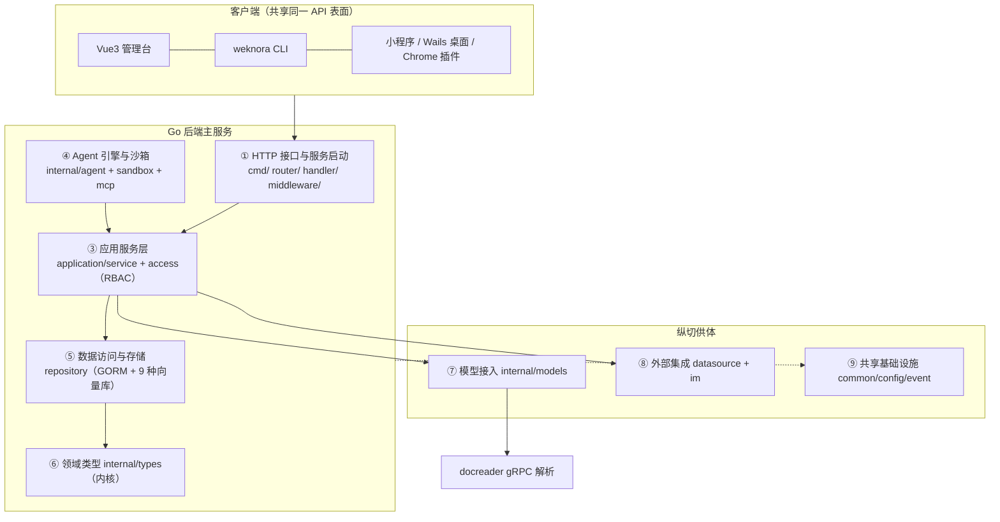
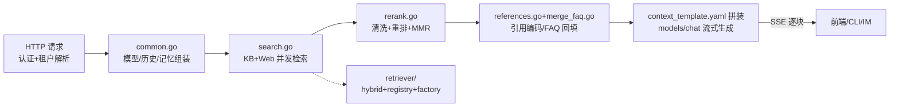

# WeKnora 新人上手指南

> 基于知识图谱（commit `5c5d46d9`，v0.8.0；12951 节点 / 112010 边 / 12 层 / 15 步导览 / 2112 个生产代码文件）与 DeepWiki 90 页编写。

## 一、项目是什么

WeKnora（维娜拉）是腾讯开源的企业级 LLM 知识管理框架，把团队分散文档沉淀为可查询、可推理的知识资产。三大核心能力：**RAG 快速问答**——插件化检索问答管线；**ReAct Agent 智能推理**——自主编排知识检索、MCP 工具、技能目录、会话级 Docker/E2B/Cube 沙箱与网络搜索；**Wiki 模式**——Agent 从原始文档自治生成互链 Markdown 知识库与图谱。外围：跨会话长期记忆（profile/preference/fact/task/interest 五类）、飞书/GitLab/Notion/语雀/钉钉/IMA/RSS 多源接入、四级角色多空间 RBAC、Langfuse 观测与 Worker 池队列，可完全私有化部署。

技术栈：后端 Go 1.26 + Gin + dig 依赖注入 + GORM + asynq；前端 Vue3 + TDesign + Pinia + Vite（注意：UI 库是腾讯 TDesign 而非 Element Plus）；文档解析是独立 Python gRPC 服务 docreader。多端：`weknora` CLI、Wails 桌面版、微信小程序、Chrome 插件。出厂六个内置智能体（`config/builtin_agents.yaml`）：快速问答、智能推理、数据分析师、维基问答、维基修订、技能安装器。

## 二、整体架构鸟瞰

后端是洋葱架构，依赖从外向内：HTTP 层消费应用服务层，应用服务层消费数据访问层，内核是零反向依赖的领域类型层 `internal/types`（全仓扇入最高，`interfaces/` 下 48 个接口剥离服务与仓储契约）。模型接入/外部集成/共享基础设施是纵切供体；所有客户端只经统一 HTTP API 表面进后端。

12 层职责（括号为文件数）：① HTTP 接口与服务启动（156）——main 包与 dig 装配、Gin 路由、认证/租户/限流中间件、SSE 流管理器、内置 MCP Server；② CLI（151）——独立 Go 模块命令族；③ 应用服务（215）——业务编排核心，含 chat_pipeline 与 access 包 RBAC；④ Agent 引擎与沙箱（182）——ReAct 运行时、工具、技能、沙箱；⑤ 数据访问（96）——GORM 仓储 + 9 种向量库驱动；⑥ 领域类型（140）——最底层契约；⑦ 模型接入（108）——chat/embedding/rerank/vlm/asr 网关；⑧ 外部集成（104）——IM 机器人与数据源连接器；⑨ 共享基础设施（105）——docreader 客户端、chunker、事件总线；⑩ 前端（568，最大层）；⑪ 辅助服务与多端（171）；⑫ 部署运维（183）。

## 三、核心模块地图

**HTTP 与启动**：`cmd/server/main.go` 是生命周期起点（dig 容器、优雅停机）；装配中枢 `internal/container/container.go` 全仓扇出最高（818 条依赖边），注册数据库、约 40 个仓储与服务、pipeline 插件与 asynq 队列。`middleware/auth.go`（829 行）实现 Bearer JWT 与 X-API-Key 三通道认证并解析租户。

**应用服务**：`agent_service.go` 是引擎工厂（扇出 416），按 AgentConfig 组装工具、MCP 目录与沙箱工具；`access/knowledgebase.go` 按归属→组织分享→共享 Agent 三级解析 KB 访问。

**Agent 与沙箱**：`internal/agent/engine.go` 驱动 think→analyze→act→observe 主循环；`tools/definitions.go` 声明工具目录与默认白名单；`shell_exec.go` 在会话独占沙箱以 root 跑 Bash（黑名单+输出上限）；`sandbox/session_manager.go` 为每租户会话维持持久远程沙箱，`url_guard.go` 出网前做 SSRF 与 L7 网络策略校验。

**数据与契约**：`application/repository/` 是 GORM 仓储与向量库驱动；`internal/types` 是词汇表——`message.go` 消息聚合、`retriever.go` 枚举 11 种检索引擎。**模型接入**：`models/chat/remote_api.go` 是 OpenAI 兼容主干，`provider.go` 收敛二十余家厂商差异。

**集成与前端**：`datasource/connector.go` 定义 Connector/StreamingConnector，`im/adapter.go` 支撑 10 个 IM 适配器；`views/chat/index.vue`（约 2000 行）是最重视图（SSE 收发、断流续传、steer 插话）。

## 四、一次 RAG 问答的生命周期

请求过认证中间件后，"快速问答"走 `application/service/chat_pipeline/` 插件管线，事件经 EventBus 由 `agent_stream_handler.go` 以 SSE 推给前端：

1. **准备**（`common.go`）：组装模型与消息、加载历史并清洗 think 标签；
2. **检索**（`search.go`）：KB 与 Web 并发——按物理 embedding 模型分组共享查询向量、合并单次 HybridSearch、失败降级关键词、低召回触发查询扩展；
3. **重排**（`rerank.go`）：12 步 passage 清洗→rerank 模型（失败降级一次）→复合打分 0.6 模型+0.3 召回+0.1 来源→MMR 选 TopK；
4. **装配**（`references.go`/`merge_faq.go`）：位置 ID 换为请求内模型句柄，编码为防注入 tool_result；
5. **生成**：`config/prompt_templates/context_template.yaml`（四模板）拼装 prompt，交模型网关流式生成带引用答案。

检索底座在 `retriever/`：`keywords_vector_hybrid_indexer.go` 是默认混合引擎，`registry.go` 双映射+singleflight 防惊群，`factory.go` 处理 env（RETRIEVE_DRIVER）与 DB VectorStore 双路径。调优优先改 prompt 模板 YAML 与 `config/config.yaml` 的 conversation 检索参数（embedding_top_k=30、阈值等）。

## 五、一次 Agent 任务的生命周期

"智能推理"由 `internal/agent` 实现经典 ReAct 循环：`engine.go` 的 Execute→executeLoop→runReActIteration 驱动 **Think**（`think.go` 流式调 LLM、双解码器分流思考与答案、解码工具调用事件）→ **Act**（`act.go` 执行工具，串行或 errgroup 并行、栅栏保序）→ **Observe**（`observe.go` 压缩调度、结果按预算裁剪、终止条件分析）循环，直到产出答案或达迭代上限由 `finalize.go` 合成收尾。

工具面由 `agent_service.go` 组装：RAG/Wiki/数据/记忆/网络内置工具按运行时能力过滤（绝不静默注入用户未选工具）；长期记忆经 `search_memory` 按需检索；MCP 服务经 `mcp/manager.go` 管理连接，`tools/mcp_tool.go` 实现 Tool 接口与人工审批门；系统提示按模式分七模板（`agent_system_prompt.yaml`）。

代码执行在**会话级沙箱**：每租户会话绑定持久远程沙箱（Docker=长命容器；E2B/Cube 云后端），技能按 Progressive Disclosure 三级加载并装进镜像快照；每轮结束把 /workspace 做成 git 检查点供会话分叉回滚。**Wiki 生成**是 Map-Reduce 流水线：`wiki_ingest.go` 以数据库表为持久队列驱动 asynq 批处理，`wiki_ingest_taxonomy.go` 规划整批目录树，`wiki_page.go` 管版本快照与双向链接。全程 18 类事件经 EventBus 进 SSE 流。

## 六、开发环境与构建

**快速开发模式**（`docs/开发指南.md`）：`make dev-start` 用 `docker-compose.dev.yml` 起 19 个基础设施容器（paradedb/redis/minio/neo4j/docreader 等）；`make dev-app` 本地跑 Go 后端（装了 air 自动热重载，内置 `.air.toml`）；`make dev-frontend` 起 Vite。等效脚本 `./scripts/dev.sh`；后端改动 5-10 秒重启，免重建镜像。地址：前端 5173、API 8080、PostgreSQL 5432。

生产部署走 `docker-compose.yml`（23 服务：本体 + 数据层 + 五种可选向量后端与 Langfuse/Dex），`cp .env.example .env` 后 `docker compose up -d` 访问 http://localhost；可选能力用 `--profile neo4j|minio|langfuse|full`。`docker/Dockerfile.app` 三阶段构建（node:24 编浏览器扩展→golang:1.26 编后端→debian:12-slim 非 root）。CI 在 `.github/workflows/app.yml`；`Makefile` 52 target 覆盖构建/镜像/启停/迁移。

## 七、推荐学习路径

**后端路线（1-2 天）**：① README_CN.md + `config/config.yaml` + `builtin_agents.yaml` → ② `cmd/server/main.go` → `internal/container/container.go` → ③ `middleware/auth.go`/`rbac.go` + 任一 routes_*.go → ④ `internal/types/` → ⑤ `chat_pipeline/` 五插件 + `retriever/` 四件套 → ⑥ `internal/agent/` engine/think/act/observe + `sandbox/session_manager.go` → ⑦ 挑一个 `repository/knowledge*.go`。

**前端路线（1 天）**：① `frontend/src/main.ts` + `App.vue` → ② `stores/auth.ts` + `utils/request.ts` → ③ `views/chat/index.vue`（SSE/断流续传/steer 插话）→ ④ 按域浏览 `api/` 与 `views/` → ⑤ 对照后端路由理解契约。

**全栈路线（2 天）**：后端路线②③⑤⑥ + `docreader/main.py` + 一个连接器（`notion/connector.go`）+ 一个 IM 适配器（`im/adapter.go`）+ compose 与 Makefile，最后用 `weknora chat` 走一遍闭环。

## 八、常见坑与新人心法

1. **多空间 RBAC 无处不在**：Owner/Admin/Contributor/Viewer 只是角色门槛，细粒度在 `access` 包三级解析与 handler 归属校验；跨租户探测伪装 404、DTO 构造时即剥离凭据。
2. **两条管线别混淆**：快速问答走 chat_pipeline（一次检索一次生成），智能推理走 ReAct（多轮工具循环）；CLI 的 `chat` 对应前者、`session ask --agent` 对应后者。名词坑：CLI 的 doc=SDK 类型 Knowledge，chunk 是切块。
3. **异步任务都是 asynq**：解析/Wiki/技能安装全在分阶段 Worker 池（core/后处理/enrichment/maintenance + Wiki 独立池），HTTP 只入队。"没反应"先查任务队列面板；重启时 resetPendingTasks 重置卡死任务。
4. **SSE 是核心契约**：前端/CLI/IM 共享同一事件流；多副本部署必须 `STREAM_MANAGER_TYPE=redis`，否则断线不能续传。
5. **配置优先级**：系统设置以代码内 registry 为键权威，三级解析 DB>ENV>默认；检索引擎有 env 与 DB VectorStore 双路径；Docker 沙箱默认关闭；前端入口可见性由 GET /system/capabilities 推导。
6. **图谱裁剪范围**：`.understandignore` 裁掉 tests/、docs/、website-docs/、migrations/（269 个 SQL）、third_party/、examples/ 等——不在图谱里，需要时直接读仓库原文。

心法：先读 container.go 零件清单再读单个 service；调回答质量优先改 `config/prompt_templates/` 的 YAML；全仓贯彻"端点默认不信任"。

## 延伸阅读

- **DeepWiki 索引**：`/data/usershare/ai/work4ai/讲透WeKnora/deepwiki/INDEX.md`（90 页）。
- **docs/ 关键文档**：`开发指南.md`、`RBAC说明.md`、`QA.md`、`agent-tools-design.md`、`CHUNKING.md`、`sandbox-docker-backend.md`、`worker-pool-governance.md`、`Langfuse集成.md`。
- **website-docs/**：VitePress 文档站，六板块覆盖约 360 个 API 端点与约 150 个环境变量。
- **图谱与配置源头**：`.understand-anything/knowledge-graph.json`；`config/` 下 config.yaml、builtin_agents.yaml 与 prompt_templates/。
