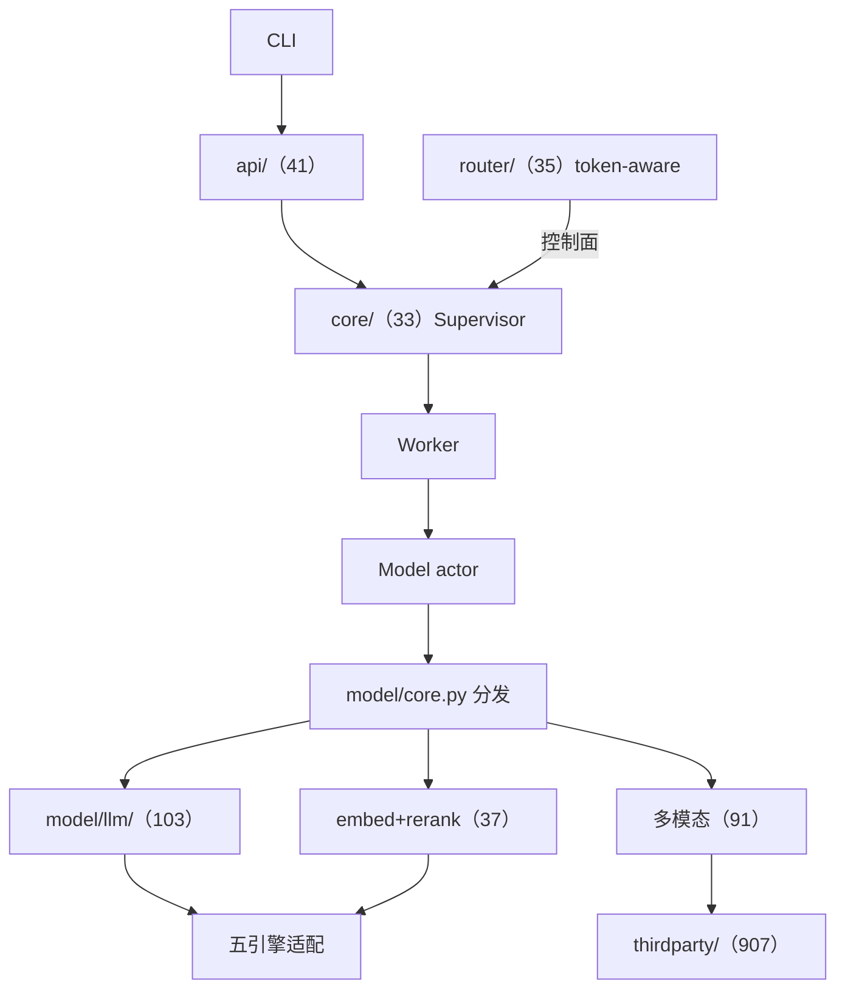

# Xinference 新人上手指南

> 基于代码知识图谱生成 · 分析 commit `b3de2604` · 2026-09-21

## 1. 项目概览

Xinference 是 Xorbits 开源的分布式推理平台：一条命令起服务，用统一 API 部署 LLM、embedding、rerank、视觉、音频、视频乃至世界模型，后端可切换 vLLM / SGLang / Transformers / llama.cpp / MLX 等引擎，对外提供 OpenAI 兼容 RESTful API + WebUI + 集群路由。技术栈以 Python 为主（FastAPI + Xoscar + PyTorch）。

与 vLLM/SGLang 的关系是**平台 vs 引擎**：二者是单一高性能推理引擎，Xinference 是引擎之上的统一部署与调度平台——不重写推理内核，而是把各引擎适配成统一模型抽象，其上提供模型注册、多 hub 缓存、集群编排、token-aware 路由与鉴权。

核心数字：全仓 1307 个文件、图谱分 11 层，其中 vendored 第三方 907 + 自研核心 412，精力应集中在自研部分。

## 2. 架构分层

- **顶层共享（11）**：types.py（OpenAI 兼容类型集，fan-in 57）、constants.py、device_utils.py（九类设备探测）、_compat.py、isolation.py。
- **API（41）**：restful_api.py 全端点；routers/ 按资源拆分；oauth2/advanced/ 认证子系统。
- **核心调度（33）**：三层 actor（supervisor/worker/model）+ launch 策略与状态守护。
- **集群路由（35）**：xinference-router 独立进程：分类、token 估算、热切换、tokenizer 资产。
- **模型注册与缓存（17）**：model/core.py 分发、model/utils.py（fan-in 62 全图之最）、CacheManager。
- **LLM（103）**：163 家族注册表 + 五引擎适配 + multimodal + parser + BatchScheduler。
- **多模态（91）**：audio/image/video/world 同构"家族 + 匹配 + 工厂"，含 OCR。
- **嵌入重排（37）**：46 条内置 embedding；四类引擎。
- **vendored（907）**：21 个上游项目，自包含、极少耦合。
- **部署（37）**：cmdline.py CLI + 角色引导 + Docker 多变体。
- **客户端（7）**：requests 同步与 aiohttp 异步 Client。

## 3. 核心概念

**RESTful API（OpenAI 兼容）**：与集群交互的唯一入口，chat/completions、embeddings、rerank 及各模态路由全走 OpenAI 风格；protocols/anthropic.py 示范 Anthropic → CanonicalChatRequest → OpenAI 的协议适配套路。

**三层 actor（xoscar actor 模型）**：SupervisorActor 集群中枢（模型全生命周期、worker 心跳、缓存编排、扩缩容），WorkerActor 节点执行（设备分配、GPU 孤儿清理、子进程池、venv），ModelActor 封装单个已启动模型（OOM、并发限流、代理推理）。链路 = API → 选节点 → 执行。

**ModelSpec / LLMModelV2 统一抽象**：模型以数据而非代码定义——LLMFamilyV2 + llm_family.json（163 家族，含按 model_format 细分的多引擎规格），各模态有同构 FamilyV2 与 model_spec.json（audio 78 条、embedding 46 条），match_llm 按名称/格式/量化匹配。

**引擎适配层**：同一 LLM 家族可跑 transformers/vllm/sglang/llama_cpp/mlx 平行子包：PytorchModel 管加载（LoRA/bnb/tensorizer）与 KV cache，VLLMModel 封装异步引擎与多进程 executor，SGLANGModel 子进程拉 HTTP 服务；共享逻辑抽为 ChatModelMixin，audio/image 多重继承生成 16 个 match 适配器。

**continuous batching**：transformers 引擎无 vLLM 原生调度器，scheduler/batch.py 的 BatchScheduler 以后台线程复刻：入队 → 步进 prefill/decode → KV cache 清理 → 失败恢复；配套 tool_parsers（13 模型族）与 reasoning_parser。

**token-aware router**：独立路由进程。RoutingPolicy 按 token 预算/thinking/tools/stream 分类后端池；tokenization 进程池隔离估算；RuntimeSnapshot 引用计数排水实现零重启热切换；经 control plane 维持注册心跳。

**多模态家族**：audio 78 条（whisper 居首）、image 生成 + OCR 六族、video（diffusers：Wan/LTX/MiniMax-H3）、world（子进程 torchrun 驱动）；重实现多 vendored，主包只做注册与薄适配。

## 4. 推荐学习路径（15 步）

1. **包入口与全局契约**：__init__.py、types.py、device_utils.py——全项目词汇表与地基。
2. **CLI 启动链**：cmdline.py 三种部署形态；local.py 同进程拉起单节点集群，即 `xinference-local` 背后。
3. **RESTful API**：restful_api.py 主服务 + routers/ + anthropic 协议适配。
4. **Supervisor 调度**：supervisor → worker → model 三层 actor，"提交请求 → 选节点 → 找到模型实例"。
5. **生命周期守护**：launch_strategy（IdleFirst）、resource、status_guard、launch_history_store——"从发起到就绪"的状态机。
6. **统一抽象**：model/core.py 按模态分发；model/utils.py 全图被依赖最多。
7. **LLM 注册表**：163 家族全以数据定义于 llm_family.json；"JSON 数据 + match_llm 匹配"分层是关键。
8. **引擎适配**：三引擎平行子包 + ChatModelMixin；"Mixin 共享 + 引擎各异"是新引擎切入点。
9. **continuous batching**：scheduler/batch.py 步进循环 + tool/reasoning parser 契约。
10. **多模态**：audio/image/video/world 复制同套注册表机制，与第 7 步对照惊人一致。
11. **Embedding 与 Rerank**：结构对称；总结"分发入口 + core/family/custom 三件套"扩展套路。
12. **客户端 SDK**：同步/异步 Client 对等封装；CLI 即其消费者。
13. **Token-aware Router**：classifier/runtime/control_plane——"多副本时请求转发给谁"。
14. **容器化**：Dockerfile 不内置引擎（per-model venv）；compose 四形态。
15. **vendored 疆界**：thirdparty/ 21 个上游项目（约 1100 文件）：TTS 系、whisper、deepseek_vl、ACE-Step。

## 5. 文件地图

| 层 | 关键文件 |
|---|---|
| 共享（11） | types.py · constants.py · device_utils.py · _compat.py · isolation.py |
| API（41） | restful_api.py；routers/；oauth2/advanced/；protocols/anthropic.py |
| 调度（33） | core/{supervisor,worker,model}.py；launch_strategy · status_guard · resource；virtual_env_manager |
| 路由（35） | router/{app,classifier,runtime,control_plane,tokenizer}.py |
| 模型公共（17） | model/{core,utils,cache_manager,custom}.py；flexible/ |
| LLM（103） | llm_family.py + llm_family.json；五引擎 core.py；scheduler/batch.py |
| 多模态（91） | {audio,image,video,world}/core.py；image/ocr/ |
| 嵌入重排（37） | {embedding,rerank}/{core,*_family}.py + model_spec.json |
| 部署（37） | deploy/{cmdline,local,supervisor,worker}.py；docker/ |
| 客户端（7） | client/restful/{restful_client,async_restful_client}.py |
| vendored（907） | thirdparty/（按需进入） |

## 6. 复杂度热点（top 10，按连接度）

| 文件 | 度 | 切入建议 |
|---|---|---|
| model/utils.py | 112 | 全模态公共底座，改动需跨模态回归 |
| api/routers/admin.py | 104 | 从 register_routes 按组读 |
| types.py | 75 | 新增 API 字段必动，守 OpenAI 兼容 |
| thirdparty/audiotools/data/transforms.py | 70 | vendored，仅音频增强任务 |
| thirdparty/ace_step_1_5/acestep/gpu_config.py | 65 | vendored，仅 ACE-Step 任务 |
| core/worker.py | 63 | 孤儿清理与子进程池恢复高频区 |
| core/utils.py | 60 | replica uid 含 legacy 格式 |
| core/virtual_env_manager.py | 60 | 引擎 venv 安装排障必读 |
| api/routers/token_routers.py | 60 | 1123 行，按三组端点读 |
| thirdparty/indextts/gpt/transformers_modeling_utils.py | 60 | vendored，仅 IndexTTS 相关 |

vendored 占 3 席，按需读。

## 7. 构建与调试

- **安装与启动**：pip 安装后经 console_scripts 获得 xinference 命令族；单机 `xinference-local`；分布式 xinference-supervisor（9997/9999）+ xinference-worker（向 supervisor 注册）。
- **Docker**：docker-compose.yml 单机（9997、GPU 直通、双缓存卷）；distributed 以 /status 5s 健康检查驱动 worker 顺序；airgap/byo-wheels 面向离线。镜像刻意不内置引擎——worker 在模型启动时按 spec 建 per-model venv。
- **测试**：根 conftest.py 的 pytest 夹具自动拉起本地集群（supervisor/worker 子进程、API、健康检查）；各子包自带 tests/。
- **可观测**：Prometheus 指标见 core/metrics.py；OpenTelemetry 需 XINFERENCE_ENABLE_OTEL=true（core/otel.py）。

## 8. 常见坑与本地约定

1. **vendored 边界**：thirdparty/（CosyVoice/whisper/fish_speech 等 21 项目）原样保留上游结构——whisper/__main__.py 仍可 python -m 独立运行、matcha/app.py 是上游 Gradio WebUI；只在各模态处被薄适配层调用，读主包时跳过，上游行为不符在适配层处理。
2. **UI 前端**：xinference/ui 在本图谱仅剩占位（前端源码被裁剪）；构建产物由 Dockerfile.cpu 的 node 阶段构建产出，api/frontend_static.py 挂载 SPA fallback（须注册在后端路由之后）。
3. **isolation.py 隔离机制**：在独立线程运行专属 asyncio 事件循环，为 vLLM 分布式执行器与 Xavier 传输提供同步上下文安全提交协程的机制——排查"卡住不返回"类问题时关注。
4. **Supervisor 消息队列脆弱**：api/utils.py 用"模型不存在"负缓存防止高频重试打爆 Supervisor 消息队列；写新端点时沿用 require_model 与负缓存模式。
5. **per-model venv 约定**：引擎相关 ImportError 先查 venv marker 与指纹（virtual_env_manager.py：torch pin、flash-attn 校验、uv 回退）。
6. **依赖 pin 与其他约定**：transformers>=4.53.3 规避 OTEL provider 冲突、peft>=0.18.0 规避 HybridCache 导入；Pydantic 从 _compat.py 导入。
