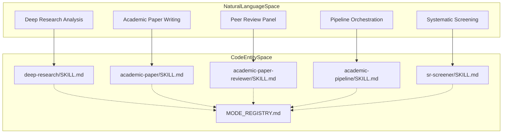
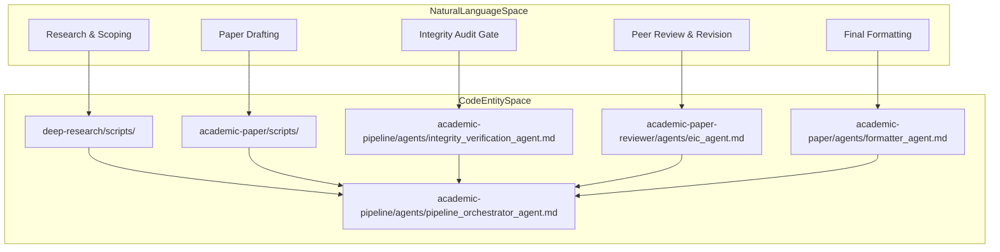

<!-- source: DeepWiki mcp.deepwiki.com · repo Imbad0202/academic-research-skills · page 1 Overview · fetched 2026-10-30 -->

# Overview

Relevant source files

The following files were used as context for generating this wiki page:

- [.claude-plugin/marketplace.json](.claude-plugin/marketplace.json)
- [.claude-plugin/plugin.json](.claude-plugin/plugin.json)
- [.claude/CLAUDE.md](.claude/CLAUDE.md)
- [CITATION.cff](CITATION.cff)
- [MODE_REGISTRY.md](MODE_REGISTRY.md)
- [POSITIONING.md](POSITIONING.md)
- [QUICKSTART.md](QUICKSTART.md)
- [README.ja-JP.md](README.ja-JP.md)
- [README.ko-KR.md](README.ko-KR.md)
- [README.md](README.md)
- [README.zh-CN.md](README.zh-CN.md)
- [README.zh-TW.md](README.zh-TW.md)
- [academic-pipeline/SKILL.md](academic-pipeline/SKILL.md)
- [docs/ARCHITECTURE.md](docs/ARCHITECTURE.md)
- [scripts/check_spec_consistency.py](scripts/check_spec_consistency.py)

## Purpose and Scope

Academic Research Skills (ARS) system (v3.23.1) is a contract-audited research-to-publication copilot framework designed for Claude Code [README.md:1-3, .claude-plugin/plugin.json:1-4]. ARS provides a human-in-the-loop architecture that assists scholars across the full lifecycle—from initial literature exploration and systematic screening to paper drafting, peer review, and final multi-format generation [README.md:10, README.ko-KR.md:10]. 

The system operates across five core modular skills (`deep-research`, `academic-paper`, `academic-paper-reviewer`, `academic-pipeline`, and `sr-screener`) that coordinate via structured handoff contracts and state machine transitions [.claude/CLAUDE.md:7-13]. ARS enforces strict verification gates to mitigate hallucination and contamination risks while preserving human authorship [README.md:21-33].

For installation, CLI setup, environment flags, and quick start guides, see [Getting Started](#1.1). For details on the multi-skill agent ecosystem, data access isolation levels, and model tiering, see [System Architecture](#1.2).

**Sources:** [README.md:1-33](), [.claude-plugin/plugin.json:1-4](), [.claude/CLAUDE.md:7-13]()

## The Five Core Skills

ARS is organized around five independent skills, each defined by its respective `SKILL.md` file and agent manifest directory [.claude/CLAUDE.md:7-13]:

| Skill Name | Skill File Path | Agent Count | Purpose & Role |
|------------|-----------------|-------------|----------------|
| `deep-research` | `deep-research/SKILL.md` | 13 | Formulates research questions, executes systematic searches, ensures PRISMA compliance, and synthesizes evidence [README.md:41-47, .claude/CLAAUDE.md:9]. |
| `academic-paper` | `academic-paper/SKILL.md` | 12 | Executes chapter planning, academic paper drafting, revision coaching, citation compliance, and LaTeX/DOCX/PDF output formatting [.claude/CLAUDE.md:10]. |
| `academic-paper-reviewer` | `academic-paper-reviewer/SKILL.md` | 7 | Executes multi-perspective peer review using a 5-person simulated panel and 0–100 quality rubrics [.claude/CLAUDE.md:11]. |
| `academic-pipeline` | `academic-pipeline/SKILL.md` | 3 | Orchestrates the end-to-end 10-stage research workflow with mandatory coverage-bounded integrity gates [.claude/CLAUDE.md:12]. |
| `sr-screener` | `sr-screener/SKILL.md` | 3+ | Manages protocol-driven study screening via dual blinded AI reviewers and a third-reviewer adjudicator [.claude/CLAUDE.md:13]. |

**Sources:** [.claude/CLAUDE.md:7-13](), [README.md:41-47]()

### Diagram: Natural Language to Code Entity Space: Skill Ecosystem Mapping

**Sources:** [MODE_REGISTRY.md:1-70](), [.claude/CLAUDE.md:7-13]()

## Pipeline Workflow and Execution Architecture

The `academic-pipeline` skill coordinates the workflow across 10 sequential stages, integrating deep research outputs, screening corpora, drafting engines, integrity gates, and peer review cycles [academic-pipeline/SKILL.md:3, docs/ARCHITECTURE.md:43-77].

### Diagram: Natural Language to Code Entity Space: Pipeline Execution Mapping

**Sources:** [academic-pipeline/SKILL.md:17-20](), [docs/ARCHITECTURE.md:43-77]()

## Claude Code Infrastructure Dependencies

ARS integrates natively with Claude Code infrastructure features:
- **Plugin Marketplace**: Installs via marketplace registry entries (`/plugin marketplace add`) [.claude-plugin/plugin.json:1-4, README.md:12-17].
- **Slash Commands**: Maps user intent to modes registered in `MODE_REGISTRY.md` via `commands/` [README.md:19].
- **Python Runtime Guards**: Enforces write-scope boundaries and verification scripts via `scripts/` and `hooks/` [.claude/CLAUDE.md:17].
- **Environment Flags**: Controls optional verification layers (e.g., `ARS_CLAIM_AUDIT=1`, `ARS_PASSPORT_RESET=1`) [academic-pipeline/SKILL.md:44-48].

**Sources:** [README.md:12-19](), [.claude-plugin/plugin.json:1-4](), [academic-pipeline/SKILL.md:44-48]()

## Child Pages

For granular technical specifications, please consult the child pages:
- **[Getting Started](#1.1)** — Installation guides, environment flags, CLI setup, and slash command references.
- **[System Architecture](#1.2)** — Multi-skill ecosystem design, agent topology, data access isolation levels, and model tiering structures.

**Sources:** [README.md:45-78](), [docs/ARCHITECTURE.md:1-15]()

---

