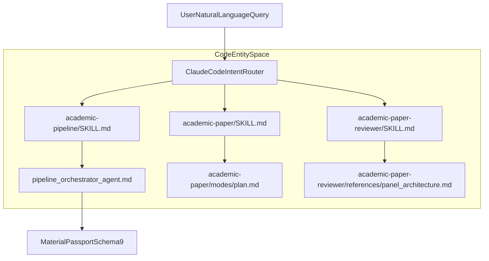
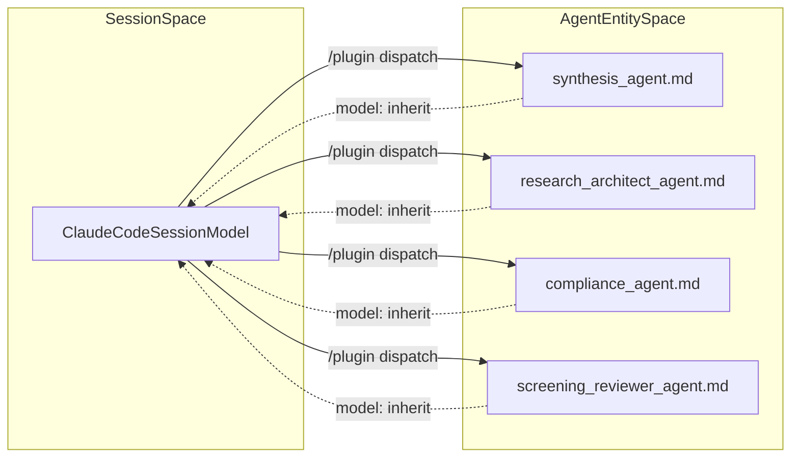

<!-- source: DeepWiki mcp.deepwiki.com · repo Imbad0202/academic-research-skills · page 1.1 Getting Started · fetched 2026-10-30 -->

# Getting Started

<details>
<summary>Relevant source files</summary>

The following files were used as context for generating this wiki page:

- [QUICKSTART.md](QUICKSTART.md)
- [commands/ars-abstract.md](commands/ars-abstract.md)
- [commands/ars-citation-check.md](commands/ars-citation-check.md)
- [commands/ars-disclosure.md](commands/ars-disclosure.md)
- [commands/ars-format-convert.md](commands/ars-format-convert.md)
- [commands/ars-full.md](commands/ars-full.md)
- [commands/ars-lit-review.md](commands/ars-lit-review.md)
- [commands/ars-outline.md](commands/ars-outline.md)
- [commands/ars-plan.md](commands/ars-plan.md)
- [commands/ars-reviewer.md](commands/ars-reviewer.md)
- [commands/ars-revision-coach.md](commands/ars-revision-coach.md)
- [commands/ars-revision.md](commands/ars-revision.md)
- [docs/PERFORMANCE.md](docs/PERFORMANCE.md)
- [docs/PERFORMANCE.zh-TW.md](docs/PERFORMANCE.zh-TW.md)
- [docs/SETUP.md](docs/SETUP.md)
- [docs/SETUP.zh-TW.md](docs/SETUP.zh-TW.md)
- [scripts/announce-ars-loaded.sh](scripts/announce-ars-loaded.sh)
- [shared/cross_model_verification.md](shared/cross_model_verification.md)

</details>


## Purpose and Scope
This page covers the technical setup, installation channels, environment configuration, slash commands in `commands/`, and quick-start protocols for the Academic Research Skills (ARS) system. It bridges environment provisioning with execution entry points across the core skills (`deep-research`, `academic-paper`, `academic-paper-reviewer`, `academic-pipeline`, `sr-screener`).

Sources: `QUICKSTART.md:1-29()`, `docs/SETUP.md:1-20()`

---

## Installation Channels

ARS supports multiple installation vectors depending on the target runtime environment (Claude Code CLI, plugin marketplace, project-local symlinks, repo clone, or web/Cowork environments).

### 1. Prerequisites and CLI Setup
ARS requires the Claude Code command-line interface. Use the native installer (recommended) or the deprecated npm package:

```bash
# macOS / Linux native installer
curl -fsSL https://claude.ai/install.sh | bash

# Windows PowerShell native installer
irm https://claude.ai/install.ps1 | iex
```
Sources: `docs/SETUP.md:23-46()`, `QUICKSTART.md:5-10()`

### 2. Installation Methods Matrix
| Method | Target Path | Description |
| :--- | :--- | :--- |
| **Plugin Marketplace** | `/plugin install academic-research-skills` | Exposes hardening subagents and plugin-managed slash commands (`commands/`). |
| **Repo Clone & Symlink** | `.claude/skills/` | Symlinks repository skill directories into a project workspace. |
| **Skills Copy** | `.claude/skills/` | Direct file copies of individual skill folders. |
| **Cowork / Web** | Manual settings upload | Custom zip upload via web or Cowork settings (does not read local `~/.claude/skills/`). |

```bash
# Example: Repo clone and local project symlinks
git clone https://github.com/Imbad0202/academic-research-skills.git ~/academic-research-skills
cd /path/to/your/project
mkdir -p .claude/skills
ln -s ~/academic-research-skills/deep-research .claude/skills/deep-research
ln -s ~/academic-research-skills/academic-paper .claude/skills/academic-paper
ln -s ~/academic-research-skills/academic-paper-reviewer .claude/skills/academic-paper-reviewer
ln -s ~/academic-research-skills/academic-pipeline .claude/skills/academic-pipeline
ln -s ~/academic-research-skills/sr-screener .claude/skills/sr-screener
```
Sources: `QUICKSTART.md:11-28()`, `docs/SETUP.md:1-13()`

---

## API Configuration and Environment Flags

### API Key Setup
The system relies on an Anthropic API key. Set it via environment variable or permit Claude Code to prompt on first run:
```bash
export ANTHROPIC_API_KEY=sk-ant-xxxxx
claude
```
Sources: `docs/SETUP.md:48-61()`

### Opt-In Environment Flags (v3.5.1+)
ARS exposes several behavior toggles via environment variables. All default to `OFF`:

| Flag | Since | Description | Reference |
| :--- | :--- | :--- | :--- |
| `ARS_CROSS_MODEL` | v3.0 | Enables cross-model verification layers. | `shared/cross_model_verification.md:1-7()` |
| `ARS_CROSS_MODEL_TRANSPORT=codex` | #630 | Routes citation-integrity checks via Codex app-server adapter. | `shared/cross_model_verification.md:16-24()` |
| `ARS_PASSPORT_RESET=1` | v3.6.3 | Promotes FULL and MANDATORY checkpoints to context reset boundaries. | `docs/SETUP.md:136-136()` |
| `ARS_CLAIM_AUDIT=1` | v3.8 | Enables claim-faithfulness verification against sources at Stage 4.5. | `docs/SETUP.md:139-139()` |
| `ARS_INQUIRY_LEDGER=1` | v3.21.1 | Activates the inquiry branch ledger (alpha). | `docs/SETUP.md:142-142()` |

Sources: `docs/SETUP.md:125-143()`

---

## Slash Commands and Command Surface

Commands located in `commands/` trigger specific skills and modes. 

### Command Reference Table
| Command | Model | Description | Target Code Entrypoint |
| :--- | :--- | :--- | :--- |
| `/ars-full` | `inherit` | Full 10-stage research pipeline | `academic-pipeline/SKILL.md` |
| `/ars-plan` | `sonnet` | Socratic chapter-by-chapter planning | `academic-paper/SKILL.md` (plan mode) |
| `/ars-reviewer` | `inherit` | Simulated peer-review panel (5 reviewers) | `academic-paper-reviewer/SKILL.md` |
| `/ars-revision-coach` | `inherit` | Parse reviewer comments into Roadmap | `academic-paper/SKILL.md` (revision-coach) |
| `/ars-lit-review` | `sonnet` | Annotated bibliography in paper format | `academic-paper/SKILL.md` (lit-review) |
| `/ars-citation-check` | `inherit` | Citation error report | `academic-paper/SKILL.md` (citation-check) |
| `/ars-disclosure` | `sonnet` | Venue policy compliance bundle | `academic-paper/SKILL.md` (disclosure) |

Sources: `scripts/announce-ars-loaded.sh:55-108()`, `commands/ars-lit-review.md:1-10()`, `commands/ars-citation-check.md:1-10()`

---

## Quick Start and Intent Routing Architecture

Users initiate sessions using natural language prompts, which the Claude Code intent router matches against skill definitions and mode registries.

### Diagram: Natural Language Space to Code Entity Space (Routing)

Sources: `QUICKSTART.md:36-81()`, `docs/design/2026-04-27-ars-v3.6.5.1-setup-fix-implementation-brief.md:29-55()`

---

## Plugin Architecture and Subagent Dispatch

When installed as a plugin, ARS exposes hardened subagents through `scripts/announce-ars-loaded.sh`. These agents inherit the dispatching session's model and operate under least-privilege tool restrictions.

### Diagram: Session Space to Agent Entity Space

Sources: `scripts/announce-ars-loaded.sh:77-105()`, `docs/PERFORMANCE.md:43-56()`

---

## Optional Toolchains and Adapters

### Optional Dependencies
* **Pandoc**: Required for direct `.docx` generation.
* **Tectonic & Fonts**: Required for PDF rendering via LaTeX (includes **Source Han Serif TC VF** for CJK support).
* **Python Interpreter**: Required for write-scope guards (`PreToolUse`), revision patches, and cache management commands (`/ars-cache-invalidate`, `/ars-mark-read`, `/ars-unmark-read`).

Sources: `docs/SETUP.md:15-97()`

### Literature Corpus Adapters
Curated libraries (Zotero, Obsidian, or PDF directories) can be pre-loaded into the Material Passport via reference Python adapters:
```bash
python scripts/adapters/folder_scan.py --input /path/to/pdfs --passport passport.yaml --rejection-log rejection_log.yaml
python scripts/adapters/zotero.py --input my-zotero-export.json --passport passport.yaml --rejection-log rejection_log.yaml
python scripts/adapters/obsidian.py --input ~/Obsidian/Lit\ Notes --passport passport.yaml --rejection-log rejection_log.yaml
```
Sources: `docs/SETUP.md:101-122()`

---

