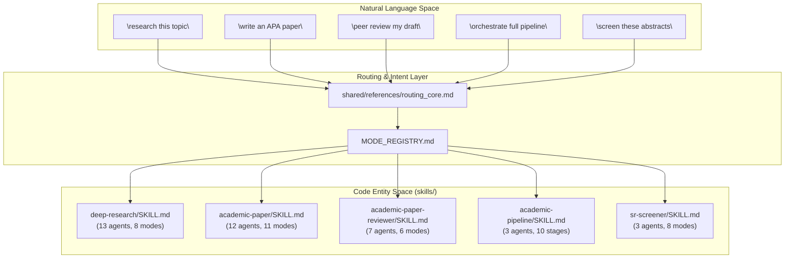
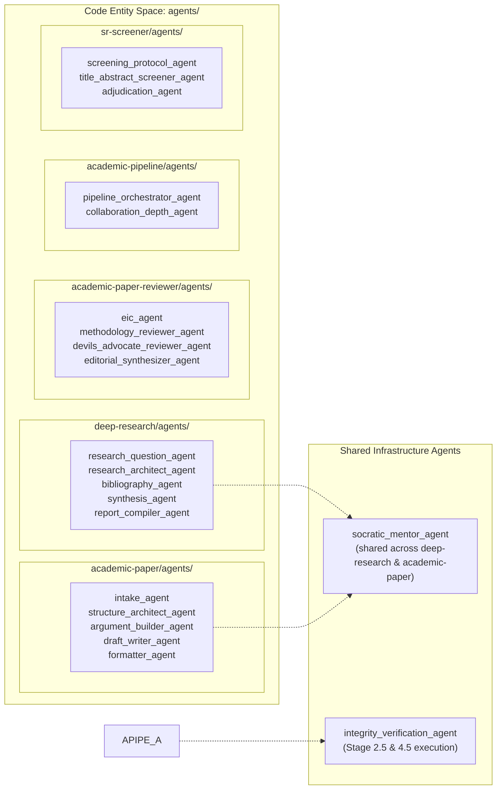

<!-- source: DeepWiki mcp.deepwiki.com · repo Imbad0202/academic-research-skills · page 1.2 System Architecture · fetched 2026-10-30 -->

# System Architecture

<details>
<summary>Relevant source files</summary>

The following files were used as context for generating this wiki page:

- [.claude-plugin/marketplace.json](.claude-plugin/marketplace.json)
- [.claude-plugin/plugin.json](.claude-plugin/plugin.json)
- [.claude/CLAUDE.md](.claude/CLAUDE.md)
- [MODE_REGISTRY.md](MODE_REGISTRY.md)
- [README.ja-JP.md](README.ja-JP.md)
- [README.ko-KR.md](README.ko-KR.md)
- [README.md](README.md)
- [README.zh-CN.md](README.zh-CN.md)
- [README.zh-TW.md](README.zh-TW.md)
- [academic-paper-reviewer/SKILL.md](academic-paper-reviewer/SKILL.md)
- [academic-paper/SKILL.md](academic-paper/SKILL.md)
- [academic-pipeline/SKILL.md](academic-pipeline/SKILL.md)
- [deep-research/SKILL.md](deep-research/SKILL.md)
- [docs/ARCHITECTURE.md](docs/ARCHITECTURE.md)
- [docs/CONTROL_AVAILABILITY.md](docs/CONTROL_AVAILABILITY.md)
- [scripts/check_spec_consistency.py](scripts/check_spec_consistency.py)
- [shared/model_tiering.md](shared/model_tiering.md)
- [shared/references/routing_core.md](shared/references/routing_core.md)
- [tests/fixtures/issue_133_routing/CALIBRATION_LOG.md](tests/fixtures/issue_133_routing/CALIBRATION_LOG.md)
- [tests/fixtures/issue_133_routing/README.md](tests/fixtures/issue_133_routing/README.md)

</details>


## Purpose and Scope

This page provides a technical overview of the Academic Research Skills (ARS v3.23.1) system architecture. It outlines the multi-skill ecosystem, agent distributions, Claude Code infrastructure dependencies, model tiering strategies, data access isolation levels, and the underlying directory layout.

Sources: [README.md:1-46](), [.claude-plugin/plugin.json:1-15]()

---

## Multi-Skill Ecosystem and Code Entity Mapping

The ARS system is structured around five core operational skills that manage distinct phases of the academic research-to-publication pipeline. The mapping from natural language requests to code entities is managed by the routing core and skill manifests.

Title: Multi-Skill Ecosystem: Natural Language Space to Code Entity Space



Sources: [.claude/CLAUDE.md:5-14](), [MODE_REGISTRY.md:1-70](), [shared/references/routing_core.md:1-32]()

---

## Agent Architecture and Distribution

ARS distributes 38 specialized subagents across the five skill directories. Each agent has a dedicated system prompt file in its respective `agents/` folder.

Title: Agent Ecosystem Distribution Across Code Directories



Sources: [deep-research/SKILL.md:1-15](), [academic-paper/SKILL.md:1-14](), [academic-paper-reviewer/SKILL.md:1-13](), [academic-pipeline/SKILL.md:1-15]()

---

## Claude Code Infrastructure Dependencies and Model Tiering

The execution environment relies on specific Claude Code runtime features, environment variables, and model tiering allocations defined in configuration files.

| Infrastructure Component | File / Setting Reference | Purpose |
|-------------------------|--------------------------|---------|
| **Agent Teams Runtime** | `CLAUDE_CODE_EXPERIMENTAL_AGENT_TEAMS=1` | Enables parallel subagent spawning via `TeamCreate`. |
| **Write-Scope Guard** | `hooks/run_guard.sh`, `scripts/ars_write_scope_guard.py` | POSIX shell watchdog enforcing phase-specific write protections [docs/ARCHITECTURE.md:1-15](), [.claude/CLAUDE.md:15-18](). |
| **Cross-Model Verification** | `ARS_CROSS_MODEL=1` | Activates secondary model evaluation tracks (e.g., Gemini / Codex) [docs/ARCHITECTURE.md:30-30](). |
| **Claim Integrity Audit** | `ARS_CLAIM_AUDIT=1` | Triggers `claim_ref_alignment_audit_agent` for L3 claim-faithfulness checks [academic-pipeline/SKILL.md:45-50](). |
| **Passport Reset Boundary** | `ARS_PASSPORT_RESET=1` | Promotes FULL and MANDATORY checkpoints to context-reset boundaries [academic-pipeline/SKILL.md:40-45](). |

Sources: [.claude/CLAUDE.md:15-35](), [academic-pipeline/SKILL.md:40-50](), [docs/ARCHITECTURE.md:1-15]()

---

## Data Access Isolation Levels and Handoff Architecture

To preserve ground-truth integrity and prevent contamination, ARS enforces strict data access boundaries across skills, backed by JSON schemas in `shared/contracts/`.

### Isolation Levels

*   `raw`: Full access to unfiltered literature searches, raw PDF texts, and unverified data sources (assigned to `deep-research`) [academic-pipeline/SKILL.md:9-9]().
*   `redacted`: Restricted access to internal search logs; operates on processed bibliographic items and structured notes (assigned to `academic-paper`) [academic-paper/SKILL.md:8-8]().
*   `verified_only`: Strictly restricted to data packets that have cleared integrity verification gates (assigned to `academic-paper-reviewer` and `academic-pipeline`) [academic-pipeline/SKILL.md:9-9]().

### Key Handoff Schemas

*   **Schema 1 (RQ Brief)**: Governs research question scoping between `deep-research` and `academic-paper`.
*   **Schema 9 (Material Passport)**: Tracks run provenance, file digests, and state transitions via `scripts/run_ledger.py` [.claude/CLAUDE.md:29-32]().
*   **Schema 11 (R&R Traceability Matrix)**: Maps journal reviewer critiques to revision patch points [academic-paper-reviewer/SKILL.md:1-13]().
*   **Schema 13 (Sprint Contract)**: Hard-gate protocol for reviewer pre-commitments [academic-pipeline/SKILL.md:1-15]().

Sources: [academic-pipeline/SKILL.md:1-15](), [.claude/CLAUDE.md:29-35](), [shared/references/routing_core.md:1-32]()

---

## Skills and Directory Structure

The repository organizes core execution code, validators, contracts, and references into a modular tree structure.

```text
skills/
├── deep-research/             # 13 agents, 8 modes (Research & Synthesis)
├── academic-paper/            # 12 agents, 11 modes (Writing & Revision)
├── academic-paper-reviewer/   # 7 agents, 6 modes (Peer Review)
├── academic-pipeline/         # 3 agents, 10 stages (Orchestration)
└── sr-screener/               # 3 agents, 8 modes (Systematic Screening)
scripts/
├── check_spec_consistency.py  # CI suite version validator
├── check_acronyms.py          # Deterministic acronym checker
└── run_ledger.py              # Passport and run ledger state manager
shared/
├── contracts/                 # 111 JSON validation schemas
└── references/                # Core routing and instruction boundaries
hooks/
├── hooks.json                 # Pre-tool use integration hooks
└── run_guard.sh               # Write-scope security guard launcher
```

Sources: [scripts/check_spec_consistency.py:1-30](), [.claude/CLAUDE.md:15-35](), [docs/ARCHITECTURE.md:1-15]()

---

