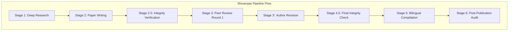

<!-- source: DeepWiki mcp.deepwiki.com · repo Imbad0202/academic-research-skills · page 10 Example Outputs and Showcase · fetched 2026-10-30 -->

# Example Outputs and Showcase

Relevant source files

The following files were used as context for generating this wiki page:

- [examples/showcase/README.md](examples/showcase/README.md)
- [examples/showcase/full_paper_apa7.pdf](examples/showcase/full_paper_apa7.pdf)
- [examples/showcase/full_paper_zh_apa7.pdf](examples/showcase/full_paper_zh_apa7.pdf)
- [examples/showcase/integrity_report_stage2.5.pdf](examples/showcase/integrity_report_stage2.5.pdf)
- [examples/showcase/integrity_report_stage4.5.pdf](examples/showcase/integrity_report_stage4.5.pdf)
- [examples/showcase/integrity_reverification_stage2.5.pdf](examples/showcase/integrity_reverification_stage2.5.pdf)
- [examples/showcase/paper_creation_process_en.pdf](examples/showcase/paper_creation_process_en.pdf)
- [examples/showcase/paper_creation_process_zh.pdf](examples/showcase/paper_creation_process_zh.pdf)
- [examples/showcase/post_publication_audit_2026-03-09.pdf](examples/showcase/post_publication_audit_2026-03-09.pdf)
- [examples/showcase/response_to_reviewers_r2.pdf](examples/showcase/response_to_reviewers_r2.pdf)

This page provides an overview of the shipped examples within the Academic Research Skills system (`v3.23.x`), covering complete showcase papers, integrity audit trails, peer review reports, compliance fixtures, and test artifact suites. As a parent page, it introduces the high-level categories of shipped outputs and links to child pages for detailed analysis.

For deep-dive documentation on specific runs and fixtures, see the child pages:
- [Showcase Paper and Reports](#10.1) — The full paper in APA 7.0 (English and Chinese), integrity reports, peer review reports, response to reviewers and process documentation in `examples/showcase/`.
- [Fixtures, Compliance Examples and Passport Samples](#10.2) — `examples/compliance` fixtures, `passport_with_repro_lock.yaml`, benchmark report templates, figure/table trace examples, and `tests/fixtures` suites.

---

## 10.1 Showcase Paper and Reports

The showcase directory contains artifacts from a complete end-to-end academic pipeline run (`examples/showcase/`), demonstrating the multi-stage quality assurance process from deep research through final APA 7.0 compilation and post-publication auditing [examples/showcase/README.md:1-7](). 

The showcase includes bilingual paper drafts (`full_paper_apa7.pdf`, `full_paper_zh_apa7.pdf`), pre-review and post-revision integrity reports (`integrity_report_stage2.5.pdf`, `integrity_report_stage4.5.pdf`), and multi-round peer review documentation (`stage3_review_report.pdf`, `response_to_reviewers_r2.pdf`) [examples/showcase/README.md:11-39](). For comprehensive walkthroughs of these documents, error tracking, and process documentation, see [Showcase Paper and Reports](#10.1)().

Sources: [examples/showcase/README.md:1-58]()

---

## 10.2 Fixtures, Compliance Examples and Passport Samples

In addition to full showcase papers, the repository bundles standardized fixtures and compliance templates in `examples/compliance/` and `tests/fixtures/`. These assets validate schema adherence, material provenance via `passport_with_repro_lock.yaml`, and formatting constraints prior to runtime execution.

For detailed breakdowns of schema validation examples, benchmark report templates, trace files, and test suites, see [Fixtures, Compliance Examples and Passport Samples](#10.2)().

Sources: [examples/showcase/README.md:1-10]()

---

