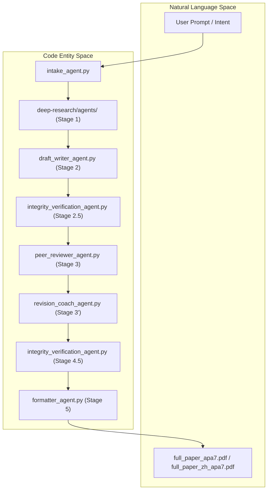
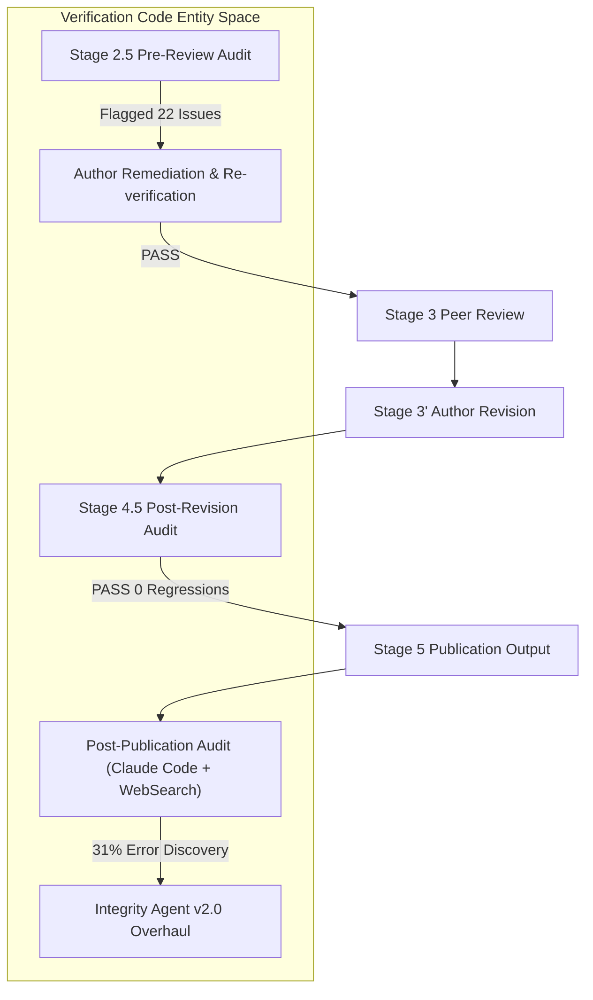
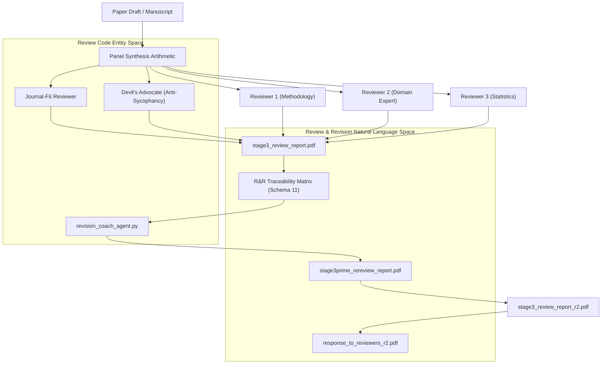

<!-- source: DeepWiki mcp.deepwiki.com · repo Imbad0202/academic-research-skills · page 10.1 Showcase Paper and Reports · fetched 2026-10-30 -->

# Showcase Paper and Reports

<details>
<summary>Relevant source files</summary>

The following files were used as context for generating this wiki page:

- [academic-paper/examples/chinese_paper_example.md](academic-paper/examples/chinese_paper_example.md)
- [academic-paper/references/journal_submission_guide.md](academic-paper/references/journal_submission_guide.md)
- [academic-paper/templates/funding_statement_template.md](academic-paper/templates/funding_statement_template.md)
- [deep-research/examples/fact_check_mode.md](deep-research/examples/fact_check_mode.md)
- [examples/showcase/README.md](examples/showcase/README.md)
- [examples/showcase/full_paper_apa7.pdf](examples/showcase/full_paper_apa7.pdf)
- [examples/showcase/full_paper_zh_apa7.pdf](examples/showcase/full_paper_zh_apa7.pdf)
- [examples/showcase/integrity_report_stage2.5.pdf](examples/showcase/integrity_report_stage2.5.pdf)
- [examples/showcase/integrity_report_stage4.5.pdf](examples/showcase/integrity_report_stage4.5.pdf)
- [examples/showcase/integrity_reverification_stage2.5.pdf](examples/showcase/integrity_reverification_stage2.5.pdf)
- [examples/showcase/paper_creation_process_en.pdf](examples/showcase/paper_creation_process_en.pdf)
- [examples/showcase/paper_creation_process_zh.pdf](examples/showcase/paper_creation_process_zh.pdf)
- [examples/showcase/post_publication_audit_2026-03-09.pdf](examples/showcase/post_publication_audit_2026-03-09.pdf)
- [examples/showcase/response_to_reviewers_r2.pdf](examples/showcase/response_to_reviewers_r2.pdf)

</details>


## Purpose and Scope

This page documents the contents, architecture, and verification history of the reference artifacts shipped in `examples/showcase/`. The showcase directory provides a complete, end-to-end audit trail and artifact bundle generated from a real academic pipeline execution (`academic-pipeline` v2.3), covering raw deep research output, dual-language APA 7.0 manuscript compilation, multi-stage integrity verification, simulated 5-person peer review panels, author response cycles, and post-publication stress-test audits. These artifacts serve as conformance benchmarks and validation fixtures for the Academic Research Skills (ARS) ecosystem.

Sources: `examples/showcase/README.md:1-8`

---

## Showcase Artifact Catalog

The `examples/showcase/` bundle contains the following categorized artifacts, mapping natural language research goals to fully compiled, verified publication packages:

| File Path / Artifact | Stage / Category | Verdict / Description |
|----------------|------------------|-----------------------|
| `examples/showcase/full_paper_apa7.pdf` | Stage 5 (Finalization) | Final English academic paper formatted in APA 7.0 (*From Snapshots to Trajectories...*) |
| `examples/showcase/full_paper_zh_apa7.pdf` | Stage 5 (Finalization) | Final Chinese academic paper formatted in APA 7.0 |
| `examples/showcase/integrity_report_stage2.5.pdf` | Stage 2.5 (Pre-Review) | **FAIL** — Flagged 15 problem references (8 bibliographic errors, 6–8 fabricated) and 3 statistical errors |
| `examples/showcase/integrity_reverification_stage2.5.pdf` | Stage 2.5 (Re-verification) | **PASS** — Confirmed all 22 identified issues resolved |
| `examples/showcase/integrity_report_stage4.5.pdf` | Stage 4.5 (Post-Revision) | **PASS** — Zero regressions, 3 newly added references verified |
| `examples/showcase/post_publication_audit_2026-03-09.pdf` | Post-Publication Audit | Independent Claude Code + WebSearch audit; found issues in 21/68 references (31%), driving integrity agent v2.0 overhaul |
| `examples/showcase/stage3_review_report.pdf` | Stage 3 (Peer Review R1) | Round 1 review from Journal-Fit Reviewer, 3 panel reviewers, and Devil's Advocate |
| `examples/showcase/stage3prime_rereview_report.pdf` | Stage 3' (Re-review) | Re-review execution following author revisions |
| `examples/showcase/stage3_review_report_r2.pdf` | Stage 3-R2 (Peer Review R2) | Round 2 follow-up review |
| `examples/showcase/response_to_reviewers_r2.pdf` | Revision Workflow | Author's point-by-point response matrix to reviewer comments |
| `examples/showcase/paper_creation_process_en.pdf` | Stage 6 (Process Summary) | Pipeline process documentation and telemetry (English) |
| `examples/showcase/paper_creation_process_zh.pdf` | Stage 6 (Process Summary) | Pipeline process documentation and telemetry (Chinese) |

Sources: `examples/showcase/README.md:9-42`

---

## End-to-End Pipeline Execution Architecture

The following diagram bridges the natural language research objectives to the underlying code entities and agent modules executed during the showcase run.


Sources: `examples/showcase/README.md:43-57`, `examples/showcase/README.md:9-15`

---

## Paper Output Artifacts

The showcase outputs include fully compiled papers in English and Chinese, adhering to APA 7.0 standards and structured via the IMRaD (Introduction, Methods, Results, and Discussion) format.

### Bilingual and APA 7.0 Structuring
- **English Manuscript (`full_paper_apa7.pdf`)**: Examines institutional accreditation and student success analytics. It includes structured running heads, author note blocks, institutional affiliations, bilingual abstracts, and strict APA 7.0 reference lists.
- **Chinese Manuscript (`full_paper_zh_apa7.pdf`)**: Demonstrates Chinese academic paper generation (modeled after `academic-paper/examples/chinese_paper_example.md`). It supports xeCJK font stacks, traditional Chinese typography, and localized APA 7.0 citation patterns.

```markdown
**AI Usage Declaration**: This study utilized generative AI tools (Claude, Anthropic, 2026) solely during literature search and preliminary classification stages. All AI-assisted outputs were manually reviewed and corrected by the authors. Final manuscript drafting, data analysis, and academic judgments were performed independently by human researchers.
```

### Funding and Conflict of Interest Declarations
Papers compiled via the pipeline integrate standardized funding templates and conflict-of-interest disclosures (`academic-paper/templates/funding_statement_template.md`), ensuring grant numbers (such as NSTC or MOE grants) and CRediT author contribution roles are formally registered.

Sources: `examples/showcase/README.md:5-15`, `academic-paper/examples/chinese_paper_example.md:1-49`, `academic-paper/templates/funding_statement_template.md:1-40`

---

## Integrity Verification Reports & Audit Pipeline

Integrity verification forms the hard gates of the ARS execution pipeline, separating preliminary drafts from submittable manuscripts.

### Stage 2.5 vs. Stage 4.5 Verification
- **Stage 2.5 (Pre-Review)**: Executed via `integrity_verification_agent.py` before peer review. In the showcase run, this gate caught 22 total issues (15 problem references including 6–8 likely fabricated citations, and 3 statistical calculation discrepancies), resulting in a `FAIL` verdict (`integrity_report_stage2.5.pdf`).
- **Re-verification**: After remediation, Stage 2.5 re-verification yielded a `PASS` verdict (`integrity_reverification_stage2.5.pdf`).
- **Stage 4.5 (Post-Revision)**: Final verification confirmed zero regressions across revised sections and validated 3 newly introduced citations (`integrity_report_stage4.5.pdf`).

### Post-Publication Stress-Test Audit (2026-03-09)
Following initial pipeline completion, a separate post-publication audit was executed using Claude Code combined with WebSearch (`post_publication_audit_2026-03-09.pdf`). 
- **Findings**: Auditing all 68 references revealed problems in 21 references (31% of the final bibliography): 4 not found / fabricated, 6 with incorrect authors, 7 with corrupted metadata (year, title, pages, or DOI), and 4 format errors.
- **System Impact**: This rigorous audit directly drove the development of the **Integrity Verification Agent v2.0**, introducing the Anti-Hallucination Mandate, gray-zone elimination protocols, and deterministic multi-index triangulation.


Sources: `examples/showcase/README.md:16-24`, `examples/showcase/README.md:59-62`

---

## Peer Review Panel Architecture & Response Workflow

The peer review documentation in `examples/showcase/` reflects a multi-perspective evaluation framework coordinated by `peer_reviewer_agent.py`.



### Review Panel Seats and Roles
1. **Journal-Fit Reviewer**: Evaluates scope alignment, target journal appropriateness, and readership impact.
2. **Reviewers 1–3**: Scrutinize theoretical framework, methodology, data integrity, and statistical validity.
3. **Devil's Advocate**: Enforces the Concession Threshold Protocol, actively challenging underlying assumptions to prevent sycophancy and frame-locking.

### Traceability and Response Generation
Author responses are managed via the **R&R Traceability Matrix (Schema 11)**. Each reviewer comment is mapped to a specific manuscript line change, generating point-by-point rebuttal documentation (`response_to_reviewers_r2.pdf`) and ensuring continuity across re-review cycles (`stage3prime_rereview_report.pdf`).

Sources: `examples/showcase/README.md:25-33`

---

## Process Documentation & Localization

The showcase suite concludes with end-to-end execution logs captured in `paper_creation_process_en.pdf` and `paper_creation_process_zh.pdf`. These documents record:
- Stage transition timestamps and token consumption telemetry.
- Checkpoint validation results across Socratic planning, deep research synthesis, and revision coaching.
- Collaboration depth metrics managed by `collaboration_depth_agent`.

Sources: `examples/showcase/README.md:34-42`

---

