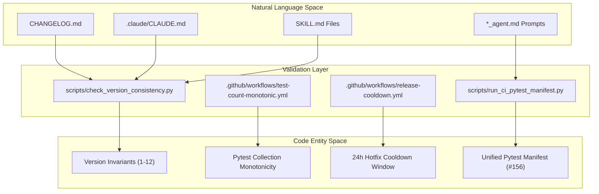
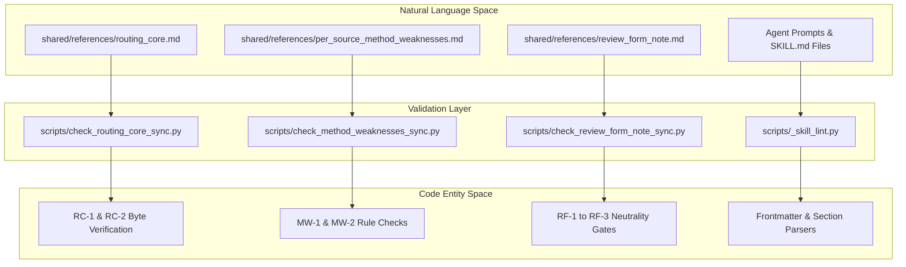

<!-- source: DeepWiki mcp.deepwiki.com · repo Imbad0202/academic-research-skills · page 11.1 Spec Consistency CI and Prompt Linting · fetched 2026-10-30 -->

# Spec Consistency CI and Prompt Linting

Relevant source files

The following files were used as context for generating this wiki page:

- [.github/workflows/defer-label-gate.yml](.github/workflows/defer-label-gate.yml)
- [.github/workflows/harness-retirement-monthly.yml](.github/workflows/harness-retirement-monthly.yml)
- [.github/workflows/pr-closes-issue.yml](.github/workflows/pr-closes-issue.yml)
- [.github/workflows/release-cooldown.yml](.github/workflows/release-cooldown.yml)
- [.github/workflows/tag-version-match.yml](.github/workflows/tag-version-match.yml)
- [.github/workflows/test-count-monotonic.yml](.github/workflows/test-count-monotonic.yml)
- [scripts/_skill_lint.py](scripts/_skill_lint.py)
- [scripts/check_method_weaknesses_sync.py](scripts/check_method_weaknesses_sync.py)
- [scripts/check_review_form_note_sync.py](scripts/check_review_form_note_sync.py)
- [scripts/check_routing_core_sync.py](scripts/check_routing_core_sync.py)
- [scripts/check_version_consistency.py](scripts/check_version_consistency.py)
- [scripts/render_harness_retirement_issue.py](scripts/render_harness_retirement_issue.py)
- [scripts/test_check_method_weaknesses_sync.py](scripts/test_check_method_weaknesses_sync.py)
- [scripts/test_check_review_form_note_sync.py](scripts/test_check_review_form_note_sync.py)
- [scripts/test_check_routing_core_sync.py](scripts/test_check_routing_core_sync.py)
- [scripts/test_check_spec_consistency.py](scripts/test_check_spec_consistency.py)
- [scripts/test_check_version_consistency.py](scripts/test_check_version_consistency.py)
- [scripts/test_render_harness_retirement_issue.py](scripts/test_render_harness_retirement_issue.py)
- [scripts/test_skill_lint_marker_block.py](scripts/test_skill_lint_marker_block.py)

This page documents the Quality Infrastructure of the Academic Research Skills (ARS) system, focusing on automated verification of architectural invariants, prompt integrity, version synchronization, and release-governance workflows. The system utilizes GitHub Actions and specialized Python validators to enforce a "Spec-as-Code" philosophy, ensuring that natural language agent instructions and documentation do not drift from the technical specifications.

## Overview of CI Workflows and Governance Gates

The codebase employs multiple GitHub Actions workflows and local scripts to maintain system integrity across agents, skills, and distribution channels.

| Workflow | File Path | Purpose |
| :--- | :--- | :--- |
| **Spec Consistency** | [.github/workflows/spec-consistency.yml:1-1]() | Primary CI gate for architectural invariants, version alignment, and prompt budget enforcement. |
| **Test Count Monotonic** | [.github/workflows/test-count-monotonic.yml:1-1]() | Verifies that PRs do not reduce the total pytest collection count vs. the base branch. |
| **Release Cooldown** | [.github/workflows/release-cooldown.yml:1-1]() | Blocks consecutive minor/patch tags within 24h of a hotfix tag to prevent review overrun. |
| **Tag Version Match** | [.github/workflows/tag-version-match.yml:1-1]() | Ensures pushed `v*` tags match the suite version in `.claude/CLAUDE.md`. |
| **Harness Retirement** | [.github/workflows/harness-retirement-monthly.yml:1-1]() | Opens a monthly tracking issue to audit obsolete prompt scaffolding. |

### Data Flow: Spec Consistency and Workflow Architecture

The following diagram bridges the Natural Language Space (Markdown specs, documentation, and prompt text) to the Code Entity Space (Python linter scripts and GitHub Actions gates).

**Title: Spec-to-Code Validation Flow**

Sources: [.github/workflows/spec-consistency.yml:1-112](), [.github/workflows/test-count-monotonic.yml:1-157](), [.github/workflows/release-cooldown.yml:1-113](), [scripts/check_version_consistency.py:1-49]()

---

## Version Consistency and Spec-as-Code Engine

The core version alignment engine is implemented in `scripts/check_version_consistency.py`. It evaluates 12 rigorous invariants to prevent drift between configuration files, documentation, package metadata, and git tags [scripts/check_version_consistency.py:4-43]().

### Enforced Invariants
*   **Invariant 1:** Every skill listed in the `.claude/CLAUDE.md` Skills Overview table must have a version equal to its own `SKILL.md` metadata version [scripts/check_version_consistency.py:5-6]().
*   **Invariant 2:** The global **Suite version** in `.claude/CLAUDE.md` must equal the most recent `## [X.Y.Z]` entry in `CHANGELOG.md` [scripts/check_version_consistency.py:7-8]().
*   **Invariant 4:** Plugin manifests (`.claude-plugin/plugin.json` and `.claude-plugin/marketplace.json`) must match the suite version [scripts/check_version_consistency.py:11-15]().
*   **Invariant 5:** The `README.md` shields.io version badge must equal the suite version [scripts/check_version_consistency.py:16-17]().
*   **Invariant 8:** The outward-facing agent-count claim in `plugin.json` must match the exact number of unique `*_agent.md` files in the tree [scripts/check_version_consistency.py:23-28]().
*   **Invariant 9:** The latest `CHANGELOG.md` entry body must be at least 100 characters to prevent empty stubs [scripts/check_version_consistency.py:30-32]().
*   **Invariant 10:** The `Last Updated` date in `.claude/CLAUDE.md` must lie within ±7 days of the latest `CHANGELOG.md` entry date [scripts/check_version_consistency.py:33-35]().
*   **Invariant 12:** `CITATION.cff` version must match the suite version, and its release date must align within a ±7-day window [scripts/check_version_consistency.py:39-42]().

Sources: [scripts/check_version_consistency.py:1-43](), [scripts/test_check_version_consistency.py:1-186]()

---

## Marker Block Sync and Prompt Linting Framework

To ensure that shared prompt snippets, routing core instructions, method weaknesses, and review form notes remain identical across all skills and configuration surfaces, ARS employs a marker-block synchronization framework built on top of `scripts/_skill_lint.py`.

### Marker Sync Validators
*   **Routing Core Sync (`check_routing_core_sync.py`):** Enforces that the canonical routing core defined in `shared/references/routing_core.md` matches byte-for-byte with embedded copies in `.claude/CLAUDE.md` and every top-level `SKILL.md` [scripts/check_routing_core_sync.py:4-15]().
*   **Method Weaknesses Sync (`check_method_weaknesses_sync.py`):** Keeps per-source method weakness rules in `shared/references/per_source_method_weaknesses.md` synchronized across target templates and agent files [scripts/check_method_weaknesses_sync.py:4-13]().
*   **Review Form Note Sync (`check_review_form_note_sync.py`):** Validates options neutrality and checks for ranking words or selection marks in review form notes [scripts/test_check_review_form_note_sync.py:1-10]().

### Data Flow: Marker Block Sync

The following diagram maps out how canonical reference sources are validated against downstream copies across agent instructions and configuration documents.

**Title: Marker Block Synchronization Architecture**

Sources: [scripts/check_routing_core_sync.py:1-58](), [scripts/check_method_weaknesses_sync.py:1-44](), [scripts/_skill_lint.py:1-33](), [scripts/test_check_review_form_note_sync.py:1-24]()

---

## Automated Validation Matrix Summary

| Validator Script / Workflow | Target File / Surface | Invariant Enforced |
| :--- | :--- | :--- |
| `check_version_consistency.py` | `.claude/CLAUDE.md`, `CHANGELOG.md`, `SKILL.md` | 12 version alignment and release invariants [scripts/check_version_consistency.py:4-43]() |
| `check_routing_core_sync.py` | `.claude/CLAUDE.md`, `SKILL.md` | Byte-identical marker synchronization for routing core [scripts/check_routing_core_sync.py:10-15]() |
| `check_method_weaknesses_sync.py` | `deep-research/SKILL.md`, templates, agents | Verifies canonical method-weakness block consistency [scripts/check_method_weaknesses_sync.py:8-13]() |
| `test-count-monotonic.yml` | Pytest suite collection | Prevents test regressions or silent suite drops [.github/workflows/test-count-monotonic.yml:1-15]() |
| `release-cooldown.yml` | Git tags | Enforces a 24-hour cooldown window following hotfix tags [.github/workflows/release-cooldown.yml:1-11]() |

Sources: [scripts/check_version_consistency.py:1-43](), [scripts/check_routing_core_sync.py:1-20](), [scripts/check_method_weaknesses_sync.py:1-18](), [.github/workflows/test-count-monotonic.yml:1-15](), [.github/workflows/release-cooldown.yml:1-12]()

---

