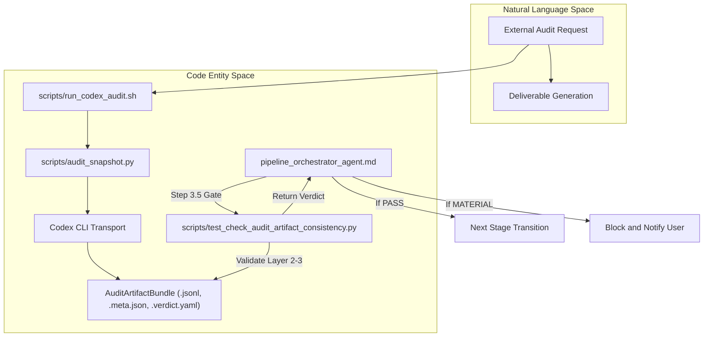
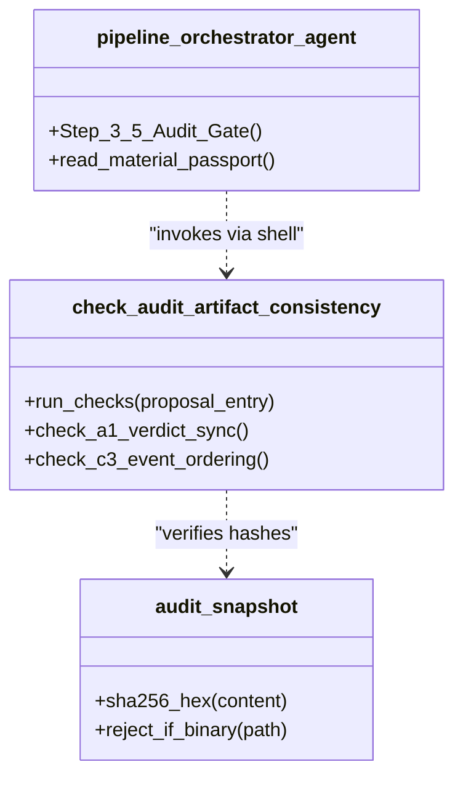

<!-- source: DeepWiki mcp.deepwiki.com · repo Imbad0202/academic-research-skills · page 11.2 Audit Artifact System · fetched 2026-10-30 -->

# Audit Artifact System

Relevant source files

The following files were used as context for generating this wiki page:

- [academic-paper/references/anti_leakage_protocol.md](academic-paper/references/anti_leakage_protocol.md)
- [academic-pipeline/references/integrity_review_protocol.md](academic-pipeline/references/integrity_review_protocol.md)
- [audits/harness-retirement-2026-09-model-update.md](audits/harness-retirement-2026-09-model-update.md)
- [docs/design/2026-04-23-ars-v3.6.4-literature-corpus-adapters-design.md](docs/design/2026-04-23-ars-v3.6.4-literature-corpus-adapters-design.md)
- [docs/design/2026-04-23-ars-v3.6.4-literature-corpus-adapters-plan.md](docs/design/2026-04-23-ars-v3.6.4-literature-corpus-adapters-plan.md)
- [docs/design/2026-04-30-ars-v3.6.7-step-6-orchestrator-hooks-spec.md](docs/design/2026-04-30-ars-v3.6.7-step-6-orchestrator-hooks-spec.md)
- [docs/design/2026-04-30-ars-v3.6.8-trust-provenance-and-drift-transparency-spec.md](docs/design/2026-04-30-ars-v3.6.8-trust-provenance-and-drift-transparency-spec.md)
- [docs/design/2026-05-12-ars-v3.7.3-claim-faithfulness-and-contaminated-source-spec.md](docs/design/2026-05-12-ars-v3.7.3-claim-faithfulness-and-contaminated-source-spec.md)
- [docs/design/2026-05-17-ars-v3.9.0-cross-index-triangulation-measurement-spec.md](docs/design/2026-05-17-ars-v3.9.0-cross-index-triangulation-measurement-spec.md)
- [examples/compliance/fixture_primary_raise_weak.yaml](examples/compliance/fixture_primary_raise_weak.yaml)
- [examples/compliance/fixture_sr_full_compliant.yaml](examples/compliance/fixture_sr_full_compliant.yaml)
- [examples/compliance/fixture_sr_missing_M4.yaml](examples/compliance/fixture_sr_missing_M4.yaml)
- [scripts/adapters/_common.py](scripts/adapters/_common.py)
- [scripts/adapters/tests/test_common.py](scripts/adapters/tests/test_common.py)
- [scripts/adapters/tests/test_rejection_log_schema.py](scripts/adapters/tests/test_rejection_log_schema.py)
- [scripts/check_v3_6_8_cite_provenance_pipeline.py](scripts/check_v3_6_8_cite_provenance_pipeline.py)
- [scripts/cross_model_codex_transport.py](scripts/cross_model_codex_transport.py)
- [scripts/cross_model_smoke_test.sh](scripts/cross_model_smoke_test.sh)
- [scripts/test_audit_schemas.py](scripts/test_audit_schemas.py)
- [scripts/test_check_audit_artifact_consistency.py](scripts/test_check_audit_artifact_consistency.py)
- [scripts/test_check_v3_6_8_cite_provenance_pipeline.py](scripts/test_check_v3_6_8_cite_provenance_pipeline.py)
- [scripts/test_cross_model_codex_transport.py](scripts/test_cross_model_codex_transport.py)
- [shared/compliance_checkpoint_protocol.md](shared/compliance_checkpoint_protocol.md)
- [shared/contracts/passport/rejection_log.schema.json](shared/contracts/passport/rejection_log.schema.json)
- [shared/prisma_trAIce_protocol.md](shared/prisma_trAIce_protocol.md)
- [shared/templates/codex_audit_multifile_template.md](shared/templates/codex_audit_multifile_template.md)

The Audit Artifact System is a cross-model audit infrastructure designed to enforce deterministic verification of high-stakes agent deliverables [docs/design/2026-04-30-ars-v3.6.7-step-6-orchestrator-hooks-spec.md:1-8](). Its primary purpose is to maintain runtime guardrails against inadvertent audit metadata fabrication ("Pattern C3") via an opt-in artifact-as-contract gating mechanism [docs/design/2026-04-30-ars-v3.6.7-step-6-orchestrator-hooks-spec.md:3-35]().

---

## 1. System Overview

The system implements an artifact-as-contract audit gate where external validation runs produce a bundle of records that the orchestrator consumes during stage transitions [docs/design/2026-04-30-ars-v3.6.7-step-6-orchestrator-hooks-spec.md:25-33]().

### 1.1 The Four-File Artifact Bundle

Every audit execution generates four distinct artifact files that must satisfy JSON schema validation and cross-file consistency checks:

| File Type | Filename Pattern | Role | Schema Reference |
| :--- | :--- | :--- | :--- |
| **JSONL Stream** | `<run_id>.jsonl` | Raw event stream from the execution harness (Layer 2). | `audit_jsonl.schema.json` |
| **Sidecar Meta** | `<run_id>.meta.json` | Runner environment metadata, git SHA, and bundle manifest (Layer 3). | `audit_sidecar.schema.json` |
| **Verdict** | `<run_id>.verdict.yaml` | The final PASS/MINOR/MAJOR decision and structured finding list. | `audit_verdict.schema.json` |
| **Passport Entry** | `<run_id>.audit_artifact_entry.json` | Material Passport record binding the deliverable to the audit artifact. | `audit_artifact_entry.schema.json` |

Sources: [docs/design/2026-04-30-ars-v3.6.7-step-6-orchestrator-hooks-spec.md:25-27](), [scripts/test_audit_schemas.py:29-34]()

### 1.2 System Data Flow

Title: "Audit Execution and Gating Flow"

Sources: [docs/design/2026-04-30-ars-v3.6.7-step-6-orchestrator-hooks-spec.md:23-33](), [scripts/run_codex_audit.sh:1-20](), [scripts/audit_snapshot.py:31-42]()

---

## 2. Implementation Components

### 2.1 Shell Wrappers and Snapshotters

The audit infrastructure relies on execution scripts and byte-exact snapshot utilities to capture deterministic state [scripts/audit_snapshot.py:10-36]().
*   `run_codex_audit.sh`: Manages execution lifecycles and process isolation [docs/design/2026-04-30-ars-v3.6.7-step-6-orchestrator-hooks-spec.md:33-35]().
*   `scripts/audit_snapshot.py`: Implements byte-exact file hashing to prevent NUL-byte or newline discrepancies [scripts/audit_snapshot.py:10-27](). Functions include `read_bytes_or_die` [scripts/audit_snapshot.py:66-77](), `reject_if_binary` [scripts/audit_snapshot.py:79-91](), and `_extract_template_sections` [scripts/audit_snapshot.py:99-122]().

Sources: [docs/design/2026-04-30-ars-v3.6.7-step-6-orchestrator-hooks-spec.md:33-35](), [scripts/audit_snapshot.py:10-122]()

### 2.2 Consistency Checkers

The script `scripts/test_check_audit_artifact_consistency.py` validates invariant families (A through F) across the artifact bundle [scripts/test_check_audit_artifact_consistency.py:1-6]().

| Family | Requirement | Implementation Reference |
| :--- | :--- | :--- |
| **A** | Verdict Mirroring: Verdict status in `.verdict.yaml` must match `.audit_artifact_entry.json`. | [scripts/test_check_audit_artifact_consistency.py:25-31]() |
| **B** | Manifest Integrity: SHA-256 of deliverable must match manifest in sidecar. | [scripts/test_check_audit_artifact_consistency.py:32-41]() |
| **C** | Event Sequence: JSONL must start with `thread.started` and follow canonical transitions. | [scripts/test_check_audit_artifact_consistency.py:42-45]() |
| **F** | Tool Traceability: Tool usage requires `item.started`/`item.completed` pairs in JSONL. | [scripts/test_check_audit_artifact_consistency.py:54-56]() |

Sources: [docs/design/2026-04-30-ars-v3.6.7-step-6-orchestrator-hooks-spec.md:25-33](), [scripts/test_check_audit_artifact_consistency.py:22-61]()

---

## 3. Pattern C3 Defense

Pattern C3 refers to inadvertent failures where a sub-agent internalizes audit instructions and emits fabricated audit metadata without executing the underlying tool [docs/design/2026-04-30-ars-v3.6.7-step-6-orchestrator-hooks-spec.md:31-35]().

### 3.1 Verification Architecture

The system enforces structural and operational boundaries to neutralize Pattern C3:
1.  **Process Separation:** The audit tool execution is decoupled from the agent session generating the deliverable [docs/design/2026-04-30-ars-v3.6.7-step-6-orchestrator-hooks-spec.md:35]().
2.  **Structural Validation:** Hallucinated text cannot easily replicate valid JSONL event streams with correct UUIDs, monotonic timestamps, and valid tool traces [docs/design/2026-04-30-ars-v3.6.7-step-6-orchestrator-hooks-spec.md:33-35]().
3.  **Orchestrator Enforcement:** The orchestrator agent verifies physical files exist on disk before completing a stage transition [docs/design/2026-05-05-phase-6.6-scoping-note.md:21-25]().

Title: "Pattern C3 Defense and Validation Architecture"

Sources: [docs/design/2026-04-30-ars-v3.6.7-step-6-orchestrator-hooks-spec.md:25-33](), [scripts/audit_snapshot.py:1-48](), [scripts/test_check_audit_artifact_consistency.py:22-61]()

---

## 4. Schema Definitions

Schemas are enforced using JSON Schema Draft 2020-12 specifications [scripts/test_audit_schemas.py:4-7]().

### 4.1 Audit Verdict Schema

The verdict schema (`audit_verdict.schema.json`) defines structure requirements for audit outcomes:

| Field | Type | Description |
| :--- | :--- | :--- |
| `verdict_status` | Enum | `PASS`, `MINOR`, `MAJOR`, or `AUDIT_FAILED` [scripts/test_check_audit_artifact_consistency.py:77-110](). |
| `finding_counts` | Object | Aggregation of P1 (Critical), P2 (Major), and P3 (Minor) findings [scripts/test_check_audit_artifact_consistency.py:80](). |
| `findings` | Array | Structured list of specific issues including location coordinates [scripts/test_check_audit_artifact_consistency.py:81-85](). |

Sources: [scripts/test_audit_schemas.py:29-34](), [scripts/test_check_audit_artifact_consistency.py:74-90]()

### 4.2 JSONL Event Schema

The JSONL schema (`audit_jsonl.schema.json`) enforces wire format constraints:
*   `thread_id`: Requires a canonical UUID format [scripts/test_audit_schemas.py:111]().
*   `usage`: Mandatory token usage tracking fields on `turn.completed` events [scripts/test_audit_schemas.py:131-136]().
*   `item.completed`: Requires non-empty payload text when block types equal `agent_message` [scripts/test_audit_schemas.py:121-124]().

Sources: [scripts/test_audit_schemas.py:109-137]()

---

