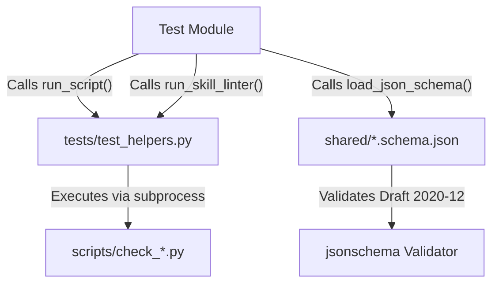
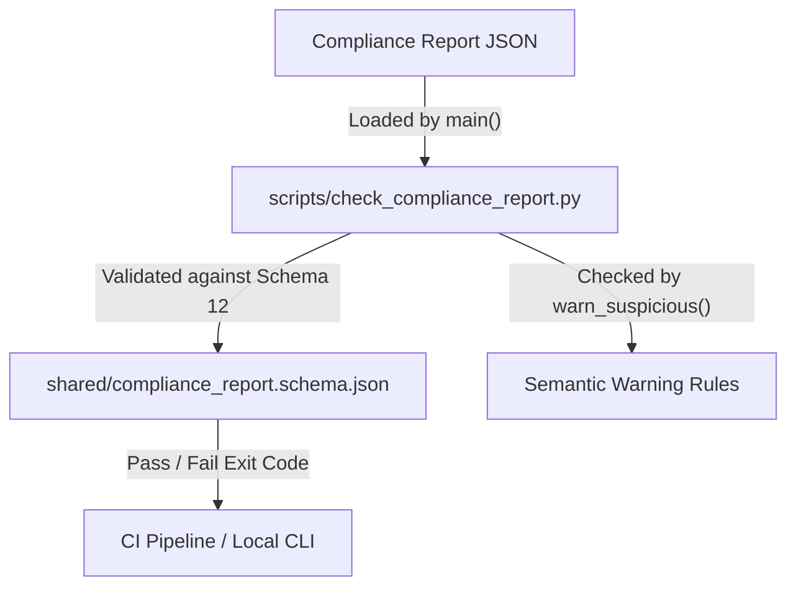
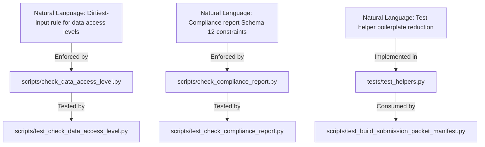

<!-- source: DeepWiki mcp.deepwiki.com · repo Imbad0202/academic-research-skills · page 11.3 Developer Environment and Test Suite · fetched 2026-10-30 -->

# Developer Environment and Test Suite

<details>
<summary>Relevant source files</summary>

The following files were used as context for generating this wiki page:

- [CONTRIBUTING.md](CONTRIBUTING.md)
- [requirements-dev.txt](requirements-dev.txt)
- [scripts/check_compliance_report.py](scripts/check_compliance_report.py)
- [scripts/check_data_access_level.py](scripts/check_data_access_level.py)
- [scripts/test_build_submission_packet_manifest.py](scripts/test_build_submission_packet_manifest.py)
- [scripts/test_check_compliance_report.py](scripts/test_check_compliance_report.py)
- [scripts/test_check_data_access_level.py](scripts/test_check_data_access_level.py)
- [scripts/test_check_task_type.py](scripts/test_check_task_type.py)
- [shared/compliance_report.schema.json](shared/compliance_report.schema.json)
- [tests/test_helpers.py](tests/test_helpers.py)

</details>


### Purpose and Scope
This page details the developer environment, dependency specifications, test helpers, and validator execution mechanics for the Academic Research Skills (ARS) codebase. ARS includes hundreds of validator scripts located under `scripts/` that ensure spec consistency, prompt hygiene, schema conformance, and structural integrity across all five skills (`deep-research`, `academic-paper`, `academic-paper-reviewer`, `academic-pipeline`, `sr-screener`).

Sources: [CONTRIBUTING.md:1-10](), [scripts/check_data_access_level.py:1-45]()

---

### 1. Python Dependencies and Environment Configuration
The development environment relies on a strict set of Python packages defined in `requirements-dev.txt`. These packages handle YAML parsing, JSON schema validation, PDF inspection, XML security, spreadsheet regression tests, and Markdown parsing.

The required packages and their minimum version floors are:
* `pyyaml`: Standard YAML parsing.
* `ruamel.yaml>=0.17`: Round-trip safe YAML manipulation [requirements-dev.txt:1-2]().
* `jsonschema[format]>=4.17`: JSON Schema Draft 2020-12 validation with format checkers [requirements-dev.txt:3]().
* `pypdf`: PDF text and metadata extraction [requirements-dev.txt:4]().
* `defusedxml`: Secure XML parsing protecting against entity expansion attacks [requirements-dev.txt:5]().
* `openpyxl>=3.1`: Excel spreadsheet processing for `sr-screener` formula-injection regression tests [requirements-dev.txt:6]().
* `markdown-it-py>=3.0` and `linkify-it-py>=2.0.3`: Markdown parsing and URL linkification support required by evidence-row unit tests [requirements-dev.txt:7-10]().

Sources: [requirements-dev.txt:1-10]()

---

### 2. Test Helper Architecture
Shared test utilities are consolidated in `tests/test_helpers.py` to prevent code duplication across test modules. These helpers provide standardized subprocess execution, dynamic module loading, synthetic skill generation, and JSON schema compilation.

Key functions defined in `tests/test_helpers.py`:
* `run_script(script_path, *args, cwd, extra_env)`: Invokes a script via `subprocess.run`, capturing stdout and stderr as text [tests/test_helpers.py:15-36]().
* `load_module_from_path(name, path)`: Imports a script file as a module using `importlib.util` for unit testing internal functions [tests/test_helpers.py:39-53]().
* `run_skill_linter(script_path, root)`: Invokes a skill linter with the `--path` argument and `PYTHONPATH` set to `scripts/` [tests/test_helpers.py:55-62]().
* `write_skill(root, name, frontmatter_body)`: Writes synthetic `<root>/<name>/SKILL.md` files with given YAML frontmatter for linter testing [tests/test_helpers.py:65-77]().
* `load_json_schema(path)`: Loads a JSON Schema file and verifies it parses correctly as Draft 2020-12 [tests/test_helpers.py:79-92]().
* `build_schema_validator(schema)`: Constructs a Draft 2020-12 validator instance with format checking enabled [tests/test_helpers.py:94-105]().


Sources: [tests/test_helpers.py:1-105]()

---

### 3. Script Validators and Linter Framework
ARS maintains a suite of lint and validation scripts under `scripts/`. Two representative examples illustrate how structural rules and schemas are enforced:

#### Data Access Level Linter (`check_data_access_level.py`)
This linter verifies that every top-level `SKILL.md` declares a valid, pinned `data_access_level` in its YAML frontmatter matching the dirtiest-input rule [scripts/check_data_access_level.py:1-45](). 
* The expected levels are mapped in `EXPECTED_LEVELS` (e.g., `academic-paper: raw`, `deep-research: raw`) [scripts/check_data_access_level.py:62-68]().
* `run_all_checks(root)` parses frontmatter across all skills, validating that metadata is structured as a mapping and that the declared level matches the pin [scripts/check_data_access_level.py:74-114]().

#### Compliance Report Validator (`check_compliance_report.py`)
This script validates compliance reports against `shared/compliance_report.schema.json` (Schema 12) [scripts/check_compliance_report.py:1-108](), [shared/compliance_report.schema.json:1-187]().
* `validate(report)` instantiates a `jsonschema.Draft202012Validator` with format checkers to iterate over schema violations [scripts/check_compliance_report.py:26-33]().
* `warn_suspicious(report)` performs semantic checks (e.g., detecting sycophancy risks where all PRISMA-trAIce items pass without evidence citations) and emits soft warnings [scripts/check_compliance_report.py:35-75]().


Sources: [scripts/check_data_access_level.py:1-114](), [scripts/check_compliance_report.py:1-108](), [shared/compliance_report.schema.json:1-187]()

---

### 4. Running the Validator Suite Locally
Developers can execute the test suite and individual validator scripts locally to verify changes prior to opening pull requests.

#### Setting Up the Local Environment
1. Create and activate a virtual environment:
   ```bash
   python3 -m venv venv
   source venv/bin/activate
   ```
2. Install development dependencies:
   ```bash
   pip install -r requirements-dev.txt
   ```

#### Executing Tests and Validators
* **Run individual validators via CLI**:
  ```bash
  python scripts/check_data_access_level.py --path .
  python scripts/check_compliance_report.py path/to/report.json
  ```
* **Run unit tests with pytest**:
  ```bash
  PYTHONPATH=scripts pytest
  ```
* **Run specific test files**:
  ```bash
  pytest scripts/test_check_data_access_level.py
  pytest scripts/test_check_compliance_report.py
  ```

Sources: [scripts/check_data_access_level.py:117-134](), [scripts/check_compliance_report.py:78-105](), [tests/test_helpers.py:55-62]()

---

### 5. Architectural Bridge: Natural Language Rules to Code Entities
The diagram below maps natural language specifications and governance rules to their corresponding executable Python lint scripts and test suites within the codebase.


Sources: [scripts/check_data_access_level.py:1-45](), [scripts/check_compliance_report.py:1-25](), [tests/test_helpers.py:1-15]()

---

