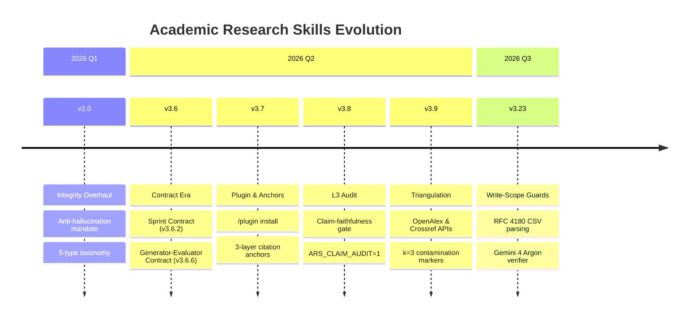
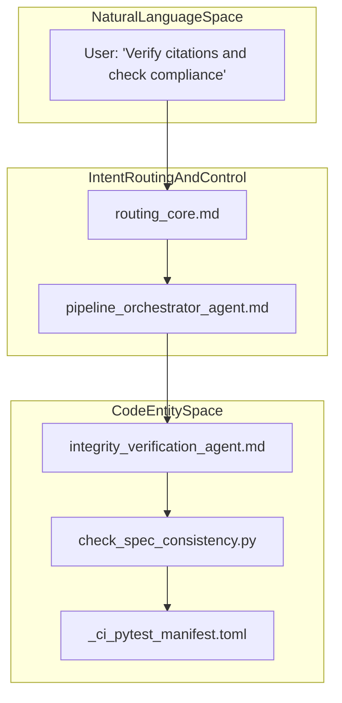
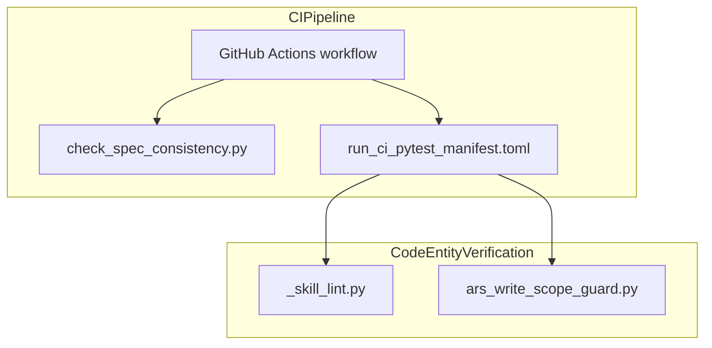

<!-- source: DeepWiki mcp.deepwiki.com · repo Imbad0202/academic-research-skills · page 12 Version History · fetched 2026-10-30 -->

# Version History

Relevant source files

The following files were used as context for generating this wiki page:

- [.claude/CHANGELOG.md](.claude/CHANGELOG.md)
- [.github/workflows/spec-consistency.yml](.github/workflows/spec-consistency.yml)
- [CHANGELOG.md](CHANGELOG.md)
- [academic-pipeline/agents/integrity_verification_agent.md](academic-pipeline/agents/integrity_verification_agent.md)
- [academic-pipeline/agents/pipeline_orchestrator_agent.md](academic-pipeline/agents/pipeline_orchestrator_agent.md)
- [academic-pipeline/references/ai_research_failure_modes.md](academic-pipeline/references/ai_research_failure_modes.md)
- [academic-pipeline/references/passport_as_reset_boundary.md](academic-pipeline/references/passport_as_reset_boundary.md)
- [academic-pipeline/references/pipeline_state_machine.md](academic-pipeline/references/pipeline_state_machine.md)
- [academic-pipeline/references/process_summary_protocol.md](academic-pipeline/references/process_summary_protocol.md)
- [deep-research/references/socratic_questioning_framework.md](deep-research/references/socratic_questioning_framework.md)
- [scripts/_ci_pytest_manifest.toml](scripts/_ci_pytest_manifest.toml)
- [scripts/check_pipeline_boundary_semantics.py](scripts/check_pipeline_boundary_semantics.py)
- [scripts/test_check_pipeline_boundary_semantics.py](scripts/test_check_pipeline_boundary_semantics.py)
- [scripts/test_v3_6_7_phase_6_6.py](scripts/test_v3_6_7_phase_6_6.py)
- [shared/contracts/README.md](shared/contracts/README.md)
- [shared/handoff_schemas.md](shared/handoff_schemas.md)

## Purpose and Scope

This page outlines the evolutionary trajectory of the Academic Research Skills (ARS) system, tracing architectural milestones, validation gates, and integrity escalations from the foundational v2.0 anti-hallucination overhaul up to the current release (v3.23.1). As a PARENT wiki page, this document provides a high-level overview of version families; detailed technical specifications, migration steps, and edge-case behaviors are delegated to the dedicated child pages.

Sources: [CHANGELOG.md:1-35](), [scripts/check_pipeline_boundary_semantics.py:72-78]()

---

## Architectural Evolution Timeline

The system has progressed from simple bibliographic assistance to a rigorously guarded, deterministic multi-agent research pipeline.

Sources: [CHANGELOG.md:1-34](), [.github/workflows/spec-consistency.yml:46-78]()

---

## Natural Language Space to Code Entity Space

To illustrate how user intents bridge to underlying agent and validation structures across releases, the following diagram maps natural language triggers to specific code entities in the repository:

Sources: [academic-pipeline/agents/pipeline_orchestrator_agent.md:18-45](), [scripts/_ci_pytest_manifest.toml:27-68]()

---

## Version Families Overview

### 12.1 v3.9.x and Later Updates

Recent versions (v3.9.x through v3.23.1) focus on cross-index triangulation, contamination backfill, phase boundary enforcement, write-scope security guards, and expanding cross-model support (such as Gemini 4 Argon). Write-scope protections ensure that sub-agents in Bucket A are properly checked by `scripts/ars_write_scope_guard.py`.

For details, see [v3.9.x and Later Updates](#12.1).

Sources: [CHANGELOG.md:15-34](), [scripts/_ci_pytest_manifest.toml:56-65]()

### 12.2 v3.8.x Updates

The v3.8.x series introduced the Claim-Faithfulness Audit Gate (`ARS_CLAIM_AUDIT=1`), the Claim Intent Manifest, and the L3 audit layer. These components evaluate whether manuscript claims are faithfully supported by cited source text, bridging semantic extraction with formal validation rules.

For details, see [v3.8.x Updates](#12.2).

Sources: [scripts/test_v3_6_7_phase_6_6.py:72-85](), [scripts/_ci_pytest_manifest.toml:70-80]()

### 12.3 v3.7.x Updates

Version 3.7.x brought three-layer citation emission, reading-check probes, trust provenance hardening, contamination signals, and standardized plugin packaging (`.claude-plugin/plugin.json`). These mechanisms ensure citation keys link reliably back to verified source inventories.

For details, see [v3.7.x Updates](#12.3).

Sources: [scripts/_ci_pytest_manifest.toml:36-55]()

### 12.4 v3.6.x Updates

The v3.6.x release established the Sprint Contract, literature corpus adapters, consumer integration protocols, the Generator-Evaluator Contract, orchestrator hooks, and the cite-provenance pipeline. This established formal boundaries between research generation and evaluation steps.

For details, see [v3.6.x Updates](#12.4).

Sources: [scripts/check_pipeline_boundary_semantics.py:72-78]()

### 12.5 v2.0 Integrity Overhaul

The v2.0 integrity overhaul instituted the core anti-hallucination mandate, requiring 100% web-search verification for references and introducing the 5-type hallucination taxonomy. This revision fundamentally reshaped the verification duties of `integrity_verification_agent`.

For details, see [v2.0 Integrity Overhaul](#12.5).

Sources: [academic-pipeline/agents/integrity_verification_agent.md:1-25](), [.claude/CHANGELOG.md:1-60]()

---

## Version Comparison Matrix

| Version Family | Core Focus | Primary Code Entities | Status |
| :--- | :--- | :--- | :--- |
| **v3.23.x** | Write-scope guards, RFC 4180 CSV, Gemini 4 Argon | `scripts/ars_write_scope_guard.py`, `srlib.py` | **Current** |
| **v3.9.x** | Cross-index triangulation | `scripts/test_check_v3_9_0_triangulation.py` | Stable |
| **v3.8.x** | L3 Claim-Faithfulness Audit | `pipeline_orchestrator_agent.md` | Stable |
| **v3.7.x** | Three-layer citation & plugins | `scripts/test_check_v3_7_3_three_layer_citation.py` | Stable |
| **v3.6.x** | Sprint & Generator-Evaluator Contracts | `scripts/check_pipeline_boundary_semantics.py` | Stable |
| **v2.0.0** | Anti-hallucination mandate | `integrity_verification_agent.md` | Legacy |

Sources: [CHANGELOG.md:1-35](), [scripts/check_pipeline_boundary_semantics.py:72-78]()

---

## CI and Validation Safeguards

System integrity across versions is continuously enforced by automated test runners and spec consistency checks. The CI pipeline executes manifest-driven pytest suites and prompt-lint scripts to prevent regressions.

Sources: [.github/workflows/spec-consistency.yml:46-78](), [scripts/_ci_pytest_manifest.toml:1-30]()

---

