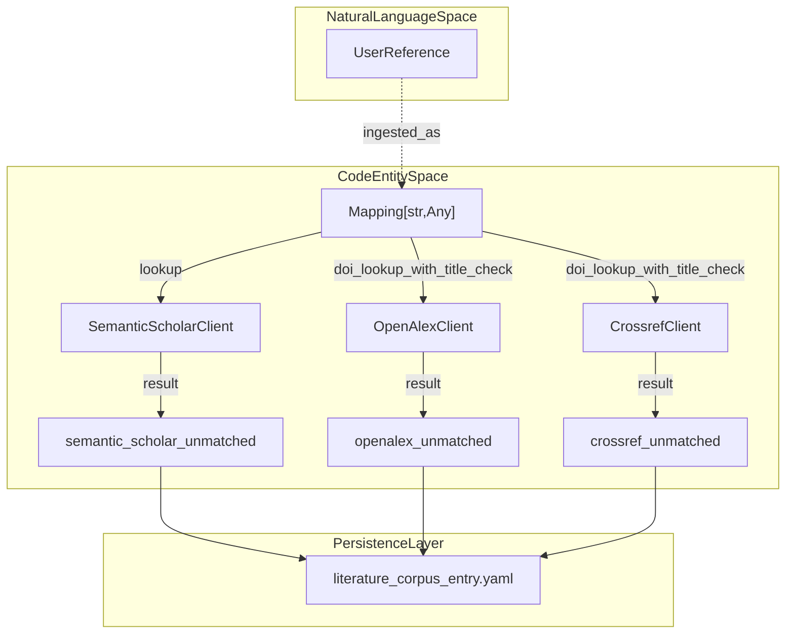
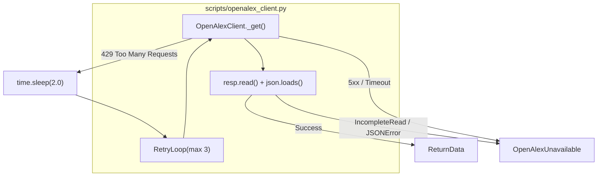
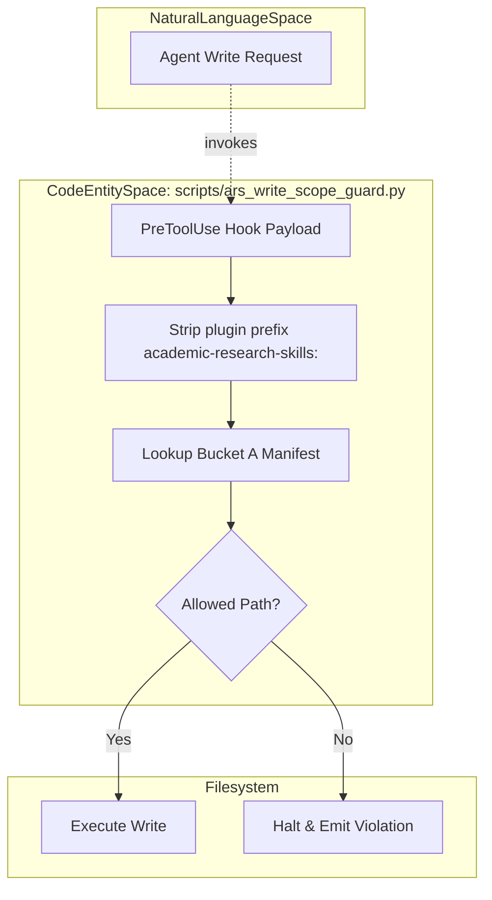

<!-- source: DeepWiki mcp.deepwiki.com · repo Imbad0202/academic-research-skills · page 12.1 v3.9.x and Later Updates · fetched 2026-10-30 -->

# v3.9.x and Later Updates

Relevant source files

The following files were used as context for generating this wiki page:

- [.github/workflows/spec-consistency.yml](.github/workflows/spec-consistency.yml)
- [CHANGELOG.md](CHANGELOG.md)
- [academic-pipeline/agents/integrity_verification_agent.md](academic-pipeline/agents/integrity_verification_agent.md)
- [academic-pipeline/agents/pipeline_orchestrator_agent.md](academic-pipeline/agents/pipeline_orchestrator_agent.md)
- [academic-pipeline/references/ai_research_failure_modes.md](academic-pipeline/references/ai_research_failure_modes.md)
- [academic-pipeline/references/passport_as_reset_boundary.md](academic-pipeline/references/passport_as_reset_boundary.md)
- [academic-pipeline/references/pipeline_state_machine.md](academic-pipeline/references/pipeline_state_machine.md)
- [academic-pipeline/references/process_summary_protocol.md](academic-pipeline/references/process_summary_protocol.md)
- [docs/design/2026-05-21-v3.10-182-promote-citation-gate-spec.md](docs/design/2026-05-21-v3.10-182-promote-citation-gate-spec.md)
- [docs/design/2026-05-21-v3.10-183-epistemic-status-spec.md](docs/design/2026-05-21-v3.10-183-epistemic-status-spec.md)
- [docs/design/2026-05-21-v3.10-184-extend-eval-harness-spec.md](docs/design/2026-05-21-v3.10-184-extend-eval-harness-spec.md)
- [evals/gold/citation_extraction/tuples/001-valid-doi-numpy-2020.json](evals/gold/citation_extraction/tuples/001-valid-doi-numpy-2020.json)
- [evals/gold/citation_extraction/tuples/002-valid-doi-alphafold-2021.json](evals/gold/citation_extraction/tuples/002-valid-doi-alphafold-2021.json)
- [evals/gold/citation_extraction/tuples/003-valid-doi-med-palm-2023.json](evals/gold/citation_extraction/tuples/003-valid-doi-med-palm-2023.json)
- [evals/gold/citation_extraction/tuples/004-valid-doi-scipy-2020.json](evals/gold/citation_extraction/tuples/004-valid-doi-scipy-2020.json)
- [scripts/_ci_pytest_manifest.toml](scripts/_ci_pytest_manifest.toml)
- [scripts/check_pipeline_boundary_semantics.py](scripts/check_pipeline_boundary_semantics.py)
- [scripts/check_v3_9_2_phase_boundary.py](scripts/check_v3_9_2_phase_boundary.py)
- [scripts/test_check_pipeline_boundary_semantics.py](scripts/test_check_pipeline_boundary_semantics.py)
- [scripts/test_check_v3_9_2_phase_boundary.py](scripts/test_check_v3_9_2_phase_boundary.py)
- [scripts/test_v3_6_7_phase_6_6.py](scripts/test_v3_6_7_phase_6_6.py)
- [shared/contracts/README.md](shared/contracts/README.md)
- [shared/handoff_schemas.md](shared/handoff_schemas.md)

## Purpose and Scope

This page documents the evolution of the Academic Research Skills (ARS) system from version 3.9.x through the current v3.23.x release. It details key architectural updates including cross-index bibliographic triangulation, signal backfill migrations, runtime write-scope enforcement, phase boundary semantics enforcement, and recent model currency updates (such as Gemini 4 Argon integration and RFC 4180 CSV parsing in `sr-screener`).

---

## Cross-Index Triangulation (v3.9.0)

To combat LLM-generated "ghost citations" and data contamination, the verification engine integrates three independent bibliographic APIs to verify reference existence and metadata. A "not found" signal is emitted only if all three indices fail.

### Implementation Logic
Triangulation is implemented in `scripts/contamination_signals.py` using strict DOI-first protocols with title cross-checks.

| Function | API Source | Protocol |
| :--- | :--- | :--- |
| `resolve_semantic_scholar_unmatched` | Semantic Scholar | DOI lookup -> Title Similarity fallback [scripts/contamination_signals.py:125-147]() |
| `resolve_openalex_unmatched` | OpenAlex | DOI lookup (w/ title check) -> Title Search [scripts/contamination_signals.py:149-179]() |
| `resolve_crossref_unmatched` | Crossref | DOI lookup (w/ title check) -> Title Search [scripts/contamination_signals.py:181-193]() |

### Data Flow: Triangulation Audit

**Triangulation Verification Flow**

Sources: [scripts/contamination_signals.py:149-193](), [scripts/openalex_client.py:126-159](), [scripts/crossref_client.py:155-190]()

---

## Client Hardening and Response Recovery (v3.9.1)

v3.9.1 introduced hardening for API clients to handle transient network faults and malformed payloads without crashing pipeline executions.

### Key Hardening Measures:
1. **Exception Wrapping**: `urllib.request.urlopen` execution blocks catch `http.client.IncompleteRead` and `json.JSONDecodeError` [scripts/openalex_client.py:93-108]().
2. **Degradation vs. Miss**: Unreachable APIs or 5xx errors raise explicit unavailable exceptions (e.g., `OpenAlexUnavailable`), triggering the **OMIT** rule where the signal is omitted rather than marked false [scripts/openalex_client.py:48-49](), [scripts/crossref_client.py:75-76]().
3. **Rate Limit Management**: Clients refresh rate-limit anchors following 429 backoff sleeps [scripts/openalex_client.py:112-118]().

**Client Error Handling Architecture**

Sources: [scripts/openalex_client.py:83-124](), [scripts/crossref_client.py:113-153]()

---

## v3.9.x Migration and Signal Backfill

The system provides migration scripts to apply triangulation signals to legacy Material Passports.

* **Backfill Migration**: `scripts/migrate_literature_corpus_to_v3_9_0.py` updates existing passports with `openalex_unmatched` and `crossref_unmatched` signals [scripts/migrate_literature_corpus_to_v3_9_0.py:1-40]().
* **Idempotency**: Partial-fill recovery detects existing keys and only populates missing attributes [scripts/migrate_literature_corpus_to_v3_7_3.py:145-162]().

Sources: [scripts/contamination_signals.py:98-122](), [scripts/migrate_literature_corpus_to_v3_7_3.py:132-175]()

---

## Write-Scope Rescoping and Guard Enforcement (v3.10 - v3.23)

Recent updates reinforced the file write boundaries across runtime environments. 

### Write-Scope Guard Repair (#972)
Claude Code identifies plugin-shipped agents using the format `academic-research-skills:<agent>`. The scope manifest expected bare names, causing the fence to bypass plugin-dispatched Bucket A agents. The write-scope guard (`scripts/ars_write_scope_guard.py`) now strips the local plugin prefix prior to manifest lookups [CHANGELOG.md:33-34](). Additionally, `hooks/run_guard.sh` was hardened against Windows built-in `timeout.exe` syntax discrepancies [CHANGELOG.md:33-34]().

**Write-Scope Enforcement Flow**

Sources: [CHANGELOG.md:15-34](), [scripts/ars_write_scope_guard.py:1-60]()

---

## Phase Boundary Semantics & Pipeline State Machine Fixes (#528, #990)

The pipeline state machine and orchestrator logic enforce strict separation between stages, particularly around Stage 5 finalization and Stage 6 process summarization.

* **Missing Required Inputs (#990)**: The missing materials section in `academic-pipeline/references/pipeline_state_machine.md` now strictly blocks transitions on missing required inputs (`HANDOFF_INCOMPLETE`), whereas recommended inputs permit continuation with a logged warning [CHANGELOG.md:11]().
* **Phase Boundary Lints**: `scripts/check_pipeline_boundary_semantics.py` verifies invariant properties across prompt surfaces, checking whole-file content hashes and method definitions [scripts/check_pipeline_boundary_semantics.py:50-78]().

Sources: [CHANGELOG.md:9-14](), [scripts/check_pipeline_boundary_semantics.py:1-124](), [academic-pipeline/references/pipeline_state_machine.md:1-25]()

---

## Later v3.10+ / v3.23.x Enhancements

1. **RFC 4180 CSV Reading in `sr-screener` (#979)**: `srlib.parse_csv` was refactored to parse CSV exports strictly via RFC 4180 rules rather than sampling heuristics, ensuring robust handling of quoted fields and escaped delimiters across large review sets [CHANGELOG.md:31]().
2. **Gemini 4 Argon Integration (#980)**: `gemini-4-argon` is added as a provisional Google verifier and the recommended Google ID in `shared/cross_model_verification.md`, supporting search grounding while leaving provider-default reasoning parameters intact [CHANGELOG.md:21]().

Sources: [CHANGELOG.md:15-34](), [shared/cross_model_verification.md:1-50]()

---

