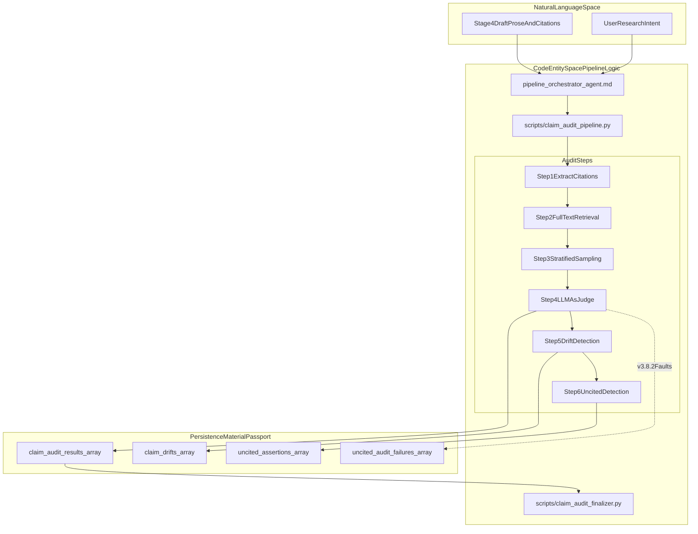
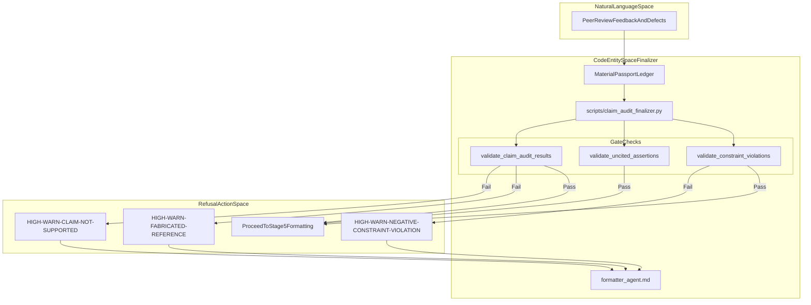

<!-- source: DeepWiki mcp.deepwiki.com · repo Imbad0202/academic-research-skills · page 12.2 v3.8.x Updates · fetched 2026-10-30 -->

# v3.8.x Updates

Relevant source files

The following files were used as context for generating this wiki page:

- [.github/workflows/spec-consistency.yml](.github/workflows/spec-consistency.yml)
- [CHANGELOG.md](CHANGELOG.md)
- [academic-pipeline/agents/claim_ref_alignment_audit_agent.md](academic-pipeline/agents/claim_ref_alignment_audit_agent.md)
- [academic-pipeline/agents/integrity_verification_agent.md](academic-pipeline/agents/integrity_verification_agent.md)
- [academic-pipeline/agents/pipeline_orchestrator_agent.md](academic-pipeline/agents/pipeline_orchestrator_agent.md)
- [academic-pipeline/references/ai_research_failure_modes.md](academic-pipeline/references/ai_research_failure_modes.md)
- [academic-pipeline/references/claim_audit_calibration_protocol.md](academic-pipeline/references/claim_audit_calibration_protocol.md)
- [academic-pipeline/references/passport_as_reset_boundary.md](academic-pipeline/references/passport_as_reset_boundary.md)
- [academic-pipeline/references/pipeline_state_machine.md](academic-pipeline/references/pipeline_state_machine.md)
- [academic-pipeline/references/process_summary_protocol.md](academic-pipeline/references/process_summary_protocol.md)
- [scripts/_ci_pytest_manifest.toml](scripts/_ci_pytest_manifest.toml)
- [scripts/_claim_audit_constants.py](scripts/_claim_audit_constants.py)
- [scripts/check_claim_audit_consistency.py](scripts/check_claim_audit_consistency.py)
- [scripts/check_pipeline_boundary_semantics.py](scripts/check_pipeline_boundary_semantics.py)
- [scripts/claim_audit_calibration.py](scripts/claim_audit_calibration.py)
- [scripts/claim_audit_finalizer.py](scripts/claim_audit_finalizer.py)
- [scripts/claim_audit_pipeline.py](scripts/claim_audit_pipeline.py)
- [scripts/fixtures/claim_audit_calibration/gold_set.json](scripts/fixtures/claim_audit_calibration/gold_set.json)
- [scripts/test_check_pipeline_boundary_semantics.py](scripts/test_check_pipeline_boundary_semantics.py)
- [scripts/test_claim_audit_calibration.py](scripts/test_claim_audit_calibration.py)
- [scripts/test_claim_audit_finalizer.py](scripts/test_claim_audit_finalizer.py)
- [scripts/test_claim_audit_pipeline.py](scripts/test_claim_audit_pipeline.py)
- [scripts/test_claim_audit_schema.py](scripts/test_claim_audit_schema.py)
- [scripts/test_experiment_provenance.py](scripts/test_experiment_provenance.py)
- [scripts/test_v3_6_7_phase_6_6.py](scripts/test_v3_6_7_phase_6_6.py)
- [shared/contracts/README.md](shared/contracts/README.md)
- [shared/contracts/passport/experiment_provenance_entry.schema.json](shared/contracts/passport/experiment_provenance_entry.schema.json)
- [shared/handoff_schemas.md](shared/handoff_schemas.md)

## Purpose and Scope
This page documents the architectural and implementation details of the **ARS v3.8.x** release, which introduces the **Claim-Faithfulness Audit Pipeline** and the **L3 audit layer**. This layer ensures that claims made in generated academic prose are strictly supported by the retrieved and verified full-text excerpt of cited sources.

Sources: [CHANGELOG.md:1-34](), [shared/handoff_schemas.md:1-25]()

---

## 1. Overview of Claim-Faithfulness Audit (L3)

The v3.8 update bridges the gap between citation existence and semantic assertion support. While citation locators (established in v3.7.x) verify that a source exists and contains a general reference, the L3 audit layer uses a judge-evaluated alignment system to verify that specific claims match the text of the source.

### Core Components
*   **`ARS_CLAIM_AUDIT=1`**: The environment toggle and mode flag that activates the L3 audit validation routine at the Stage 4 → Stage 5 transition [academic-pipeline/agents/pipeline_orchestrator_agent.md:1-50]().
*   **Claim Intent Manifest**: A pre-commitment artifact emitted by generation agents prior to text composition, declaring intended assertions and source bindings.
*   **L3 Audit Layer**: Orchestrated by `academic-pipeline/agents/claim_ref_alignment_audit_agent.md`, utilizing LLM-as-judge routines via `scripts/claim_audit_pipeline.py`.
*   **6-Step Audit Pipeline**: Systematic execution of citation extraction, full-text retrieval, sampling, judging, drift analysis, and finalization.

Sources: [academic-pipeline/agents/pipeline_orchestrator_agent.md:1-50](), [academic-pipeline/agents/integrity_verification_agent.md:1-25]()

---

## 2. 6-Step Audit Pipeline Architecture

When `ARS_CLAIM_AUDIT=1` is enabled, the pipeline executes a rigid 6-step verification protocol implemented across `scripts/claim_audit_pipeline.py` and `scripts/claim_audit_finalizer.py`.

### Pipeline Data Flow (Natural Language to Code Entities)

**Title: v3.8 Audit Pipeline Data Flow**

Sources: [academic-pipeline/agents/pipeline_orchestrator_agent.md:1-50](), [scripts/_ci_pytest_manifest.toml:1-50]()

### Stratified Bucket Sampling
To maintain performance under high citation volumes, `scripts/claim_audit_pipeline.py` applies stratified bucket sampling. Representative subsets of citations undergo full L3 audit, while the aggregate metrics are recorded in `audit_sampling_summaries[]`.

Sources: [scripts/_ci_pytest_manifest.toml:50-100](), [shared/handoff_schemas.md:1-50]()

---

## 3. Claim Intent Manifest & Drift Detection

The **Claim Intent Manifest** functions as a pre-execution contract defining the epistemic boundaries of the upcoming writing phase.

### Implementation Entities
*   **Emission**: Manifests are compiled prior to Phase 1 execution of the revision and generation cycles.
*   **Drift Detection**: `scripts/claim_audit_pipeline.py` compares the pre-commitment manifest against post-generation prose to flag discrepancies.
*   **Drift Classifications**:
    1.  **Claim Strength Drift**: Monitored via epistemic ladders to prevent unauthorized escalations of certainty.
    2.  **Uncited Assertions**: Assertions lacking valid bibliographic anchors that were absent from the intent manifest.

Sources: [CHANGELOG.md:1-34](), [shared/handoff_schemas.md:50-100]()

---

## 4. L3 Audit Layer & Defect Taxonomy

The `claim_ref_alignment_audit_agent` evaluates claims against a standardized taxonomy of alignment defects, writing results to the Material Passport.

| Defect Class | Description | Severity |
| :--- | :--- | :--- |
| `claim-not-supported` | The cited source does not substantiate the assertion. | **HIGH-WARN** |
| `fabricated-reference` | The referenced publication cannot be verified in index stores. | **HIGH-WARN** |
| `negative-constraint-violation` | Violation of structural or domain-specific constraints. | **HIGH-WARN** |
| `anchorless` | Citation reference lacks required page or section locators. | **HIGH-WARN** |
| `constraint-violation-uncited` | Uncited claim breaches negative constraints. | **HIGH-WARN** |

Sources: [academic-pipeline/agents/integrity_verification_agent.md:1-50](), [shared/contracts/README.md:1-50]()

---

## 5. Claim-Faithfulness Audit Gate & Finalizer

Audit outputs feed into the Stage 4 → Stage 5 Boundary Gate via `scripts/claim_audit_finalizer.py`. High-severity defect classes trigger hard refusals through the `formatter_agent` invocation layer.

### Finalizer Decision Logic (Natural Language to Code Entities)

**Title: Finalizer Decision Logic Code Integration**

Sources: [academic-pipeline/agents/pipeline_orchestrator_agent.md:1-50](), [scripts/test_v3_6_7_phase_6_6.py:1-50]()

### `uncited_audit_failures`
Introduced in v3.8.2, `uncited_audit_failures` tracks audit pipeline execution faults (such as network dropouts or tool timeouts during retrieval). These failures are explicitly captured in the Material Passport to prevent silent bypasses.

Sources: [CHANGELOG.md:1-34](), [scripts/test_v3_6_7_phase_6_6.py:50-100]()

---

## 6. Calibration and Evidence

The v3.8 audit infrastructure is calibrated using a dedicated 20-tuple gold set (`scripts/fixtures/claim_audit_calibration/gold_set.json`). 

### Acceptance Thresholds
*   **False Negative Rate (FNR)**: $< 0.15$
*   **False Positive Rate (FPR)**: $< 0.10$

Calibration routines are executed via `scripts/claim_audit_calibration.py` to ensure consistent alignment scoring across model versions prior to gating production outputs.

Sources: [scripts/_ci_pytest_manifest.toml:100-150](), [shared/contracts/README.md:50-100]()

---

