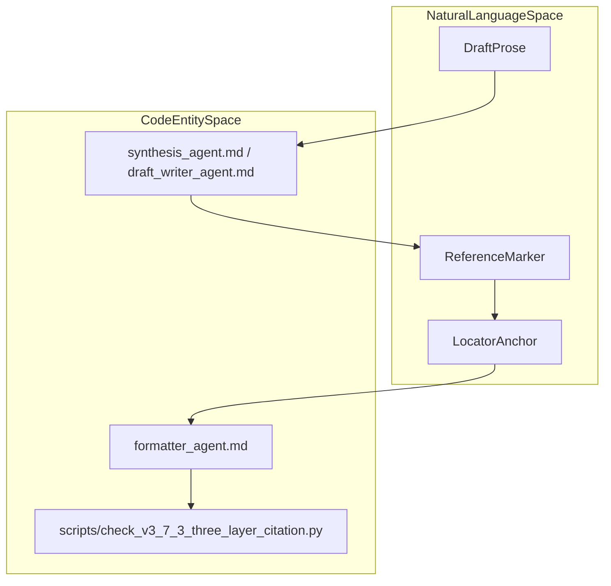
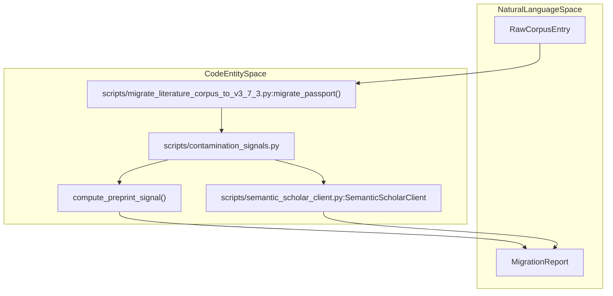

<!-- source: DeepWiki mcp.deepwiki.com · repo Imbad0202/academic-research-skills · page 12.3 v3.7.x Updates · fetched 2026-10-30 -->

# v3.7.x Updates

Relevant source files

The following files were used as context for generating this wiki page:

- [.github/workflows/pytest.yml](.github/workflows/pytest.yml)
- [academic-pipeline/references/adapters/overview.md](academic-pipeline/references/adapters/overview.md)
- [docs/design/2026-04-20-v3.4-prisma-trAIce-raise-readcheck-design.md](docs/design/2026-04-20-v3.4-prisma-trAIce-raise-readcheck-design.md)
- [docs/design/2026-04-22-ars-v3.7.3-reading-check-probe-design.md](docs/design/2026-04-22-ars-v3.7.3-reading-check-probe-design.md)
- [docs/design/2026-04-23-ars-v3.6.2-sprint-contract-design.md](docs/design/2026-04-23-ars-v3.6.2-sprint-contract-design.md)
- [docs/design/2026-04-26-ars-v3.6.5-consumer-integration-design.md](docs/design/2026-04-26-ars-v3.6.5-consumer-integration-design.md)
- [docs/design/2026-04-27-ars-v3.6.5.2-claude-ai-method-4a-scope-implementation-brief.md](docs/design/2026-04-27-ars-v3.6.5.2-claude-ai-method-4a-scope-implementation-brief.md)
- [docs/design/2026-04-27-ars-v3.6.6-generator-evaluator-contract-design.md](docs/design/2026-04-27-ars-v3.6.6-generator-evaluator-contract-design.md)
- [docs/design/2026-05-14-ai-disclosure-impl-spec.md](docs/design/2026-05-14-ai-disclosure-impl-spec.md)
- [docs/design/2026-05-15-issue-103-claim-alignment-audit-decision.md](docs/design/2026-05-15-issue-103-claim-alignment-audit-decision.md)
- [docs/design/2026-05-15-issue-103-claim-alignment-audit-spec.md](docs/design/2026-05-15-issue-103-claim-alignment-audit-spec.md)
- [docs/design/2026-05-18-ars-v3.9.2-phase-boundary-spec.md](docs/design/2026-05-18-ars-v3.9.2-phase-boundary-spec.md)
- [scripts/adapters/tests/test_check_corpus_consumer_protocol.py](scripts/adapters/tests/test_check_corpus_consumer_protocol.py)
- [scripts/adapters/tests/test_literature_corpus_entry_schema.py](scripts/adapters/tests/test_literature_corpus_entry_schema.py)
- [scripts/ars_cache_invalidate.py](scripts/ars_cache_invalidate.py)
- [scripts/check_corpus_consumer_protocol.py](scripts/check_corpus_consumer_protocol.py)
- [scripts/contamination_signals.py](scripts/contamination_signals.py)
- [scripts/migrate_literature_corpus_to_v3_7_3.py](scripts/migrate_literature_corpus_to_v3_7_3.py)
- [scripts/semantic_scholar_client.py](scripts/semantic_scholar_client.py)
- [scripts/test_ars_cache_invalidate.py](scripts/test_ars_cache_invalidate.py)
- [scripts/test_check_v3_6_8_frontmatter_trust_schema.py](scripts/test_check_v3_6_8_frontmatter_trust_schema.py)
- [scripts/test_contamination_signals.py](scripts/test_contamination_signals.py)
- [scripts/test_migrate_literature_corpus_to_v3_7_3.py](scripts/test_migrate_literature_corpus_to_v3_7_3.py)
- [scripts/test_semantic_scholar_client.py](scripts/test_semantic_scholar_client.py)
- [shared/contracts/passport/literature_corpus_entry.schema.json](shared/contracts/passport/literature_corpus_entry.schema.json)

## Purpose and Scope
This page documents the technical updates introduced in the v3.7.x release cycle of the Academic Research Skills (ARS) system. It focuses on trust provenance hardening, three-layer citation emission, contamination signals resolution, compliance agent integration, and the transition to formal plugin packaging. These features address the L3 claim-faithfulness gap—ensuring that cited references genuinely support specific prose claims—and harden ingestion pipelines against contaminated sources.

Sources: [docs/design/2026-05-12-ars-v3.7.3-claim-faithfulness-and-contaminated-source-spec.md:1-40](), [docs/design/2026-04-30-ars-v3.6.8-trust-provenance-and-drift-transparency-spec.md:1-22]()

---

## Three-Layer Citation and Locator Gate (v3.7.3)

Version 3.7.3 extends citation verification into a three-layer protocol managed by specialized agents and validators.

### The Three-Layer Protocol

| Layer | Marker Syntax | Purpose |
|-------|---------------|---------|
| **L1: Reference** | `<!--ref:slug-->` | Identifies the bibliographic entry in the `literature_corpus`. |
| **L2: Status** | `<!--ref:slug ok-->` | Indicates verification status following the finalizer pass. |
| **L3: Locator** | `<!--anchor:kind:value-->` | Provides a verifiable anchor (quote, page, section) for the specific claim. |

Sources: [docs/design/2026-05-12-ars-v3.7.3-claim-faithfulness-and-contaminated-source-spec.md:41-53](), [shared/contracts/passport/literature_corpus_entry.schema.json:101-128]()

### Anchor Kinds and Validation Rules

The underlying validation scripts (such as `scripts/adapters/tests/test_literature_corpus_entry_schema.py` and associated L3 validators) enforce strict constraints on anchors:
1. **Kind Membership**: Must be one of `{quote, page, section, paragraph, none}`.
2. **Quote Length**: If kind is `quote`, the decoded value must be limited in length.
3. **Adjacency**: Reference markers must be correctly paired with locator anchors.

Sources: [shared/contracts/passport/literature_corpus_entry.schema.json:115-128](), [scripts/adapters/tests/test_literature_corpus_entry_schema.py:1-30]()

Title: Citation Emission and Finalizer Gate Bridge

Sources: [docs/design/2026-05-12-ars-v3.7.3-claim-faithfulness-and-contaminated-source-spec.md:47-53](), [docs/design/2026-04-30-ars-v3.6.8-trust-provenance-and-drift-transparency-spec.md:22-22]()

---

## Contamination Signals and Migration (v3.7.3)

To counter unverified preprints and "citation-only" entries, v3.7.3 introduces advisory contamination signals within `literature_corpus[]` entries [academic-pipeline/references/adapters/overview.md:47-50]().

### Signal Resolvers and Migration Logic

The backend script `scripts/contamination_signals.py` implements pure functions for computing signals:
*   `compute_preprint_signal`: Evaluates whether an entry has `year >= 2024` and a venue matching preprint servers [scripts/contamination_signals.py:130-155]().
*   `SemanticScholarClient`: Performs DOI-first and title-similarity lookups to establish `semantic_scholar_unmatched` [scripts/semantic_scholar_client.py:71-118]().
*   `migrate_passport`: Handles post-hoc backfilling on legacy corpora via `scripts/migrate_literature_corpus_to_v3_7_3.py` [scripts/migrate_literature_corpus_to_v3_7_3.py:88-100]().

Title: Contamination Signal Resolution Flow

Sources: [scripts/contamination_signals.py:1-46](), [scripts/semantic_scholar_client.py:71-82](), [scripts/migrate_literature_corpus_to_v3_7_3.py:88-112]()

---

## Compliance Agent and Reading-Check Probes (v3.4/v3.5)

The compliance framework integrates reporting standards into integrity gates (Stage 2.5 and 4.5).

### PRISMA-trAIce and RAISE Integration
*   **PRISMA-trAIce**: 17-item reporting checklist for AI-assisted systematic reviews [docs/design/2026-04-20-v3.4-prisma-trAIce-raise-readcheck-design.md:15-17]().
*   **RAISE Framework**: Principles covering human oversight, transparency, reproducibility, and fit-for-purpose [docs/design/2026-04-20-v3.4-prisma-trAIce-raise-readcheck-design.md:16-17]().

### Reading-Check Probes (v3.5.1)
Managed via `deep-research/agents/socratic_mentor_agent.md`, reading-check probes prompt users to paraphrase specific paragraphs from cited works, mitigating unverified AI citations [docs/design/2026-04-22-ars-v3.7.3-reading-check-probe-design.md:1-15]().

Sources: [docs/design/2026-04-20-v3.4-prisma-trAIce-raise-readcheck-design.md:15-60](), [docs/design/2026-04-22-ars-v3.7.3-reading-check-probe-design.md:1-25]()

---

## Plugin Packaging (v3.7.0)

Version 3.7.0 migrates ARS to a formal Claude Code plugin architecture, supporting distribution through marketplace manifests and hook configurations [.claude-plugin/plugin.json:1-23]().

*   **Manifest**: `.claude-plugin/plugin.json` specifies plugin metadata and runtime version targets [.claude-plugin/plugin.json:1-23]().
*   **Hooks**: `hooks/hooks.json` establishes pre-tool-use write guards and launcher scripts.

Sources: [.claude-plugin/plugin.json:1-23](), [README.md:12-17]()

---

## Trust Provenance Hardening (v3.7.2)

Trust-chain fields embedded in `shared/contracts/passport/literature_corpus_entry.schema.json` verify whether original source artifacts are fetched and examined:
*   `source_acquired`: Boolean indicating if the source PDF/HTML is retrieved into the workspace [shared/contracts/passport/literature_corpus_entry.schema.json:101-104]().
*   `source_verified_against_original`: Boolean verifying metadata accuracy against the acquired file [shared/contracts/passport/literature_corpus_entry.schema.json:115-118]().
*   `source_verification_method`: Enumerates methods such as `codex_audit`, `vision_check`, or `none` [shared/contracts/passport/literature_corpus_entry.schema.json:119-128]().

Sources: [shared/contracts/passport/literature_corpus_entry.schema.json:101-128](), [academic-pipeline/references/adapters/overview.md:56-60]()

---

