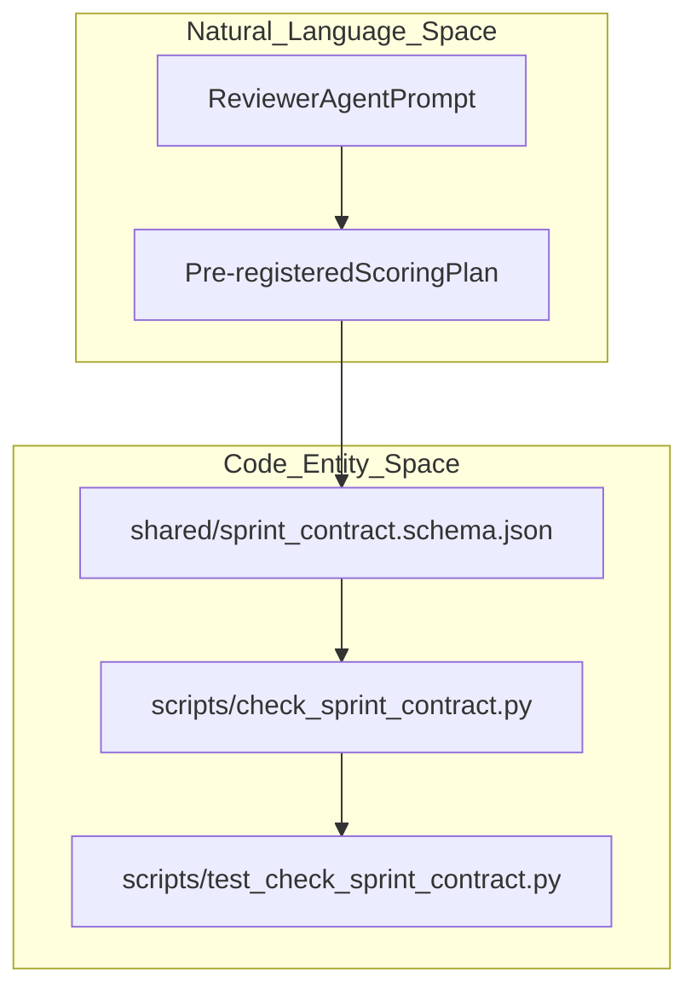
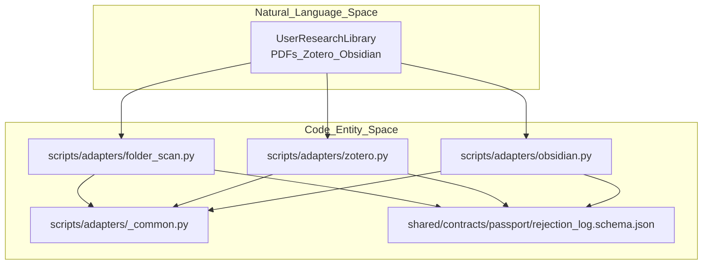
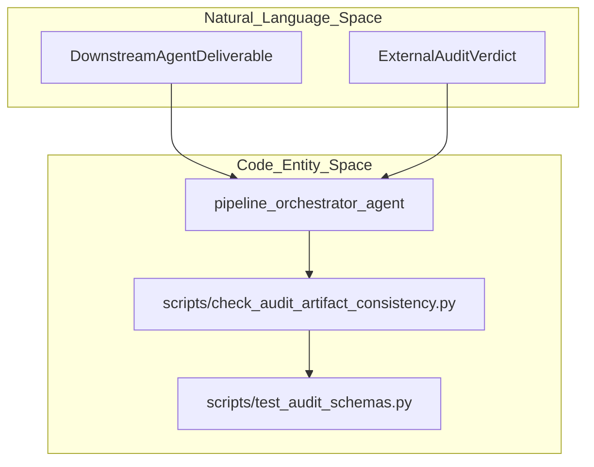

<!-- source: DeepWiki mcp.deepwiki.com · repo Imbad0202/academic-research-skills · page 12.4 v3.6.x Updates · fetched 2026-10-30 -->

# v3.6.x Updates

Relevant source files

The following files were used as context for generating this wiki page:

- [docs/design/2026-04-23-ars-v3.6.4-literature-corpus-adapters-design.md](docs/design/2026-04-23-ars-v3.6.4-literature-corpus-adapters-design.md)
- [docs/design/2026-04-23-ars-v3.6.4-literature-corpus-adapters-plan.md](docs/design/2026-04-23-ars-v3.6.4-literature-corpus-adapters-plan.md)
- [docs/design/2026-04-30-ars-v3.6.7-step-6-orchestrator-hooks-spec.md](docs/design/2026-04-30-ars-v3.6.7-step-6-orchestrator-hooks-spec.md)
- [scripts/adapters/_common.py](scripts/adapters/_common.py)
- [scripts/adapters/tests/test_common.py](scripts/adapters/tests/test_common.py)
- [scripts/adapters/tests/test_rejection_log_schema.py](scripts/adapters/tests/test_rejection_log_schema.py)
- [scripts/check_sprint_contract.py](scripts/check_sprint_contract.py)
- [scripts/test_audit_schemas.py](scripts/test_audit_schemas.py)
- [scripts/test_check_audit_artifact_consistency.py](scripts/test_check_audit_artifact_consistency.py)
- [scripts/test_check_sprint_contract.py](scripts/test_check_sprint_contract.py)
- [shared/contracts/passport/rejection_log.schema.json](shared/contracts/passport/rejection_log.schema.json)
- [shared/contracts/reviewer/full.json](shared/contracts/reviewer/full.json)
- [shared/contracts/reviewer/methodology_focus.json](shared/contracts/reviewer/methodology_focus.json)
- [shared/sprint_contract.schema.json](shared/sprint_contract.schema.json)

## Purpose and Scope
This page documents the architectural refinements, inter-skill data contracts, and verification pipelines introduced across the `v3.6.x` release series of the Academic Research Skills (ARS) system. The scope covers the formalization of machine-checkable Sprint Contracts (`Schema 13`), literature corpus ingestion adapters and rejection logging (`Schema 9` / `Schema 9.1`), consumer integration protocols, the Generator-Evaluator drafting contract, orchestrator hooks with artifact-as-contract audit gates, and the cite-time provenance pipeline.

---

## 1. Sprint Contract (v3.6.2)

The Sprint Contract (`Schema 13`) establishes machine-checkable pre-registered acceptance criteria for pipeline stages, serving primarily as an evaluator anti-drift mechanism that prevents peer reviewers and editors from shifting their scoring standards after reviewing manuscript text [shared/sprint_contract.schema.json:1-15]().

### 1.1 Two-Phase Hard Gate Protocol
Reviewer execution is partitioned into a blind phase and a visible phase, managed via `scripts/check_sprint_contract.py` and defined in `shared/sprint_contract.schema.json`:
1.  **Phase 1 (Blind)**: Reviewers consume only the sprint contract and metadata (title, field, length) to pre-commit to a scoring plan and evaluation focus [shared/sprint_contract.schema.json:59-72]().
2.  **Phase 2 (Visible)**: Reviewers receive the full paper and execute evaluations against their pre-registered dimensions (`D1` through `D6`) [scripts/test_check_sprint_contract.py:160-171]().

### 1.2 Structural Validation and Code Entities
The schema validator enforces strict structural invariants, role allocations, and priority bindings [scripts/check_sprint_contract.py:44-130]().

**Diagram: Sprint Contract Validation Architecture Bridging Natural Language to Code Entities**

Sources: `shared/sprint_contract.schema.json:1-15`, `scripts/check_sprint_contract.py:44-130`, `scripts/test_check_sprint_contract.py:160-171`

---

## 2. Literature Corpus Adapters (v3.6.4)

v3.6.4 formalizes the input port for user-owned research libraries, enabling the ingestion of local PDF directories, Zotero CSL-JSON exports, and Obsidian markdown vaults into the Material Passport (`literature_corpus[]`) [docs/design/2026-04-23-ars-v3.6.4-literature-corpus-adapters-design.md:10-21]().

### 2.1 Adapter Architecture & Rejection Logging
Adapters normalize heterogeneous reference sources into standardized passport entries while emitting a machine-validated rejection log for unparseable or incomplete records [shared/contracts/passport/rejection_log.schema.json:1-15]().

**Diagram: Literature Corpus Ingestion and Adapter Architecture**

### 2.2 Key Functions and Components
*   `scripts/adapters/_common.py`: Provides shared helper functions including `make_citation_key()`, `ensure_unique_citekey()`, `parse_csl_name()`, and `path_to_file_uri()` for RFC 8089 compliant file URIs [scripts/adapters/_common.py:16-123]().
*   `rejection_log.schema.json`: Enforces a strict schema on discarded records, requiring a `detail` string when `reason` is set to `other` [shared/contracts/passport/rejection_log.schema.json:37-87]().
*   `test_common.py`: Verifies collision handling, sanitization rules, and YAML serialization stability [scripts/adapters/tests/test_common.py:22-174]().

Sources: `shared/contracts/passport/rejection_log.schema.json:1-87`, `scripts/adapters/_common.py:16-123`, `scripts/adapters/tests/test_common.py:22-174`, `docs/design/2026-04-23-ars-v3.6.4-literature-corpus-adapters-design.md:10-21`

---

## 3. Generator-Evaluator Contract (v3.6.6)

Introduced in v3.6.6, the Generator-Evaluator Contract structures manuscript generation within the `academic-paper` skill into discrete iterative phases to prevent hallucinated citations and argumentative drift.

### 3.1 Implementation and Phase Enforcement
The draft writer agent executes a structured multi-pass workflow governed by upstream configuration records and argument blueprints [shared/sprint_contract.schema.json:103-125](). It requires explicit self-evaluation against structural constraints prior to manuscript section finalization.

Sources: `shared/sprint_contract.schema.json:103-125`, `docs/design/2026-04-27-ars-v3.6.6-generator-evaluator-contract-design.md`()

---

## 4. Audit Artifact Gate (v3.6.7)

v3.6.7 establishes a runtime enforcement layer via an "artifact-as-contract" audit gate, preventing sub-agents from falsely claiming integrity audit completion [docs/design/2026-04-30-ars-v3.6.7-step-6-orchestrator-hooks-spec.md:25-30]().

### 4.1 Orchestrator Hooks and Audit Schemas
The `pipeline_orchestrator_agent` halts stage transitions if matching audit artifacts are absent or malformed [docs/design/2026-04-30-ars-v3.6.7-step-6-orchestrator-hooks-spec.md:25-30](). Validation covers Layer 2 JSONL event streams and Layer 3 metadata sidecars [scripts/test_audit_schemas.py:1-16]().

*Diagram: Audit Artifact Gate Verification Pipeline*

Sources: `docs/design/2026-04-30-ars-v3.6.7-step-6-orchestrator-hooks-spec.md:25-30`, `scripts/test_audit_schemas.py:1-16`, `scripts/test_check_audit_artifact_consistency.py:1-10`

---

## 5. Trust and Cite Provenance Pipeline (v3.6.8)

The v3.6.8 release implements the Cite-Time Provenance Finalizer to resolve and verify reference markers across manuscript drafts.

### 5.1 Provenance Resolution Logic
The finalizer integrates human-read logs (`_human_read_log.yaml`) with automated verification statuses, ensuring citations are flagged or promoted accordingly before final publication packaging [scripts/test_check_audit_artifact_consistency.py:70-120]().

Sources: `scripts/test_check_audit_artifact_consistency.py:70-120`

---

