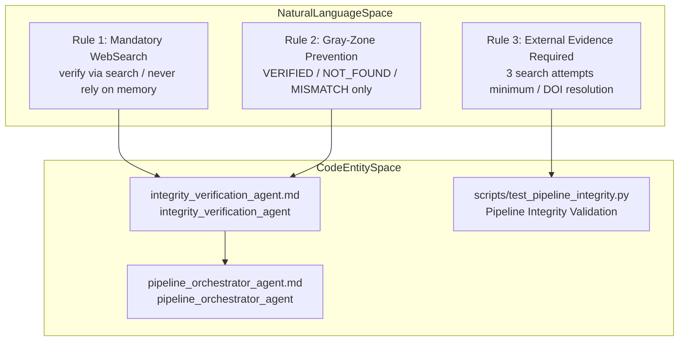
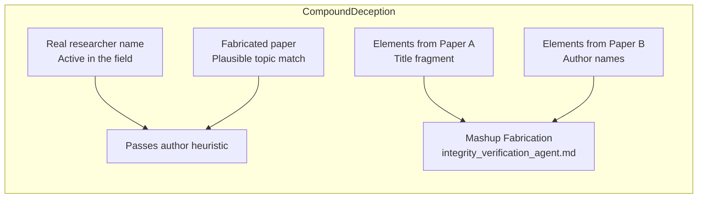
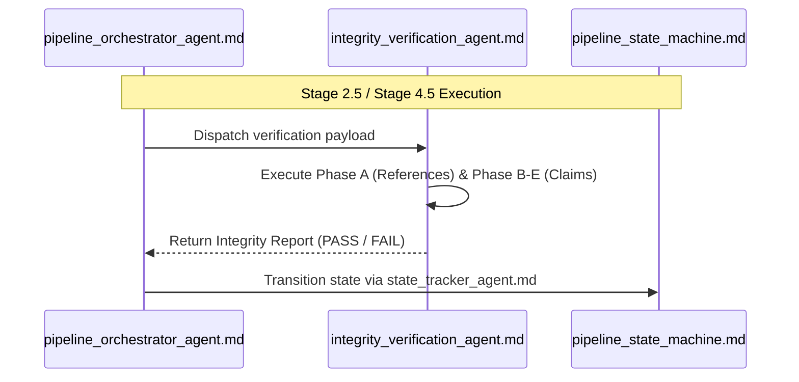

<!-- source: DeepWiki mcp.deepwiki.com · repo Imbad0202/academic-research-skills · page 12.5 v2.0 Integrity Overhaul · fetched 2026-10-30 -->

# v2.0 Integrity Overhaul

Relevant source files

The following files were used as context for generating this wiki page:

- [.github/workflows/spec-consistency.yml](.github/workflows/spec-consistency.yml)
- [CHANGELOG.md](CHANGELOG.md)
- [academic-pipeline/agents/integrity_verification_agent.md](academic-pipeline/agents/integrity_verification_agent.md)
- [academic-pipeline/agents/pipeline_orchestrator_agent.md](academic-pipeline/agents/pipeline_orchestrator_agent.md)
- [academic-pipeline/references/ai_research_failure_modes.md](academic-pipeline/references/ai_research_failure_modes.md)
- [academic-pipeline/references/passport_as_reset_boundary.md](academic-pipeline/references/passport_as_reset_boundary.md)
- [academic-pipeline/references/pipeline_state_machine.md](academic-pipeline/references/pipeline_state_machine.md)
- [academic-pipeline/references/process_summary_protocol.md](academic-pipeline/references/process_summary_protocol.md)
- [examples/showcase/README.md](examples/showcase/README.md)
- [examples/showcase/full_paper_apa7.pdf](examples/showcase/full_paper_apa7.pdf)
- [examples/showcase/full_paper_zh_apa7.pdf](examples/showcase/full_paper_zh_apa7.pdf)
- [examples/showcase/integrity_report_stage2.5.pdf](examples/showcase/integrity_report_stage2.5.pdf)
- [examples/showcase/integrity_report_stage4.5.pdf](examples/showcase/integrity_report_stage4.5.pdf)
- [examples/showcase/integrity_reverification_stage2.5.pdf](examples/showcase/integrity_reverification_stage2.5.pdf)
- [examples/showcase/paper_creation_process_en.pdf](examples/showcase/paper_creation_process_en.pdf)
- [examples/showcase/paper_creation_process_zh.pdf](examples/showcase/paper_creation_process_zh.pdf)
- [examples/showcase/post_publication_audit_2026-03-09.pdf](examples/showcase/post_publication_audit_2026-03-09.pdf)
- [examples/showcase/response_to_reviewers_r2.pdf](examples/showcase/response_to_reviewers_r2.pdf)
- [scripts/_ci_pytest_manifest.toml](scripts/_ci_pytest_manifest.toml)
- [scripts/check_pipeline_boundary_semantics.py](scripts/check_pipeline_boundary_semantics.py)
- [scripts/test_check_pipeline_boundary_semantics.py](scripts/test_check_pipeline_boundary_semantics.py)
- [scripts/test_v3_6_7_phase_6_6.py](scripts/test_v3_6_7_phase_6_6.py)
- [shared/contracts/README.md](shared/contracts/README.md)
- [shared/handoff_schemas.md](shared/handoff_schemas.md)

## Purpose and Scope

This page documents the v2.0 overhaul of the integrity verification system, which introduced the **anti-hallucination mandate** and fundamentally restructured the verification protocol to prevent citation fabrication in AI-generated academic papers. The v2.0 update was motivated by a post-publication audit that found a 31% error rate (21 of 68 references) in a showcase paper, including mashup fabrications that had escaped three rounds of checking [examples/showcase/README.md:61]().

The overhaul establishes the `integrity_verification_agent` as a hard gate in the `academic-pipeline`, enforcing 100% reference verification via WebSearch and external APIs (Semantic Scholar, OpenAlex, Crossref) to eliminate reliance on LLM internal memory [academic-pipeline/SKILL.md:27-32]().

Sources: [academic-pipeline/SKILL.md:27-32](), [examples/showcase/README.md:61]()

---

## v2.0 Anti-Hallucination Mandate

The v2.0 overhaul introduced non-negotiable rules to eliminate same-source hallucination, where the AI verifier "agrees" with the AI author's fabrications due to shared training data [academic-pipeline/SKILL.md:27-32]().

### Mandate Enforcement Architecture

**Diagram: Anti-Hallucination Mandate Enforcement Architecture**

The mandate eliminates verification loopholes by requiring:
1. **External validation**: Every reference must be confirmed via WebSearch, even if the model "knows" it [academic-pipeline/SKILL.md:29]().
2. **Binary verdicts**: No uncertain classifications; if a reference cannot be confirmed, it is `NOT_FOUND` [docs/ARCHITECTURE.md:41]().
3. **Triangulation**: v3.9.0+ adds cross-index triangulation using OpenAlex and Crossref APIs to ensure bibliographic data is accurate across sources [CHANGELOG.md:12-13]().

Sources: [academic-pipeline/SKILL.md:27-32](), [docs/ARCHITECTURE.md:40-42](), [CHANGELOG.md:12-13]()

---

## Five-Type Hallucination Taxonomy

v2.0 introduced a systematic taxonomy to classify AI-generated errors, allowing `integrity_verification_agent` to apply targeted detection strategies [README.md:29-31]().

| Type Code | Name | Detection Strategy | Severity |
|-----------|------|-------------------|----------|
| **TF** | Total Fabrication | WebSearch title + author → no results | SERIOUS |
| **PAC** | Plausible Author/Conference | Verify author's actual publication list via API | SERIOUS |
| **IH** | Incomplete Hallucination | Flag references lacking DOI/volume/pages | MEDIUM |
| **PH** | Partial Hallucination | Cross-verify ALL metadata fields against ONE source | SERIOUS |
| **SH** | Subtle Hallucination | Compare each field individually against publisher | MEDIUM |

### Compound Deception Patterns

**Diagram: Compound Deception Patterns in Citation Hallucinations**

The system is specifically hardened against Mashup Fabrication, which was the primary driver for the v2.0 overhaul after a Lin et al. (2020) citation was found to be a blend of real 2021 data and fabricated 2020 metadata [README.md:31-33]().

Sources: [README.md:29-33](), [academic-pipeline/agents/integrity_verification_agent.md:43-68]()

---

## Two-Stage Integrity Protocol

The `academic-pipeline` enforces integrity at two critical stages to ensure errors are caught before peer review and before final publication [docs/ARCHITECTURE.md:36-42]().

### Stage 2.5: Pre-Review Integrity
Triggered after the initial draft is complete (Stage 2).
- **Mode**: `pre-review` [academic-pipeline/SKILL.md:107]().
- **Focus**: 7-mode failure checklist including TF/PAC/PH detection [docs/ARCHITECTURE.md:40]().
- **Gate**: Integrity Report PASS/FAIL + any SUSPECTED flags acknowledged by user [docs/ARCHITECTURE.md:40]().

### Stage 4.5: Final Integrity
Triggered after all revisions are complete (Stage 4).
- **Mode**: `final-check` (Deep Mode 2) [docs/ARCHITECTURE.md:41]().
- **Focus**: 100% verification of all claims and citations, zero-tolerance for errors [docs/ARCHITECTURE.md:41]().
- **Audit**: v3.8+ adds an opt-in `ARS_CLAIM_AUDIT=1` gate that fetches cited sources to judge if claims are actually supported (L3 Audit) [academic-pipeline/SKILL.md:25]().

### Protocol Flow and Code Entities

**Diagram: Two-Stage Integrity Protocol Execution Flow**

Sources: [docs/ARCHITECTURE.md:36-42](), [academic-pipeline/SKILL.md:25-31](), [academic-pipeline/references/pipeline_state_machine.md:107-134]()

---

## Post-Publication Audit Case Study

The v2.0 overhaul was driven by the findings of a "Showcase Audit" performed on a paper generated by the pre-v2.0 system [examples/showcase/README.md:61]().

### Audit Findings
- **Error Rate**: 31% (21/68 references had bibliographic or existence issues) [examples/showcase/README.md:61]().
- **Failure Mode**: The system had passed the paper through three rounds of integrity checking because the verifier was susceptible to plausible-sounding fabrications [README.md:27-29]().
- **Correction**: All 21 references were corrected in the final showcase files, but the incident highlighted the need for the WebSearch Mandate [examples/showcase/README.md:61]().

### Lessons Applied to v2.0
1. **Mandatory External Search**: Verification must use live search/APIs, never internal model weights [academic-pipeline/SKILL.md:29]().
2. **Hard Gate**: Pipeline cannot proceed to Stage 3 (Review) or Stage 5 (Finalize) without a PASS verdict from the integrity agent [academic-pipeline/SKILL.md:107-113]().
3. **L3 Claim Audit**: Introduction of the `ARS_CLAIM_AUDIT` flag to verify not just that a paper exists, but that it actually supports the claim being made [academic-pipeline/SKILL.md:25]().

Sources: [examples/showcase/README.md:61](), [README.md:27-33](), [academic-pipeline/SKILL.md:25-32]()

---

