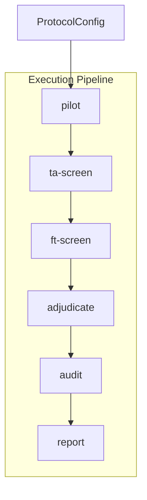
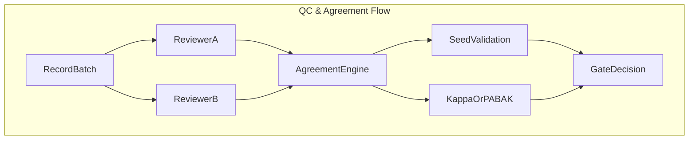
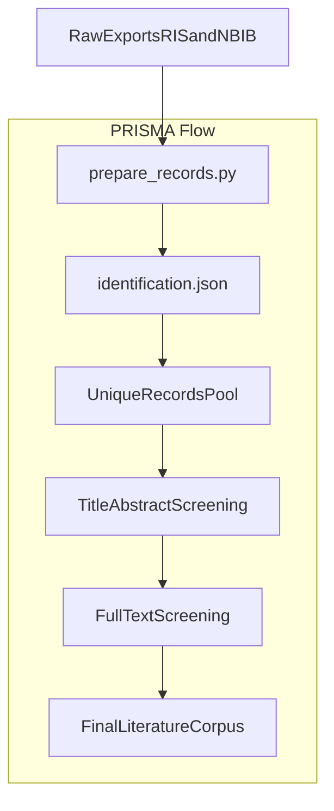

<!-- source: DeepWiki mcp.deepwiki.com · repo Imbad0202/academic-research-skills · page 13.1 Screening Modes and Adjudication Protocol · fetched 2026-10-30 -->

# Screening Modes and Adjudication Protocol

<details>
<summary>Relevant source files</summary>

The following files were used as context for generating this wiki page:

- [academic-paper/references/anti_leakage_protocol.md](academic-paper/references/anti_leakage_protocol.md)
- [academic-pipeline/references/integrity_review_protocol.md](academic-pipeline/references/integrity_review_protocol.md)
- [docs/design/2026-04-30-ars-v3.6.8-trust-provenance-and-drift-transparency-spec.md](docs/design/2026-04-30-ars-v3.6.8-trust-provenance-and-drift-transparency-spec.md)
- [docs/design/2026-05-12-ars-v3.7.3-claim-faithfulness-and-contaminated-source-spec.md](docs/design/2026-05-12-ars-v3.7.3-claim-faithfulness-and-contaminated-source-spec.md)
- [docs/design/2026-05-17-ars-v3.9.0-cross-index-triangulation-measurement-spec.md](docs/design/2026-05-17-ars-v3.9.0-cross-index-triangulation-measurement-spec.md)
- [examples/compliance/fixture_primary_raise_weak.yaml](examples/compliance/fixture_primary_raise_weak.yaml)
- [examples/compliance/fixture_sr_full_compliant.yaml](examples/compliance/fixture_sr_full_compliant.yaml)
- [examples/compliance/fixture_sr_missing_M4.yaml](examples/compliance/fixture_sr_missing_M4.yaml)
- [scripts/check_v3_6_8_cite_provenance_pipeline.py](scripts/check_v3_6_8_cite_provenance_pipeline.py)
- [scripts/test_check_v3_6_8_cite_provenance_pipeline.py](scripts/test_check_v3_6_8_cite_provenance_pipeline.py)
- [scripts/test_sr_screener_pipeline.py](scripts/test_sr_screener_pipeline.py)
- [shared/compliance_checkpoint_protocol.md](shared/compliance_checkpoint_protocol.md)
- [shared/prisma_trAIce_protocol.md](shared/prisma_trAIce_protocol.md)
- [shared/templates/codex_audit_multifile_template.md](shared/templates/codex_audit_multifile_template.md)
- [sr-screener/scripts/srlib.py](sr-screener/scripts/srlib.py)

</details>


## Purpose and Scope

This wiki page details the technical architecture of the `sr-screener` skill within the Academic Research Skills (ARS) codebase. It covers the eight operational screening modes, ordered exclusion codes, quality control (QC) mechanisms (including seed study validation and inter-rater agreement metrics such as Cohen's Kappa and PABAK), and PRISMA 2020 quantitative flow tracking.

Sources: `sr-screener/scripts/srlib.py()`, `scripts/test_sr_screener_pipeline.py()`

---

## 1. The Eight Operational Screening Modes

The `sr-screener` skill operates across eight distinct execution modes managed via workflow build scripts and runtime handlers. These modes structure the systematic review pipeline from protocol ingestion to final PRISMA reporting.

| Mode Identifier | Role & Function | Key Code Reference |
|---|---|---|
| `protocol` | Ingests and validates review protocols, research questions, core criteria, and exclusion schemas. | `sr-screener/scripts/srlib.py()` |
| `quick` | Performs rapid exploratory screening on a subset of records without dual-reviewer gating. | `sr-screener/scripts/srlib.py()` |
| `pilot` | Executes a mandatory calibration phase on a labelled subset of records to test prompt/reviewer alignment. | `scripts/test_sr_screener_pipeline.py()` |
| `ta-screen` | Title/Abstract screening phase using dual blinded AI reviewers (`screening_reviewer_agent`). | `sr-screener/scripts/srlib.py()` |
| `ft-screen` | Full-text screening phase evaluating retrieved manuscript texts against eligibility criteria. | `sr-screener/scripts/srlib.py()` |
| `adjudicate` | Resolves conflicts between reviewers or senior-reviews excluded records via adjudication agents. | `sr-screener/scripts/srlib.py()` |
| `audit` | Performs QC checks, random exclusion sampling, and inter-rater agreement calculations. | `sr-screener/scripts/srlib.py()` |
| `report` | Compiles PRISMA 2020 counts, exclusion logs, and the `literature_corpus[]` handoff for downstream use. | `scripts/test_sr_screener_pipeline.py()` |

Sources: `sr-screener/scripts/srlib.py()`, `scripts/test_sr_screener_pipeline.py()`


Sources: `sr-screener/scripts/srlib.py()`, `scripts/test_sr_screener_pipeline.py()`

---

## 2. Ordered Exclusion Codes and Decision Boundaries

Exclusion codes are defined in the review configuration dictionary and structured hierarchically. Each decision state maps to specific categorical outcomes (`include`, `unclear`, `exclude`) and standard exclusion codes (`E1`, `E2`, etc.).

```python
CONFIG = {
    "review_title": "Synthetic NGAL review",
    "exclusion_codes": [
        {"code": "E1", "short": "publication type", "label": "Publication type"},
        {"code": "E2", "short": "not human", "label": "Not human"},
        {"code": "E3", "short": "population", "label": "Population"},
        {"code": "E4", "short": "index test", "label": "Index test not urinary NGAL"},
    ],
    ...
}
```
*Config structure exemplar.* Sources: `scripts/test_sr_screener_pipeline.py:114-126()`

### Decision Rules and Validation
- **No Silent Defaults:** Malformed reviewer decisions are dropped, keeping records in a `pending` state.
- **Methods Withholding:** The methods synthesis is withheld until all pending records are fully adjudicated.
- **Exclusion Code Mapping:** Every exclusion decision must reference a valid configured code (`E1`-`En`) with a prose justification (`why`).

Sources: `scripts/test_sr_screener_pipeline.py()`, `sr-screener/scripts/srlib.py()`

---

## 3. Quality Control, Seed Studies, and Inter-Rater Agreement

Quality control (QC) in `sr-screener` relies on seed validation, double-blind review comparison, and statistical agreement calculations.

### Seed Study Verification
Seed studies (defined in the configuration with known inclusion status, e.g., DOI `10.1000/test.0001`) are injected into the screening stream. If dual reviewers fail to advance a seed study, the pipeline halts and emits a calibration warning.

### Agreement Metrics (Kappa / PABAK)
The library computes inter-rater agreement across screening batches:
- **Cohen's Kappa ($\kappa$):** Measures pairwise agreement beyond chance for categorical screening decisions.
- **Prevalence-Adjusted Bias-Adjusted Kappa (PABAK):** Corrects for skewed marginal distributions common in systematic reviews where exclusions greatly outnumber inclusions.


Sources: `sr-screener/scripts/srlib.py()`, `scripts/test_sr_screener_pipeline.py()`

Sources: `sr-screener/scripts/srlib.py()`, `scripts/test_sr_screener_pipeline.py()`

---

## 4. PRISMA 2020 Quantitative Flow Tracking

The skill tracks record disposition from raw bibliographic ingestion to final inclusion, enforcing PRISMA 2020 standards.


Sources: `sr-screener/scripts/srlib.py()`, `scripts/test_sr_screener_pipeline.py()`

### Quantitative Metrics Tracked
- `raw_total`: Total records parsed from RIS, PubMed `.nbib`, Web of Science, or CSV exports.
- `unique_total`: Records remaining after automated and manual deduplication.
- `duplicates_removed`: Count of exact and fuzzy duplicate matches filtered out.
- `literature_corpus[]`: Final validated entries handed off to downstream `academic-paper` skills conforming to `shared/contracts/passport/literature_corpus_entry.schema.json`.

Sources: `scripts/test_sr_screener_pipeline.py:170-175()`, `sr-screener/scripts/srlib.py()`

---

