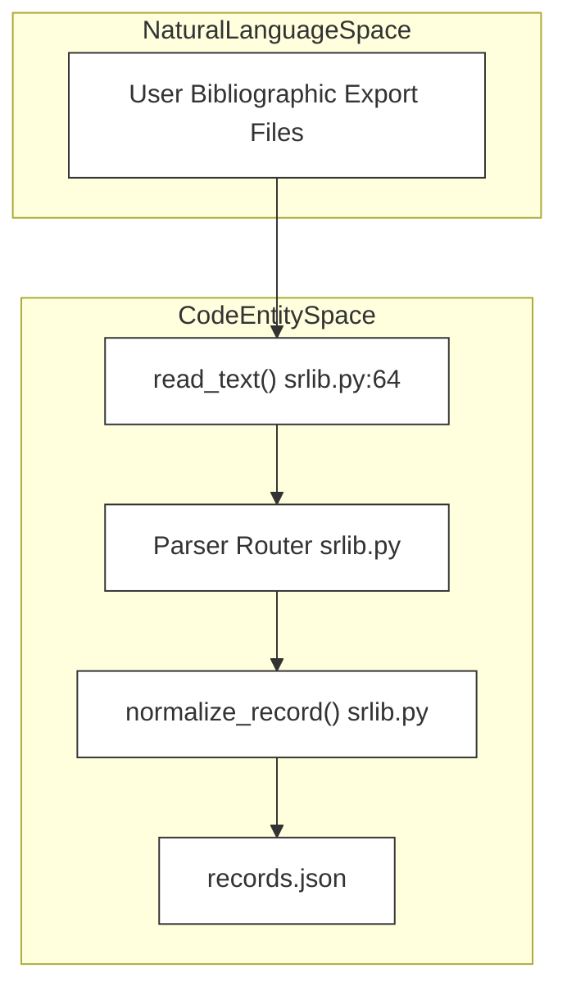
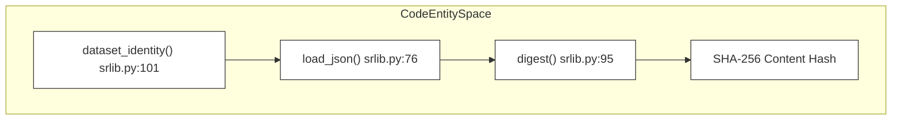
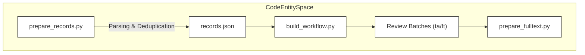
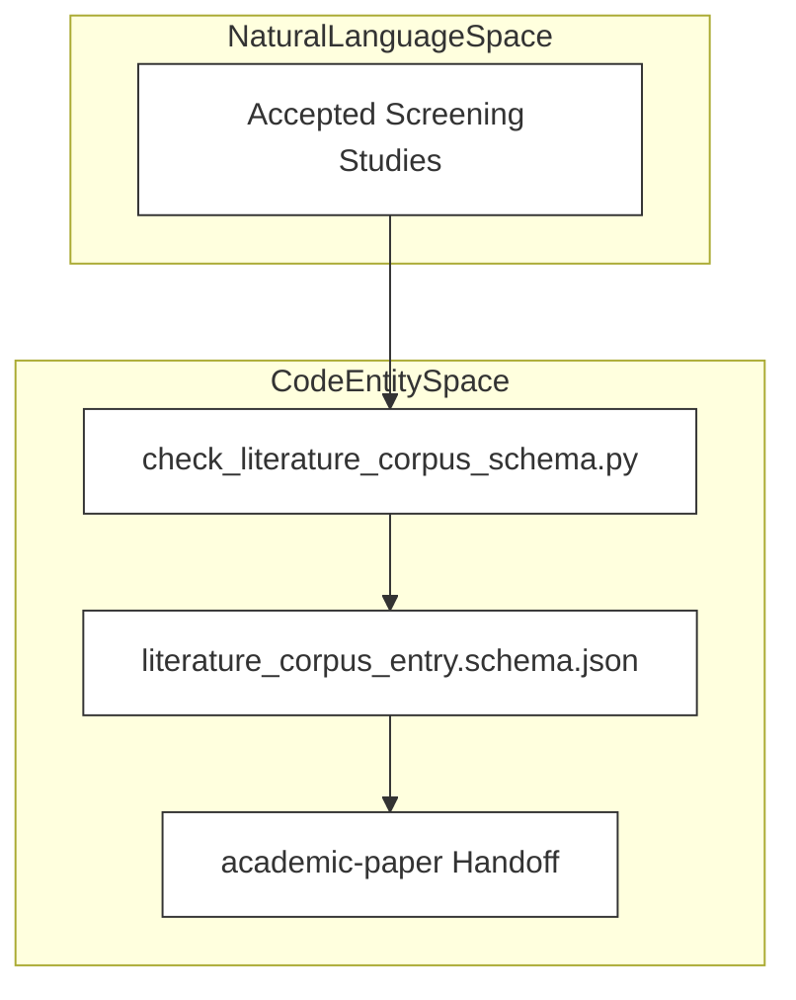

<!-- source: DeepWiki mcp.deepwiki.com · repo Imbad0202/academic-research-skills · page 13.2 Screening Scripts and Handoff Outputs · fetched 2026-10-30 -->

# Screening Scripts and Handoff Outputs

Relevant source files

The following files were used as context for generating this wiki page:

- [scripts/adapters/tests/test_check_literature_corpus_schema.py](scripts/adapters/tests/test_check_literature_corpus_schema.py)
- [scripts/check_literature_corpus_schema.py](scripts/check_literature_corpus_schema.py)
- [scripts/check_v3_10_policy.py](scripts/check_v3_10_policy.py)
- [scripts/test_check_394_submission_policy.py](scripts/test_check_394_submission_policy.py)
- [scripts/test_check_v3_10_policy.py](scripts/test_check_v3_10_policy.py)
- [scripts/test_citation_existence_policy.py](scripts/test_citation_existence_policy.py)
- [scripts/test_sr_screener_pipeline.py](scripts/test_sr_screener_pipeline.py)
- [shared/contracts/passport/terminal_policies.schema.json](shared/contracts/passport/terminal_policies.schema.json)
- [sr-screener/scripts/srlib.py](sr-screener/scripts/srlib.py)

## Purpose and Scope
This page details the implementation of the `sr-screener` script ecosystem centered around `sr-screener/scripts/srlib.py` and its sibling utilities [sr-screener/scripts/srlib.py:1](). It covers multi-format bibliographic ingestion (RIS, PubMed `.nbib`, Web of Science, CSV), deterministic deduplication, stateful configuration management, resumable screening batches, audit logging, and the `literature_corpus[]` handoff protocol connecting systematic screening outputs to the `academic-paper` skill.

Sources: `sr-screener/scripts/srlib.py:1-6`, `scripts/test_sr_screener_pipeline.py:1-26`

---

## 1. Bibliographic Import Formats and Normalization (`srlib.py`)
The ingestion pipeline normalizes heterogeneous bibliographic exports into a standardized JSON record schema. `srlib.py` provides pure Python utilities to parse RIS, MEDLINE/PubMed `.nbib`, Web of Science, and CSV exports without external bibliographic database dependencies.

Key normalizations include:
* **Encoding Robustness**: `read_text()` handles UTF-8 with BOM, UTF-16, and Windows CP1252 fallbacks, replacing line endings to guarantee cross-platform consistency [sr-screener/scripts/srlib.py:64-74].
* **Field Mapping**: Maps variant tags (e.g., `TI`, `AB`, `AU`, `FAU`, `PY`, `DP`, `DO`, `JO`, `TA`) to canonical internal record structures.
* **Language & Type Translation**: Translates ISO-639-3 language codes (via `LANG` lookup) and reference types (`TY_LABEL`) into human-readable labels [sr-screener/scripts/srlib.py:31-50].

*Sources: `sr-screener/scripts/srlib.py:31-74`*

---

## 2. Deduplication and Dataset Identity (`dataset_identity`)
Deduplication relies on stable identifiers (DOIs, normalized PMIDs) and title/author fuzzy-matching keys. `dataset_identity()` computes a content-stable SHA-256 digest of the unique record set, ensuring that workflow steps and audits remain reproducible independently of file system timestamps or JSON formatting variations [sr-screener/scripts/srlib.py:95-116].

* **Stable Hashing**: `digest(obj)` serializes dictionaries with sorted keys and tight separators before hashing [sr-screener/scripts/srlib.py:95-99].
* **Review Identity**: Binds unique records to a review UUID (`review_id`) stored in `review_identity.json` or inline within `records.json` [sr-screener/scripts/srlib.py:101-116].

*Sources: `sr-screener/scripts/srlib.py:95-116`*

---

## 3. Resumable Batches and Configuration Scoping (`screening_config`)
Screening execution is structured around auditable stages (Title/Abstract `ta`, Full-Text `ft`). `screening_config()` extracts decision-critical parameters while ignoring non-functional reporting properties [sr-screener/scripts/srlib.py:117-143].

* **Config Scoping**: Filters out metadata that does not alter screening logic, binding only exclusion codes, core criteria, personas, models, and QC policies into the configuration hash [sr-screener/scripts/srlib.py:117-143].
* **Migration & Upgrades**: `upgrade_config_identity()` updates legacy configuration structures without invalidating completed work or pilot outcomes [sr-screener/scripts/srlib.py:146-160].
* **Context Activation**: `activate_context()` archives prior decisions before resetting an active stage for re-screening or amendment [sr-screener/scripts/srlib.py:163-168].

Sources: `sr-screener/scripts/srlib.py:117-168`

---

## 4. Screening Workflow Scripts and Pipeline Execution
The pipeline orchestration scripts drive multi-reviewer screening, agreement measurement, and batch progression. The end-to-end regression test suite (`test_sr_screener_pipeline.py`) validates the execution of these scripts on synthetic datasets [scripts/test_sr_screener_pipeline.py:1-26].

* **Preparation**: `prepare_records.py` ingests RIS/NBIB/CSV inputs, executes deduplication, and verifies seed inclusion [scripts/test_sr_screener_pipeline.py:152-156].
* **Workflow Building**: `build_workflow.py` partitions records into pilot and production batches for reviewers `A` and `B` [scripts/test_sr_screener_pipeline.py:157-158].
* **Conflict & Adjudication**: Enforces strict gating rules — unlabelled or malformed reviewer decisions are dropped to pending status, methods text is withheld while records remain pending, and pilot consensus is required before advancing to full-text or broad screening [scripts/test_sr_screener_pipeline.py:7-21].

*Sources: `scripts/test_sr_screener_pipeline.py:1-175`*

---

## 5. Literature Corpus Handoff to Academic Paper (`literature_corpus[]`)
Upon completion of screening and adjudication, accepted studies are compiled into the `literature_corpus[]` handoff structure. This structure bridges the systematic review output to the `academic-paper` skill.

* **Schema Enforcement**: Handoff entries are validated against `shared/contracts/passport/literature_corpus_entry.schema.json` via JSON Schema Draft 2020-12 validators [scripts/check_literature_corpus_schema.py:58-90].
* **Integrity & Uniqueness**: `check_literature_corpus_schema.py` enforces citation key uniqueness within each passport, validates rejection logs, and checks for contamination or vetting signals [scripts/check_literature_corpus_schema.py:1-110].

*Sources: `scripts/check_literature_corpus_schema.py:1-110`, `scripts/adapters/tests/test_check_literature_corpus_schema.py:1-95`*

---

