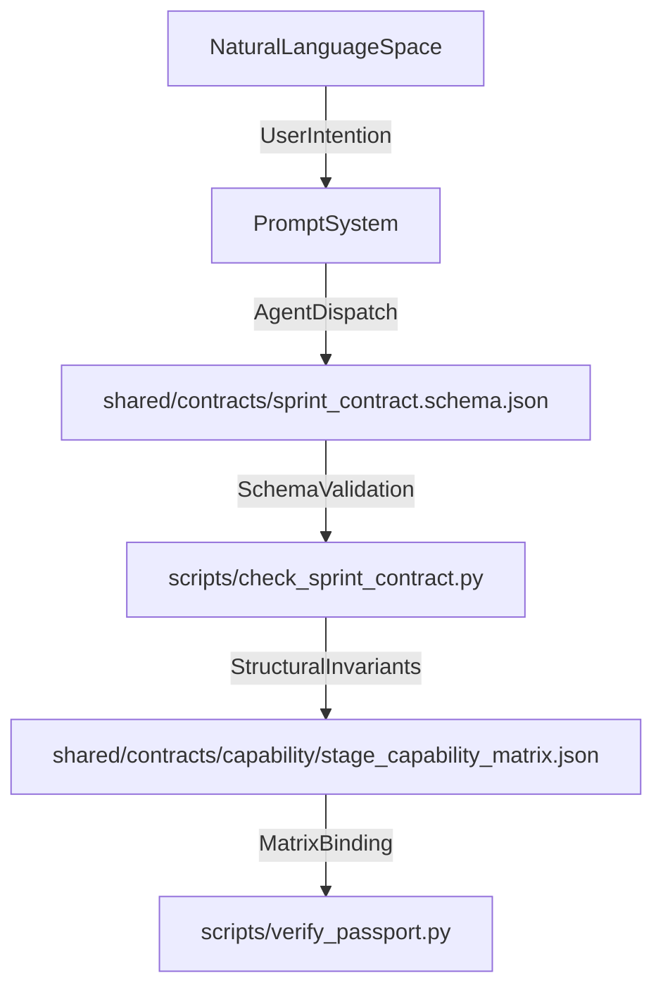
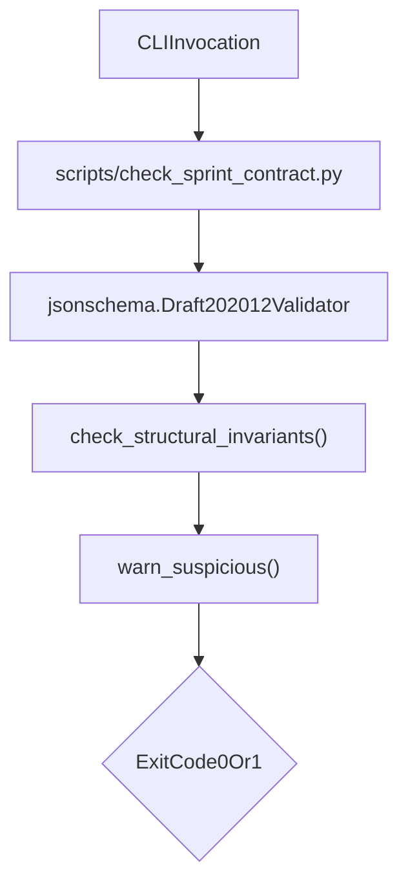

<!-- source: DeepWiki mcp.deepwiki.com · repo Imbad0202/academic-research-skills · page 14 Contracts, Schemas and Script Toolkit · fetched 2026-10-30 -->

# Contracts, Schemas and Script Toolkit

Relevant source files

The following files were used as context for generating this wiki page:

- [academic-pipeline/agents/state_tracker_agent.md](academic-pipeline/agents/state_tracker_agent.md)
- [docs/DATA_FLOWS.md](docs/DATA_FLOWS.md)
- [docs/RISK_REGISTER.md](docs/RISK_REGISTER.md)
- [scripts/ars_mark_read.py](scripts/ars_mark_read.py)
- [scripts/check_sprint_contract.py](scripts/check_sprint_contract.py)
- [scripts/claim_strength_drift_disposition.py](scripts/claim_strength_drift_disposition.py)
- [scripts/human_read_attestation_resolver.py](scripts/human_read_attestation_resolver.py)
- [scripts/run_ledger.py](scripts/run_ledger.py)
- [scripts/test_ars_mark_read.py](scripts/test_ars_mark_read.py)
- [scripts/test_check_sprint_contract.py](scripts/test_check_sprint_contract.py)
- [scripts/test_claim_strength_drift_disposition.py](scripts/test_claim_strength_drift_disposition.py)
- [scripts/test_file_lock.py](scripts/test_file_lock.py)
- [scripts/test_human_read_attestation_resolver.py](scripts/test_human_read_attestation_resolver.py)
- [scripts/test_run_ledger.py](scripts/test_run_ledger.py)
- [shared/contracts/passport/run_ledger.schema.json](shared/contracts/passport/run_ledger.schema.json)
- [shared/contracts/reviewer/full.json](shared/contracts/reviewer/full.json)
- [shared/contracts/reviewer/methodology_focus.json](shared/contracts/reviewer/methodology_focus.json)
- [shared/sprint_contract.schema.json](shared/sprint_contract.schema.json)

The Contracts, Schemas and Script Toolkit forms the deterministic backbone of the Academic Research Skills (ARS) system. It governs data structures, cross-skill handoffs, attestation ledgers, and pipeline invariant enforcement via a library of 111 JSON schemas under `shared/contracts/` [docs/RISK_REGISTER.md:20-21]() and over 600 validation scripts under `scripts/`.

As a PARENT page, this section provides a high-level overview of the schema architecture and validation toolchains. For exhaustive technical specifications, refer to the child pages:
- [Contract Schema Catalog](#14.1) — Detailed tour of contract families (`passport`, `re_review`, `revision`, `evidence`, `claim_standing`, `audit`, `submission`, `review_target`, `human_subjects`, `pdf`, `cross_model`, `capability`).
- [Passport Ledgers and Human Attestation](#14.2) — Cryptographic hash chains in `run_ledger.py`, advisory file locking (`file_lock.py`), atomic replacement, and `USER_ATTESTED_READ` resolution.
- [Advisory and Conformance Check Families](#14.3) — The `check_*.py` script suite enforcing structural invariants, surface-form parity, tortured-phrase screening, and routing sync.

---

## 1. Schema Ecosystem Architecture

The ARS contract layer enforces strict separation between policy definitions (JSON schemas) and execution logic (Python validators). Schemas are written against JSON Schema Draft 2020-12 [scripts/check_sprint_contract.py:37-40] and define data shapes for every cross-agent handoff, review panel contract, and material passport.

*Figure 1: Bridging natural language intent to mechanical contract validation.*  
Sources: [shared/sprint_contract.schema.json:1-35](), [scripts/check_sprint_contract.py:34-42](), [docs/RISK_REGISTER.md:18-24]()

### Core Schema Families Overview

| Family Directory | Primary Role | Key Enforcing Script |
| :--- | :--- | :--- |
| `shared/contracts/passport/` | Material provenance and run history | `scripts/verify_passport.py`, `scripts/run_ledger.py` [scripts/run_ledger.py:1-20]() |
| `shared/contracts/reviewer/` | Peer review panel seats and scoring rules | `scripts/check_sprint_contract.py` [scripts/check_sprint_contract.py:20-45]() |
| `shared/contracts/re_review/` | Revision yardstick continuity and R&R matrices | `scripts/check_re_review_synthesis.py` |
| `shared/contracts/audit/` | Claim faithfulness and integrity report formats | `scripts/verify_citation_integrity.py` |
| `shared/contracts/capability/` | Stage capability matrix and evidence statuses | `scripts/check_risk_register.py` [docs/RISK_REGISTER.md:20-25]() |

Sources: [docs/RISK_REGISTER.md:20-25](), [scripts/check_sprint_contract.py:1-30](), [scripts/run_ledger.py:1-25]()

---

## 2. Script Toolkit and Enforcement Workflow

Validation scripts enforce syntactic validity and deep semantic invariants that JSON Schema alone cannot capture (such as cross-field role eligibility and cryptographic hash chains).

*Executing script validation workflow.*  
Sources: [scripts/check_sprint_contract.py:1-174](), [scripts/test_check_sprint_contract.py:28-33]()

### Key Validation Utilities

- **Sprint Contracts (`scripts/check_sprint_contract.py`)**: Validates reviewer role-scoping, mandatory fatal atoms, and scoring plan schemas against `sprint_contract.schema.json` [shared/sprint_contract.schema.json:1-100]().
- **Run Ledgers (`scripts/run_ledger.py`)**: Maintains append-only hash chains for conversational history, tool receipts, and checkpoint answers [scripts/run_ledger.py:1-45]().
- **Human Read Attestation (`scripts/ars_mark_read.py`)**: Implements bounded advisory file locking (`file_lock.py`), atomic replacement, and schema-compliant user read logs [scripts/ars_mark_read.py:1-35]().

Sources: [scripts/check_sprint_contract.py:1-45](), [scripts/run_ledger.py:1-30](), [scripts/ars_mark_read.py:1-35]()

---

## 3. Child Page Directory

For full technical breakdowns, navigate to the specific child documentation pages:

- **14.1** [Contract Schema Catalog](#14.1) — Detailed specifications of all 111 JSON schemas across the 12 contract families and their validation entrypoints.
- **14.2** [Passport Ledgers and Human Attestation](#14.2) — Mechanics of `run_ledger.py` hash chains, advisory file locks, atomic replacements, and `USER_ATTESTED_READ` verification.
- **14.3** [Advisory and Conformance Check Families](#14.3) — Comprehensive catalog of `check_*.py` validation utilities, covering tortured-phrase screening, cross-document consistency, and skill linting.

Sources: [scripts/check_sprint_contract.py:1-15](), [scripts/run_ledger.py:1-15](), [scripts/ars_mark_read.py:1-20]()

---

