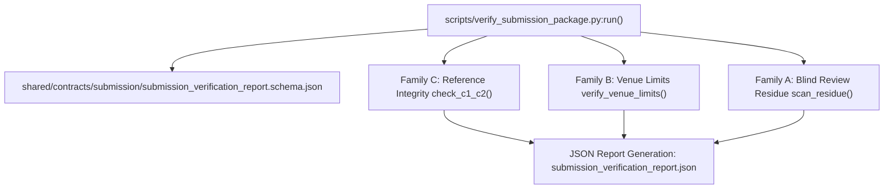
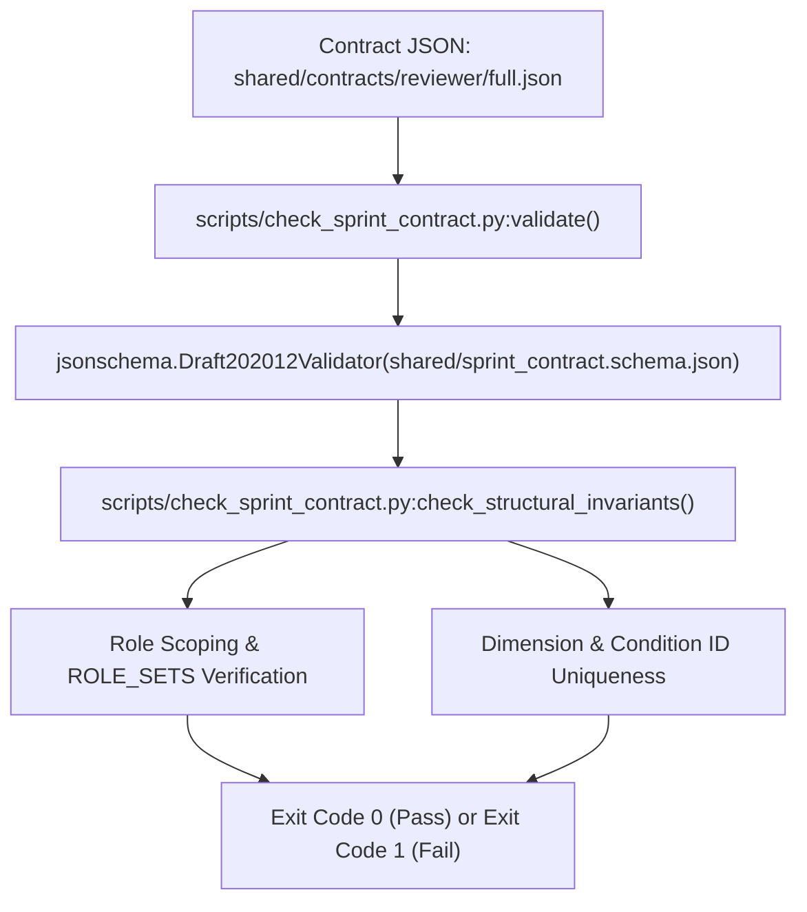

<!-- source: DeepWiki mcp.deepwiki.com · repo Imbad0202/academic-research-skills · page 14.1 Contract Schema Catalog · fetched 2026-10-30 -->

# Contract Schema Catalog

Relevant source files

The following files were used as context for generating this wiki page:

- [docs/design/2026-05-15-issue-111-slr-lineage-emission-design.md](docs/design/2026-05-15-issue-111-slr-lineage-emission-design.md)
- [docs/design/2026-06-10-394-family-d-repro-lock-assessment.md](docs/design/2026-06-10-394-family-d-repro-lock-assessment.md)
- [docs/design/2026-06-10-394-submission-package-verifier-spec.md](docs/design/2026-06-10-394-submission-package-verifier-spec.md)
- [pyproject.toml](pyproject.toml)
- [scripts/check_passport_reset_contract.py](scripts/check_passport_reset_contract.py)
- [scripts/check_sprint_contract.py](scripts/check_sprint_contract.py)
- [scripts/fixtures/submission_package/profiles/full.yaml](scripts/fixtures/submission_package/profiles/full.yaml)
- [scripts/slr_lineage.py](scripts/slr_lineage.py)
- [scripts/test_check_passport_reset_contract.py](scripts/test_check_passport_reset_contract.py)
- [scripts/test_check_sprint_contract.py](scripts/test_check_sprint_contract.py)
- [scripts/test_slr_lineage_emission.py](scripts/test_slr_lineage_emission.py)
- [scripts/test_verify_submission_package.py](scripts/test_verify_submission_package.py)
- [scripts/verify_submission_package.py](scripts/verify_submission_package.py)
- [shared/contracts/passport/reset_ledger_entry.schema.json](shared/contracts/passport/reset_ledger_entry.schema.json)
- [shared/contracts/reviewer/full.json](shared/contracts/reviewer/full.json)
- [shared/contracts/reviewer/methodology_focus.json](shared/contracts/reviewer/methodology_focus.json)
- [shared/contracts/submission/submission_verification_report.schema.json](shared/contracts/submission/submission_verification_report.schema.json)
- [shared/contracts/submission/venue_profile.schema.json](shared/contracts/submission/venue_profile.schema.json)
- [shared/sprint_contract.schema.json](shared/sprint_contract.schema.json)

## Purpose and Scope
This page provides a comprehensive technical tour of the `shared/contracts/` schema families within the Academic Research Skills (ARS v3.23.x) system. It details the JSON schemas, structural invariants, validation entrypoint scripts, and data flow mechanisms that govern inter-agent communication, pipeline checkpoints, peer-review panels, and submission verification packages.

Sources: `shared/sprint_contract.schema.json:1-35` (), `shared/contracts/passport/reset_ledger_entry.schema.json:1-25` ()

---

## 1. Overview of Contract Families

The ARS codebase centralizes schema definitions under `shared/contracts/` and root JSON schema files. These contracts enforce strict property constraints, structural invariants, and role-scoping rules across the research-to-publication pipeline.

The major contract families include:
- **`passport`**: Manages state persistence, reset boundaries, and resume execution ledgers via entries such as `reset_ledger_entry.schema.json` [shared/contracts/passport/reset_ledger_entry.schema.json:1-10]().
- **`submission`**: Governs deterministic submission package verifications, venue profiles, and reporting structures (`submission_verification_report.schema.json`) [shared/contracts/submission/submission_verification_report.schema.json:1-15]().
- **`reviewer`, `writer`, `evaluator`**: Shipped under schema families defining multi-perspective peer review panels, scoring plans, and failure conditions (Schema 13.2 Sprint Contracts) [shared/sprint_contract.schema.json:1-30]().
- **Other specialized families**: `re_review`, `revision`, `evidence`, `claim_standing`, `audit`, `review_target`, `human_subjects`, `pdf`, `cross_model`, and `capability`.

Sources: `shared/sprint_contract.schema.json:1-30` (), `shared/contracts/passport/reset_ledger_entry.schema.json:1-15` ()

---

## 2. Submission and Audit Contract Family (#394)

The submission verification system is defined by `docs/design/2026-06-10-394-submission-package-verifier-spec.md` [docs/design/2026-06-10-394-submission-package-verifier-spec.md:1-10]() and implemented through `scripts/verify_submission_package.py` [scripts/verify_submission_package.py:1-45](). It validates output packages against deterministic rules across check families (Family A: blind-review residue, Family B: venue limits, Family C: reference integrity, Family D: repro lock).

The verification report structure conforms to `shared/contracts/submission/submission_verification_report.schema.json` [shared/contracts/submission/submission_verification_report.schema.json:1-25]().

### Submission Verifier Pipeline Architecture
The diagram below maps natural language concepts (e.g., submission verification checks) directly to the underlying script functions and schema modules.

Sources: `docs/design/2026-06-10-394-submission-package-verifier-spec.md:1-45` (), `scripts/verify_submission_package.py:1-40` (), `shared/contracts/submission/submission_verification_report.schema.json:1-20` ()

---

## 3. Passport and Reset Boundary Contract Family

Passport reset boundaries are governed by `shared/contracts/passport/reset_ledger_entry.schema.json` [shared/contracts/passport/reset_ledger_entry.schema.json:1-15]() and enforced by `scripts/check_passport_reset_contract.py` [scripts/check_passport_reset_contract.py:1-35](). 

Key aspects of this contract:
- **Append-Only Ledger Entries**: Supports two discriminator kinds: `boundary` (recorded at FULL checkpoints when `ARS_PASSPORT_RESET=1`) and `resume` (recorded when `resume_from_passport` consumes a boundary entry) [shared/contracts/passport/reset_ledger_entry.schema.json:5-10]().
- **Cryptographic Hashing**: Each boundary entry contains a 12-character lowercase hex hash over the concatenated ledger using the placeholder `000000000000` [shared/contracts/passport/reset_ledger_entry.schema.json:28-32]().
- **Pending Decision Options**: When co-occurring with mandatory user decisions, `pending_decision.options[]` arrays require unique `value` fields, validated by `scan_duplicate_option_values()` [scripts/check_passport_reset_contract.py:113-180]().

Sources: `shared/contracts/passport/reset_ledger_entry.schema.json:1-60` (), `scripts/check_passport_reset_contract.py:1-45` ()

---

## 4. Sprint Contract Family (Schema 13.2)

Schema 13.2 Sprint Contracts (`shared/sprint_contract.schema.json`) [shared/sprint_contract.schema.json:1-20]() establish operational parameters for reviewer, writer, and evaluator modes. They define `acceptance_dimensions` [shared/sprint_contract.schema.json:37-58](), `measurement_procedure` [shared/sprint_contract.schema.json:59-102](), and `failure_conditions`.

### Validation Entrypoint (`scripts/check_sprint_contract.py`)
Validation is executed via `scripts/check_sprint_contract.py` [scripts/check_sprint_contract.py:1-42](), which performs two-stage verification:
1. **Schema Validation**: Evaluates contract dictionaries against `shared/sprint_contract.schema.json` using `jsonschema.Draft202012Validator` [scripts/check_sprint_contract.py:30-42]().
2. **Structural Invariants**: `check_structural_invariants()` checks uniqueness of dimension IDs, condition IDs, and enforces role-scoping constraints for reviewer modes (`reviewer_full`, `reviewer_methodology_focus`) [scripts/check_sprint_contract.py:44-130](). Shipped templates such as `shared/contracts/reviewer/full.json` [shared/contracts/reviewer/full.json:1-20]() and `shared/contracts/reviewer/methodology_focus.json` [shared/contracts/reviewer/methodology_focus.json:1-15]() serve as reference baselines.

### Sprint Contract Validation Engine
The diagram below illustrates how sprint contracts are processed and validated within the validation harness.

Sources: `scripts/check_sprint_contract.py:1-131` (), `shared/sprint_contract.schema.json:1-35` (), `shared/contracts/reviewer/full.json:1-15` (), `shared/contracts/reviewer/methodology_focus.json:1-15` ()

---

## 5. Summary of Validation Entrypoints

| Script Path | Target Contract Family | Key Validation Functions |
| :--- | :--- | :--- |
| `scripts/check_sprint_contract.py` [scripts/check_sprint_contract.py:1-45]() | `sprint_contract.schema.json` [shared/sprint_contract.schema.json:1-20]() | `validate()`, `check_structural_invariants()`, `warn_suspicious()` [scripts/check_sprint_contract.py:34-158]() |
| `scripts/check_passport_reset_contract.py` [scripts/check_passport_reset_contract.py:1-50]() | `reset_ledger_entry.schema.json` [shared/contracts/passport/reset_ledger_entry.schema.json:1-10]() | `scan()`, `scan_duplicate_option_values()` [scripts/check_passport_reset_contract.py:77-180]() |
| `scripts/verify_submission_package.py` [scripts/verify_submission_package.py:1-45]() | `submission_verification_report.schema.json` [shared/contracts/submission/submission_verification_report.schema.json:1-15]() | `run()`, check execution across Families A, B, C [scripts/verify_submission_package.py:1-140]() |

Sources: `scripts/check_sprint_contract.py:1-50` (), `scripts/check_passport_reset_contract.py:1-40` (), `scripts/verify_submission_package.py:1-40` ()

---

