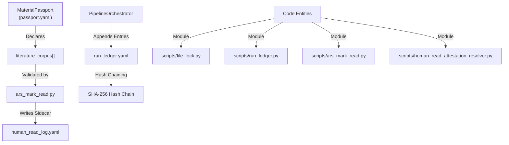
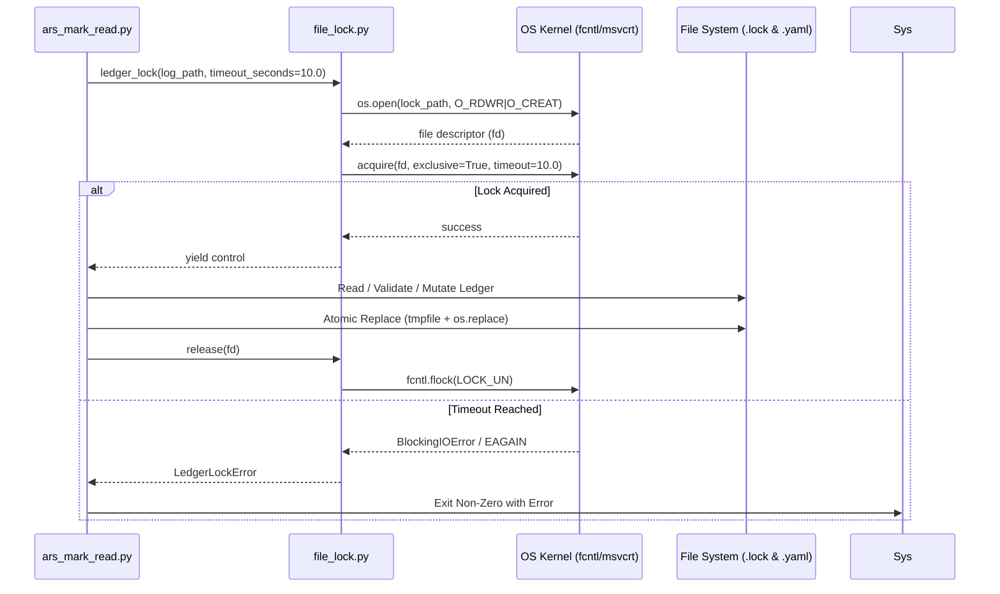
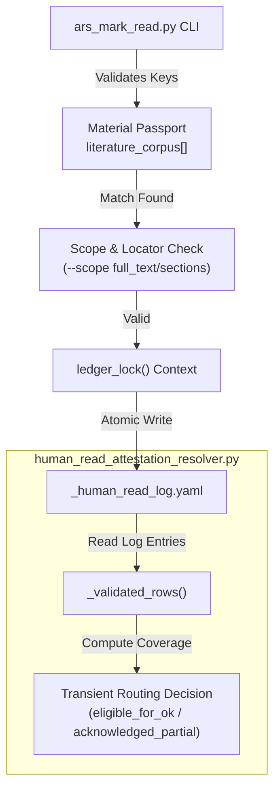
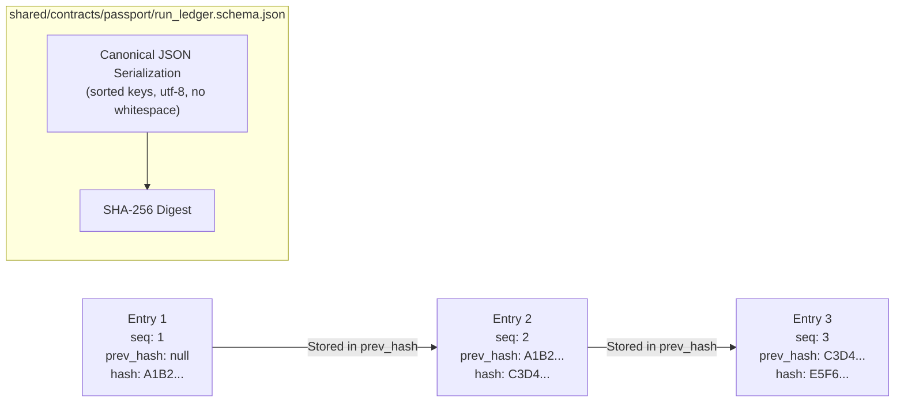
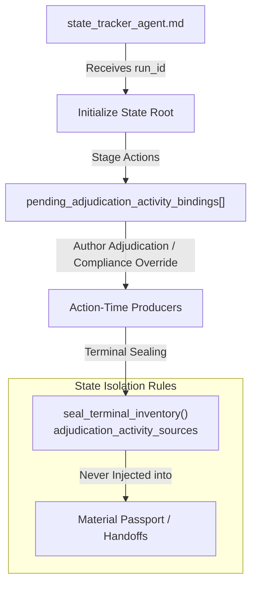

<!-- source: DeepWiki mcp.deepwiki.com · repo Imbad0202/academic-research-skills · page 14.2 Passport Ledgers and Human Attestation · fetched 2026-10-30 -->

# Passport Ledgers and Human Attestation

Relevant source files

The following files were used as context for generating this wiki page:

- [academic-pipeline/agents/state_tracker_agent.md](academic-pipeline/agents/state_tracker_agent.md)
- [commands/ars-mark-read.md](commands/ars-mark-read.md)
- [commands/ars-unmark-read.md](commands/ars-unmark-read.md)
- [docs/DATA_FLOWS.md](docs/DATA_FLOWS.md)
- [docs/RISK_REGISTER.md](docs/RISK_REGISTER.md)
- [docs/design/2026-07-20-513-read-scope-attestation-spec.md](docs/design/2026-07-20-513-read-scope-attestation-spec.md)
- [scripts/adjudication_activity.py](scripts/adjudication_activity.py)
- [scripts/ars_mark_read.py](scripts/ars_mark_read.py)
- [scripts/check_673_adjudication_activity.py](scripts/check_673_adjudication_activity.py)
- [scripts/check_v3_6_8_mark_read_commands.py](scripts/check_v3_6_8_mark_read_commands.py)
- [scripts/claim_strength_drift_disposition.py](scripts/claim_strength_drift_disposition.py)
- [scripts/file_lock.py](scripts/file_lock.py)
- [scripts/human_read_attestation_resolver.py](scripts/human_read_attestation_resolver.py)
- [scripts/inquiry_branch_ledger.py](scripts/inquiry_branch_ledger.py)
- [scripts/review_criteria_binding.py](scripts/review_criteria_binding.py)
- [scripts/run_ledger.py](scripts/run_ledger.py)
- [scripts/test_adjudication_activity.py](scripts/test_adjudication_activity.py)
- [scripts/test_ars_mark_read.py](scripts/test_ars_mark_read.py)
- [scripts/test_check_v3_6_8_mark_read_commands.py](scripts/test_check_v3_6_8_mark_read_commands.py)
- [scripts/test_claim_strength_drift_disposition.py](scripts/test_claim_strength_drift_disposition.py)
- [scripts/test_file_lock.py](scripts/test_file_lock.py)
- [scripts/test_human_read_attestation_resolver.py](scripts/test_human_read_attestation_resolver.py)
- [scripts/test_inquiry_branch_ledger.py](scripts/test_inquiry_branch_ledger.py)
- [scripts/test_run_ledger.py](scripts/test_run_ledger.py)
- [shared/contracts/passport/human_read_log.schema.json](shared/contracts/passport/human_read_log.schema.json)
- [shared/contracts/passport/run_ledger.schema.json](shared/contracts/passport/run_ledger.schema.json)
- [tests/test_mark_read_args.py](tests/test_mark_read_args.py)

## Purpose and Scope

This section details the sub-system responsible for tracking execution provenance, user read attestations, and audit trails in the Academic Research Skills (ARS) framework. Specifically, it covers the architecture and implementation of sidecar passport ledgers (`<passport-stem>_run_ledger.yaml` and `<passport-stem>_human_read_log.yaml`), advisory file locking (`file_lock.py`), atomic file replacement, the `ars_mark_read` command-line interface, the `USER_ATTESTED_READ` resolver (`human_read_attestation_resolver.py`), and inquiry branch/adjudication activity tracking managed by the `state_tracker_agent`.

---

## 1. Architecture of Passport Sidecar Ledgers

ARS maintains execution integrity by decoupling immutable source declarations from dynamic run-time state. While the Material Passport holds the primary literature corpus and structural configurations, audit trails and user declarations reside in dedicated peer files called **sidecar ledgers**. This design ensures that compaction routines and agent returns cannot silently alter historical records or bypass verification gates.

The sidecar files reside alongside the active Material Passport in the filesystem:
- **Run Ledger**: `<passport-stem>_run_ledger.yaml` — Tracks execution steps, tool receipts, checkpoint interactions, and cryptographic hash chains [scripts/run_ledger.py:2-12]().
- **Human Read Log**: `<passport-stem>_human_read_log.yaml` — Records user-owned reading attestations (`USER_ATTESTED_READ`) tied strictly to items in the passport's `literature_corpus[]` [scripts/ars_mark_read.py:5-9]().

*Figure 1.1: Sidecar Ledger Architecture bridging natural language state declarations to concrete Python modules.*

**Sources:** `scripts/ars_mark_read.py:1-35` (), `scripts/run_ledger.py:1-27` ()

---

## 2. Concurrency Control and Advisory Locking (`file_lock.py` & Atomic Replace)

To prevent race conditions during concurrent updates by CLI tools and pipeline orchestrators, ARS implements a directory-local exclusive advisory locking mechanism [scripts/ars_mark_read.py:110-120]().

### Advisory Locking Mechanics
The locking module (`scripts/file_lock.py`) abstracts operating system differences between POSIX (`fcntl`) and Windows (`msvcrt`) [scripts/test_file_lock.py:1-7]() via file descriptors:
- **POSIX Host**: Uses `fcntl.flock(fd, fcntl.LOCK_EX | fcntl.LOCK_NB)` with a bounded retry polling loop.
- **Windows Host**: Uses `msvcrt.locking` with zero-offset positioning on a stable peer lock path (e.g., `.<log_path>.lock`) [scripts/ars_mark_read.py:99-107](), [scripts/test_file_lock.py:159-171]().

*Figure 2.1: Advisory locking and atomic replacement data flow during ledger transactions.*

### Atomic Replacement Protocol
Ledger files are never updated in-place. Mutations follow a strict copy-on-write pattern:
1. Acquire the exclusive advisory `ledger_lock` [scripts/ars_mark_read.py:110-120]().
2. Write new content to a temporary file created in the same directory using `tempfile` to guarantee same-volume semantics.
3. Perform an atomic rename (`os.replace`) to overwrite the target ledger file, ensuring readers never observe partial writes.

**Sources:** `scripts/ars_mark_read.py:99-171](), [scripts/test_file_lock.py:1-60]()`

---

## 3. Human Read Attestation (`ars_mark_read.py` & `human_read_attestation_resolver.py`)

The `ars_mark_read.py` CLI utility manages user reading declarations [scripts/ars_mark_read.py:1-12](). It enforces strict schema validation and fail-fast guarantees before updating the human read log.

### Fail-Fast Environmental Checks
Before any write occurs, `_validate_passport_environment()` executes four fail-fast checks [scripts/ars_mark_read.py:172-181]():
1. **Active Passport Existence**: Verifies that a passport path is supplied or discoverable.
2. **Passport File Validity**: Ensures the passport file exists on disk.
3. **Parent Directory Readability**: Validates POSIX read permissions (`R_OK`) on the parent directory.
4. **Log Writability**: Verifies that the peer log path is writable.

### Attestation Schema and Scope Levels
Every mark requires an explicit scope level (`--scope`) to record how much of the source was examined [scripts/ars_mark_read.py:23-34]()`:
- `full_text`: Entire document read.
- `sections`: Specific sections or pages (requires `--locator`).
- `abstract_only`: Abstract and metadata review only.
- `toc_only`: Table of contents review only.
- `unknown`: Legacy or unverified breadth.

The deterministic resolver (`scripts/human_read_attestation_resolver.py`) inspects these logs during finalizer passes to determine `ok_eligible` status for citation compliance without inferring unproven comprehension [scripts/human_read_attestation_resolver.py:1-11]().

*Figure 3.1: Attestation recording and resolution flow.*

**Sources:** `scripts/ars_mark_read.py:1-181](), [scripts/human_read_attestation_resolver.py:1-55]()`

---

## 4. Pipeline Run Ledger Hash Chains (`run_ledger.py`)

The pipeline run ledger (`scripts/run_ledger.py`) records all checkpoint interactions, tool execution receipts, and user instructions [scripts/run_ledger.py:2-12](). 

### Cryptographic Hash Chaining
To prevent tampering or silent truncation, every entry in `run_ledger.yaml` is cryptographically chained to its predecessor [scripts/run_ledger.py:18-26]():
- **`seq`**: Monotonically increasing integer starting at `1`.
- **`prev_hash`**: SHA-256 hash of the previous entry's canonical JSON representation (`null` for `seq: 1`).
- **`hash`**: SHA-256 hash computed over the entry's fields excluding the `hash` property itself (sorted keys, no whitespace, UTF-8 encoding) [shared/contracts/passport/run_ledger.schema.json:1-5]().

*Figure 4.1: SHA-256 hash chaining mechanism in the run ledger.*

### Entry Kinds
The ledger schema supports seven discrete entry types defined in `shared/contracts/passport/run_ledger.schema.json` [shared/contracts/passport/run_ledger.schema.json:15-24]():
1. `initial_instructions`: User prompts and initial directives.
2. `checkpoint_opened`: Opening of a `FULL`, `SLIM`, or `MANDATORY` evaluation gate.
3. `checkpoint_closed`: User response and exact words addressing a checkpoint.
4. `partial_answer`: Granular multi-item responses (e.g., individual review criteria).
5. `tool_receipt`: Execution status, exit code, retries, and file input/output SHA-256 fingerprints for CLI tools.
6. `progress`: Stage counters and execution metrics.
7. `file_reference`: Fingerprints of transient input files.

**Sources:** `scripts/run_ledger.py:1-60](), [shared/contracts/passport/run_ledger.schema.json:1-50]()`

---

## 5. Inquiry Branch and Adjudication Activity Ledgers

Managed primarily by the `state_tracker_agent` and helper utilities (`adjudication_activity.py`), adjudication ledgers track human-in-the-loop decisions, compliance overrides, and review panel interactions [academic-pipeline/agents/state_tracker_agent.md:34-58]().

### Adjudication Activity Lifecycle
1. **Initialization**: The state tracker receives an explicit run identifier matching `^[A-Za-z0-9][A-Za-z0-9._:-]{0,127}$` [academic-pipeline/agents/state_tracker_agent.md:34-40]().
2. **Pending Bindings**: Artifacts are staged in `pending_adjudication_activity_bindings[]` following actions such as author adjudications, compliance overrides, or re-review quartets [academic-pipeline/agents/state_tracker_agent.md:41-60]().
3. **Terminal Sealing**: Upon pipeline termination, the orchestrator invokes `seal_terminal_inventory()` to freeze pending bindings into `adjudication_activity_sources`, locking the audit record without altering underlying state byte-semantically [academic-pipeline/agents/state_tracker_agent.md:84-100]().

*Figure 5.1: Adjudication activity state tracking and sealing workflow.*

**Sources:** `academic-pipeline/agents/state_tracker_agent.md:34-109]()`

---

