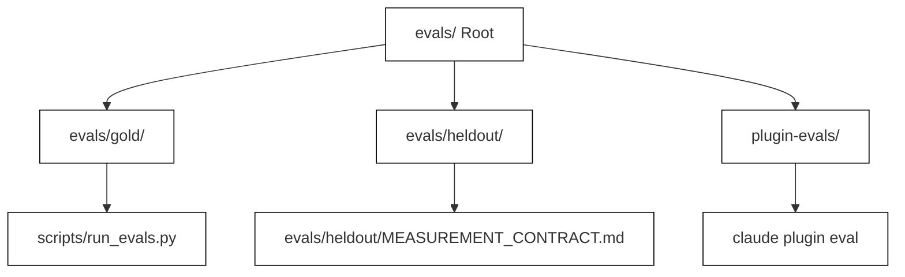

<!-- source: DeepWiki mcp.deepwiki.com · repo Imbad0202/academic-research-skills · page 15 Evaluation and Measurement Infrastructure · fetched 2026-10-30 -->

# Evaluation and Measurement Infrastructure

Relevant source files

The following files were used as context for generating this wiki page:

- [.github/pull_request_template.md](.github/pull_request_template.md)
- [.github/workflows/platform-port-reminder.yml](.github/workflows/platform-port-reminder.yml)
- [evals/README.md](evals/README.md)
- [evals/gold/citation_extraction/README.md](evals/gold/citation_extraction/README.md)
- [evals/heldout/MEASUREMENT_CONTRACT.md](evals/heldout/MEASUREMENT_CONTRACT.md)
- [evals/heldout/experiment_alignment_overclaim/README.md](evals/heldout/experiment_alignment_overclaim/README.md)
- [evals/heldout/experiment_alignment_overclaim/heldout_set.json](evals/heldout/experiment_alignment_overclaim/heldout_set.json)
- [evals/heldout/experiment_alignment_overclaim/passports/st2-01-negative-transfer.yaml](evals/heldout/experiment_alignment_overclaim/passports/st2-01-negative-transfer.yaml)
- [evals/heldout/experiment_alignment_overclaim/passports/st2-02-neighbour-attention.yaml](evals/heldout/experiment_alignment_overclaim/passports/st2-02-neighbour-attention.yaml)
- [evals/heldout/suite_registry.json](evals/heldout/suite_registry.json)
- [scripts/_eval_threshold_gate.py](scripts/_eval_threshold_gate.py)
- [scripts/check_ranking_lift.py](scripts/check_ranking_lift.py)
- [scripts/run_evals.py](scripts/run_evals.py)
- [scripts/test__eval_threshold_gate.py](scripts/test__eval_threshold_gate.py)
- [scripts/test_check_ranking_lift.py](scripts/test_check_ranking_lift.py)
- [scripts/test_experiment_alignment_overclaim_fixtures.py](scripts/test_experiment_alignment_overclaim_fixtures.py)
- [scripts/test_run_evals.py](scripts/test_run_evals.py)

The Academic Research Skills (ARS) measurement infrastructure provides automated validation across deterministic gold-set corpora, governed held-out behavioral suites, and plugin-level model bakeoffs. The `evals/` directory and its associated harnesses enforce regression gates, metric tracking, and protocol adherence across all skill executions.

*Sources: [evals/README.md:1-20](), [evals/heldout/MEASUREMENT_CONTRACT.md:1-13]()*

---

## 15.1 Gold Sets and `run_evals` Harness

The `evals/gold/` directory hosts self-contained measurement corpora for tasks like citation extraction, field norm severity, and RQ framing patterns [evals/README.md:1-20](). The multi-task evaluation harness `scripts/run_evals.py` discovers manifests, measures compliance against expected outcomes, and emits standardized lift reports [evals/README.md:22-30]().

For detailed coverage of test discovery, task manifests, threshold gates, and ranking lift enforcement via `scripts/check_ranking_lift.py`, see [Gold Sets and run_evals Harness](#15.1).

*Sources: [evals/README.md:1-46](), [scripts/run_evals.py:1-20]()*

---

## 15.2 Held-Out Suites and the Measurement Contract

The `evals/heldout/` directory houses suites that evaluate model and pipeline behavior on data not parsed by `scripts/run_evals.py` [evals/heldout/MEASUREMENT_CONTRACT.md:1-18](). Governed by `evals/heldout/MEASUREMENT_CONTRACT.md`, these suites utilize `evals/heldout/suite_registry.json` to map suites to execution classes such as `llm_judged`, `mechanical_match`, and `paired_controls` [evals/heldout/MEASUREMENT_CONTRACT.md:68-100]().

For a complete breakdown of suite registry classes, report schema enforcement, and specific suites like `reviewer_seeded_defects` and `revision_claim_drift`, see [Held-Out Suites and the Measurement Contract](#15.2).

*Sources: [evals/heldout/MEASUREMENT_CONTRACT.md:1-102](), [evals/heldout/suite_registry.json:1-17]()*

---

## 15.3 Plugin Eval Suites and Model Bakeoffs

Plugin-level evaluations test prompt bundles and integration hooks through suites under `plugin-evals/`, `plugin-evals-citation-check/`, and `plugin-evals-citation-locale/` [evals/heldout/MEASUREMENT_CONTRACT.md:1-10](). These suites run alongside comparative model bakeoffs in `evals/bakeoff/` to quantify cross-model degradation and delta scoring.

For details on grader architectures, model comparison runs, and execution protocols, see [Plugin Eval Suites and Model Bakeoffs](#15.3).

*Sources: [evals/README.md:1-10](), [evals/heldout/MEASUREMENT_CONTRACT.md:1-13]()*

---

