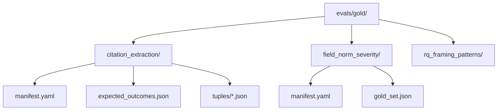

<!-- source: DeepWiki mcp.deepwiki.com · repo Imbad0202/academic-research-skills · page 15.1 Gold Sets and run_evals Harness · fetched 2026-10-30 -->

# Gold Sets and run_evals Harness

<details>
<summary>Relevant source files</summary>

The following files were used as context for generating this wiki page:

- [.github/pull_request_template.md](.github/pull_request_template.md)
- [.github/workflows/platform-port-reminder.yml](.github/workflows/platform-port-reminder.yml)
- [evals/README.md](evals/README.md)
- [evals/gold/citation_extraction/README.md](evals/gold/citation_extraction/README.md)
- [evals/gold/citation_extraction/expected_outcomes.json](evals/gold/citation_extraction/expected_outcomes.json)
- [evals/gold/citation_extraction/manifest.yaml](evals/gold/citation_extraction/manifest.yaml)
- [evals/gold/citation_extraction/tuples/051-fabricated-title-only-no-identifier.json](evals/gold/citation_extraction/tuples/051-fabricated-title-only-no-identifier.json)
- [evals/gold/field_norm_severity/README.md](evals/gold/field_norm_severity/README.md)
- [evals/gold/field_norm_severity/gold_set.json](evals/gold/field_norm_severity/gold_set.json)
- [evals/gold/field_norm_severity/manifest.yaml](evals/gold/field_norm_severity/manifest.yaml)
- [scripts/_eval_threshold_gate.py](scripts/_eval_threshold_gate.py)
- [scripts/check_215_field_norm.py](scripts/check_215_field_norm.py)
- [scripts/check_evals_gold_set.py](scripts/check_evals_gold_set.py)
- [scripts/check_field_norm_severity.py](scripts/check_field_norm_severity.py)
- [scripts/check_ranking_lift.py](scripts/check_ranking_lift.py)
- [scripts/citation_verification_summary.py](scripts/citation_verification_summary.py)
- [scripts/fixtures/check_evals_gold_set/clean/expected_outcomes.json](scripts/fixtures/check_evals_gold_set/clean/expected_outcomes.json)
- [scripts/run_evals.py](scripts/run_evals.py)
- [scripts/test__eval_threshold_gate.py](scripts/test__eval_threshold_gate.py)
- [scripts/test_check_field_norm_severity.py](scripts/test_check_field_norm_severity.py)
- [scripts/test_check_ranking_lift.py](scripts/test_check_ranking_lift.py)
- [scripts/test_citation_verification_summary.py](scripts/test_citation_verification_summary.py)
- [scripts/test_evals_citation_extraction.py](scripts/test_evals_citation_extraction.py)
- [scripts/test_run_evals.py](scripts/test_run_evals.py)

</details>


## Purpose and Scope
This page details the evaluation and measurement infrastructure of the Academic Research Skills (ARS) system, focusing on the `evals/gold/` corpora, the multi-task evaluation harness (`scripts/run_evals.py`), validation scripts, and the CI gating logic that prevents score and ranking regressions [evals/README.md:1-30](). ARS uses rigorous gold-set benchmarks to track performance across measurement targets such as citation extraction, field-norm severity classification, RQ framing patterns, and surface form parity.

---

## 1. Gold-Set Corpora and Suite Layout (`evals/gold/`)

The `evals/gold/` directory houses self-contained, structured gold subsets for specific measurement tasks [evals/README.md:1-5](). Each sub-directory includes a `manifest.yaml` [evals/README.md:22-25](), an `expected_outcomes.json` mapping, and a `tuples/` corpus directory [evals/README.md:10-16]().

### Citation Extraction Suite (`citation_extraction`)
The `citation_extraction` suite evaluates `verification_gate.verify_citation` accuracy across 51 hand-curated tuples [evals/gold/citation_extraction/manifest.yaml:1-24](). It targets a 3-class enum classification: `true`, `false`, and `unresolvable` [evals/gold/citation_extraction/manifest.yaml:24](). 
* **Distributions**: Includes valid DOIs (`n=20`), valid arXiv IDs (`n=10`), manual exemptions (`n=5`), fabricated citations (`n=15`), and a specialized `fabricated_title_only` coverage-gap fixture (`n=1`) that exercises the C-V6(a) narrow-false path [evals/gold/citation_extraction/manifest.yaml:37-52]().
* **Thresholds**: Enforces an aggregate accuracy threshold of $\ge 0.90$ and per-class thresholds of $\ge 0.85$ [evals/gold/citation_extraction/manifest.yaml:25-36]().

### Field-Norm Severity Regression Fixture (`field_norm_severity`)
Unlike outcome-gradable classification suites, the `#215` field-norm severity suite acts as a **first-party regression fixture** (`task_type: regression-fixture`) rather than a detector calibration set [scripts/check_field_norm_severity.py:2-10](). Because miscalibration in field norms or significance boundaries requires domain judgment rather than a deterministic predictor, the suite enforces structural completeness and stable first-party provenance back to source papers [scripts/check_field_norm_severity.py:2-10]().
* **Validation Schema**: Each item requires a `field_norm`, a `subtype` (`field_norm_boundary` or `significance_boundary`), `severity_miscalibration: true`, and a `provenance` block specifying `section`, `paper_citation`, and `verbatim_anchor` [scripts/check_field_norm_severity.py:29-37]().
* **Contextual Exceptions**: Items carrying an `-exception` ID suffix must declare `exception: true` and provide a non-empty `exception_reason` string (guarding against silent semantic drift) [scripts/check_field_norm_severity.py:31-35]().


*Sources: [evals/README.md:1-20](), [scripts/check_field_norm_severity.py:1-38](), [evals/gold/citation_extraction/manifest.yaml:1-52]()*

---

## 2. Gold-Set Validation and Integrity Architecture

To prevent data drift, corruption, or missing metadata in benchmark sets, the repository provides strict static validators.

### Gold Set Validator (`check_evals_gold_set.py`)
`scripts/check_evals_gold_set.py` enforces a comprehensive suite of structural invariants across any task directory under `evals/gold/` [scripts/check_evals_gold_set.py:1-13]().
* **Invariant I1 (Tuple alignment)**: Tuple filename stems must exactly match the keys present in `expected_outcomes.json` [scripts/check_evals_gold_set.py:90-104]().
* **Invariant I2 (ID matching)**: Each tuple's internal `tuple_id` must match its filename stem [scripts/check_evals_gold_set.py:114-118]().
* **Invariant I3 (Distribution sync)**: The sum and categories of observed tuple kinds must precisely match the `tuple_distribution` declared in `manifest.yaml` [scripts/check_evals_gold_set.py:120-162]().
* **Invariant I4 (JSON strictness)**: Files are loaded with duplicate-key protection enabled [scripts/check_evals_gold_set.py:66-76]().

### Field-Norm Severity Validator (`check_field_norm_severity.py`)
For the non-classification regression fixtures, `scripts/check_field_norm_severity.py` verifies metadata task types, structural item uniqueness, required provenance anchors, and paired exception-reason logic [scripts/check_field_norm_severity.py:40-132]().

```mermaid
graph TD
    CLI[""check_evals_gold_set.py""] --> Load[""_load_json_strict()""]
    Load --> Inv1[""I1: Tuple Stem Alignment""]
    Load --> Inv2[""I2: Tuple ID Match""]
    Load --> Inv3[""I3: Manifest Distribution""]
    Inv1 --> Validate[""Draft202012Validator Schema Check""]
    Inv2 --> Validate
    Inv3 --> Validate
    Validate --> Exit[""Exit 0 (Clean) or 1 (Violations)""]
```
*Sources: [scripts/check_evals_gold_set.py:1-80](), [scripts/check_field_norm_severity.py:40-135]()*

---

## 3. The `run_evals.py` Discovery and Execution Harness

The multi-task harness located at `scripts/run_evals.py` automates suite discovery, evaluation execution, and report synthesis [evals/README.md:22-30]().

### Discovery and Execution Flow
1. **Discovery**: The harness scans the `evals/gold/` directory, locating every `manifest.yaml` file [evals/README.md:22-25]().
2. **Execution**: For each discovered task, it loads the corresponding test tuples and expected outcomes, invokes the target entrypoint function, and calculates accuracy and error metrics across aggregate and per-class dimensions [scripts/test_evals_citation_extraction.py:112-133]().
3. **Report Generation**: Emits a unified JSON report adhering strictly to the schema defined in `shared/evals_lift_report.schema.json` [evals/README.md:22-25]().

```mermaid
graph TD
    CLI[""run_evals.py""] --> Disc[""Discover manifest.yaml under evals/gold/""]
    Disc --> Load[""Load tuples and expected_outcomes.json""]
    Load --> Exec[""Run Task Entrypoint""]
    Exec --> Reducer[""reduce_lookup_verified()""]
    Reducer --> Report[""Emit evals_lift_report.schema.json""]
```
*Sources: [scripts/test_evals_citation_extraction.py:112-143](), [evals/README.md:22-30]()*

---

## 4. Absolute Threshold Gates and Ranking Lift

Changes to generation logic, extractors, or scoring rules are governed by automated CI checks that evaluate metric performance against absolute thresholds and comparative lifts [scripts/_eval_threshold_gate.py:1-58](), [scripts/check_ranking_lift.py:1-27]().

### Absolute Threshold Gates (`_eval_threshold_gate.py`)
In environments lacking a main baseline (such as PRs introducing new measurement tasks), `scripts/_eval_threshold_gate.py` runs an absolute threshold check [scripts/_eval_threshold_gate.py:1-6](). It parses the `run_evals` output report and fails if any measured task falls below its declared aggregate or per-class threshold (`passed: false`), outputting failing keys to standard error [scripts/_eval_threshold_gate.py:26-58]().

### Ranking Lift and Anti-Regression Gating (`check_ranking_lift.py`)
When comparing a branch against a baseline report, `scripts/check_ranking_lift.py` computes polarity-corrected signed lifts [scripts/check_ranking_lift.py:1-27]().
* **Signed Lift Formula**: 
  * `higher_is_better`: $\frac{\text{compare} - \text{baseline}}{|\text{baseline}|}$ [scripts/check_ranking_lift.py:13-14]()
  * `lower_is_better`: $\frac{\text{baseline} - \text{compare}}{|\text{baseline}|}$ [scripts/check_ranking_lift.py:15-16]()
* **Zero-Baseline Handling**: Transitioning from zero produces `+inf` (improvement) or `-inf` (regression) [scripts/check_ranking_lift.py:17-19](). Pending tasks are filtered out of baselines to avoid spurious zero-baseline flags [scripts/check_ranking_lift.py:102-125]().
* **Gate Enforcement**: Blocks PRs if signed lift drops below `-0.05` or if zero-baseline metrics change adversely, unless overridden by the PR body containing the acknowledgement token `[ranking-regression-acknowledged]` and a link to an open GitHub issue [scripts/check_ranking_lift.py:20-27]().

```mermaid
graph TD
    Report[""run_evals Report""] --> Flat[""_flatten_report()""]
    Flat --> Lift[""compute_signed_lift()""]
    Lift --> Check[""_is_regression() / _is_zero_baseline_change()""]
    Check --> GateDecision{""Regressed past -0.05?""}
    GateDecision -- Yes --> AckCheck{""PR Body has [ranking-regression-acknowledged] + Open Issue?""}
    AckCheck -- Yes --> Pass[""Pass with Warning""]
    AckCheck -- No --> Block[""Block PR (Exit 1)""]
    GateDecision -- No --> Pass
```
*Sources: [scripts/check_ranking_lift.py:1-120](), [scripts/_eval_threshold_gate.py:26-58]()*

---

## 5. Pull Request Integration and Governance

Contributions altering scoring, ranking, or generation logic must explicitly declare eval impacts within the pull request template [.github/pull_request_template.md:1-24]().

* **Declaration Format**: Contributors must declare affected metrics individually using the exact syntax:
  ```markdown
  Affected metric: <task>.<class>.<metric>
  ```
  *(e.g., `Affected metric: citation_extraction.aggregate.accuracy`)* [.github/pull_request_template.md:17-24]()
* **Regression Acknowledgement**: If a metric regresses (`signed_lift < -0.05`) and is intentionally permitted, the PR body must include the appropriate token (`[eval-regression-acknowledged]` or `[ranking-regression-acknowledged]`) alongside a link to an open GitHub tracking issue [.github/pull_request_template.md:26-34]().

```mermaid
graph TD
    PR[""Pull Request Submission""] --> Template[""Check .github/pull_request_template.md""]
    Template --> EvalImpact{""Alters scoring/generation?""}
    EvalImpact -- Yes --> Declare[""Declare Affected metric: <task>.<class>.<metric>""]
    Declare --> RegressCheck{""Metric Regressed?""}
    RegressCheck -- Yes --> TokenCheck[""Provide [ranking-regression-acknowledged] + Open Issue URL""]
    TokenCheck --> Workflow[""GitHub Actions: eval-harness.yml""]
    RegressCheck -- No --> Workflow
    EvalImpact -- No --> Workflow
```
*Sources: [.github/pull_request_template.md:1-35](), [evals/README.md:22-33]()*

---

