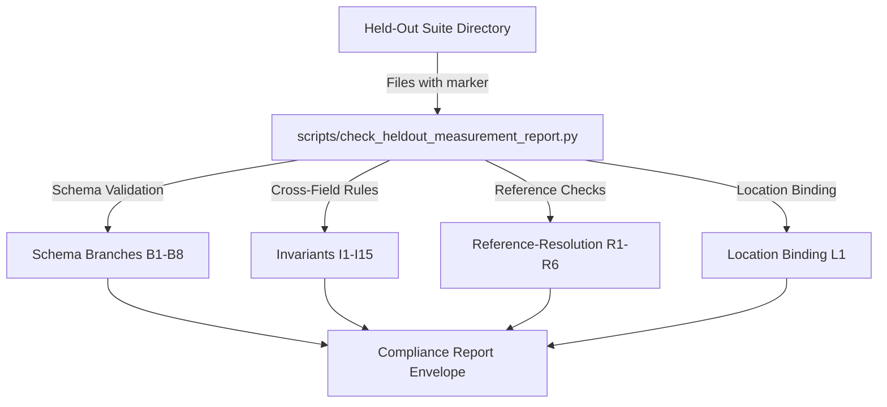
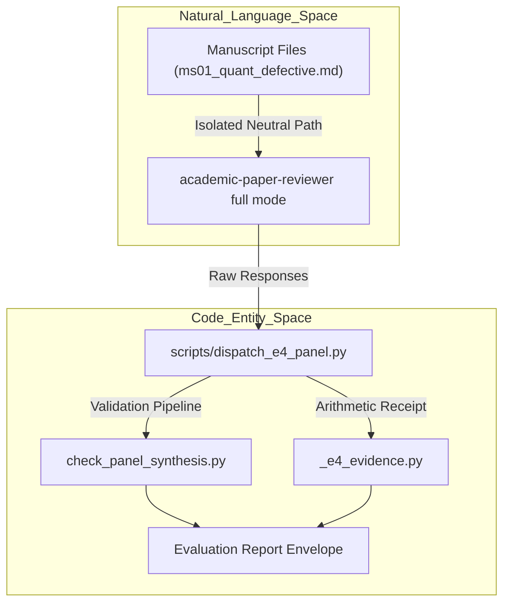

<!-- source: DeepWiki mcp.deepwiki.com · repo Imbad0202/academic-research-skills · page 15.2 Held-Out Suites and the Measurement Contract · fetched 2026-10-30 -->

# Held-Out Suites and the Measurement Contract

Relevant source files

The following files were used as context for generating this wiki page:

- [audits/rq-advisory-505-exemption-sharpening-2026-07-11.md](audits/rq-advisory-505-exemption-sharpening-2026-07-11.md)
- [audits/rq-advisory-heldout-measurement-2026-07-11.md](audits/rq-advisory-heldout-measurement-2026-07-11.md)
- [docs/design/2026-08-02-610-statistical-recompute-baseline-spec.md](docs/design/2026-08-02-610-statistical-recompute-baseline-spec.md)
- [evals/heldout/MEASUREMENT_CONTRACT.md](evals/heldout/MEASUREMENT_CONTRACT.md)
- [evals/heldout/experiment_alignment_overclaim/README.md](evals/heldout/experiment_alignment_overclaim/README.md)
- [evals/heldout/experiment_alignment_overclaim/heldout_set.json](evals/heldout/experiment_alignment_overclaim/heldout_set.json)
- [evals/heldout/experiment_alignment_overclaim/passports/st2-01-negative-transfer.yaml](evals/heldout/experiment_alignment_overclaim/passports/st2-01-negative-transfer.yaml)
- [evals/heldout/experiment_alignment_overclaim/passports/st2-02-neighbour-attention.yaml](evals/heldout/experiment_alignment_overclaim/passports/st2-02-neighbour-attention.yaml)
- [evals/heldout/reviewer_seeded_defects/README.md](evals/heldout/reviewer_seeded_defects/README.md)
- [evals/heldout/reviewer_seeded_defects/manifests/ms01_quant.defects.json](evals/heldout/reviewer_seeded_defects/manifests/ms01_quant.defects.json)
- [evals/heldout/reviewer_seeded_defects/manifests/ms02_qual.defects.json](evals/heldout/reviewer_seeded_defects/manifests/ms02_qual.defects.json)
- [evals/heldout/reviewer_seeded_defects/manuscripts/ms00_clean_control.md](evals/heldout/reviewer_seeded_defects/manuscripts/ms00_clean_control.md)
- [evals/heldout/reviewer_seeded_defects/manuscripts/ms01_quant_defective.md](evals/heldout/reviewer_seeded_defects/manuscripts/ms01_quant_defective.md)
- [evals/heldout/reviewer_seeded_defects/manuscripts/ms02_qual_defective.md](evals/heldout/reviewer_seeded_defects/manuscripts/ms02_qual_defective.md)
- [evals/heldout/rq_framing_offlist/README.md](evals/heldout/rq_framing_offlist/README.md)
- [evals/heldout/rq_framing_offlist/heldout_set.json](evals/heldout/rq_framing_offlist/heldout_set.json)
- [evals/heldout/rq_framing_offlist/judge_reasoning_excerpts.md](evals/heldout/rq_framing_offlist/judge_reasoning_excerpts.md)
- [evals/heldout/rq_framing_offlist/measurement-2026-07-11-505.json](evals/heldout/rq_framing_offlist/measurement-2026-07-11-505.json)
- [evals/heldout/rq_framing_offlist/measurement-2026-07-11.json](evals/heldout/rq_framing_offlist/measurement-2026-07-11.json)
- [evals/heldout/suite_registry.json](evals/heldout/suite_registry.json)
- [evals/heldout/within_session_ideation_diversity/README.md](evals/heldout/within_session_ideation_diversity/README.md)
- [evals/heldout/within_session_ideation_diversity/assignment_gate_receipt.schema.json](evals/heldout/within_session_ideation_diversity/assignment_gate_receipt.schema.json)
- [evals/heldout/within_session_ideation_diversity/first_round_delivery_marker.schema.json](evals/heldout/within_session_ideation_diversity/first_round_delivery_marker.schema.json)
- [evals/heldout/within_session_ideation_diversity/judge_assignment_ledger.schema.json](evals/heldout/within_session_ideation_diversity/judge_assignment_ledger.schema.json)
- [scripts/check_seeded_defect_fixtures.py](scripts/check_seeded_defect_fixtures.py)
- [scripts/dispatch_e4_panel.py](scripts/dispatch_e4_panel.py)
- [scripts/ideation_diversity_assignment_gate.py](scripts/ideation_diversity_assignment_gate.py)
- [scripts/resume_e4_record.py](scripts/resume_e4_record.py)
- [scripts/test_check_seeded_defect_fixtures.py](scripts/test_check_seeded_defect_fixtures.py)
- [scripts/test_dispatch_e4_panel.py](scripts/test_dispatch_e4_panel.py)
- [scripts/test_experiment_alignment_overclaim_fixtures.py](scripts/test_experiment_alignment_overclaim_fixtures.py)
- [scripts/test_ideation_diversity_assignment_gate.py](scripts/test_ideation_diversity_assignment_gate.py)
- [scripts/test_resume_e4_record.py](scripts/test_resume_e4_record.py)

## Purpose and Scope
Section 15.2 details the evaluation and measurement infrastructure housed under `evals/heldout/` within the Academic Research Skills (ARS) system (v3.23.x). Unlike golden sets (`evals/gold/`), which are discovered by `scripts/run_evals.py` and evaluated via deterministic script entrypoints, held-out suites target LLM agent behaviors, prompt modifications, and complex multi-turn qualitative outputs. Because these cannot be reduced to simple script assertions, they are governed by the **Held-Out Measurement Contract** (`evals/heldout/MEASUREMENT_CONTRACT.md`) and mapped through the authoritative `evals/heldout/suite_registry.json`.

Sources: `evals/heldout/MEASUREMENT_CONTRACT.md:1-34` [evals/heldout/MEASUREMENT_CONTRACT.md:1-34](), `evals/heldout/suite_registry.json:1-18` [evals/heldout/suite_registry.json:1-17]()

---

## 1. The Heldout-Measurement Contract Envelope
Issues #654 and #664 establish the heldout-measurement contract envelope (`heldout-measurement/1.1`). The contract defines machine artifacts including `measurement_report.schema.json`, `measurement_report.template.json`, `execution_manifest.schema.json`, and `suite_registry.json`. 

Enforcement is driven by validation scripts such as `scripts/check_heldout_measurement_report.py`, which checks schema branches B1–B8, cross-field invariants I1–I15, reference-resolution checks R1–R6 (covering rubrics, pre-registration plans, execution manifests, raw output paths, commit pins, and human-expert panel records), and location binding L1 (requiring a row filed under `evals/heldout/<dir>/` to declare `suite == <dir>`).

*Figure 1: Validation data flow from held-out suites to the measurement report checker.*

Sources: `evals/heldout/MEASUREMENT_CONTRACT.md:1-34` [evals/heldout/MEASUREMENT_CONTRACT.md:1-34]()

---

## 2. Suite Classes and the Registry
`evals/heldout/suite_registry.json` acts as the authoritative mapping of suites to suite classes. A contract report's `suite` property must correspond to a key in this registry, and its `suite_class` must match invariant I5.

| Suite | Class | Description / Notes |
| :--- | :--- | :--- |
| `revision_claim_drift` | `llm_judged` | Cross-model judge combined with maintainer adjudication |
| `unsupported_claim_recovery` | `llm_judged` | #825 drafting recovery route adjudication |
| `per_source_method_weaknesses` | `llm_judged` | #916 reading-output bounded absence checks |
| `experiment_alignment_overclaim` | `mechanical_match` | #915 provenance alignment checks against manuscript tables |
| `indirect_prompt_injection_behavior` | `paired_controls` | #675 2x2 synthetic behavioral probe |
| `reviewer_calibration` | `llm_judged` | Gold accept/reject labels with judge plans (#653) |
| `rq_framing_offlist` | `llm_judged` | Runtime LLM judge evaluating wording-pattern advisories |
| `pipeline_behavior_robustness` | `mechanical_match` | Full-expectation mechanical match |
| `reviewer_seeded_defects` | `seeded_manifest_adjudicated` | E4 machinery evaluating reviewer defect recall |
| `re_review_persuasion_invariance` | `paired_controls` | SD-11 paired controls reuses E4 machinery |
| `within_session_ideation_diversity` | `paired_controls` | #659 exploratory guardrail and adjacent probe comparisons |

### Suite Class Semantics
- **`mechanical_match`**: May run zero judges (`judge_plan.exception: "mechanical_suite"`, `adjudication.applies: false`). Pass/fail relies on direct mechanical comparison against documented expectations.
- **`llm_judged`** and **`seeded_manifest_adjudicated`**: Require `adjudication.applies: true` and at least one model judge.
- **`paired_controls`**: Requires model judges but typically omits adjudication; verdicts are per-pair expectation matches anchored to specification clauses.

Sources: `evals/heldout/MEASUREMENT_CONTRACT.md:70-102` [evals/heldout/MEASUREMENT_CONTRACT.md:70-102](), `evals/heldout/suite_registry.json:1-17` [evals/heldout/suite_registry.json:1-17]()

---

## 3. Reviewer Seeded-Defects Suite (`reviewer_seeded_defects`)
The `reviewer_seeded_defects` suite serves as a held-out acceptance instrument for reviewer-prompt changes (#574 E4 / #610 v0.2 prospective). It utilizes synthetic manuscripts containing planted, ground-truthed quality defects alongside a clean control manuscript to measure review quality.

*Figure 2: Bridging natural language manuscript evaluations to the E4 dispatch harness code entities.*

### Key Fixtures and Measurement Protocol
- **MS01**: Quantitative manuscript (educational technology) with 11 seeded defects (`evals/heldout/reviewer_seeded_defects/manuscripts/ms01_quant_defective.md`, `manifests/ms01_quant.defects.json`) [evals/heldout/reviewer_seeded_defects/README.md:28-31]().
- **MS02**: Qualitative/mixed manuscript (higher-education policy) with 9 seeded defects [evals/heldout/reviewer_seeded_defects/README.md:31]().
- **MS00**: Clean control manuscript with zero planted defects (`evals/heldout/reviewer_seeded_defects/manuscripts/ms00_clean_control.md`) [evals/heldout/reviewer_seeded_defects/README.md:32]().

The measurement protocol requires isolated execution where reviewer agents receive only the neutral-named manuscript path, skill files, and contract data. Replicates (at least 2 independent runs per manuscript condition) feed into strict recall adjudication (`DETECTED`, `PARTIAL`, `MISSED`).

Sources: `evals/heldout/reviewer_seeded_defects/README.md:1-108` [evals/heldout/reviewer_seeded_defects/README.md:1-108](), `scripts/dispatch_e4_panel.py:1-65` [scripts/dispatch_e4_panel.py:1-65]()

---

## 4. Revision Claim Drift and Re-Review Persuasion Invariance Suites
- **`revision_claim_drift`**: Measures whether claims drift in meaning or validation strength across revision loops. It employs cross-model judges paired with maintainer adjudication under version 1.0/1.1 contracts [evals/heldout/MEASUREMENT_CONTRACT.md:46-51]().
- **`re_review_persuasion_invariance`**: Uses paired controls (`paired_controls` suite class) to verify that re-reviews remain invariant to rhetorical adjustments, reusing E4 validation machinery (SD-11) [evals/heldout/MEASUREMENT_CONTRACT.md:86-90]().

Sources: `evals/heldout/MEASUREMENT_CONTRACT.md:46-51,86-90` [evals/heldout/MEASUREMENT_CONTRACT.md:46-51,86-90]()

---

## 5. Ideation Diversity Suite (`within_session_ideation_diversity`)
Issue #659 establishes the `within_session_ideation_diversity` suite to evaluate Layer-1 Socratic mechanisms. 

### Implementation Structure
The suite provides a file-only, no-call execution envelope for a 48-cell plan (2 experiments x 6 scenarios x 2 arms x 2 replicates). Key scripts and assets include:
- `evals/heldout/within_session_ideation_diversity/heldout_set.json` [evals/heldout/within_session_ideation_diversity/README.md:16-17]()
- `scripts/validate_ideation_diversity_assets.py`: Validates offline assets and materializes non-production variants [evals/heldout/within_session_ideation_diversity/README.md:49-50]()
- `scripts/run_ideation_diversity_no_call.py`: Handles plan initialization, materialization, validation, transcript ingestion, and blind packet preparation [evals/heldout/within_session_ideation_diversity/README.md:51-55]()
- `scripts/ideation_diversity_assignment_gate.py`: Operates the assignment-ledger gate (`verify` + `deliver`) [evals/heldout/within_session_ideation_diversity/README.md:54-55]()

Sources: `evals/heldout/within_session_ideation_diversity/README.md:1-55` [evals/heldout/within_session_ideation_diversity/README.md:1-55]()

---

## 6. RQ Framing Off-List Suite (`rq_framing_offlist`)
Issue #501 Part 2 defines the held-out measurement set for the Socratic wording-pattern advisory's runtime LLM judge.

### Architecture and Evaluation
The suite evaluates research question shells that bypass surface-form regex patterns. 
- **Dataset Construction**: Contains 32 shell items (23 `family_variant` and 9 `off_list`) plus 16 domain-native hard negatives (total 48 items) [evals/heldout/rq_framing_offlist/README.md:70-71]().
- **Protocol**: An isolated LLM judge receives the `## Wording-Pattern Advisory` text and mini-batches of items, determining fire/silent status independently without repository access [evals/heldout/rq_framing_offlist/README.md:73-80]().

Sources: `evals/heldout/rq_framing_offlist/README.md:1-84` [evals/heldout/rq_framing_offlist/README.md:1-84]()

---

## 7. Experiment Alignment Overclaim Suite (`experiment_alignment_overclaim`)
Issue #915 introduces the `experiment_alignment_overclaim` suite (`mechanical_match`), which tests whether the integrity verification agent's C4 check (Experiment Provenance & Claim Alignment) correctly identifies overstatements in manuscript claims relative to their underlying data tables.

### Passports and Scenarios
- **Source Material**: Built from the DynaSpec-RAG showcase manuscript (Nam et al., 2026, arXiv:2609.19644 v1) [evals/heldout/experiment_alignment_overclaim/README.md:8-10]().
- **Cases**:
  - `st2-01` (`passports/st2-01-negative-transfer.yaml`): Evaluates unconditional claims over validation-scoped results. Expected verdicts include `OVERSTATED` or `NOT_SUPPORTED_BY_PROVENANCE` alongside control claims marked `ALIGNED` [evals/heldout/experiment_alignment_overclaim/heldout_set.json:30-60]().
  - `st2-02` (`passports/st2-02-neighbour-attention.yaml`): Evaluates component credit isolation in ablation studies [evals/heldout/experiment_alignment_overclaim/heldout_set.json:69-90]().
- **Validation Script**: `scripts/test_experiment_alignment_overclaim_fixtures.py` verifies passport schemas and ensures answer keys are not leaked to subject-visible inputs [scripts/test_experiment_alignment_overclaim_fixtures.py:1-87]().

Sources: `evals/heldout/experiment_alignment_overclaim/README.md:1-23` [evals/heldout/experiment_alignment_overclaim/README.md:1-22](), `evals/heldout/experiment_alignment_overclaim/heldout_set.json:1-46` [evals/heldout/experiment_alignment_overclaim/heldout_set.json:1-46](), `scripts/test_experiment_alignment_overclaim_fixtures.py:1-40` [scripts/test_experiment_alignment_overclaim_fixtures.py:1-40]()

---

