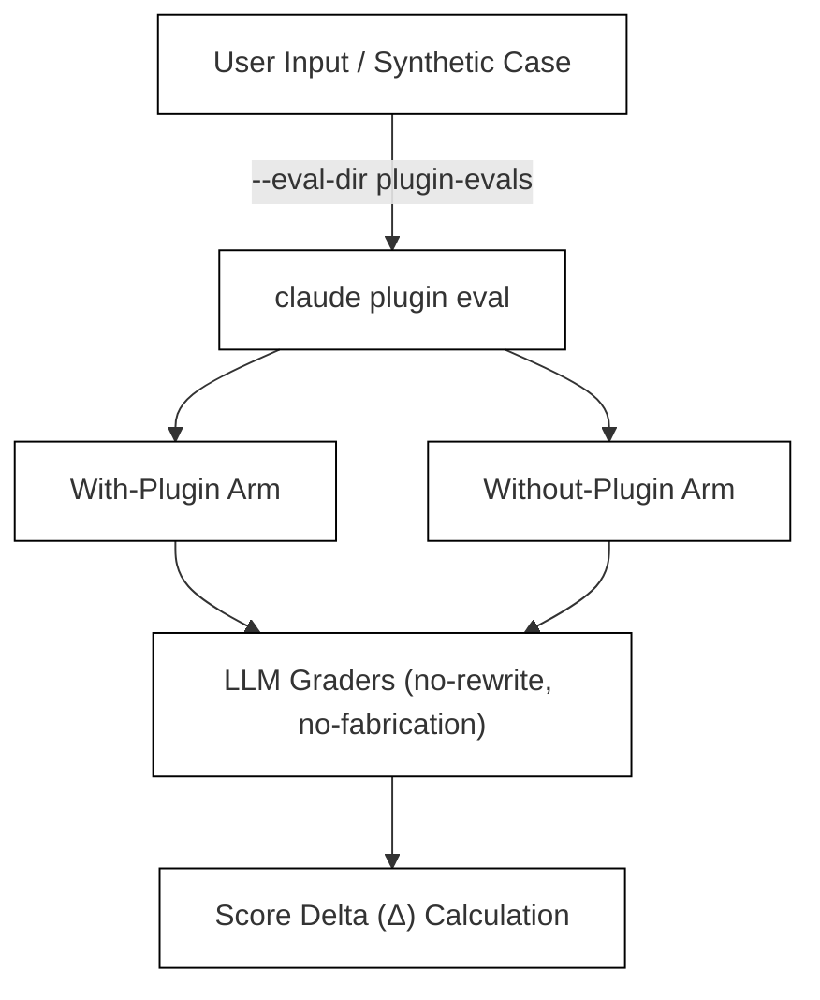
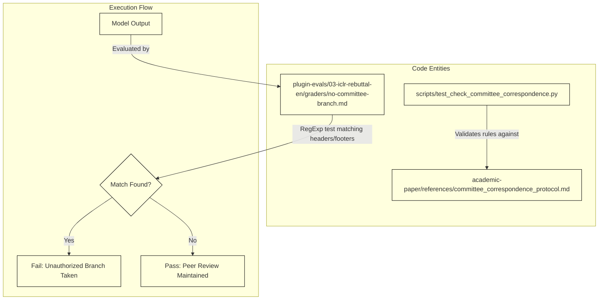
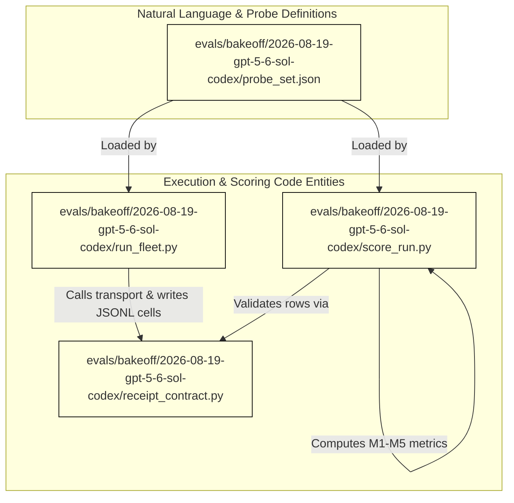

<!-- source: DeepWiki mcp.deepwiki.com · repo Imbad0202/academic-research-skills · page 15.3 Plugin Eval Suites and Model Bakeoffs · fetched 2026-10-30 -->

# Plugin Eval Suites and Model Bakeoffs

<details>
<summary>Relevant source files</summary>

The following files were used as context for generating this wiki page:

- [academic-paper/references/committee_correspondence_protocol.md](academic-paper/references/committee_correspondence_protocol.md)
- [audits/bakeoff-gpt-5-6-sol-codex-2026-08-19.md](audits/bakeoff-gpt-5-6-sol-codex-2026-08-19.md)
- [evals/bakeoff/2026-08-19-gpt-5-6-sol-codex/probe_set.json](evals/bakeoff/2026-08-19-gpt-5-6-sol-codex/probe_set.json)
- [evals/bakeoff/2026-08-19-gpt-5-6-sol-codex/receipt_contract.py](evals/bakeoff/2026-08-19-gpt-5-6-sol-codex/receipt_contract.py)
- [evals/bakeoff/2026-08-19-gpt-5-6-sol-codex/run7_call_index.jsonl](evals/bakeoff/2026-08-19-gpt-5-6-sol-codex/run7_call_index.jsonl)
- [evals/bakeoff/2026-08-19-gpt-5-6-sol-codex/run7_receipts_gpt-5.5.jsonl](evals/bakeoff/2026-08-19-gpt-5-6-sol-codex/run7_receipts_gpt-5.5.jsonl)
- [evals/bakeoff/2026-08-19-gpt-5-6-sol-codex/run7_receipts_gpt-5.6-sol.jsonl](evals/bakeoff/2026-08-19-gpt-5-6-sol-codex/run7_receipts_gpt-5.6-sol.jsonl)
- [evals/bakeoff/2026-08-19-gpt-5-6-sol-codex/run_fleet.py](evals/bakeoff/2026-08-19-gpt-5-6-sol-codex/run_fleet.py)
- [evals/bakeoff/2026-08-19-gpt-5-6-sol-codex/score_run.py](evals/bakeoff/2026-08-19-gpt-5-6-sol-codex/score_run.py)
- [plugin-evals-citation-check/01-apa-en-misattribution/graders/skill-fired.md](plugin-evals-citation-check/01-apa-en-misattribution/graders/skill-fired.md)
- [plugin-evals-citation-check/02-apa-zh-mixed-overclaim/graders/skill-fired.md](plugin-evals-citation-check/02-apa-zh-mixed-overclaim/graders/skill-fired.md)
- [plugin-evals-citation-check/03-ieee-en-prose/graders/skill-fired.md](plugin-evals-citation-check/03-ieee-en-prose/graders/skill-fired.md)
- [plugin-evals-citation-check/04-vancouver-en-terse-retraction/graders/skill-fired.md](plugin-evals-citation-check/04-vancouver-en-terse-retraction/graders/skill-fired.md)
- [plugin-evals-citation-check/05-apa-es-locale/graders/skill-fired.md](plugin-evals-citation-check/05-apa-es-locale/graders/skill-fired.md)
- [plugin-evals-citation-check/06-chicago-nb-en-footnotes/graders/skill-fired.md](plugin-evals-citation-check/06-chicago-nb-en-footnotes/graders/skill-fired.md)
- [plugin-evals-citation-check/README.md](plugin-evals-citation-check/README.md)
- [plugin-evals/03-iclr-rebuttal-en/graders/no-committee-branch.md](plugin-evals/03-iclr-rebuttal-en/graders/no-committee-branch.md)
- [plugin-evals/03-iclr-rebuttal-en/graders/no-fabrication.md](plugin-evals/03-iclr-rebuttal-en/graders/no-fabrication.md)
- [plugin-evals/03-iclr-rebuttal-en/graders/pushback-per-reviewer.md](plugin-evals/03-iclr-rebuttal-en/graders/pushback-per-reviewer.md)
- [plugin-evals/README.md](plugin-evals/README.md)
- [scripts/test_check_committee_correspondence.py](scripts/test_check_committee_correspondence.py)

</details>


## Purpose and Scope

This page documents the evaluation and measurement infrastructure for `claude plugin eval` suites (`plugin-evals/` and `plugin-evals-citation-check/`) and cross-model promotion bakeoffs (`evals/bakeoff/`). It details how prompt regressions, instruction-following fidelity, citation auditing accuracy, and cross-model transport performance are quantitatively measured using delta ($\Delta$) scoring, ablation runners, deterministic validators, and frozen probe sets.

---

## 1. Plugin Eval Framework and Revision Coach Suite (`plugin-evals/`)

The `plugin-evals/` suite evaluates the `academic-paper` revision-coach flow using `claude plugin eval` [plugin-evals/README.md:1-5](). The primary evaluation axis is **unauthorized rewriting prevention**—ensuring the model does not draft manuscript prose without instructions, alter unrequested items, or assert unperformed experiments [plugin-evals/README.md:7-10]().

### Evaluation Architecture and Command Execution
Suites are executed via the CLI evaluation harness with configurable ablations and judge models [plugin-evals/README.md:17-19]():
```bash
claude plugin eval . --eval-dir plugin-evals --ablation with-without --judge-model sonnet
```
The headline metric is $\Delta$ (score with plugin minus score without plugin) across 3 runs per case [plugin-evals/README.md:21-22](). Synthetic test cases exercise mixed journal formats, editor decision letters, ICLR rebuttals, ethics committee letters, and negative control scenarios [plugin-evals/README.md:28-34]().


*Sources: [plugin-evals/README.md:1-22]()*, *[plugin-evals/README.md:28-34]()*

### Committee-Branch Guard and Routing Retests
To prevent peer-review flows from improperly triggering the `#668` committee correspondence protocol, case 03 incorporates a specialized regex guard (`no-committee-branch.md`) [plugin-evals/README.md:61-68](). The deterministic validation of this guard is executed via `scripts/test_check_committee_correspondence.py` [plugin-evals/README.md:69-73]().


*Sources: [plugin-evals/README.md:61-78]()*, *[plugin-evals/references/committee_correspondence_protocol.md:1-15]()*, *[scripts/test_check_committee_correspondence.py:111-152]()*

Sources:
- `plugin-evals/README.md:1-122`
- `plugin-evals/03-iclr-rebuttal-en/graders/no-committee-branch.md:1-9`
- `scripts/test_check_committee_correspondence.py:111-152`

---

## 2. Citation Check Evaluation Suite (`plugin-evals-citation-check/`)

The `plugin-evals-citation-check/` suite evaluates the `citation-check` mode of `academic-paper`, validating detection of reference errors given a manuscript excerpt, bibliography, and offline source pack [plugin-evals-citation-check/README.md:1-6]().

### Core Citation Failure Taxonomy
Graders enforce four primary citation error categories [plugin-evals-citation-check/README.md:8-14]():
1. **無中生有 (Hallucination)**: Referencing items absent from the source pack; graded as unverifiable without claiming online existence.
2. **張冠李戴 (Misattribution)**: Right paper, wrong authors.
3. **小題大作 (Overclaim)**: Citing hedged or minor findings as established results.
4. **以訛傳訛 (Retraction propagation)**: Citing retracted or concern-flagged papers as live evidence.

Secondary axes verify mechanical error detection (orphans, et al. usage, ampersand conventions), absence of false positives on clean entries, and language/locale adherence (e.g., APA 7 Spanish or Chinese formatting) [plugin-evals-citation-check/README.md:15-18]().

Sources:
- `plugin-evals-citation-check/README.md:1-112`

---

## 3. Committee Correspondence Protocol and Guard Implementation (`#668`)

The committee correspondence protocol (`committee_correspondence_protocol.md`) structures correspondence from institutional review boards or administrative committees [academic-paper/references/committee_correspondence_protocol.md:1-7]().

### Protocol Rules and Bundle Layout
1. **Activation Gate**: Used exclusively when the user identifies input as a letter from a real committee/institutional review office [academic-paper/references/committee_correspondence_protocol.md:15-21](). Peer reviews from journals or conferences remain under standard revision-coach flows [academic-paper/references/committee_correspondence_protocol.md:22-25]().
2. **Bundle Layout**: Stored under `committee_correspondence/<source_sha256_first_12>/` containing `source_letter.txt`, `concern_tracker.json`, and `response_skeleton.md` [academic-paper/references/committee_correspondence_protocol.md:65-74]().
3. **Classification Taxonomy**: `authority_status` must be one of `explicitly_required`, `conditional`, `question`, `suggestion`, or `unclear` [academic-paper/references/committee_correspondence_protocol.md:79-88](). `action_type[]` supports multi-valued actions (`design`, `explanation`, `revise_artifact`, `add_artifact`, `administrative`, `legal_or_policy_check`) [academic-paper/references/committee_correspondence_protocol.md:89-97]().

Sources:
- `academic-paper/references/committee_correspondence_protocol.md:1-162`
- `scripts/test_check_committee_correspondence.py:1-170`

---

## 4. Promotion Bakeoffs and Model Comparison Runs (`evals/bakeoff/`)

Promotion bakeoffs evaluate alternative models (e.g., `gpt-5.6-sol`) over containerized citation transport layers (e.g., ChatGPT-subscription codex) [audits/bakeoff-gpt-5-6-sol-codex-2026-08-19.md:1-12]().

### Probe Set and Evaluation Measures
The probe set (`probe_set.json`) comprises 30 references: 20 real (10 easy DOI-keyed, 10 hard preprints/non-English) and 10 synthetic fabrications [evals/bakeoff/2026-08-19-gpt-5-6-sol-codex/probe_set.json:1-6]().

Scoring is executed via `score_run.py`, evaluating five official bakeoff measures [evals/bakeoff/2026-08-19-gpt-5-6-sol-codex/score_run.py:1-12]():
1. **Grounded Completion Rate ($M_1$)**: Proportion of calls successfully completing search validation [evals/bakeoff/2026-08-19-gpt-5-6-sol-codex/score_run.py:137]().
2. **Fabrication Recall ($M_2$)**: Proportion of synthetic fabrications correctly identified as `NOT_FOUND` or `MISMATCH` [evals/bakeoff/2026-08-19-gpt-5-6-sol-codex/score_run.py:33-138]().
3. **False Disagreement Rate ($M_3$)**: Proportion of real references incorrectly flagged as discordant [evals/bakeoff/2026-08-19-gpt-5-6-sol-codex/score_run.py:139]().
4. **Shape-Guard Misfires ($M_4$)**: Zero fail-closed receipt-guard exceptions across execution streams [audits/bakeoff-gpt-5-6-sol-codex-2026-08-19.md:12]().
5. **p95 Latency ($M_5$)**: Nearest-rank 95th percentile wall-clock execution time [evals/bakeoff/2026-08-19-gpt-5-6-sol-codex/score_run.py:55-141]().


*Sources: [evals/bakeoff/2026-08-19-gpt-5-6-sol-codex/probe_set.json:1-10](), [evals/bakeoff/2026-08-19-gpt-5-6-sol-codex/run_fleet.py:1-40](), [evals/bakeoff/2026-08-19-gpt-5-6-sol-codex/score_run.py:1-82]()*

Sources:
- `evals/bakeoff/2026-08-19-gpt-5-6-sol-codex/probe_set.json:1-10`
- `evals/bakeoff/2026-08-19-gpt-5-6-sol-codex/run_fleet.py:1-50`
- `evals/bakeoff/2026-08-19-gpt-5-6-sol-codex/score_run.py:1-148`
- `audits/bakeoff-gpt-5-6-sol-codex-2026-08-19.md:1-44`

---

