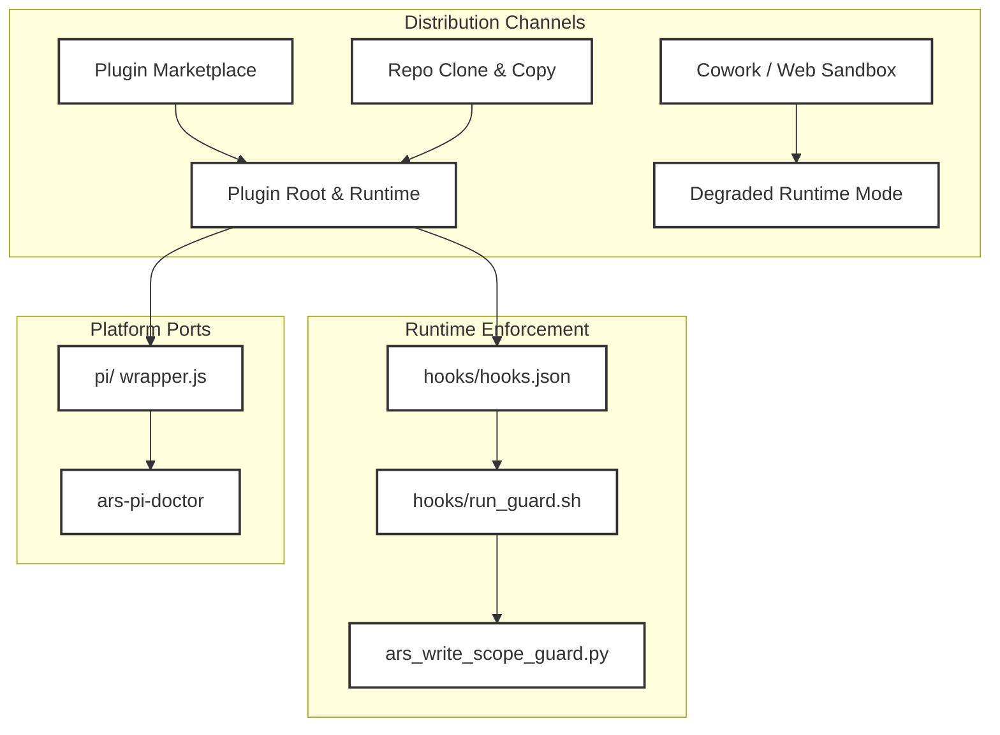
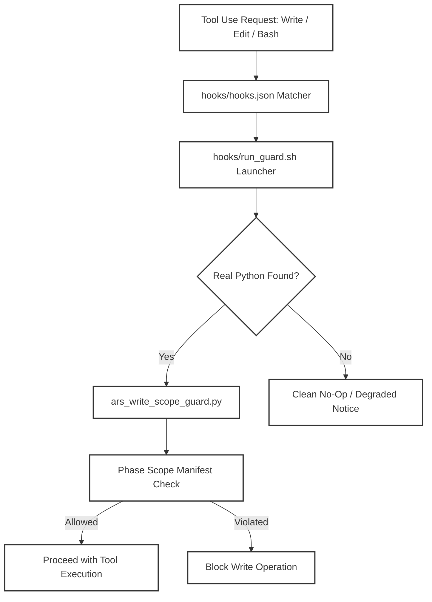
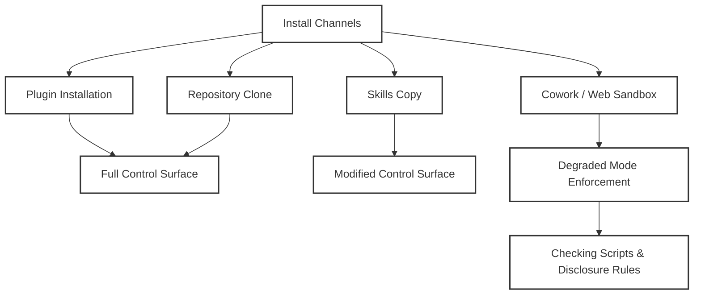
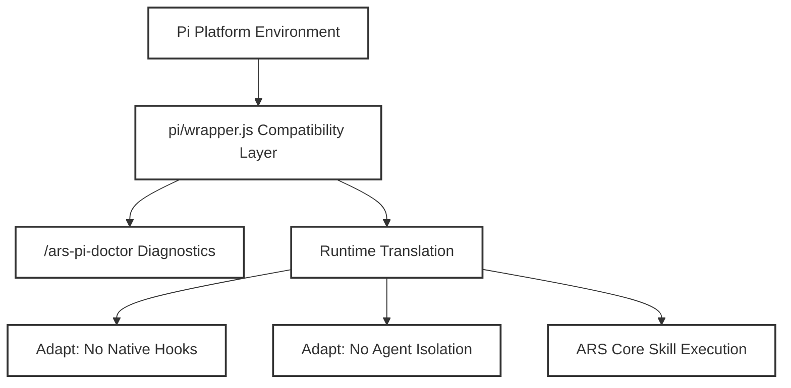

<!-- source: DeepWiki mcp.deepwiki.com · repo Imbad0202/academic-research-skills · page 16 Distribution, Runtime Guards and Platform Ports · fetched 2026-10-30 -->

# Distribution, Runtime Guards and Platform Ports

Relevant source files

The following files were used as context for generating this wiki page:

- [docs/PERFORMANCE.md](docs/PERFORMANCE.md)
- [docs/PERFORMANCE.zh-TW.md](docs/PERFORMANCE.zh-TW.md)
- [docs/SETUP.md](docs/SETUP.md)
- [docs/SETUP.zh-TW.md](docs/SETUP.zh-TW.md)
- [docs/design/2026-04-30-ars-v3.7.0-plugin-packaging-roadmap.md](docs/design/2026-04-30-ars-v3.7.0-plugin-packaging-roadmap.md)
- [hooks/hooks.json](hooks/hooks.json)
- [shared/cross_model_verification.md](shared/cross_model_verification.md)

## Overview and Scope

The Academic Research Skills (ARS) distribution and runtime enforcement framework governs how the system is packaged, installed across diverse deployment channels, and safeguarded against unintended file modifications or platform capability gaps. Because ARS operates across multiple environments—ranging from native local repositories and plugin marketplaces to restricted web and Cowork environments—its packaging architecture couples flexible deployment with strict runtime guardrails. 

This parent page introduces the high-level distribution topology, runtime enforcement mechanisms, and platform compatibility wrappers. For exhaustive technical specifications, implementation internals, and operational playbooks, consult the designated child pages linked throughout.

**Sources:**
- `hooks/hooks.json:1-25` [hooks/hooks.json:1-25]()
- `docs/SETUP.md:15-19` [docs/SETUP.md:15-19]()

---

## 16.1. Hooks and Write-Scope Guard

To prevent agents from modifying files outside their authorized phase scope or stepping outside designated workspace boundaries, ARS integrates event-driven runtime hooks and write-scope guards. Defined via `hooks/hooks.json`, the environment registers `SessionStart` and `PreToolUse` hooks [hooks/hooks.json:3-23](). 

The `PreToolUse` hook intercepts file-modifying tools (`Write`, `Edit`, `MultiEdit`, `Bash`) [hooks/hooks.json:15](), passing execution to the POSIX shell launcher `hooks/run_guard.sh` [hooks/hooks.json:19](). This launcher evaluates the request against phase scope manifests via Python validators (such as `ars_write_scope_guard.py`), ensuring that plugin-root protection is enforced. On platforms lacking a real Python interpreter or POSIX shell support (such as Windows environments lacking Git Bash), the guard degrades gracefully, failing open or logging non-blocking notices [docs/SETUP.md:17-19]().

For details on hook configuration, write-scope manifests, plugin-root protection rules, and Windows Python/Git Bash portability considerations, see [Hooks and Write-Scope Guard](#16.1).

**Sources:**
- `hooks/hooks.json:1-25` [hooks/hooks.json:1-25]()
- `docs/SETUP.md:15-19` [docs/SETUP.md:15-19]()

---

## 16.2. Control Availability by Install Channel

ARS supports multiple installation and execution channels, including Claude Code plugin installations, direct skills copies, full repository clones, Anthropic Cowork sessions, and web-based execution. Because different environments restrict shell access, local file writing, or subagent spawning to varying degrees, feature availability shifts across channels.

The conformance and capability matrix maintained in documentation (`docs/CONTROL_AVAILABILITY.md`) tracks these capabilities. When running in restricted environments, ARS detects missing capabilities and enters a disclosed degraded mode, governed by automated checking scripts that verify environment invariants before launching complex orchestration pipelines.

For a complete breakdown of feature matrices across channels, degraded-mode disclosure rules, and checking scripts, see [Control Availability by Install Channel](#16.2).

**Sources:**
- `docs/SETUP.md:7-13` [docs/SETUP.md:7-13]()

---

## 16.3. Pi Platform Wrapper

To support execution within the Pi platform ecosystem, ARS provides a compatibility layer located in the `pi/` directory. Because the Pi runtime environment presents structural differences from native Claude Code—notably the absence of native subagent isolation and event-driven hook execution—the platform wrapper bridges these gaps.

The Pi wrapper centers around `pi/wrapper.js` and diagnostic tooling such as `/ars-pi-doctor`. It manages load-bearing runtime differences, ensuring that prompt execution, file parsing, and schema generation function correctly despite the lack of underlying hook infrastructure. Empirical validation runs for these environments are documented under `examples/pi/`.

For deep technical documentation on `pi/wrapper.js`, diagnostic commands, runtime differences, and the `examples/pi` degraded-mode evidence runs, see [Pi Platform Wrapper](#16.3).

**Sources:**
- `docs/SETUP.md:35-37` [docs/SETUP.md:35-37]()

---

