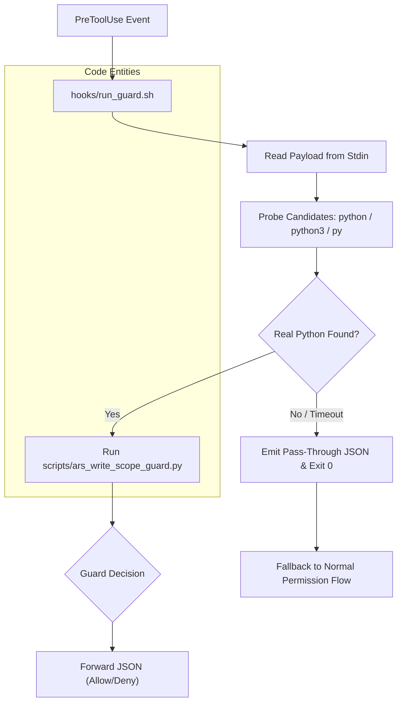
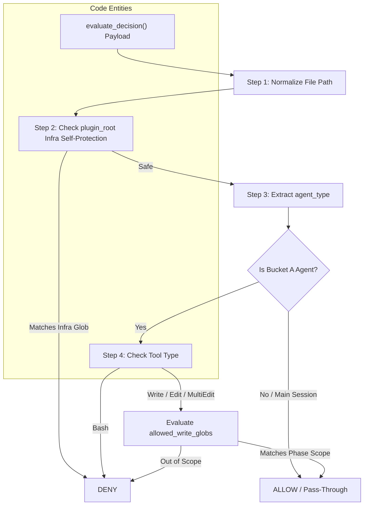

<!-- source: DeepWiki mcp.deepwiki.com · repo Imbad0202/academic-research-skills · page 16.1 Hooks and Write-Scope Guard · fetched 2026-10-30 -->

# Hooks and Write-Scope Guard

<details>
<summary>Relevant source files</summary>

The following files were used as context for generating this wiki page:

- [.gitattributes](.gitattributes)
- [docs/design/2026-04-30-ars-v3.7.0-plugin-packaging-roadmap.md](docs/design/2026-04-30-ars-v3.7.0-plugin-packaging-roadmap.md)
- [docs/design/2026-06-01-ars-134-conductor-rescope-deterministic-write-guard-spec.md](docs/design/2026-06-01-ars-134-conductor-rescope-deterministic-write-guard-spec.md)
- [docs/design/2026-06-16-448-infra-protection-plugin-root-scope-spec.md](docs/design/2026-06-16-448-infra-protection-plugin-root-scope-spec.md)
- [docs/design/2026-06-17-454-windows-python-hook-portability-design.md](docs/design/2026-06-17-454-windows-python-hook-portability-design.md)
- [hooks/hooks.json](hooks/hooks.json)
- [hooks/run_guard.sh](hooks/run_guard.sh)
- [scripts/ars_phase_scope_manifest.json](scripts/ars_phase_scope_manifest.json)
- [scripts/ars_write_scope_guard.py](scripts/ars_write_scope_guard.py)
- [scripts/check_agents_mirror_sync.py](scripts/check_agents_mirror_sync.py)
- [scripts/check_v3_10_134_write_scope.py](scripts/check_v3_10_134_write_scope.py)
- [scripts/test_ars_write_scope_guard.py](scripts/test_ars_write_scope_guard.py)
- [scripts/test_check_agents_mirror_sync.py](scripts/test_check_agents_mirror_sync.py)
- [scripts/test_check_v3_10_134_write_scope.py](scripts/test_check_v3_10_134_write_scope.py)
- [scripts/test_run_guard_launcher.py](scripts/test_run_guard_launcher.py)

</details>


### Purpose and Scope
This page documents the Academic Research Skills (ARS) runtime hook architecture, focusing on deterministic file-write enforcement for single-phase agents, Windows Python portability, and infrastructure self-protection. It covers `hooks/hooks.json` [hooks/hooks.json:1-25](), the launcher script `hooks/run_guard.sh` [hooks/run_guard.sh:1-116](), the write-scope guard `scripts/ars_write_scope_guard.py` [scripts/ars_write_scope_guard.py:35-115](), the phase scope manifest `scripts/ars_phase_scope_manifest.json` [scripts/ars_phase_scope_manifest.json:1-27](), and the plugin-root scoping mechanisms introduced in issue #448 [docs/design/2026-06-16-448-infra-protection-plugin-root-scope-spec.md:1-119]().

---

## 1. Hook Infrastructure and Routing

The ARS plugin registers runtime hooks via `hooks/hooks.json`. The configuration establishes two primary event bindings: a `SessionStart` hook that announces the loaded plugin environment, and a `PreToolUse` hook that intercepts mutation tools (`Write`, `Edit`, `MultiEdit`, and `Bash`) to enforce phase write-scopes.

```json
{
  "hooks": {
    "SessionStart": [
      {
        "hooks": [
          {
            "type": "command",
            "command": "bash \"${CLAUDE_PLUGIN_ROOT}/scripts/announce-ars-loaded.sh\""
          }
        ]
      }
    ],
    "PreToolUse": [
      {
        "matcher": "Write|Edit|MultiEdit|Bash",
        "hooks": [
          {
            "type": "command",
            "command": "bash \"${CLAUDE_PLUGIN_ROOT}/hooks/run_guard.sh\""
          }
        ]
      }
    ]
  }
}
```

Sources: `[hooks/hooks.json:1-25]()`

---

## 2. Windows Python Portability & The Launcher

On Windows platforms, invoking `python3` non-interactively frequently hits 0-byte Microsoft Store App Execution Alias stubs rather than a functioning interpreter. If a hook script attempts to execute `python3` directly, it fails before the Python script's internal logic can execute, producing environment errors and hook log spam.

To resolve this, ARS routes all `PreToolUse` hook invocations through `hooks/run_guard.sh`. The launcher acts as a supervised runner that:
1. Derives the absolute path to `scripts/ars_write_scope_guard.py` relative to its own location.
2. Captures the hook JSON payload from standard input once.
3. Probes candidate Python interpreters on `PATH`, validating them against an execution marker probe (`ARS_PY_OK`).
4. Binds a wall-clock timeout (using GNU `timeout` or a portable process-group watchdog fallback) to prevent hanging interpreters from blocking the hot path.
5. Implements **Plan A graceful degradation**: if no real Python interpreter is verified, or if the guard subprocess encounters an unhandled failure, the launcher emits a canonical pass-through JSON payload (`{"hookSpecificOutput":{"hookEventName":"PreToolUse"}}`) and exits with status `0`. It never exits non-zero on infrastructure gaps, ensuring users are never locked out of write operations.



Sources: `[hooks/run_guard.sh:1-116](), [hooks/run_guard.sh:117-255]()`

---

## 3. The Write-Scope Guard Core

The core evaluation logic resides in `scripts/ars_write_scope_guard.py`. Exposed as a pure function `evaluate_decision(payload, manifest, workspace_root, plugin_root)` [scripts/test_ars_write_scope_guard.py:5-6](), the guard processes payloads deterministically through sequential evaluation layers:

1. **Path Normalization (Step 1):** Resolves the target file path against `workspace_root`, ensuring absolute resolution, symlink traversal safety, and confinement checking.
2. **Infrastructure Self-Protection (Step 2):** Checks whether the target file resolves inside `plugin_root` and matches `INFRA_PROTECTED_GLOBS` (e.g., `hooks/hooks.json`, `.claude-plugin/plugin.json`, guard scripts, agent source files). If matched, the write is denied unconditionally to prevent subagents from neutering the guard [docs/design/2026-06-16-448-infra-protection-plugin-root-scope-spec.md:1-60]().
3. **Agent Gating (Step 3):** Extracts `agent_type` from the subagent payload. If the agent maps to a Bucket A single-phase role in the manifest, its target path is checked against `allowed_write_globs`. Main session payloads or unmapped agents bypass this gate.
4. **Tool-Specific Constraints (Step 4):** 
   - Structured tools (`Write`, `Edit`, `MultiEdit`) are verified against single top-level file paths.
   - **Bash execution by Bucket A agents is denied wholesale.** Due to the impossibility of distinguishing read-only versus mutation commands statically without a sandbox, all Bash execution for fenced agents is blocked [docs/design/2026-06-01-ars-134-conductor-rescope-deterministic-write-guard-spec.md:9-22]().



Sources: `[scripts/ars_write_scope_guard.py:35-115](), [scripts/test_ars_write_scope_guard.py:1-40]()`

---

## 4. Phase Scope Manifest and Bucket A Fencing

Permitted write scopes for the 23 Bucket A single-phase agents are defined in `scripts/ars_phase_scope_manifest.json`. Each entry maps an agent's frontmatter `name` to an allowed workspace glob (`allowed_write_globs`), ensuring agents write exclusively into their designated phase directories (`phaseN_*/`) [scripts/ars_phase_scope_manifest.json:1-12]().

```json
{
  "version": 1,
  "spec": "docs/design/2026-06-01-ars-134-conductor-rescope-deterministic-write-guard-spec.md",
  "source": "docs/design/2026-05-18-ars-v3.9.2-agent-phase-classification.md",
  "agents": {
    "research_question_agent": {
      "bucket": "A",
      "skill": "deep-research",
      "phase": "1",
      "allowed_write_globs": ["phase1_*/**"]
    },
    "bibliography_agent": {
      "bucket": "A",
      "skill": "deep-research",
      "phase": "2",
      "allowed_write_globs": ["phase2_*/**"],
      "known_named_outputs": ["phase2_*/pre_screened_citation_keys_*.txt"]
    },
    "draft_writer_agent": {
      "bucket": "A",
      "skill": "academic-paper",
      "phase": "4",
      "allowed_write_globs": ["phase4_*/**", "phase6_*/**"],
      "_note": "Dual-phase static union (phase4 drafting | phase6 revision)"
    }
  }
}
```

Static linters such as `scripts/check_v3_10_134_write_scope.py` ensure that the manifest roster, frontmatter names, and pipeline classification tables remain synchronized to prevent fail-open configuration drift [scripts/check_v3_10_134_write_scope.py:1-35]().

Sources: `[scripts/ars_phase_scope_manifest.json:1-27](), [scripts/check_v3_10_134_write_scope.py:1-35]()`

---

## 5. Plugin-Root Infra Self-Protection

Earlier iterations of the guard evaluated infrastructure protection against `workspace_root` unconditionally. When ARS was installed as a plugin into a user's research repository, `workspace_root` resolved to the user's project directory rather than the plugin installation directory (`CLAUDE_PLUGIN_ROOT`). This triggered false-positive denials when users attempted to edit their own project-root `CLAUDE.md` or configuration files [docs/design/2026-06-16-448-infra-protection-plugin-root-scope-spec.md:7-37]().

Issue #448 introduced **dual-root anchoring**:
* **Phase Scope Enforcement (Step 4):** Fences subagents to their phase directories inside the user's project. Anchor: `workspace_root` (`CLAUDE_PROJECT_DIR`) [docs/design/2026-06-16-448-infra-protection-plugin-root-scope-spec.md:43-45]().
* **Infra Self-Protection (Step 2):** Protects ARS internal enforcement files against tampering. Anchor: `plugin_root` (`CLAUDE_PLUGIN_ROOT`) [docs/design/2026-06-16-448-infra-protection-plugin-root-scope-spec.md:46-48]().

A target file is classified as protected infrastructure **only if** it resolves within `plugin_root` *and* matches `INFRA_PROTECTED_GLOBS`. Operations on user project files outside `plugin_root` are permitted [docs/design/2026-06-16-448-infra-protection-plugin-root-scope-spec.md:57-60]().

Sources: `[docs/design/2026-06-16-448-infra-protection-plugin-root-scope-spec.md:1-119]()`

---

