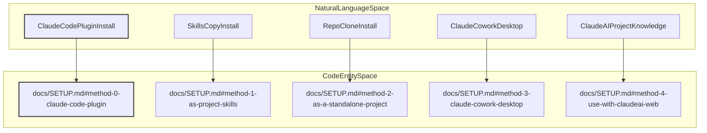
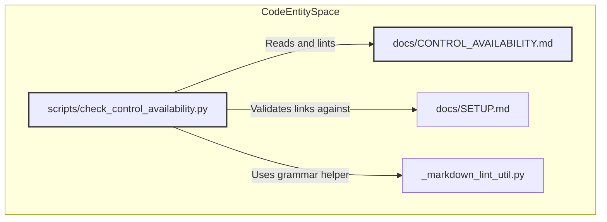

<!-- source: DeepWiki mcp.deepwiki.com · repo Imbad0202/academic-research-skills · page 16.2 Control Availability by Install Channel · fetched 2026-10-30 -->

# Control Availability by Install Channel

Relevant source files

The following files were used as context for generating this wiki page:

- [academic-paper-reviewer/SKILL.md](academic-paper-reviewer/SKILL.md)
- [academic-paper/SKILL.md](academic-paper/SKILL.md)
- [audits/575-scope-closure-audit-2026-08-24.md](audits/575-scope-closure-audit-2026-08-24.md)
- [audits/684-expert-readiness-2026-08-24.md](audits/684-expert-readiness-2026-08-24.md)
- [deep-research/SKILL.md](deep-research/SKILL.md)
- [docs/CONTROL_AVAILABILITY.md](docs/CONTROL_AVAILABILITY.md)
- [scripts/_markdown_lint_util.py](scripts/_markdown_lint_util.py)
- [scripts/check_control_availability.py](scripts/check_control_availability.py)
- [scripts/check_data_flows.py](scripts/check_data_flows.py)
- [scripts/check_promotion_bakeoff_preregistration.py](scripts/check_promotion_bakeoff_preregistration.py)
- [scripts/check_risk_register.py](scripts/check_risk_register.py)
- [scripts/test__markdown_lint_util.py](scripts/test__markdown_lint_util.py)
- [scripts/test_check_control_availability.py](scripts/test_check_control_availability.py)
- [scripts/test_check_risk_register.py](scripts/test_check_risk_register.py)
- [shared/references/routing_core.md](shared/references/routing_core.md)
- [tests/fixtures/issue_133_routing/CALIBRATION_LOG.md](tests/fixtures/issue_133_routing/CALIBRATION_LOG.md)
- [tests/fixtures/issue_133_routing/README.md](tests/fixtures/issue_133_routing/README.md)

## Purpose and Scope

The Academic Research Skills (ARS) system defines several core integrity and runtime controls—such as the write-scope guard, the citation-verification gate, mandatory checkpoints, and tool allowlists. However, whether these controls actively operate depends entirely on the chosen installation channel. This page details the mechanism-by-channel matrix defined in `docs/CONTROL_AVAILABILITY.md`, the architectural constraints of each install channel, the rules for degraded-mode disclosures, and the programmatic checking scripts that enforce documentation-to-code integrity [`docs/CONTROL_AVAILABILITY.md:1-14`]().

Sources: `docs/CONTROL_AVAILABILITY.md` [docs/CONTROL_AVAILABILITY.md:1-14]()

---

## 1. Install Channels and Channel-Wide Limitations

ARS supports multiple installation methods, each with distinct execution capabilities, manifest wirings, and architectural restrictions. These channels are cataloged in `docs/CONTROL_AVAILABILITY.md` and cross-referenced with `docs/SETUP.md` [`docs/CONTROL_AVAILABILITY.md:15-26`]().

*Figure 1: Mapping user install channels from Natural Language descriptions to setup documentation anchors.*

Sources: `docs/CONTROL_AVAILABILITY.md` [docs/CONTROL_AVAILABILITY.md:15-26]()

---

## 2. The Availability Matrix

The availability matrix evaluates each integrity mechanism across all supported install channels. Mechanisms are classified as **Active**, **Conditional**, or **Absent** [`docs/CONTROL_AVAILABILITY.md:27-49`]().

| Mechanism | Plugin | Skills copy | Repo clone | Cowork | claude.ai Project | Claude Science | Pi port |
|---|---|---|---|---|---|---|---|
| Methodology Layer (`SKILL.md` protocols) | Active | Active | Active | Active | Conditional | Active | Active |
| Skill Auto-Routing (Trigger keywords) | Active | Active | Active | Active | Absent | Conditional | Conditional |
| Cross-Skill Routing Discipline (`routing_core.md`) | Conditional | Conditional | Active | Conditional | Absent | Conditional | Conditional |
| `/ars-*` Slash Commands | Active | Absent | Absent | Absent | Absent | Absent | Conditional |
| Write-Scope Guard (`PreToolUse` hook) | Conditional | Absent | Absent | Absent | Absent | Absent | Absent |
| Subagent Dispatch (Task-tool multi-agent) | Active | Active | Active | Absent | Absent | Absent | Conditional |

Sources: `docs/CONTROL_AVAILABILITY.md` [docs/CONTROL_AVAILABILITY.md:27-49]()

---

## 3. Degraded-Mode Disclosure Rules and Environment Guards

When executing in non-reference environments (such as a pure skills copy or the Pi port wrapper), certain background daemons, hooks, or Python-backed scripts (`scripts/`) may be absent or partially supported. ARS enforces a **defined degraded state** principle rather than failing silently or crashing [`docs/CONTROL_AVAILABILITY.md:60-77`]().

* **Write-Scope Guard Limitations:** The write-scope guard requires a real Python interpreter and a `bash` shell launcher. If either is missing, it falls back to a prompt-level warning rather than an absolute block [`docs/CONTROL_AVAILABILITY.md:65-72`]().
* **Pi Port Wrapper:** Community-maintained wrappers like `pi/README.md` disclose that role execution may fall back to sequential execution rather than concurrent multi-agent isolation when independent agent containers are unavailable [`docs/CONTROL_AVAILABILITY.md:25`()].

*Figure 2: Data flow and dependency graph for the control availability validation machinery.*

Sources: `docs/CONTROL_AVAILABILITY.md` [docs/CONTROL_AVAILABILITY.md:25-77](), `scripts/check_control_availability.py` [scripts/check_control_availability.py:1-51]()

---

## 4. Checking Script Infrastructure

To prevent documentation drift between `docs/CONTROL_AVAILABILITY.md`, `docs/SETUP.md`, and project entrypoints, ARS implements a dedicated checking script: `scripts/check_control_availability.py` [scripts/check_control_availability.py:1-51]().

The validation suite enforces three primary invariants:
1. **CA-1 (Link Resolution):** Every relative markdown link in `docs/CONTROL_AVAILABILITY.md` must resolve successfully on disk, including intra-document anchor fragments and headings in target files like `docs/SETUP.md` [scripts/check_control_availability.py:55-92]().
2. **CA-2 (Method Coverage):** Every `### Method` heading defined in `docs/SETUP.md` must be explicitly linked from the control availability matrix to ensure new install channels cannot be added without auditing [scripts/check_control_availability.py:95-123]().
3. **CA-3 (Inbound Discoverability):** `README.md` and `docs/SETUP.md` must maintain rendered inbound links pointing to `docs/CONTROL_AVAILABILITY.md` [scripts/check_control_availability.py:125-143]().

Sources: `scripts/check_control_availability.py` [scripts/check_control_availability.py:1-170]()

---

## 5. Testing and Mutation Suite

The integrity of `check_control_availability.py` is guarded by a comprehensive pytest mutation suite located at `scripts/test_check_control_availability.py` [scripts/test_check_control_availability.py:1-59](). 

The test harness copies mirrored repository files into a temporary directory fixture, verifies baseline execution success, and then injects targeted mutations (such as unlinking documents, renaming setup headers, or breaking intra-document anchors) to assert that CA-1, CA-2, and CA-3 fire correct diagnostic errors [scripts/test_check_control_availability.py:40-104]().

Sources: `scripts/test_check_control_availability.py` [scripts/test_check_control_availability.py:1-200]()

---

