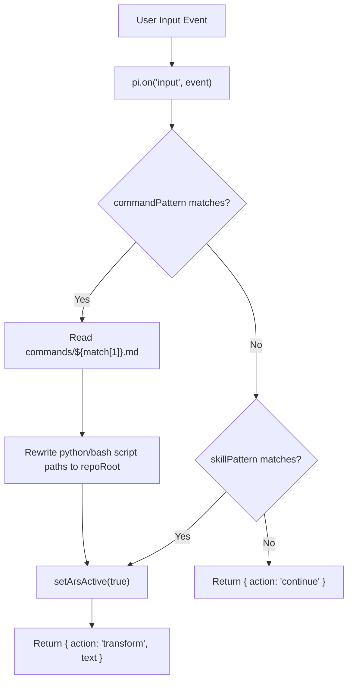
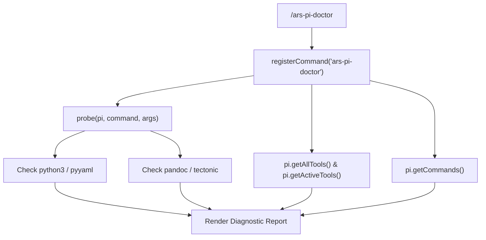

<!-- source: DeepWiki mcp.deepwiki.com · repo Imbad0202/academic-research-skills · page 16.3 Pi Platform Wrapper · fetched 2026-10-30 -->

# Pi Platform Wrapper

<details>
<summary>Relevant source files</summary>

The following files were used as context for generating this wiki page:

- [pi/README.md](pi/README.md)
- [pi/wrapper.integration.test.mjs](pi/wrapper.integration.test.mjs)
- [pi/wrapper.js](pi/wrapper.js)
- [pi/wrapper.test.mjs](pi/wrapper.test.mjs)

</details>


## Purpose and Scope
This page details the Pi platform compatibility wrapper for running Academic Research Skills (ARS) within the Pi coding assistant environment [pi/README.md:1-3](). It covers the implementation architecture in `pi/wrapper.js`, load-bearing runtime differences (such as the absence of agent isolation and Claude-specific hooks), the environment diagnostic command `/ars-pi-doctor`, session mode management (`/ars-pi-start`, `/ars-pi-stop`), and installation channels [pi/README.md:1-129]().

Sources: [pi/README.md:1-129]()

---

## 16.3.1 Wrapper Architecture and `wrapper.js` Implementation

The Pi wrapper is a thin, non-invasive compatibility layer [pi/README.md:3-5](). It does not copy or modify the canonical `SKILL.md` files or underlying scripts [pi/README.md:3-5](). Instead, `pi/wrapper.js` intercepts user inputs matching command patterns, transforms them to point to repository-relative scripts [pi/wrapper.js:103-130](), and dynamically manages skill visibility in the system prompt [pi/wrapper.js:44-54]().

When loaded, `pi/wrapper.js` calculates `repoRoot` from its own file URL [pi/wrapper.js:5](). It defines a regular expression pattern `commandPattern` (`/^\/(ars-[a-z0-9-]+)(?:\s+([\s\S]*))?$/`) to capture ARS commands [pi/wrapper.js:6]() and monitors `skillNames` (`deep-research`, `academic-paper`, `academic-paper-reviewer`, `academic-pipeline`) [pi/wrapper.js:7](). 

The function `hideArsSkills(systemPrompt)` inspects skill blocks within the system prompt and omits canonical ARS skill definitions when ARS mode is inactive [pi/wrapper.js:44-54](). When an `/ars-*` command or direct `/skill:*` is invoked, `setArsActive(true)` records state changes via `pi.appendEntry()` using the custom type `ars-pi-state` [pi/wrapper.js:80-93]().


*Figure 1: Input Transformation and State Activation Flow in `pi/wrapper.js`*

Sources: [pi/README.md:3-6](), [pi/wrapper.js:1-130]()

---

## 16.3.2 Load-Bearing Runtime Differences

Running ARS in Pi introduces two load-bearing runtime boundaries that affect agent execution and evidence interpretation [pi/README.md:7-14]():

1. **No Agent Isolation or Parallel Orchestration**: Pi does not provide native subagent isolation or parallel agent workflows comparable to Claude Code [pi/README.md:7-11](). When ARS specialist roles are invoked, they execute sequentially in the current context unless an independent Pi subagent or workflow skill is explicitly configured [pi/README.md:7-11](). This constitutes degraded execution and must be disclosed [pi/README.md:7-11]().
2. **No Claude Hooks (`PreToolUse`)**: Claude-specific infrastructure hooks do not execute in Pi [pi/README.md:12-14](). Specifically, the write-scope enforcement provided by `ars_write_scope_guard.py` or `PreToolUse` hooks is prompt-level only unless supplied by a separate environment mechanism [pi/README.md:12-14]().

Sources: [pi/README.md:7-14]()

---

## 16.3.3 Capability Doctor (`/ars-pi-doctor`)

The wrapper registers the `/ars-pi-doctor` command to inspect environment capabilities without triggering LLM calls [pi/README.md:113-115](), [pi/wrapper.js:148-150](). It queries active and installed tools (`pi.getAllTools()`), available commands (`pi.getCommands()`), and system binaries (`python`, `yaml`, `pandoc`, `tectonic`) via `pi.exec()` [pi/wrapper.js:151-160]().


*Figure 2: Environment Diagnostic Flow via `/ars-pi-doctor`*

Sources: [pi/README.md:113-115](), [pi/wrapper.js:148-211]()

---

## 16.3.4 Installation, Session Modes and Degraded-Mode Evidence (`examples/pi`)

### Installation Options
Pi supports loading ARS directly from GitHub or via a local repository checkout [pi/README.md:16-112](). 

* **Temporary execution via remote Git**:
  ```bash
  pi -e git:github.com/Imbad0202/academic-research-skills
  ```[pi/README.md:29-33]()
* **Local checkout installation**:
  ```bash
  git clone https://github.com/Imbad0202/academic-research-skills.git
  cd academic-research-skills
  pi install .
  ```[pi/README.md:35-41](), [pi/README.md:92-94]()

### Session Modes and State Persistence
ARS compatibility instructions and skill visibility can be explicitly toggled during an active session:
* `/ars-pi-start`: Enables ARS mode and automatic skill selection for subsequent prompts [pi/README.md:62-66](), [pi/wrapper.js:132-138]().
* `/ars-pi-stop`: Hides ARS skills from system prompts and disables compatibility instructions [pi/README.md:125-129](), [pi/wrapper.js:140-146]().

State persistence follows branch navigation (`session_tree`), storing `ars-pi-state` custom entries in the session ledger [pi/wrapper.js:82-101]().

### Degraded-Mode Evidence Run
The curated execution logs and evidence files under `examples/pi/README.md` demonstrate a complete end-to-end ARS run under Pi's degraded-mode constraints (sequential execution and prompt-level boundaries) [pi/README.md:11-14]().

Sources: [pi/README.md:16-129](), [pi/wrapper.js:80-146]()

---

