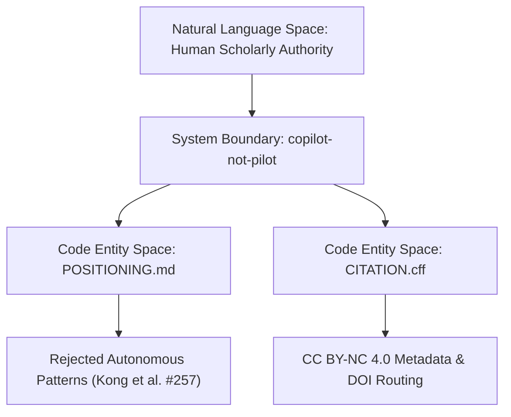
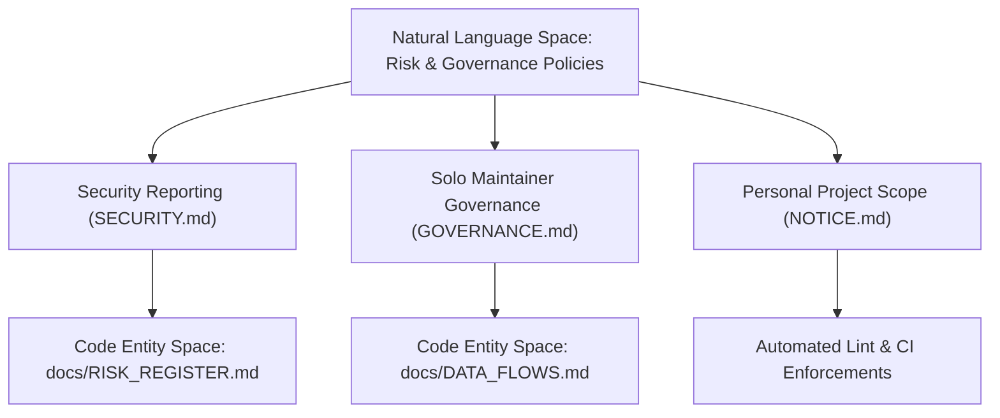

<!-- source: DeepWiki mcp.deepwiki.com · repo Imbad0202/academic-research-skills · page 17 Governance, Risk and Positioning · fetched 2026-10-30 -->

# Governance, Risk and Positioning

Relevant source files

The following files were used as context for generating this wiki page:

- [CITATION.cff](CITATION.cff)
- [GOVERNANCE.md](GOVERNANCE.md)
- [NOTICE.md](NOTICE.md)
- [POSITIONING.md](POSITIONING.md)
- [SECURITY.md](SECURITY.md)
- [THIRD_PARTY.md](THIRD_PARTY.md)

This page provides an overview of the project scope boundaries, risk controls, licensing terms, and contribution and release disciplines established for Academic Research Skills (ARS). ARS operates under a strict human-in-the-loop philosophy, bounded by clear licensing terms and rigorous governance structures designed for noncommercial scholarly use.

For detailed information, refer to the child pages:
- **[Positioning and Scope Boundaries](#17.1)** ([POSITIONING.md]()) — Scope definitions, rejected autonomous-research patterns, human mandates, and CC BY-NC licensing.
- **[Risk Register, Data Flows and Security](#17.2)** (`docs/RISK_REGISTER.md`, `docs/DATA_FLOWS.md`, `SECURITY.md`, `NOTICE.md`, `GOVERNANCE.md`) — Risk controls, network touchpoints, security policies, and lint enforcement.
- **[Contributing, Design Docs and Release Discipline](#17.3)** (`CONTRIBUTING.md`, `docs/design/`, release workflows) — Contribution guidelines, design spec records, multilingual documentation, and release cycles.

---

## 17.1. Positioning and Scope Boundaries

Academic Research Skills (ARS) is defined as a source-available academic research copilot framework rather than an autonomous paper-writing system [POSITIONING.md:3-11](). Its core philosophy relies on human-in-the-loop interactions, maintaining that AI outputs serve as inputs to human scholarly judgment rather than substitutes for it [POSITIONING.md:11-12](). 

The positioning framework explicitly rejects several autonomous-research anti-patterns (such as end-to-end autonomous research pipelines, autonomous hypothesis generation without oversight, and automated wet-lab integration) to ensure researchers retain absolute control over every stage transition [POSITIONING.md:13-36](). Licensing and metadata are formally defined under CC BY-NC 4.0 within `CITATION.cff` [CITATION.cff:1-35]().

*Sources: [POSITIONING.md:1-42](), [CITATION.cff:1-35]()*

For details, see [Positioning and Scope Boundaries](#17.1).

---

## 17.2. Risk Register, Data Flows and Security

The security and risk management architecture of ARS is documented through transparent policy files and governance documents. Security vulnerabilities are managed via a private reporting pipeline outlined in `SECURITY.md`, defining structured severity response windows and scope boundaries [SECURITY.md:1-52](). Personal project statements and governance postures are detailed in `NOTICE.md` [NOTICE.md:1-26]() and `GOVERNANCE.md` [GOVERNANCE.md:1-116](). 

Compliance, risk mitigation, and data isolation levels are enforced mechanically using lint scripts and architectural validation suites that evaluate network touchpoints and local storage boundaries.

*Sources: [SECURITY.md:1-52](), [NOTICE.md:1-26](), [GOVERNANCE.md:1-116]()*

For details, see [Risk Register, Data Flows and Security](#17.2).

---

## 17.3. Contributing, Design Docs and Release Discipline

Code contributions, architectural changes, and release cycles adhere to strict discipline frameworks. Contribution workflows, issue templates, and development requirements are governed by `CONTRIBUTING.md`. Architectural decisions and spec changes are tracked via decision records located under `docs/design/`, maintaining version consistency alongside multilingual README resources and automated release tooling.

For details, see [Contributing, Design Docs and Release Discipline](#17.3).

---

