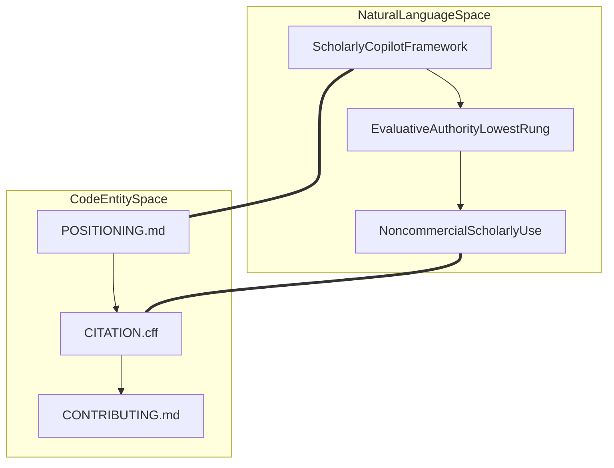
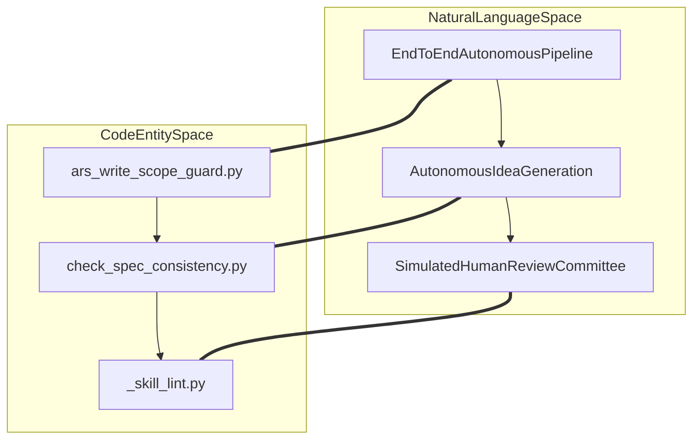

<!-- source: DeepWiki mcp.deepwiki.com · repo Imbad0202/academic-research-skills · page 17.1 Positioning and Scope Boundaries · fetched 2026-10-30 -->

# Positioning and Scope Boundaries

Relevant source files

The following files were used as context for generating this wiki page:

- [CITATION.cff](CITATION.cff)
- [GOVERNANCE.md](GOVERNANCE.md)
- [NOTICE.md](NOTICE.md)
- [POSITIONING.md](POSITIONING.md)
- [SECURITY.md](SECURITY.md)
- [THIRD_PARTY.md](THIRD_PARTY.md)

## Purpose and Scope

This wiki page documents the architectural positioning, functional scope boundaries, rejected autonomous research patterns, and licensing constraints of the Academic Research Skills (ARS) framework (v3.23.x). Grounded in [`POSITIONING.md`](POSITIONING.md) and [`CITATION.cff`](CITATION.cff), this page establishes what ARS is, what it explicitly refuses to do, and how metadata and noncommercial licensing are structured.

Sources: `[POSITIONING.md:1-42]`, `[CITATION.cff:1-36]`

---

## 1. What ARS Is and Is Not

Academic Research Skills (ARS) is a source-available academic research copilot framework designed strictly for noncommercial scholarly use `[POSITIONING.md:3-5]`, `[CITATION.cff:16-20]`. The reference distribution operates as a suite of Claude Code skills assisting human researchers through the research-to-publication lifecycle `[POSITIONING.md:5-6]`. 

### Evaluative Authority Boundaries
ARS is **not** an autonomous paper-writing system or a replacement for human scholarship `[POSITIONING.md:9-11]`. On the evaluative-authority ladder defined by Wang, Li et al. (2026, arXiv:2609.07713, §4.1), ARS sits on the lowest rung by design `[POSITIONING.md:11-12]`:
- It produces author-facing feedback and assists with structured review.
- It carries **zero publication authority**.
- Its outputs serve strictly as inputs to human judgment rather than substitutes for academic authorship `[POSITIONING.md:11-12]`.

Title: NaturalLanguageToCodeEvaluationLadder

Sources: `[POSITIONING.md:3-12]`, `[CITATION.cff:16-20]`

---

## 2. Rejected Autonomous-Research Anti-Patterns

ARS maintains load-bearing boundaries against fully autonomous research patterns, drawing from the taxonomy established by Kong et al. (2026), *AI for Auto-Research: Roadmap & User Guide* (arXiv:2605.18661) `[POSITIONING.md:13-16]`. These are non-negotiable architectural exclusions rather than deferred features:

1. **End-to-End Autonomous Research Pipeline (Kong §7.4.8):** A system driving a project from research question to manuscript without scholar verification at each state transition is rejected `[POSITIONING.md:17-17]`. Mandatory checkpoints prevent the scholar from becoming merely a reviewer of AI output `[POSITIONING.md:17-17]`.
2. **Autonomous Idea-Generation Agent (Kong §3.1):** Agents proposing research hypotheses or questions *for* the scholar without explicit authorship boundaries are rejected `[POSITIONING.md:18-24]`. While in non-generation Socratic mode, ARS may summarize directions the scholar already expressed, but must never propose, substitute, rank, or select hypotheses `[POSITIONING.md:21-25]`. If explicitly asked to generate candidates, ARS must trigger `[SOCRATIC-NON-GENERATION-EXIT: explicit_user_request]` before emitting candidate content `[POSITIONING.md:25-29]`.
3. **Paper2X Auto-Generation (Kong §6):** Automated transformation of a manuscript into slides, posters, or videos is rejected `[POSITIONING.md:31-31]`. Fidelity auditing of an externally generated artifact against a manuscript is permitted, but automated dissemination design is out of scope `[POSITIONING.md:31-31]`.
4. **Autonomous Experiment Execution / Coding (Kong §3.3):** LLMs running experiments or code without direct human oversight are rejected `[POSITIONING.md:32-32]`. While Experiment Provenance Intake ingests user-declared external results, ARS never treats tool-executed experiment outputs as autonomous evidence `[POSITIONING.md:32-32]`.
5. **Physical Wet-Lab Automation API (Kong §7.4.6):** Interfaces driving liquid handlers or lab infrastructure are rejected as violating the copilot positioning `[POSITIONING.md:33-33]`.
6. **Simulated Human-Subjects Review Committee:** LLM lenses pre-committing statutory protocol risk levels are rejected `[POSITIONING.md:34-34]`. Statutory bodies require representative, conflict-accountable human accountability under regulations like 45 CFR 46.107 and the Taiwan Human Subjects Research Act Art. 7 `[POSITIONING.md:34-34]`.
7. **Volume as an Outcome:** Batch-generating manuscripts or optimizing time-to-first-draft as an outcome is rejected, countering the systemic publishing pressures analyzed by Gartenberg et al. (2026, *Organization Science* 37(3)) `[POSITIONING.md:35-35]`.

Title: RejectedAntiPatternsAndEnforcementMapping

Sources: `[POSITIONING.md:13-37]`, `[docs/design/2026-06-08-kong-255-l1-copilot-not-auto-research.md:1-50]`, `[docs/design/2026-06-08-kong-255-l2-advisory-not-generation.md:1-50]`

---

## 3. Human-in-the-Loop Mandates and State Control

The operational design of ARS rests on explicit design lessons encoded in design documentation:
- **L1 Copilot Not Auto-Research:** Codified in `docs/design/2026-06-08-kong-255-l1-copilot-not-auto-research.md`, ensuring the human researcher controls every state transition `[POSITIONING.md:15-16]`.
- **L2 Advisory Not Generation:** Codified in `docs/design/2026-06-08-kong-255-l2-advisory-not-generation.md`, enforcing that Socratic interactions remain diagnostic and advisory rather than generative of primary hypotheses `[POSITIONING.md:29-30]`.

Sources: `[POSITIONING.md:15-30]`, `[docs/design/2026-06-08-kong-255-l1-copilot-not-auto-research.md:1-10]`, `[docs/design/2026-06-08-kong-255-l2-advisory-not-generation.md:1-10]`

---

## 4. Metadata Structure and Licensing (`CITATION.cff`)

The release metadata of ARS is governed by [`CITATION.cff`](CITATION.cff), which specifies citation parameters, versioning, and licensing under the Citation File Format 1.2.0 standard `[CITATION.cff:1-5]`.

### Key Citation Attributes
- **Title:** `Academic Research Skills for Claude Code` (`[CITATION.cff:6-6]()`)
- **Version:** `3.23.1` (`[CITATION.cff:30-30]()`)
- **Release Date:** `2026-10-16` (`[CITATION.cff:31-31]()`)
- **Author:** `Cheng-I Wu` (`[CITATION.cff:11-13]()`)
- **Repository:** `https://github.com/Imbad0202/academic-research-skills` (`[CITATION.cff:14-14]()`)
- **Concept DOI:** `10.5281/zenodo.20696614` (`[CITATION.cff:35-35]()`)
- **License:** `CC-BY-NC-4.0` (`[CITATION.cff:29-29]`, `[POSITIONING.md:7-8]()`)

The `CC BY-NC 4.0` license restricts commercial utilization by design, guaranteeing that the framework remains freely accessible for academic communities while disallowing unauthorized commercial exploitation `[POSITIONING.md:7-8]`.

Sources: `[CITATION.cff:1-36]`, `[POSITIONING.md:5-8]`

---

