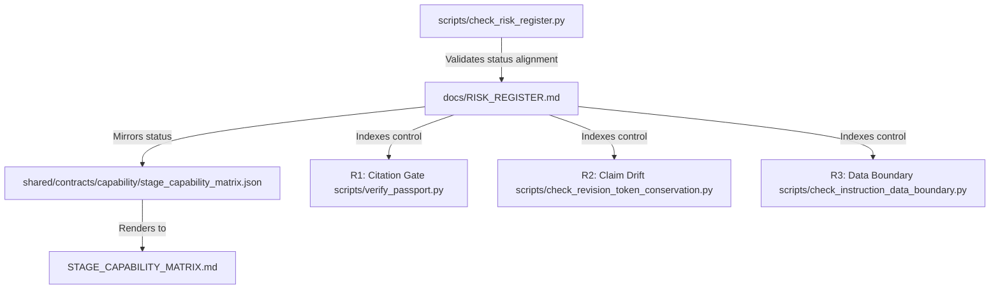
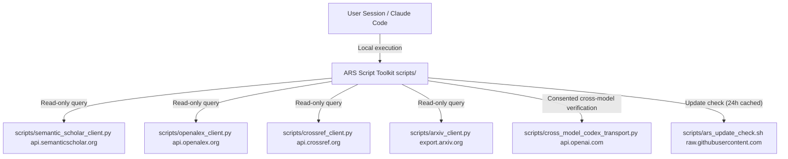

<!-- source: DeepWiki mcp.deepwiki.com · repo Imbad0202/academic-research-skills · page 17.2 Risk Register, Data Flows and Security · fetched 2026-10-30 -->

# Risk Register, Data Flows and Security

Relevant source files

The following files were used as context for generating this wiki page:

- [GOVERNANCE.md](GOVERNANCE.md)
- [NOTICE.md](NOTICE.md)
- [SECURITY.md](SECURITY.md)
- [THIRD_PARTY.md](THIRD_PARTY.md)
- [academic-pipeline/agents/state_tracker_agent.md](academic-pipeline/agents/state_tracker_agent.md)
- [audits/575-scope-closure-audit-2026-08-24.md](audits/575-scope-closure-audit-2026-08-24.md)
- [audits/684-expert-readiness-2026-08-24.md](audits/684-expert-readiness-2026-08-24.md)
- [docs/DATA_FLOWS.md](docs/DATA_FLOWS.md)
- [docs/RISK_REGISTER.md](docs/RISK_REGISTER.md)
- [scripts/_markdown_lint_util.py](scripts/_markdown_lint_util.py)
- [scripts/ars_mark_read.py](scripts/ars_mark_read.py)
- [scripts/check_control_availability.py](scripts/check_control_availability.py)
- [scripts/check_data_flows.py](scripts/check_data_flows.py)
- [scripts/check_promotion_bakeoff_preregistration.py](scripts/check_promotion_bakeoff_preregistration.py)
- [scripts/check_risk_register.py](scripts/check_risk_register.py)
- [scripts/claim_strength_drift_disposition.py](scripts/claim_strength_drift_disposition.py)
- [scripts/human_read_attestation_resolver.py](scripts/human_read_attestation_resolver.py)
- [scripts/run_ledger.py](scripts/run_ledger.py)
- [scripts/test__markdown_lint_util.py](scripts/test__markdown_lint_util.py)
- [scripts/test_ars_mark_read.py](scripts/test_ars_mark_read.py)
- [scripts/test_check_control_availability.py](scripts/test_check_control_availability.py)
- [scripts/test_check_risk_register.py](scripts/test_check_risk_register.py)
- [scripts/test_claim_strength_drift_disposition.py](scripts/test_claim_strength_drift_disposition.py)
- [scripts/test_file_lock.py](scripts/test_file_lock.py)
- [scripts/test_human_read_attestation_resolver.py](scripts/test_human_read_attestation_resolver.py)
- [scripts/test_run_ledger.py](scripts/test_run_ledger.py)
- [shared/contracts/passport/run_ledger.schema.json](shared/contracts/passport/run_ledger.schema.json)

This page details the risk management framework, data flow boundaries, security policy, and governance mechanisms governing the Academic Research Skills (ARS) system (`v3.23.x`). It covers the implementation of `docs/RISK_REGISTER.md`, `docs/DATA_FLOWS.md`, `SECURITY.md`, `NOTICE.md`, `GOVERNANCE.md`, and the automated lint infrastructure enforcing compliance across code and documentation boundaries.

---

## 1. Risk Register & ISO/IEC 42001-Spirit Gap Assessment

ARS maintains a centralized risk register in `docs/RISK_REGISTER.md` that indexes standing risks, their existing implementation controls, evidence statuses, and residual gaps [docs/RISK_REGISTER.md:1-12](). Rather than adopting a heavy, formal Artificial Intelligence Management System (AIMS) process, the suite implements a lightweight gap assessment framework inspired by ISO/IEC 42001 [docs/RISK_REGISTER.md:10-16]().

### Control State and Lint Enforcement

The risk register maintains a strict coupling with the stage capability matrix (`shared/contracts/capability/stage_capability_matrix.json`) [docs/RISK_REGISTER.md:18-24]().
- **Status Vocabulary**: Statuses use matrix values (`DESIGNED`, `NOT_RUN`, `MEASURED`, `MIXED`) [docs/RISK_REGISTER.md:22-23]().
- **Lint Validation**: `scripts/check_risk_register.py` programmatically ensures that risk register entries citing matrix rows match their recorded `behavioral_evidence.status` [docs/RISK_REGISTER.md:23-26]().
- **Authoring Constraints**: Backtick code spans containing slashes must point to existing repository files, and statuses marked as asserted locally cannot claim matrix backing [docs/RISK_REGISTER.md:28-31]().

### Core Indexed Risks
1. **R1 — Hallucinated Citations**: Mitigated by the deterministic four-index existence gate (`scripts/verify_passport.py`, `scripts/verification_gate/__init__.py`), locator-bearing citation emission (`scripts/check_v3_7_3_three_layer_citation.py`), and the excluded source ledger (`shared/contracts/passport/excluded_source_entry.schema.json`) [docs/RISK_REGISTER.md:35-46]().
2. **R2 — Silent Claim-Strength Drift in Revision**: Mitigated by the claim-strength ladder (`shared/references/claim_strength_ladder.md`), token conservation validators (`scripts/check_revision_token_conservation.py`), and Phase E6 drift checks [docs/RISK_REGISTER.md:62-68]().
3. **R3 — Indirect Prompt Injection via Retrieved Content**: Mitigated by instruction/data boundary enforcement across deep-research agents, the revision coach, integrity gates, and `SKILL.md` loading wrappers, verified by `scripts/check_instruction_data_boundary.py` and `scripts/check_reviewer_data_fences.py` [docs/RISK_REGISTER.md:74-98]().

*Figure 1: Risk Register and Capability Matrix Enforcement Architecture.*

Sources:
- `docs/RISK_REGISTER.md` [docs/RISK_REGISTER.md:1-110]()
- `scripts/check_risk_register.py`

---

## 2. Data Flows, Network Touchpoints, and Local Storage Boundaries

The data flow architecture (`docs/DATA_FLOWS.md`) draws clear boundaries between local state, network lookups, and session communications [docs/DATA_FLOWS.md:1-6](). 

### Scope Boundaries
- **Claude Session Isolation**: The core Claude session, user prompts, and local file reads travel over platform connections governed by Anthropic account settings, independent of ARS script execution [docs/DATA_FLOWS.md:18-22]().
- **Maintainer Harnesses**: Diagnostic scripts (e.g., `scripts/dispatch_e4_panel.py`, `scripts/run_review_criteria_constructive_value.py`, `scripts/check_ranking_lift.py`) are strictly restricted to maintainer environments and never invoked by user-facing workflows [docs/DATA_FLOWS.md:23-32]().
- **Lookup-Only Network Design**: ARS components never autonomously submit, post, or upload user work; all network touchpoints are read-only public index queries, update checks, or consented verification calls [docs/DATA_FLOWS.md:33-38]().

### Network Touchpoints Reference

| Touchpoint Module | Endpoint / Target | Data Transmitted | Credentials / Off-Switch |
| :--- | :--- | :--- | :--- |
| `scripts/semantic_scholar_client.py` [docs/DATA_FLOWS.md:55-55]() | `api.semanticscholar.org` [docs/DATA_FLOWS.md:55-55]() | Identifiers (DOIs/arXiv IDs) & title query strings [docs/DATA_FLOWS.md:46-48]() | `S2_API_KEY` (optional) [docs/DATA_FLOWS.md:55-55]() |
| `scripts/openalex_client.py` [docs/DATA_FLOWS.md:56-56]() | `api.openalex.org` [docs/DATA_FLOWS.md:56-56]() | Identifiers & titles [docs/DATA_FLOWS.md:46-48](), polite-pool email [docs/DATA_FLOWS.md:56-56]() | `OPENALEX_API_KEY` (optional) [docs/DATA_FLOWS.md:56-56]() |
| `scripts/crossref_client.py` [docs/DATA_FLOWS.md:57-57]() | `api.crossref.org` [docs/DATA_FLOWS.md:57-57]() | Identifiers & titles [docs/DATA_FLOWS.md:46-48]() | User-Agent polite email [docs/DATA_FLOWS.md:57-57]() |
| `scripts/arxiv_client.py` [docs/DATA_FLOWS.md:58-58]() | `export.arxiv.org` [docs/DATA_FLOWS.md:58-58]() | arXiv paper IDs [docs/DATA_FLOWS.md:46-48]() | ToU-aligned ≥3s pacing [docs/DATA_FLOWS.md:58-58]() |
| `scripts/chinese_literature_client.py` [docs/DATA_FLOWS.md:64-64]() | `doi.org`, NCBI E-utilities [docs/DATA_FLOWS.md:64-64]() | DOI prefixes, PubMed contact email, query strings [docs/DATA_FLOWS.md:64-64]() | NCBI email required; client only [docs/DATA_FLOWS.md:64-64]() |
| `scripts/claim_standing_discovery.py` [docs/DATA_FLOWS.md:65-65]() | Four bibliographic indexes [docs/DATA_FLOWS.md:65-65]() | Claim-derived search query strings [docs/DATA_FLOWS.md:65-65]() | Consent-gated; off by default [docs/DATA_FLOWS.md:65-65]() |
| Cross-Model Verification Transport [docs/DATA_FLOWS.md:67-67]() | OpenAI, Google AI, or compatible base URL [docs/DATA_FLOWS.md:67-67]() | Manuscript samples, integrity samples, critique text [docs/DATA_FLOWS.md:67-67]() | `ARS_CROSS_MODEL` env + explicit consent [docs/DATA_FLOWS.md:67-67]() |
| `scripts/ars_update_check.sh` [docs/DATA_FLOWS.md:70-70]() | `raw.githubusercontent.com` [docs/DATA_FLOWS.md:70-70]() | None (version metadata fetch only) [docs/DATA_FLOWS.md:70-70]() | `ARS_UPDATE_CHECK=0` [docs/DATA_FLOWS.md:70-70]() |

*Figure 2: Data Flow and Network Boundary Architecture.*

Sources:
- `docs/DATA_FLOWS.md` [docs/DATA_FLOWS.md:1-70]()
- `scripts/ars_update_check.sh`

---

## 3. Run Ledgers, Mark-Read Attestations, and Advisory Locking

To guarantee provenance and transactional integrity without external databases, ARS manages local state using sidecar YAML ledgers protected by advisory file locking [scripts/ars_mark_read.py:1-35]().

### Human Read Attestation (`scripts/ars_mark_read.py`)
- **Sidecar File**: Writes peer files named `<passport-stem>_human_read_log.yaml` beside the active Material Passport [scripts/ars_mark_read.py:3-8]().
- **Adapter Separation**: The literature corpus schema is adapter-owned and never mutated for reading attestations [scripts/ars_mark_read.py:6-8]().
- **Fail-Fast Safeguards**: Four fail-fast checks validate passport existence, file accessibility, parent readability, and writability before executing operations [scripts/ars_mark_read.py:14-16]().
- **Attestation Scopes**: Enforces `--scope {full_text, sections, abstract_only, toc_only, unknown}` declarations (`USER_ATTESTED_READ`), rejecting un-scoped or invalid key mutations [scripts/ars_mark_read.py:23-34]().

### Run Ledgers (`scripts/run_ledger.py`)
- **Pipeline Handoff Record**: `<passport-stem>_run_ledger.yaml` records initial user instructions, checkpoint Q&A, tool receipts, and hash chains (`ars-run-ledger/1.0`) [scripts/run_ledger.py:1-12]().
- **Atomic Operations**: Appends validate entry structure, compute sequential hashes (`seq`, `prev_hash`, `hash`), and perform atomic replacements under advisory locks [scripts/run_ledger.py:18-26]().

### Advisory Locking (`scripts/file_lock.py`)
- Provides cross-platform exclusive and shared advisory file locking using `fcntl` on POSIX environments and `msvcrt` on Windows [scripts/test_file_lock.py:1-7]().
- Guarantees bounded acquisition timeouts (`LEDGER_LOCK_TIMEOUT_SECONDS = 10.0`) to prevent deadlocks during concurrent subagent dispatches [scripts/ars_mark_read.py:80-125]().

Sources:
- `scripts/ars_mark_read.py` [scripts/ars_mark_read.py:1-35]()
- `scripts/run_ledger.py` [scripts/run_ledger.py:1-59]()
- `scripts/file_lock.py` [scripts/test_file_lock.py:1-15]()
- `scripts/human_read_attestation_resolver.py` [scripts/human_read_attestation_resolver.py:1-11]()

---

## 4. Security Policy, Threat Model, and Vulnerability Triage

The project security policy (`SECURITY.md`) establishes disclosure procedures, severity classifications, and boundaries for security reports [SECURITY.md:1-52]().

### Supported Versions and Reporting
- Only the latest release on the `main` branch receives security patches [SECURITY.md:3-10]().
- Vulnerabilities must be reported privately via GitHub's Private Vulnerability Reporting interface rather than public issues [SECURITY.md:12-21]().

### Severity Triage Matrix

| Severity Level | Definition | Response Target & Action |
| :--- | :--- | :--- |
| **Critical** [SECURITY.md:33-33]() | Exploitable credential exposure or unauthorized data exfiltration beyond `docs/DATA_FLOWS.md` [SECURITY.md:33-33]() | Best-effort target 14 days; published GitHub security advisory [SECURITY.md:33-33]() |
| **High** [SECURITY.md:34-34]() | Integrity gate bypass or prompt injection reaching gate decisions on default paths [SECURITY.md:34-34]() | Next release; best-effort target 30 days; advisory published [SECURITY.md:34-34]() |
| **Moderate / Low** [SECURITY.md:35-35]() | Hardening opt-in paths or defense-in-depth issues [SECURITY.md:35-35]() | Scheduled into ordinary release work; no target date [SECURITY.md:35-35]() |

### Scope Boundaries
- **In Scope**: Prompt injection bypassing IRON RULE constraints or integrity gates; credential leakage of API keys (`ARS_CROSS_MODEL`, Semantic Scholar); unauthorized data exfiltration; integrity gate bypasses [SECURITY.md:40-48]().
- **Out of Scope**: AI output quality limitations (hallucinations, weak arguments) and general feature requests [SECURITY.md:49-52]().

Sources:
- `SECURITY.md` [SECURITY.md:1-52]()

---

## 5. Governance, Legal Notices, and Lint Enforcement

Project governance (`GOVERNANCE.md`) and legal attribution (`NOTICE.md`) establish maintainer responsibilities, contribution workflows, and dependency acknowledgements.

### Governance Principles
- **Solo-Maintained Scope**: Defines operational limits, quality standards, and continuity plans for project maintenance.
- **Release Discipline**: Automated validation scripts ensure schema compliance, link integrity, and control availability across distribution channels.

### Automated Lint Scripts
- `scripts/check_risk_register.py`: Verifies risk register alignment against stage capability matrices.
- `scripts/check_data_flows.py`: Validates network touchpoint documentation and consistency.
- `scripts/check_control_availability.py`: Enforces link validity and heading integrity across documentation touchpoints (`docs/CONTROL_AVAILABILITY.md`, `docs/SETUP.md`, `README.md`) [scripts/test_check_control_availability.py:1-40]().

Sources:
- `GOVERNANCE.md`
- `NOTICE.md`
- `scripts/check_control_availability.py` [scripts/test_check_control_availability.py:1-40]()

---

