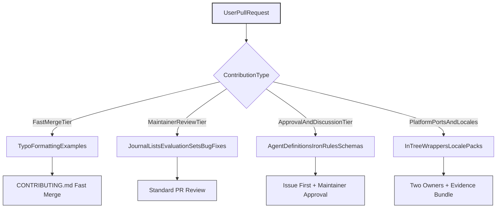
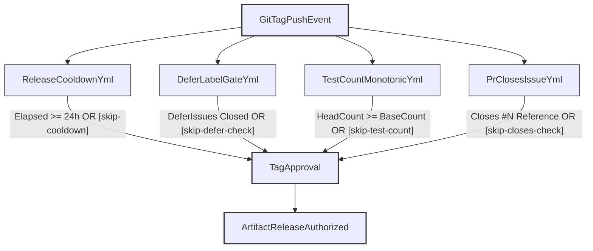

<!-- source: DeepWiki mcp.deepwiki.com · repo Imbad0202/academic-research-skills · page 17.3 Contributing, Design Docs and Release Discipline · fetched 2026-10-30 -->

# Contributing, Design Docs and Release Discipline

<details>
<summary>Relevant source files</summary>

The following files were used as context for generating this wiki page:

- [.github/workflows/defer-label-gate.yml](.github/workflows/defer-label-gate.yml)
- [.github/workflows/harness-retirement-monthly.yml](.github/workflows/harness-retirement-monthly.yml)
- [.github/workflows/pr-closes-issue.yml](.github/workflows/pr-closes-issue.yml)
- [.github/workflows/release-cooldown.yml](.github/workflows/release-cooldown.yml)
- [.github/workflows/test-count-monotonic.yml](.github/workflows/test-count-monotonic.yml)
- [CONTRIBUTING.md](CONTRIBUTING.md)
- [README.es-ES.md](README.es-ES.md)
- [scripts/render_harness_retirement_issue.py](scripts/render_harness_retirement_issue.py)
- [scripts/test_render_harness_retirement_issue.py](scripts/test_render_harness_retirement_issue.py)

</details>


## Purpose and Scope
This document specifies the contribution workflows, design-to-spec conventions (`docs/design/`), multilingual README standards, and release discipline pipelines (`.github/workflows/release-cooldown.yml`, `.github/workflows/defer-label-gate.yml`, `.github/workflows/test-count-monotonic.yml`) governing the Academic Research Skills (ARS) repository (v3.23.x).

---

## 1. Contributing Workflow and Governance (`CONTRIBUTING.md`)

ARS enforces a strict **fork-and-PR** contribution model against `Imbad0202/academic-research-skills` [CONTRIBUTING.md:7-11](). Direct pushes to the upstream repository are disabled. Contributions are categorized into four distinct review tiers based on their systemic impact:


*Figure 1: Contribution routing architecture and review tier assignment.*

Sources: `[CONTRIBUTING.md:1-70]()`

### 1.1 Contribution Review Tiers

1. **Community-maintained (Fast Merge):** Minor fixes (typos, markdown rendering, broken links), new worked examples, and non-operative translation improvements [CONTRIBUTING.md:17-24](). Changes to operative instructions (agent definitions, IRON RULE text, integrity protocols) are explicitly excluded from fast-merge [CONTRIBUTING.md:23]().
2. **Requires Maintainer Review:** Additions to journal and field reference lists (`top_journals_by_field.md`), gold-standard evaluation sets, new methodology guides, bug fixes, and minor mode adjustments [CONTRIBUTING.md:25-34]().
3. **Requires Maintainer Approval + Discussion:** Requires opening an issue prior to PR submission for modifications to agent definitions (`*/agents/*.md`), IRON RULE modifications, ethics/integrity protocols, handoff schema definitions (`shared/handoff_schemas.md`), or new pipeline skills [CONTRIBUTING.md:35-44]().
4. **Platform Ports & Locale Packs:** Platform ports (Opencode, Cursor, Continue, Aider) and locale packs must adhere to strict provenance rules, including named maintainers, end-to-end evidence suites (`examples/`), claims-evidence alignment, and dual-owner requirements for locale packs [CONTRIBUTING.md:45-70]().

Sources: `[CONTRIBUTING.md:1-70]()`

---

## 2. Design Documents and Spec-and-Decision Records (`docs/design/`)

Design proposals follow a structured convention under `docs/design/`. To prevent prompt debt and maintain architectural integrity, scaffolding inventories and scope manifests are programmatically validated. For instance, the monthly harness-retirement workflow indexes Bucket A agents directly from `scripts/ars_phase_scope_manifest.json` via `scripts/render_harness_retirement_issue.py` [scripts/render_harness_retirement_issue.py:1-167]().

```mermaid
graph TD
    A["ArsPhaseScopeManifestJson"] -->|"--manifest"| B["RenderHarnessRetirementIssuePy"]
    B -->|"--output issue-body.md"| C["HarnessRetirementMonthlyYml"]
    C -->| "gh issue create" | D["GitHubIssueTracking"]
    E["TestRenderHarnessRetirementIssuePy"] -->|"--pytest"| B

    style A fill:#none,stroke:#333,stroke-width:1px
    style B fill:#none,stroke:#333,stroke-width:1px
    style C fill:#none,stroke:#333,stroke-width:1px
    style D fill:#none,stroke:#333,stroke-width:1px
    style E fill:#none,stroke:#333,stroke-width:1px
```
*Figure 2: Dataflow for automated harness retirement tracking and spec validation.*

Sources: `[scripts/render_harness_retirement_issue.py:1-167](), [scripts/test_render_harness_retirement_issue.py:1-110]()`

Sources: `[scripts/render_harness_retirement_issue.py:1-167](), [scripts/test_render_harness_retirement_issue.py:1-110]()`

---

## 3. Multilingual README Architecture

The repository maintains its canonical reference documentation in English (`README.md`) alongside primary localized distributions (e.g., Spanish in `README.es-ES.md`, Simplified/Traditional Chinese, Japanese, and Korean) [README.es-ES.md:1-9](). 

Translations of operative instructions, trigger keywords, and integrity protocols are strictly guarded. Non-default locale packs require dual owners and adherence to agent length limits (such as the Agent Skills 1,024-character description ceiling) to prevent silent prompt degradation across language ports [CONTRIBUTING.md:62-70]().

Sources: `[README.es-ES.md:1-36](), [CONTRIBUTING.md:62-70]()`

---

## 4. Release Discipline, Cooldown Workflows and Quality Gates

Release management is protected by a multi-layered GitHub Actions validation suite. Tags triggering releases must pass test-count monotonicity, defer-label checks, and hotfix cooldown windows.


*Figure 3: Release discipline gate architecture and validation flow.*

Sources: `[.github/workflows/release-cooldown.yml:1-113](), [.github/workflows/defer-label-gate.yml:1-69](), [.github/workflows/test-count-monotonic.yml:1-157](), [.github/workflows/pr-closes-issue.yml:1-62]()`

### 4.1 Automated Release Workflows

- **Release Cooldown (`release-cooldown.yml`):** Blocks consecutive tags within 24 hours of a hotfix tag (identified by four dot-segments or hotfix commit messages) unless overridden via the `[skip-cooldown]` token and justification in the annotated tag or commit message [.github/workflows/release-cooldown.yml:1-113]().
- **Defer Label Gate (`defer-label-gate.yml`):** Prevents tagging if any open GitHub issues carry the `defer:vX.Y.Z` label, enforcing spec completion prior to version stamping [.github/workflows/defer-label-gate.yml:1-69]().
- **Test Count Monotonicity (`test-count-monotonic.yml`):** Verifies that PR test collection counts via `pytest --collect-only` do not regress against the base branch, preventing silent deletion or skipping of test suites [.github/workflows/test-count-monotonic.yml:1-157]().
- **PR Closes-Issue Check (`pr-closes-issue.yml`):** Requires every pull request targeting `main` to reference an issue using GitHub auto-close keywords (`Closes #N`, `Fixes #N`, `Resolves #N`) [.github/workflows/pr-closes-issue.yml:1-62]().

Sources: `[.github/workflows/release-cooldown.yml:1-113](), [.github/workflows/defer-label-gate.yml:1-69](), [.github/workflows/test-count-monotonic.yml:1-157](), [.github/workflows/pr-closes-issue.yml:1-62]()`

---

