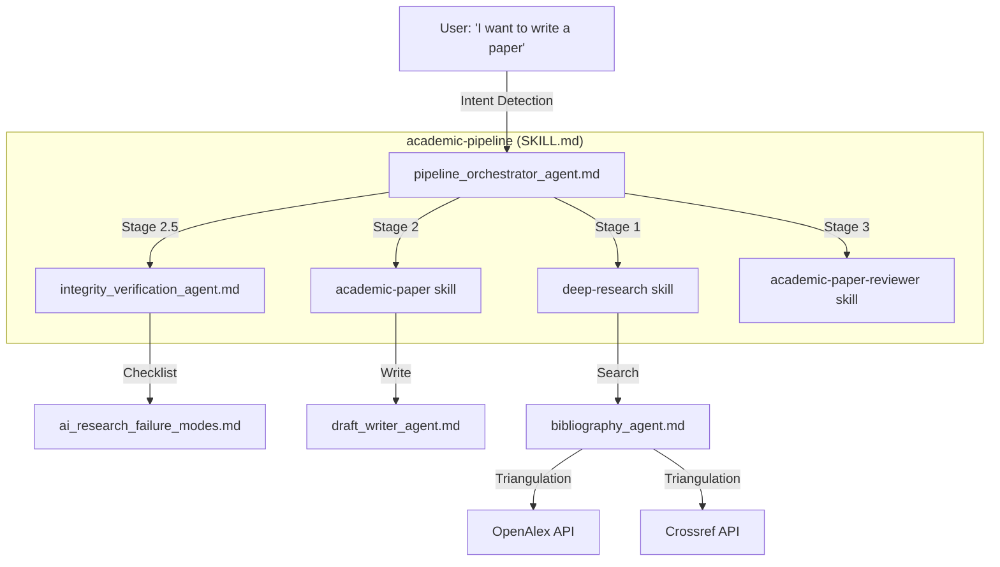
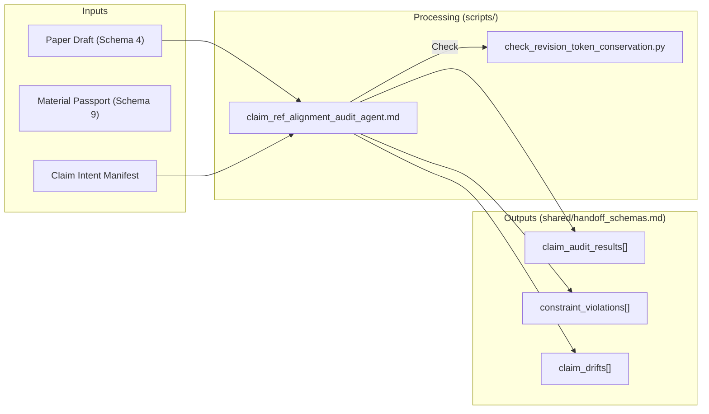

<!-- source: DeepWiki mcp.deepwiki.com · repo Imbad0202/academic-research-skills · page 18 Glossary · fetched 2026-10-30 -->

# Glossary

Relevant source files

The following files were used as context for generating this wiki page:

- [.claude-plugin/marketplace.json](.claude-plugin/marketplace.json)
- [.claude-plugin/plugin.json](.claude-plugin/plugin.json)
- [.claude/CLAUDE.md](.claude/CLAUDE.md)
- [.github/workflows/spec-consistency.yml](.github/workflows/spec-consistency.yml)
- [CHANGELOG.md](CHANGELOG.md)
- [MODE_REGISTRY.md](MODE_REGISTRY.md)
- [README.ja-JP.md](README.ja-JP.md)
- [README.ko-KR.md](README.ko-KR.md)
- [README.md](README.md)
- [README.zh-CN.md](README.zh-CN.md)
- [README.zh-TW.md](README.zh-TW.md)
- [academic-pipeline/SKILL.md](academic-pipeline/SKILL.md)
- [academic-pipeline/agents/integrity_verification_agent.md](academic-pipeline/agents/integrity_verification_agent.md)
- [academic-pipeline/agents/pipeline_orchestrator_agent.md](academic-pipeline/agents/pipeline_orchestrator_agent.md)
- [academic-pipeline/agents/state_tracker_agent.md](academic-pipeline/agents/state_tracker_agent.md)
- [academic-pipeline/references/ai_research_failure_modes.md](academic-pipeline/references/ai_research_failure_modes.md)
- [academic-pipeline/references/passport_as_reset_boundary.md](academic-pipeline/references/passport_as_reset_boundary.md)
- [academic-pipeline/references/pipeline_state_machine.md](academic-pipeline/references/pipeline_state_machine.md)
- [academic-pipeline/references/process_summary_protocol.md](academic-pipeline/references/process_summary_protocol.md)
- [docs/ARCHITECTURE.md](docs/ARCHITECTURE.md)
- [docs/DATA_FLOWS.md](docs/DATA_FLOWS.md)
- [docs/RISK_REGISTER.md](docs/RISK_REGISTER.md)
- [scripts/_ci_pytest_manifest.toml](scripts/_ci_pytest_manifest.toml)
- [scripts/ars_mark_read.py](scripts/ars_mark_read.py)
- [scripts/check_pipeline_boundary_semantics.py](scripts/check_pipeline_boundary_semantics.py)
- [scripts/check_spec_consistency.py](scripts/check_spec_consistency.py)
- [scripts/claim_strength_drift_disposition.py](scripts/claim_strength_drift_disposition.py)
- [scripts/human_read_attestation_resolver.py](scripts/human_read_attestation_resolver.py)
- [scripts/run_ledger.py](scripts/run_ledger.py)
- [scripts/test_ars_mark_read.py](scripts/test_ars_mark_read.py)
- [scripts/test_check_pipeline_boundary_semantics.py](scripts/test_check_pipeline_boundary_semantics.py)
- [scripts/test_claim_strength_drift_disposition.py](scripts/test_claim_strength_drift_disposition.py)
- [scripts/test_file_lock.py](scripts/test_file_lock.py)
- [scripts/test_human_read_attestation_resolver.py](scripts/test_human_read_attestation_resolver.py)
- [scripts/test_run_ledger.py](scripts/test_run_ledger.py)
- [scripts/test_v3_6_7_phase_6_6.py](scripts/test_v3_6_7_phase_6_6.py)
- [shared/contracts/README.md](shared/contracts/README.md)
- [shared/contracts/passport/run_ledger.schema.json](shared/contracts/passport/run_ledger.schema.json)
- [shared/handoff_schemas.md](shared/handoff_schemas.md)

This page provides technical definitions and implementation details for codebase-specific terms, jargon, abbreviations, and domain concepts within the Academic Research Skills (ARS) v3.23.x ecosystem. It serves as the primary reference for onboarding engineers to understand the internal mechanics and data contracts governing the research-to-publication pipeline.

## Core System Concepts

### Material Passport (Schema 9)
The **Material Passport** is the central state-tracking mechanism for the entire pipeline [academic-pipeline/SKILL.md:55-59](). It acts as an append-only ledger that records the provenance, verification status, and location of all research artifacts (RQ Briefs, Bibliographies, Synthesis Reports, and Paper Drafts). It enables "Mid-Entry" by allowing the system to ingest existing materials and determine the current pipeline stage based on the highest-order artifact present [academic-pipeline/SKILL.md:43-48]().

### Reset Boundary
A protocol that converts **FULL checkpoints** into context-reset points [academic-pipeline/SKILL.md:23-23](). When `ARS_PASSPORT_RESET=1` is set, the `pipeline_orchestrator_agent` freezes the current state, computes a 12-character SHA-256 hash of the ledger, and halts [academic-pipeline/agents/pipeline_orchestrator_agent.md:50-54](). This allows users to resume the pipeline in a fresh Claude Code session using `resume_from_passport=<hash>`, saving tokens and preventing "frame-lock" [academic-pipeline/agents/pipeline_orchestrator_agent.md:55-64]().

### Sprint Contract (Schema 13)
A formal data contract used to pre-commit agents to specific quality standards before a task begins. It defines **Acceptance Dimensions** (e.g., methodological rigor), **Measurement Procedures**, and **Failure Conditions**. It is primarily used to align reviewer panels during Stage 3 [CHANGELOG.md:10-15]().

### Routing Core
The centralized instruction block (`shared/references/routing_core.md`) mirrored across skills that dictates intent classification, explicit skill routing, and the escape-hatch protocol [academic-pipeline/SKILL.md:21-21]().

### Escape Hatch (`[direct-mode]`)
A byte-0 token (`[direct-mode]`) that, when present at the start of a user message, bypasses cross-phase clarification steps and routes directly to the specified skill or agent [academic-pipeline/SKILL.md:21-24]().

### Run Ledger
A local yaml ledger (`run_ledger.py`) that backs session handoffs after compaction, resume, and subagent returns, storing exact user prompts and step receipts [README.md:31-31]().

### Degradation Registry
A registry and checking mechanism (`scripts/test_check_degradation_registry.py`) that tracks fallback modes and degraded functional pathways when primary API calls or tools fail [.github/workflows/spec-consistency.yml:216-218]().

### Held-Out Measurement Contract
An evaluation framework envelope (`evals/heldout/`) containing test suite registries and report schema enforcement to prevent training leakage during model bakeoffs and metric scoring [CHANGELOG.md:10-15]().

Sources: [academic-pipeline/SKILL.md:21-59](), [academic-pipeline/agents/pipeline_orchestrator_agent.md:50-64](), [README.md:31-31](), [.github/workflows/spec-consistency.yml:216-218]()

---

## Integrity & Verification Jargon

### L3 Audit (Claim-Faithfulness)
The "L3" gap refers to the discrepancy between a claim made in a paper and what the cited source actually supports [README.md:31-33](). The **L3 Audit** is an opt-in pass (`ARS_CLAIM_AUDIT=1`) that dispatches the `claim_ref_alignment_audit_agent` after the Cite-Time Provenance Finalizer to judge supportiveness [academic-pipeline/SKILL.md:25-25]().

### Contamination Signals
Heuristic and lookup-based flags used to identify potentially fabricated or low-quality citations [README.md:31-33](). 
*   **Vector 1:** `preprint_post_llm_inflection` (Preprints published after mid-2024).
*   **Vector 2:** `semantic_scholar_unmatched` (No match in S2 database).
*   **Vector 3:** Cross-index triangulation using **OpenAlex** and **Crossref** APIs [.claude/CLAUDE.md:17-17]().

### Claim Intent Manifest
A structured mapping of every claim made in a manuscript to its intended supporting reference and specific locator (quote, page, or section) [README.md:33-33](). It is consumed by audit agents to perform the L3 audit and is linked to experimental provenance [README.zh-TW.md:91-91]().

### Goalpost Guard
A control mechanism (`claim_strength_drift_disposition.py`) preventing the shifting of evaluation metrics or criteria across re-review cycles [.github/workflows/spec-consistency.yml:1-15]().

### USER_ATTESTED_READ
A verification resolver (`human_read_attestation_resolver.py`) ensuring human-in-the-loop attestation of ingested documents before critical gate transitions occur [.github/workflows/spec-consistency.yml:1-15]().

Sources: [README.md:31-33](), [academic-pipeline/SKILL.md:25-25](), [.claude/CLAUDE.md:17-17](), [README.zh-TW.md:91-91]()

---

## Operational Protocols

### SCR Loop (State-Challenge-Reflect)
The core logic used by the `socratic_mentor_agent`. It involves summarizing the user's current research position (**State**), posing a critical question to test the logic (**Challenge**), and extracting an **INSIGHT** once convergence is reached [README.zh-TW.md:83-83]().

### PRISMA-trAIce
A specialized protocol for conducting **PRISMA 2020** compliant systematic reviews using AI [MODE_REGISTRY.md:22-22](). It ensures that the `systematic-review` mode follows a rigid screening and reporting workflow, including **Risk of Bias** assessments (RoB 2, ROBINS-I) and meta-analysis [academic-pipeline/SKILL.md:105-105]().

Sources: [README.zh-TW.md:83-83](), [MODE_REGISTRY.md:22-22](), [academic-pipeline/SKILL.md:105-105]()

---

## System Architecture Diagrams

### From Natural Language to Code Entities (Orchestration)
The following diagram illustrates how user intent in natural language triggers specific code entities and state transitions within the `academic-pipeline`.

Title: User Intent to Code Mapping

Sources: [academic-pipeline/SKILL.md:101-112](), [academic-pipeline/agents/pipeline_orchestrator_agent.md:18-31](), [docs/ARCHITECTURE.md:45-62]()

### The L3 Audit Data Flow
This diagram shows the relationship between audit agents and the various schemas consumed and produced during a Stage 4 transition.

Title: L3 Audit Implementation Flow

Sources: [academic-pipeline/SKILL.md:25-25](), [shared/handoff_schemas.md:1-10](), [.claude/CLAUDE.md:16-16]()

---

## Summary Table of Key Files

| File / Entity | Role |
| :--- | :--- |
| `MODE_REGISTRY.md` | Single source of truth for all system modes [MODE_REGISTRY.md:1-7](). |
| `handoff_schemas.md` | Defines data structures (RQ Brief, Bib, etc.) for inter-skill transfer [shared/handoff_schemas.md:1-9](). |
| `pipeline_orchestrator_agent.md` | Manages the 10 stages and transition logic for the orchestrator [academic-pipeline/agents/pipeline_orchestrator_agent.md:6-12](). |
| `ai_research_failure_modes.md` | Blocking checklist for Stage 2.5/4.5 integrity gates [README.md:29-29](). |
| `run_ledger.py` | Ledger management script for execution tracking and replay [scripts/run_ledger.py:1-15](). |

Sources: [MODE_REGISTRY.md:1-7](), [shared/handoff_schemas.md:1-9](), [academic-pipeline/agents/pipeline_orchestrator_agent.md:6-12](), [README.md:29-29](), [scripts/run_ledger.py:1-15]()