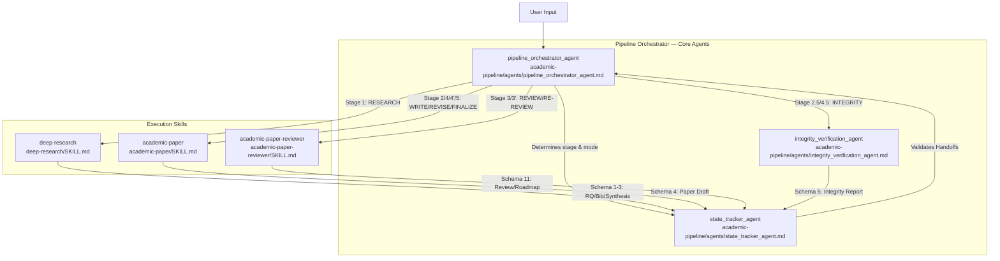

<!-- source: DeepWiki mcp.deepwiki.com · repo Imbad0202/academic-research-skills · page 2 Academic Pipeline Orchestrator · fetched 2026-10-30 -->

# Academic Pipeline Orchestrator

Relevant source files

The following files were used as context for generating this wiki page:

- [.claude-plugin/marketplace.json](.claude-plugin/marketplace.json)
- [.claude-plugin/plugin.json](.claude-plugin/plugin.json)
- [.claude/CLAUDE.md](.claude/CLAUDE.md)
- [.github/workflows/spec-consistency.yml](.github/workflows/spec-consistency.yml)
- [CHANGELOG.md](CHANGELOG.md)
- [MODE_REGISTRY.md](MODE_REGISTRY.md)
- [README.ja-JP.md](README.ja-JP.md)
- [README.ko-KR.md](README.ko-KR.md)
- [README.md](README.md)
- [README.zh-CN.md](README.zh-CN.md)
- [README.zh-TW.md](README.zh-TW.md)
- [academic-pipeline/SKILL.md](academic-pipeline/SKILL.md)
- [academic-pipeline/agents/integrity_verification_agent.md](academic-pipeline/agents/integrity_verification_agent.md)
- [academic-pipeline/agents/pipeline_orchestrator_agent.md](academic-pipeline/agents/pipeline_orchestrator_agent.md)
- [academic-pipeline/references/ai_research_failure_modes.md](academic-pipeline/references/ai_research_failure_modes.md)
- [academic-pipeline/references/passport_as_reset_boundary.md](academic-pipeline/references/passport_as_reset_boundary.md)
- [academic-pipeline/references/pipeline_state_machine.md](academic-pipeline/references/pipeline_state_machine.md)
- [academic-pipeline/references/process_summary_protocol.md](academic-pipeline/references/process_summary_protocol.md)
- [docs/ARCHITECTURE.md](docs/ARCHITECTURE.md)
- [scripts/_ci_pytest_manifest.toml](scripts/_ci_pytest_manifest.toml)
- [scripts/check_pipeline_boundary_semantics.py](scripts/check_pipeline_boundary_semantics.py)
- [scripts/check_spec_consistency.py](scripts/check_spec_consistency.py)
- [scripts/test_check_pipeline_boundary_semantics.py](scripts/test_check_pipeline_boundary_semantics.py)
- [scripts/test_v3_6_7_phase_6_6.py](scripts/test_v3_6_7_phase_6_6.py)
- [shared/contracts/README.md](shared/contracts/README.md)
- [shared/handoff_schemas.md](shared/handoff_schemas.md)

This wiki page covers the **academic-pipeline** skill (v3.23.1), an orchestrator that coordinates the research-to-publication workflow [academic-pipeline/SKILL.md:1-17](). The orchestrator manages a seamless 10-stage process by dispatching specialized skills (`deep-research`, `academic-paper`, `academic-paper-reviewer`), enforcing mandatory integrity gates, and tracking state across sessions via the Material Passport system [academic-pipeline/SKILL.md:3-7]().

Sources: [academic-pipeline/SKILL.md:1-17](), [.claude/CLAUDE.md:7-12]()

---

## System Architecture

The academic pipeline implements a dispatch-based architecture that enforces workflow consistency and quality gates across the research lifecycle. It coordinates specialized agents through a thin coordination layer defined in `academic-pipeline/SKILL.md` [academic-pipeline/SKILL.md:17-20]().

### Core Agent Team and Data Flow

The orchestrator employs project management and verification agents rather than content generation agents [academic-pipeline/agents/pipeline_orchestrator_agent.md:8-12]().

Sources: [academic-pipeline/SKILL.md:3-7](), [academic-pipeline/agents/pipeline_orchestrator_agent.md:6-12](), [shared/handoff_schemas.md:25-115]()

---

## Pipeline Stages Overview

The orchestrator coordinates a 10-stage workflow, with Stages 2.5 and 4.5 operating as mandatory blocking gates [docs/ARCHITECTURE.md:45-77]().

| Stage | Name | Skill / Agent | Key Deliverables |
|-------|------|---------------|------------------|
| 1 | RESEARCH | `deep-research` | RQ Brief, Methodology Blueprint, Bibliography, Synthesis Report [scripts/check_pipeline_boundary_semantics.py:86-90]() |
| 2 | WRITE | `academic-paper` | Paper Draft [docs/ARCHITECTURE.md:45-77]() |
| **2.5** | **INTEGRITY** | **`integrity_verification_agent`** | **Integrity Report + Corrected Paper** [docs/ARCHITECTURE.md:45-77]() |
| 3 | REVIEW | `academic-paper-reviewer` | 5 Review Reports + Editorial Decision [docs/ARCHITECTURE.md:45-77]() |
| 4 | REVISE | `academic-paper` | Revised Draft + Response to Reviewers [docs/ARCHITECTURE.md:45-77]() |
| **3'** | **RE-REVIEW** | **`academic-paper-reviewer`** | **Verification Review Report** [docs/ARCHITECTURE.md:45-77]() |
| **4'** | **RE-REVISE** | **`academic-paper`** | **Second Revised Draft (if needed)** [docs/ARCHITECTURE.md:45-77]() |
| **4.5** | **FINAL INTEGRITY** | **`integrity_verification_agent`** | **Final Verification Report (Zero Hallucination)** [docs/ARCHITECTURE.md:45-77]() |
| 5 | FINALIZE | `academic-paper` | MD, DOCX, LaTeX, and PDF Output [docs/ARCHITECTURE.md:45-77]() |
| 6 | PROCESS SUMMARY | `pipeline_orchestrator_agent` | **Paper Creation Process Record** [docs/ARCHITECTURE.md:45-77]() |

Sources: [docs/ARCHITECTURE.md:45-77](), [scripts/check_pipeline_boundary_semantics.py:86-90]()

---

## Child Page Guide

For detailed technical specifications, examine the child pages linked below:

- **[Pipeline Stages Reference](#2.1)** — Detailed documentation on all 10 stages, state machine transitions, revision loop limits, and stage capability matrices [academic-pipeline/references/pipeline_state_machine.md:1-50]().
- **[Adaptive Checkpoint System](#2.2)** — Overview of FULL, SLIM, and MANDATORY checkpoints, confirmation gates, awareness guards, and the Sprint Contract protocol [docs/ARCHITECTURE.md:17-42]().
- **[Mid-Entry and Material Passport](#2.3)** — Instructions for entering the pipeline mid-stage, tracking provenance via Material Passport (Schema 9), reset boundaries, and using `resume_from_passport` with `state_tracker_agent` [academic-pipeline/agents/pipeline_orchestrator_agent.md:47-89]().
- **[External Review Protocol](#2.4)** — Guidelines for integrating real journal reviewer feedback, mapping R&R Traceability Matrices (Schema 11), and handling revision roadmaps [academic-pipeline/SKILL.md:49-53]().
- **[Process Summary and Collaboration Quality](#2.5)** — Documentation on Stage 6 auto-generated artifacts and collaboration quality assessment via `collaboration_depth_agent` [docs/ARCHITECTURE.md:34-93]().

Sources: [academic-pipeline/SKILL.md:25-53](), [docs/ARCHITECTURE.md:17-93](), [academic-pipeline/agents/pipeline_orchestrator_agent.md:47-89]()

---

