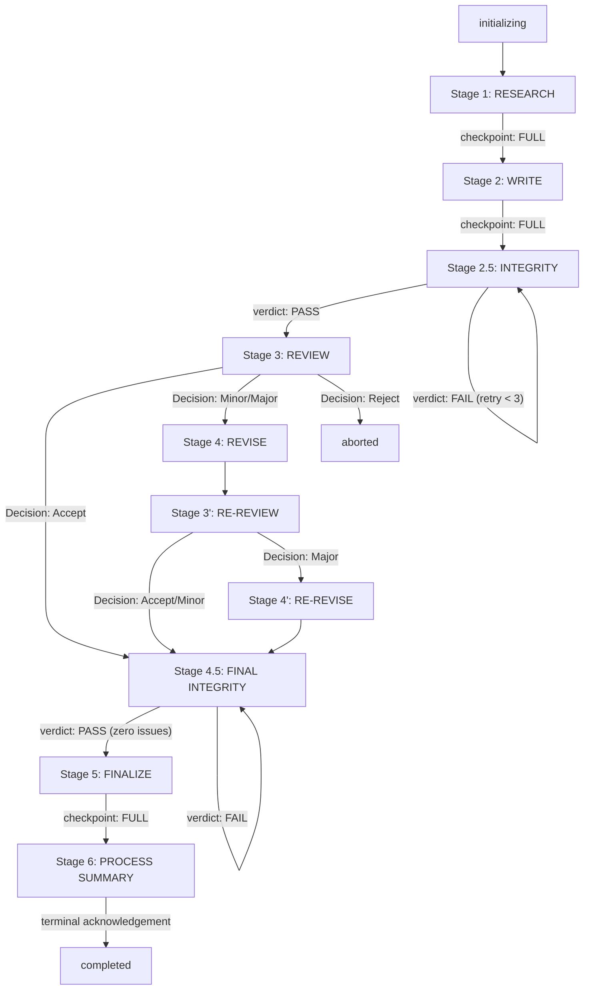
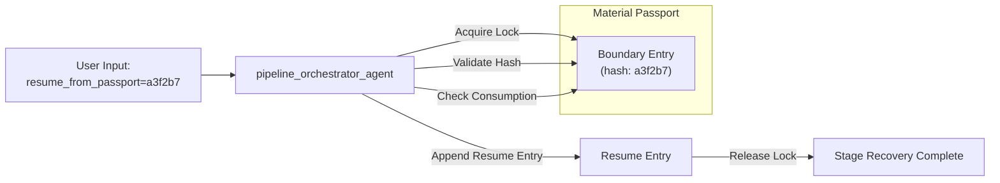

<!-- source: DeepWiki mcp.deepwiki.com · repo Imbad0202/academic-research-skills · page 2.1 Pipeline Stages Reference · fetched 2026-10-30 -->

# Pipeline Stages Reference

Relevant source files

The following files were used as context for generating this wiki page:

- [.github/workflows/spec-consistency.yml](.github/workflows/spec-consistency.yml)
- [CHANGELOG.md](CHANGELOG.md)
- [academic-pipeline/agents/integrity_verification_agent.md](academic-pipeline/agents/integrity_verification_agent.md)
- [academic-pipeline/agents/pipeline_orchestrator_agent.md](academic-pipeline/agents/pipeline_orchestrator_agent.md)
- [academic-pipeline/references/ai_research_failure_modes.md](academic-pipeline/references/ai_research_failure_modes.md)
- [academic-pipeline/references/passport_as_reset_boundary.md](academic-pipeline/references/passport_as_reset_boundary.md)
- [academic-pipeline/references/pipeline_state_machine.md](academic-pipeline/references/pipeline_state_machine.md)
- [academic-pipeline/references/process_summary_protocol.md](academic-pipeline/references/process_summary_protocol.md)
- [docs/STAGE_CAPABILITY_MATRIX.md](docs/STAGE_CAPABILITY_MATRIX.md)
- [docs/design/2026-08-17-742-research-family-profile-contract-design.md](docs/design/2026-08-17-742-research-family-profile-contract-design.md)
- [scripts/_ci_pytest_manifest.toml](scripts/_ci_pytest_manifest.toml)
- [scripts/check_pipeline_boundary_semantics.py](scripts/check_pipeline_boundary_semantics.py)
- [scripts/check_stage_capability_matrix.py](scripts/check_stage_capability_matrix.py)
- [scripts/test_check_pipeline_boundary_semantics.py](scripts/test_check_pipeline_boundary_semantics.py)
- [scripts/test_check_stage_capability_matrix.py](scripts/test_check_stage_capability_matrix.py)
- [scripts/test_v3_6_7_phase_6_6.py](scripts/test_v3_6_7_phase_6_6.py)
- [shared/contracts/README.md](shared/contracts/README.md)
- [shared/contracts/capability/stage_capability_matrix.json](shared/contracts/capability/stage_capability_matrix.json)
- [shared/handoff_schemas.md](shared/handoff_schemas.md)

## Purpose and Scope

This document provides a comprehensive technical reference for all 10 stages of the `academic-pipeline` orchestration workflow. Each stage is documented with its triggering conditions, skill/agent invocations, input/output schemas, checkpoint behavior, and state transitions. 

The pipeline is managed by the `pipeline_orchestrator_agent`, which acts as a project manager, coordinating handoffs between `deep-research`, `academic-paper`, `academic-paper-reviewer`, and the `integrity_verification_agent`. The orchestrator is responsible for intent detection, mode recommendation, and **checkpoint management**, but does not perform substantive research or writing [academic-pipeline/agents/pipeline_orchestrator_agent.md:6-12](). Missing required inputs block pipeline transitions per the pipeline state machine specifications [CHANGELOG.md:11]().

**Sources:** [academic-pipeline/agents/pipeline_orchestrator_agent.md:1-13](), [CHANGELOG.md:7-14]()

---

## Stage Overview and Capability Matrix

The pipeline consists of 10 sequential stages, with mandatory quality gates that cannot be bypassed. Stage 2.5 and 4.5 are specialized integrity checkpoints powered by the `integrity_verification_agent` [academic-pipeline/agents/pipeline_orchestrator_agent.md:26-27]().

| Stage | Name | Type | Skill/Agent | Checkpoint Type | Skippable |
|-------|------|------|-------------|-----------------|-----------|
| 1 | RESEARCH | Execution | `deep-research` | FULL | No |
| 2 | WRITE | Execution | `academic-paper` | FULL | No |
| **2.5** | **INTEGRITY** | **Gate** | **`integrity_verification_agent`** | **MANDATORY** | **No** |
| 3 | REVIEW | Gate | `academic-paper-reviewer` | MANDATORY | No |
| 4 | REVISE | Execution | `academic-paper` | FULL | Conditional* |
| **3'** | **RE-REVIEW** | **Gate** | **`academic-paper-reviewer`** | **MANDATORY** | **Conditional*** |
| **4'** | **RE-REVISE** | **Execution** | **`academic-paper`** | **FULL** | **Conditional*** |
| **4.5** | **FINAL INTEGRITY** | **Gate** | **`integrity_verification_agent`** | **MANDATORY** | **No** |
| 5 | FINALIZE | Execution | `academic-paper` | FULL | No |
| **6** | **PROCESS SUMMARY** | **Documentation** | **`pipeline_orchestrator_agent`** | **MANDATORY** | **No** |

\* Stages 4, 3', 4' are conditional based on review decisions (e.g., "Accept" skips directly to Stage 4.5). A Stage 3' Minor decision does *not* trigger coaching [academic-pipeline/references/pipeline_state_machine.md:73-95](), [scripts/check_pipeline_boundary_semantics.py:18-19]().

**Sources:** [academic-pipeline/agents/pipeline_orchestrator_agent.md:22-31](), [academic-pipeline/references/pipeline_state_machine.md:9-28](), [scripts/check_pipeline_boundary_semantics.py:21-25]()

---

## Pipeline State Machine and Transitions

The `state_tracker_agent` is the **single source of truth** for pipeline state, maintaining the `pipeline_state`, `current_stage`, and `material_version_control` [academic-pipeline/agents/state_tracker_agent.md:12-14]().

### Technical Transition Logic
The following state transition diagram maps the legal flows and decision logic managed by the `pipeline_orchestrator_agent` and recorded by the `state_tracker_agent` [academic-pipeline/references/pipeline_state_machine.md:32-131]().

**Sources:** [academic-pipeline/references/pipeline_state_machine.md:34-142](), [academic-pipeline/agents/state_tracker_agent.md:8-10]()

---

## Stage 1: RESEARCH

### Overview
Invokes the `deep-research` skill. The orchestrator recommends a mode (`socratic`, `full`, or `quick`) based on the user's initial prompt keywords like "investigate" or "literature review" [academic-pipeline/agents/pipeline_orchestrator_agent.md:24-30]().

### Deliverables
Produces artifacts defined in `shared/handoff_schemas.md`:
- **RQ Brief** (Schema 1): Research question, FINER scores, and scope constraints [shared/handoff_schemas.md:13-38]().
- **Methodology Blueprint**: Required for Stage 1 -> 2 handoff [scripts/check_pipeline_boundary_semantics.py:87-90]().
- **Bibliography** (Schema 2): Minimum 15 sources for full mode; includes `evidence_tier` and `quality_tier` [shared/handoff_schemas.md:94-114]().
- **Synthesis Report** (Schema 3): Thematic integration and research gaps.

**Sources:** [shared/handoff_schemas.md:13-114](), [academic-pipeline/agents/pipeline_orchestrator_agent.md:101-105](), [scripts/check_pipeline_boundary_semantics.py:85-90]()

---

## Stage 2: WRITE

### Overview
Invokes the `academic-paper` skill. The `draft_writer_agent` is activated to produce the full draft. If comprehensive research materials are present, the **Anti-Leakage Protocol** (Knowledge Isolation) is activated to ensure the paper is built from session materials rather than parametric memory [academic-paper/agents/draft_writer_agent.md:10](), [academic-paper/references/anti_leakage_protocol.md:21-25]().

### Input/Output
- **Input**: Schema 1 (RQ Brief), Methodology Blueprint, Schema 2 (Bibliography), and Schema 3 (Synthesis Report) [scripts/check_pipeline_boundary_semantics.py:87-88]().
- **Output**: **Paper Draft** (Schema 4) containing full manuscript sections and metadata.

**Sources:** [shared/handoff_schemas.md:1-115](), [academic-paper/references/anti_leakage_protocol.md:1-57](), [scripts/check_pipeline_boundary_semantics.py:85-90]()

---

## Stage 2.5: INTEGRITY (Pre-Review)

### Overview
A mandatory gate where the `integrity_verification_agent` performs verification of references and statistical data. It uses a **Five-Type Taxonomy** (TF, PAC, IH, PH, SH) to detect hallucinations [academic-pipeline/agents/integrity_verification_agent.md:8-12, 27-36](). 

### Pass/Fail Protocol
- **Scope**: Reference verification (Phase A), citation context (Phase B), statistical data (Phase C), and risk-stratified claim verification (Phase E).
- **Correction Loop**: Maximum 3 rounds of fix/re-verify.
- **Deliverable**: **Integrity Report** (Schema 5) detailing verified vs. failed items.

**Sources:** [academic-pipeline/references/integrity_review_protocol.md:3-23](), [academic-pipeline/agents/integrity_verification_agent.md:23-44]()

---

## Stage 3: REVIEW

### Overview
Invokes the `academic-paper-reviewer` panel consisting of the EIC, 3 peer reviewers, and a Devil's Advocate. The panel uses a 0-100 scoring system to reach an editorial decision [academic-pipeline/references/two_stage_review_protocol.md:3-8]().

### Deliverables
- **Review Reports**: 5 individual review reports (Schema 6).
- **Revision Roadmap** (Schema 7): Structured list of required changes.

**Sources:** [academic-pipeline/references/two_stage_review_protocol.md:3-10](), [shared/handoff_schemas.md:1-115]()

---

## Stage 4 & 4': REVISE / RE-REVISE

### Overview
The `draft_writer_agent` addresses reviewer feedback. In Stage 4, it produces a full revised draft or a patch document depending on the escalation level [academic-paper/agents/draft_writer_agent.md:14]().

### Loop Limits and Transitions
- **Stage 4 (REVISE)**: Triggered by Minor/Major revision decisions.
- **Stage 3' (RE-REVIEW)**: Verification review of the revised draft against the original roadmap and the **R&R Traceability Matrix** (Schema 11) [academic-pipeline/references/two_stage_review_protocol.md:16-21]().
- **Stage 4' (RE-REVISE)**: Triggered only if Stage 3' results in a "Major" decision [academic-pipeline/references/pipeline_state_machine.md:100-101]().

**Sources:** [academic-pipeline/references/pipeline_state_machine.md:79-106](), [academic-paper/agents/draft_writer_agent.md:10-24](), [academic-pipeline/references/two_stage_review_protocol.md:12-27]()

---

## Stage 4.5: FINAL INTEGRITY

### Overview
A stricter version of the integrity gate enforcing zero-tolerance criteria before proceeding to Stage 5 [academic-pipeline/references/integrity_review_protocol.md:44]().

### Verification Depth
Unlike Stage 2.5, Stage 4.5 requires complete verification for citation context (Phase B) and claim verification (Phase E) [academic-pipeline/references/integrity_review_protocol.md:33-38]().

**Sources:** [academic-pipeline/references/integrity_review_protocol.md:25-45]()

---

## Stage 5: FINALIZE

### Overview
Invokes the `academic-paper` skill in `format-convert` mode. This stage handles LaTeX hardening and multi-format output (Markdown, DOCX, PDF). The completion checkpoint for Stage 5 is **FULL — never SLIM** [academic-pipeline/agents/pipeline_orchestrator_agent.md:29](), [scripts/check_pipeline_boundary_semantics.py:23]().

**Sources:** [academic-pipeline/agents/pipeline_orchestrator_agent.md:29](), [scripts/check_pipeline_boundary_semantics.py:21-26]()

---

## Stage 6: PROCESS SUMMARY

### Overview
The final non-mandatory stage generates documentation of the entire research lifecycle, including the collaboration quality assessment. It requires a terminal acknowledgement using keywords like `finish`, `end`, `done`, or `confirm` [academic-pipeline/references/process_summary_protocol.md:3-5](), [scripts/check_pipeline_boundary_semantics.py:117]().

### Collaboration Quality
Includes a dimensional assessment via the `collaboration_depth_agent`. The `state_tracker_agent` maintains historical records which are appended to the final Process Record [academic-pipeline/agents/state_tracker_agent.md:30-33](), [academic-pipeline/references/process_summary_protocol.md:30-34]().

**Sources:** [academic-pipeline/agents/state_tracker_agent.md:30-34](), [academic-pipeline/references/process_summary_protocol.md:1-55](), [scripts/check_pipeline_boundary_semantics.py:27-32]()

---

## Passport Reset and Resume

The pipeline supports **Reset Boundaries** using the Material Passport (Schema 9) to ensure consistency and prevent session history divergence [academic-pipeline/agents/pipeline_orchestrator_agent.md:43-47]().

### Resume Contract
- **Trigger**: User input `resume_from_passport=<hash>` [academic-pipeline/agents/pipeline_orchestrator_agent.md:45]().
- **Concurrency**: The orchestrator must acquire an exclusive advisory lock on the passport file before reading or appending [academic-pipeline/agents/pipeline_orchestrator_agent.md:50]().
- **Validation**: Prevents double-resume by checking for prior consumption of the boundary hash [academic-pipeline/agents/pipeline_orchestrator_agent.md:54]().

**Sources:** [academic-pipeline/agents/pipeline_orchestrator_agent.md:43-91](), [academic-pipeline/agents/state_tracker_agent.md:44-63](), [academic-pipeline/references/passport_as_reset_boundary.md:1-68]()

---

