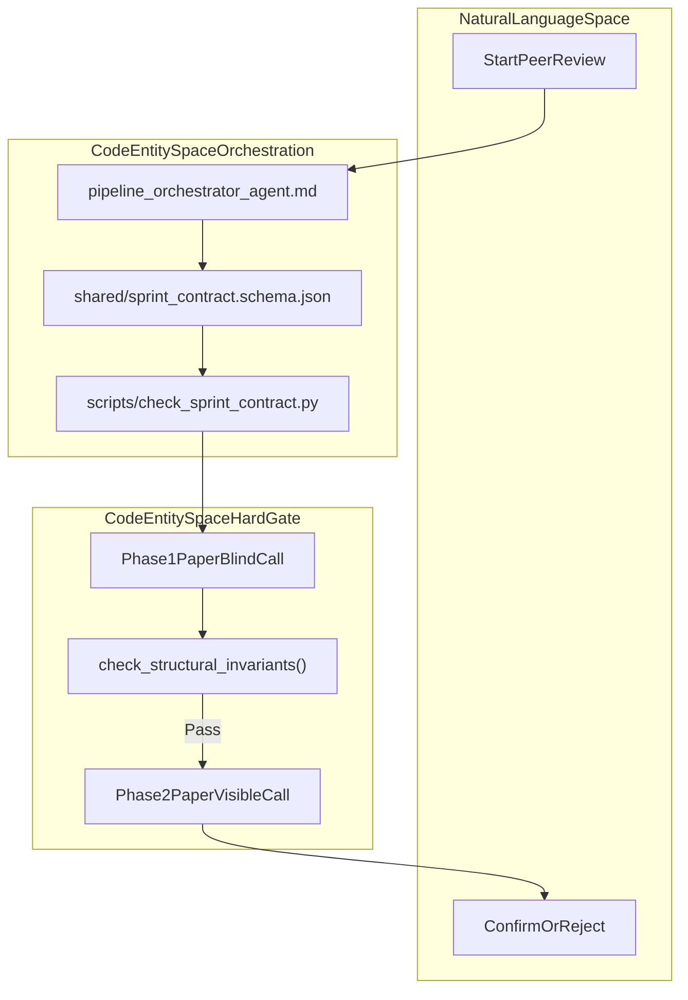
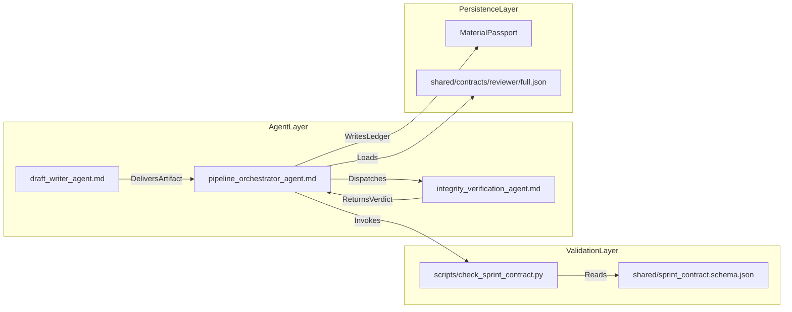

<!-- source: DeepWiki mcp.deepwiki.com · repo Imbad0202/academic-research-skills · page 2.2 Adaptive Checkpoint System · fetched 2026-10-30 -->

# Adaptive Checkpoint System

Relevant source files

The following files were used as context for generating this wiki page:

- [.github/workflows/spec-consistency.yml](.github/workflows/spec-consistency.yml)
- [CHANGELOG.md](CHANGELOG.md)
- [academic-pipeline/agents/integrity_verification_agent.md](academic-pipeline/agents/integrity_verification_agent.md)
- [academic-pipeline/agents/pipeline_orchestrator_agent.md](academic-pipeline/agents/pipeline_orchestrator_agent.md)
- [academic-pipeline/references/ai_research_failure_modes.md](academic-pipeline/references/ai_research_failure_modes.md)
- [academic-pipeline/references/passport_as_reset_boundary.md](academic-pipeline/references/passport_as_reset_boundary.md)
- [academic-pipeline/references/pipeline_state_machine.md](academic-pipeline/references/pipeline_state_machine.md)
- [academic-pipeline/references/process_summary_protocol.md](academic-pipeline/references/process_summary_protocol.md)
- [scripts/_ci_pytest_manifest.toml](scripts/_ci_pytest_manifest.toml)
- [scripts/check_pipeline_boundary_semantics.py](scripts/check_pipeline_boundary_semantics.py)
- [scripts/check_sprint_contract.py](scripts/check_sprint_contract.py)
- [scripts/test_check_pipeline_boundary_semantics.py](scripts/test_check_pipeline_boundary_semantics.py)
- [scripts/test_check_sprint_contract.py](scripts/test_check_sprint_contract.py)
- [scripts/test_v3_6_7_phase_6_6.py](scripts/test_v3_6_7_phase_6_6.py)
- [shared/contracts/README.md](shared/contracts/README.md)
- [shared/contracts/reviewer/full.json](shared/contracts/reviewer/full.json)
- [shared/contracts/reviewer/methodology_focus.json](shared/contracts/reviewer/methodology_focus.json)
- [shared/handoff_schemas.md](shared/handoff_schemas.md)
- [shared/sprint_contract.schema.json](shared/sprint_contract.schema.json)

## Purpose and Scope

The Adaptive Checkpoint System is a stage-based user confirmation and quality-gate mechanism implemented in the `academic-pipeline` skill (`academic-pipeline/SKILL.md`) and managed by `academic-pipeline/agents/pipeline_orchestrator_agent.md`. It coordinates how users interact with and approve transitions across pipeline stages, balancing user control with workflow efficiency through three checkpoint classifications: `FULL`, `SLIM`, and `MANDATORY`. 

The system incorporates the **Sprint Contract** (Schema 13), a hard-gate protocol validated by `scripts/check_sprint_contract.py` that forces reviewers and writers to pre-commit to evaluation criteria before viewing substantive manuscript content, thereby preventing rationalization drift.

Sources: `academic-pipeline/agents/pipeline_orchestrator_agent.md:12-13`(), `shared/sprint_contract.schema.json:1-15`(), `scripts/check_sprint_contract.py:1-15`()

---

## Core Design Principle

The system enforces a strict rule: after each stage completion, the orchestrator proactively prompts the user and waits for confirmation before proceeding to the subsequent stage (`academic-pipeline/agents/pipeline_orchestrator_agent.md`). The presentation adapts based on context, engagement patterns, and phase criticality.

Sources: `academic-pipeline/agents/pipeline_orchestrator_agent.md:100-115`(), `academic-pipeline/references/pipeline_state_machine.md:1-25`()

---

## Three Checkpoint Types

The pipeline classifies every stage transition into one of three checkpoint types:

| Checkpoint Type | Trigger Conditions | Content Displayed | User Action Required |
|----------------|-------------------|-------------------|---------------------|
| **FULL** | First checkpoint of session; after integrity boundaries (Stage 2.5, 4.5); before finalization (Stage 5); awareness guard triggered | Complete deliverables list + Decision Dashboard + all available options | Explicit confirmation or decision |
| **SLIM** | After consecutive `continue` responses on non-critical stages | One-line status summary + auto-continue cadence | Can interrupt or let auto-continue |
| **MANDATORY** | Integrity verification FAIL; Review decisions (Stage 3, 3'); Stage 5 entry gate; Sprint Contract Phase 1 completion | Full information + explicit options + contract artifacts | Cannot be skipped; requires explicit input |

### FULL Checkpoints
FULL checkpoints present the complete Decision Dashboard with execution metrics, generated deliverables, flagged warnings, and available navigation branches.

### SLIM Checkpoints
SLIM checkpoints provide a minimal status line to maintain execution speed during routine linear flows.

### MANDATORY Checkpoints
MANDATORY checkpoints enforce hard-stop gates. These include the Phase 1 Contract Acknowledgement for reviewers and the final integrity pass-fail verification (`Stage 4.5`) before final document generation (`Stage 5`).

Sources: `academic-pipeline/agents/pipeline_orchestrator_agent.md:100-120`(), `academic-pipeline/references/pipeline_state_machine.md:146-160`()

---

## Sprint Contract Protocol (Schema 13)

The Sprint Contract acts as a machine-checkable pre-registered acceptance contract governed by `shared/sprint_contract.schema.json` and validated by `scripts/check_sprint_contract.py`.

### Two-Phase Hard-Gate Protocol
To eliminate evaluator bias, reviewer and writer agents operate under a two-phase separation:
1. **Phase 1 (Paper-Blind)**: The agent receives only metadata and the contract template, returning a `Contract Paraphrase` and a `Scoring Plan`.
2. **Phase 1 Validation**: `scripts/check_sprint_contract.py` executes structural checks, verifying that role sets and dimension assignments match `ROLE_SETS` (`scripts/check_sprint_contract.py`).
3. **Phase 2 (Paper-Visible)**: The agent receives the full manuscript alongside its pre-committed plan to evaluate performance.

Sources: `shared/sprint_contract.schema.json:1-40`(), `scripts/check_sprint_contract.py:20-80`()

---

## Implementation Architecture

Sources: `shared/sprint_contract.schema.json:1-30`(), `scripts/check_sprint_contract.py:44-90`(), `academic-pipeline/agents/pipeline_orchestrator_agent.md:40-60`()

---

## Decision Dashboard and Metrics

FULL checkpoints render a Decision Dashboard aggregating validation metrics:
- **Word Count**: Monitored against target tolerances (`OK`, `OVER`, `UNDER`).
- **References**: Evaluated via citation verification (`PASS`, `FAIL`).
- **Integrity Status**: Governed by `academic-pipeline/agents/integrity_verification_agent.md` (`PASS`, `FAIL`).
- **Review Decision**: Governed by peer review panels (`Accept`, `Minor`, `Major`, `Reject`).

Sources: `academic-pipeline/agents/integrity_verification_agent.md:1-15`(), `academic-pipeline/agents/pipeline_orchestrator_agent.md:80-110`()

---

## Adaptive Rules and Awareness Guards

To maintain user engagement, the orchestrator tracks consecutive SLIM checkpoints. If a threshold of auto-continues is reached, the system forces a `FULL` checkpoint. Furthermore, agents such as `academic-paper/agents/draft_writer_agent.md` respect strict phase boundaries to prevent leakage of downstream deliverables into earlier stages.

Sources: `academic-pipeline/agents/pipeline_orchestrator_agent.md:50-90`(), `academic-paper/agents/draft_writer_agent.md:1-30`()

---

## Checkpoint Rules Matrix

| Stage Transition | Checkpoint Type | Sprint Contract Required | Skip Allowed |
|-----------------|-----------------|------------------------|--------------|
| Stage 1 → 2 | FULL | No | No |
| Stage 2 → 2.5 | FULL | No | No |
| Stage 2.5 → 3 | MANDATORY | No (Integrity Gate) | No |
| Stage 3 (Review) | MANDATORY | Yes (Schema 13) | No |
| Stage 4.5 → 5 | MANDATORY | No (Iron Rule) | No |

Sources: `academic-pipeline/references/pipeline_state_machine.md:100-150`(), `scripts/check_pipeline_boundary_semantics.py:72-90`()

---

## System Integration Diagram

Sources: `shared/contracts/README.md:1-15`(), `scripts/test_check_sprint_contract.py:10-35`(), `academic-pipeline/agents/pipeline_orchestrator_agent.md:10-40`()

---

