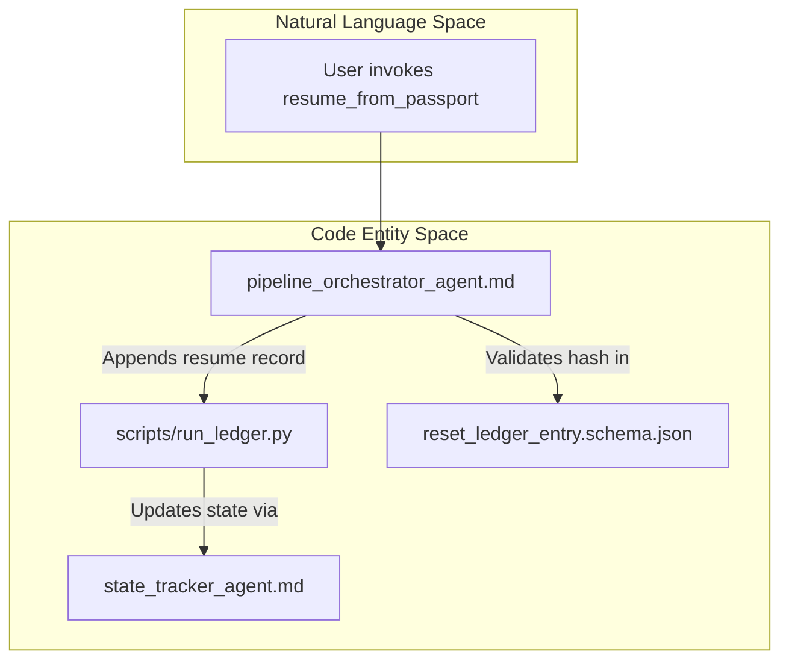
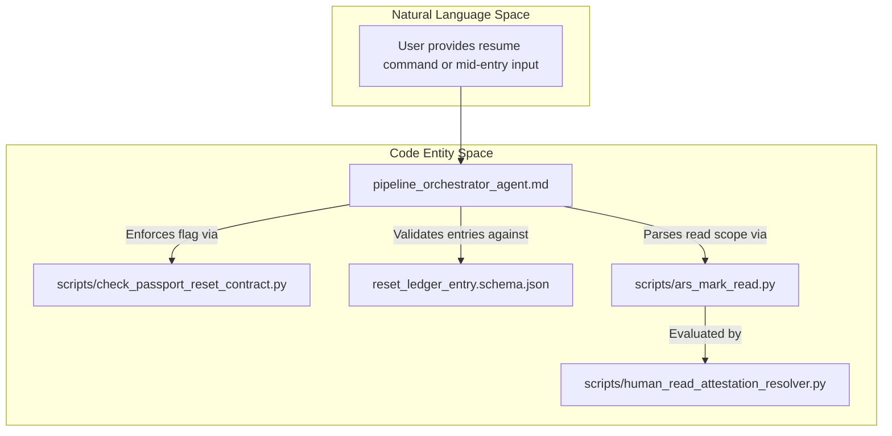
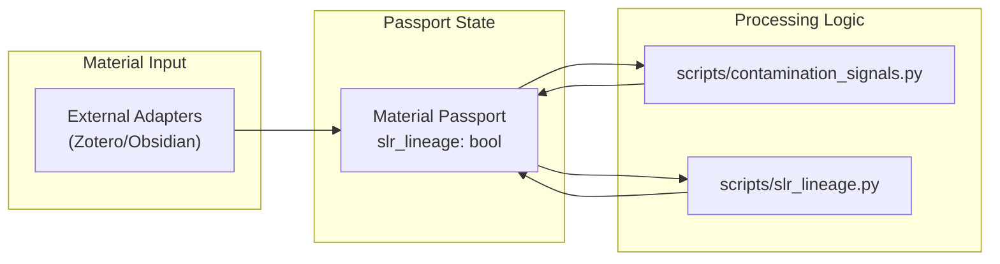

<!-- source: DeepWiki mcp.deepwiki.com · repo Imbad0202/academic-research-skills · page 2.3 Mid-Entry and Material Passport · fetched 2026-10-30 -->

# Mid-Entry and Material Passport

Relevant source files

The following files were used as context for generating this wiki page:

- [academic-pipeline/agents/state_tracker_agent.md](academic-pipeline/agents/state_tracker_agent.md)
- [docs/DATA_FLOWS.md](docs/DATA_FLOWS.md)
- [docs/RISK_REGISTER.md](docs/RISK_REGISTER.md)
- [docs/design/2026-05-15-issue-111-slr-lineage-emission-design.md](docs/design/2026-05-15-issue-111-slr-lineage-emission-design.md)
- [pyproject.toml](pyproject.toml)
- [scripts/ars_mark_read.py](scripts/ars_mark_read.py)
- [scripts/check_passport_reset_contract.py](scripts/check_passport_reset_contract.py)
- [scripts/claim_strength_drift_disposition.py](scripts/claim_strength_drift_disposition.py)
- [scripts/human_read_attestation_resolver.py](scripts/human_read_attestation_resolver.py)
- [scripts/run_ledger.py](scripts/run_ledger.py)
- [scripts/slr_lineage.py](scripts/slr_lineage.py)
- [scripts/test_ars_mark_read.py](scripts/test_ars_mark_read.py)
- [scripts/test_check_passport_reset_contract.py](scripts/test_check_passport_reset_contract.py)
- [scripts/test_claim_strength_drift_disposition.py](scripts/test_claim_strength_drift_disposition.py)
- [scripts/test_file_lock.py](scripts/test_file_lock.py)
- [scripts/test_human_read_attestation_resolver.py](scripts/test_human_read_attestation_resolver.py)
- [scripts/test_run_ledger.py](scripts/test_run_ledger.py)
- [scripts/test_slr_lineage_emission.py](scripts/test_slr_lineage_emission.py)
- [shared/contracts/passport/reset_ledger_entry.schema.json](shared/contracts/passport/reset_ledger_entry.schema.json)
- [shared/contracts/passport/run_ledger.schema.json](shared/contracts/passport/run_ledger.schema.json)

## Purpose and Scope

This page documents the **mid-entry protocol**, **Material Passport system**, and associated sidecar ledgers (`_run_ledger.yaml` and `_human_read_log.yaml`) in the academic-pipeline skill. Mid-entry allows users to enter the pipeline workflow at any stage (2, 2.5, 3, 4, etc.) rather than always starting from Stage 1 (`RESEARCH`). The Material Passport (Schema 9) is a provenance tracking mechanism that validates existing materials, enforces a **Reset Boundary Protocol** for session-spanning workflows, and determines whether stages such as Stage 2.5 (`INTEGRITY`) can be safely skipped.

Sources: [academic-pipeline/agents/pipeline_orchestrator_agent.md:33-41](), [shared/handoff_schemas.md:1-10](), [academic-pipeline/references/passport_as_reset_boundary.md:1-5]()

---

## Mid-Entry Overview

### Entry Point Detection

The `pipeline_orchestrator_agent` analyzes user input and attached files to determine what materials already exist. It uses keyword mapping and material detection logic to route the user to the correct entry stage.

**Material-to-Stage Mapping:**

| User Intent Keywords | Entry Stage | Material Detected |
|---------------------|-----------|-------------------|
| Research, investigate | Stage 1 (`RESEARCH`) | None (starting from scratch) |
| Write paper, compose | Stage 2 (`WRITE`) | Research data (RQ Brief, Synthesis) |
| Verify citations, check | Stage 2.5 (`INTEGRITY`) | Paper draft (no verification) |
| Review paper, examine | Stage 2.5* | Paper draft (requires integrity first) |
| Revise, reviewer feedback| Stage 4 (`REVISE`) | Paper + Review Report |
| Format, LaTeX, convert | Stage 5 (`FINALIZE`) | Final manuscript |

*\*Note: Users requesting "review" for a new paper are routed to Stage 2.5 (`INTEGRITY`) first. Stage 3 (`REVIEW`) cannot be entered directly without a valid integrity report.*

Sources: [academic-pipeline/agents/pipeline_orchestrator_agent.md:18-42](), [academic-pipeline/agents/pipeline_orchestrator_agent.md:90-98]()

---

## Material Passport (Schema 9) and Sidecar Ledgers

### Structure and Sidecar Files

The Material Passport is a provenance tracking record defined in `shared/handoff_schemas.md`. It pairs with two explicit sidecar ledger files to record execution history and human attestations without violating adapter-owned schemas:
1. **Run Ledger (`_run_ledger.yaml`)**: Maintained by `scripts/run_ledger.py`, storing tool receipts, checkpoint interactions, and cryptographic hash chains across session compactions.
2. **Human Read Log (`_human_read_log.yaml`)**: Maintained by `scripts/ars_mark_read.py`, recording user-owned `USER_ATTESTED_READ` declarations.

Sources: [shared/handoff_schemas.md:214-230](), [scripts/run_ledger.py:1-42](), [scripts/ars_mark_read.py:1-35]()

### Schema 9 Key Fields and Ledgers

| Field / Sidecar | Type | Description |
|-----------------|------|-------------|
| `verification_status` | Enum | `VERIFIED`, `UNVERIFIED`, `STALE`. Authoritative status for skip logic. |
| `slr_lineage` | Boolean | `true` if any stage in run history was `systematic-review` mode. |
| `reset_boundary[]` | Array | Append-only ledger of `kind: boundary` and `kind: resume` entries (`shared/contracts/passport/reset_ledger_entry.schema.json`). |
| `_run_ledger.yaml` | Sidecar | Handoff records, checkpoint responses, and command receipts (`scripts/run_ledger.py`). |
| `_human_read_log.yaml` | Sidecar | User read scope attestations (`scripts/ars_mark_read.py`). |

Sources: [shared/handoff_schemas.md:214-245](), [shared/contracts/passport/reset_ledger_entry.schema.json:11-66](), [scripts/ars_mark_read.py:1-35]()

---

## Reset Boundary Protocol

The Material Passport acts as a **Reset Boundary** when `ARS_PASSPORT_RESET=1` is set (`scripts/check_passport_reset_contract.py`). This protocol allows the pipeline to halt at a `FULL` checkpoint, emit a unique hash, and resume in a fresh Claude Code session to save tokens and manage context window limits.

### Reset Boundary Generation

When a `FULL` checkpoint is reached with the reset flag active, the orchestrator performs the following steps:
1. **Freeze State**: Prepares a `kind: boundary` ledger entry with metadata and artifact references (`shared/contracts/passport/reset_ledger_entry.schema.json`).
2. **Compute Hash**: Generates a 12-character SHA-256 hex digest over the concatenated ledger using JSON canonical ordering.
3. **Emit Reset Tag**: Outputs the reset marker containing the hash, completed stage, and next route.
4. **Halt**: Stops execution and provides the user with a resume command.

Sources: [academic-pipeline/references/passport_as_reset_boundary.md:19-39](), [shared/contracts/passport/reset_ledger_entry.schema.json:28-32](), [scripts/check_passport_reset_contract.py:1-22]()

### Resume from Passport and State Tracking

The `resume_from_passport` interface uses exclusive advisory file locking (`scripts/file_lock.py`) to safely update session state.

Sources: [academic-pipeline/agents/pipeline_orchestrator_agent.md:43-85](), [scripts/run_ledger.py:1-42](), [academic-pipeline/agents/state_tracker_agent.md:1-25](), [shared/contracts/passport/reset_ledger_entry.schema.json:113-145]()

---

## Code Entity Mapping

The following diagram bridges the high-level Material Passport concepts to the specific code entities and schemas that implement them across the pipeline.

Sources: [academic-pipeline/agents/pipeline_orchestrator_agent.md:43-85](), [scripts/check_passport_reset_contract.py:1-22](), [shared/contracts/passport/reset_ledger_entry.schema.json:1-10](), [scripts/ars_mark_read.py:1-35](), [scripts/human_read_attestation_resolver.py:1-15]()

---

## Material Detection and Skip Logic

### Stage-Skip Eligibility (Stage 2.5)

The orchestrator uses the Passport's `verification_status` to determine if the mandatory Stage 2.5 (`INTEGRITY`) check can be bypassed.

| Status | Condition | Action |
|--------|-----------|--------|
| `VERIFIED` | Valid passport provided | Proceed to Stage 3 (`REVIEW`) |
| `STALE` | Modification detected or >24h | Warn user; recommend re-verification |
| `UNVERIFIED` | No passport or invalid hash | Force Stage 2.5 (Mandatory) |

Sources: [academic-pipeline/agents/pipeline_orchestrator_agent.md:80-83](), [academic-pipeline/references/passport_as_reset_boundary.md:62-63]()

### Contamination Signals and SLR Lineage

For research materials entered via the `literature_corpus[]`, the system computes contamination signals to warn of potential AI-generated or unverified content.

Sources: [scripts/slr_lineage.py:31-59](), [shared/contracts/passport/literature_corpus_entry.schema.json:48-52]()

---

## Related Documentation

- **[Pipeline Stages Reference](2.1)** — Detailed breakdown of the 10 stages.
- **[Adaptive Checkpoint System](2.2)** — How FULL vs SLIM checkpoints trigger reset boundaries.
- **[Integrity Verification System](6)** — Technical details of the verification protocol.
- **[Handoff Schemas](9.1)** — Schema 9 and Reset Ledger technical specifications.

---

