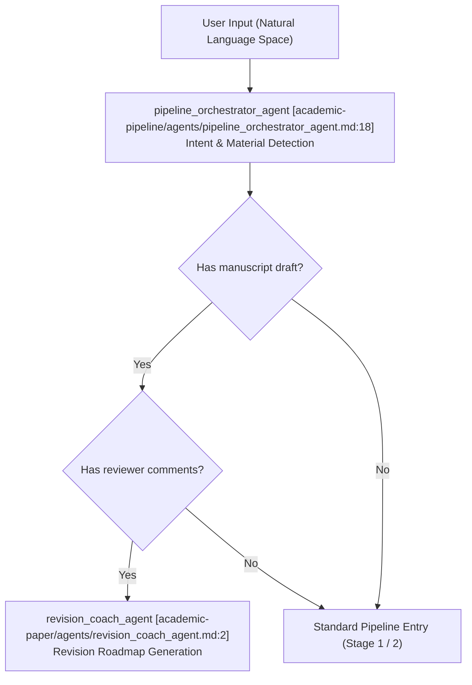
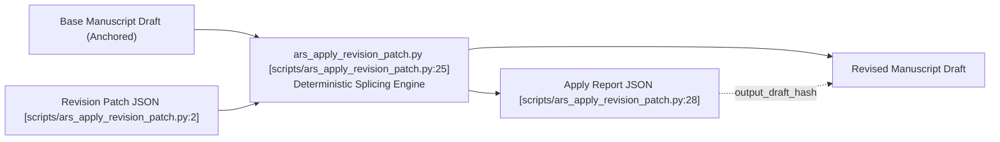

<!-- source: DeepWiki mcp.deepwiki.com · repo Imbad0202/academic-research-skills · page 2.4 External Review Protocol · fetched 2026-10-30 -->

# External Review Protocol

Relevant source files

The following files were used as context for generating this wiki page:

- [academic-paper-reviewer/references/re_review_mode_protocol.md](academic-paper-reviewer/references/re_review_mode_protocol.md)
- [academic-paper/agents/revision_coach_agent.md](academic-paper/agents/revision_coach_agent.md)
- [academic-paper/examples/commitment_ledger_example.md](academic-paper/examples/commitment_ledger_example.md)
- [academic-paper/templates/revision_tracking_template.md](academic-paper/templates/revision_tracking_template.md)
- [academic-pipeline/references/two_stage_review_protocol.md](academic-pipeline/references/two_stage_review_protocol.md)
- [docs/design/2026-05-31-ars-268-schema11-nested-commitment-ledger-spec.md](docs/design/2026-05-31-ars-268-schema11-nested-commitment-ledger-spec.md)
- [evals/calibration/commitment_ledger_seed.yaml](evals/calibration/commitment_ledger_seed.yaml)
- [scripts/check_268_nested_commitment_ledger.py](scripts/check_268_nested_commitment_ledger.py)
- [scripts/check_670_revision_roadmap_integration.py](scripts/check_670_revision_roadmap_integration.py)
- [scripts/check_re_review_synthesis.py](scripts/check_re_review_synthesis.py)
- [scripts/test_check_268_nested_commitment_ledger.py](scripts/test_check_268_nested_commitment_ledger.py)
- [scripts/test_check_re_review_synthesis.py](scripts/test_check_re_review_synthesis.py)

## Purpose and Scope

The External Review Protocol governs the integration of real journal reviewer feedback into the academic research and publication pipeline. This protocol activates when researchers receive editorial decisions and peer-review reports from external journals or conferences (as opposed to the internal simulated peer review at Pipeline Stage 3) and need to structure, track, and verify their revisions. It relies upon the **R&R Traceability Matrix (Schema 11)**, the nested commitment ledger, and the three-gate re-review verification pipeline.

For related subsystem details, consult [Academic Paper Reviewer Skill](#5) for internal peer review, [Pipeline Stages Reference](#2.1) for general stage management, and [Mid-Entry and Material Passport](#2.3) for passport-based provenance.

Sources: [academic-pipeline/SKILL.md:337-342](), [shared/handoff_schemas.md:353-358](), [academic-paper/templates/revision_tracking_template.md:8-9]()

---

## Trigger Conditions and Intake Handling

The External Review Protocol is triggered when ingestion routines or orchestrator agents detect external review feedback alongside an existing manuscript draft. The `pipeline_orchestrator_agent` inspects incoming materials to determine whether to launch the `revision-coach` mode or normal pipeline intake.

### Activation Signatures

| Language / Channel | Trigger Keywords & Indicators |
|--------------------|--------------------------------|
| English (Text/Pasted) | "I received reviewer comments", "reviewer feedback", "revise and resubmit", "R&R", "major revision from journal", "parse reviews", "revision roadmap" |
| 繁體中文 (Text/Pasted) | "審查意見", "修訂路線圖", "幫我修改", "我收到審查意見" |

### Entry Point Routing

When external comments are detected, `pipeline_orchestrator_agent` initiates the intake flow, invoking `revision_coach_agent` to parse unstructured feedback into source-accounted structures without assuming editorial authority [academic-paper/agents/revision_coach_agent.md:10-21]().

**Diagram: External Review Protocol Entry Detection (Natural Language to Code Entity Space)**

Sources: [academic-pipeline/agents/pipeline_orchestrator_agent.md:20-36](), [academic-paper/agents/revision_coach_agent.md:10-21](), [academic-paper/templates/revision_tracking_template.md:8-9]()

---

## The R&R Traceability Matrix & Nested Commitment Ledger (Schema 11)

The primary data structure for tracking external revisions is the **R&R Traceability Matrix** (Schema 11), implemented via the Revision Tracking Template (`academic-paper/templates/revision_tracking_template.md`). Following the architectural update in #268, the commitment ledger utilizes a **nested-object shape** rather than parallel index-aligned lists, eliminating index desynchronization risks between commitments, fulfillment statuses, and rationales [docs/design/2026-05-31-ars-268-schema11-nested-commitment-ledger-spec.md:8-20]().

### Ledger Schema Structure
Each concern extracted by `revision_coach_agent` contains a nested list of commitments (`commitment_extracted`) with embedded lifecycle properties [academic-paper/templates/revision_tracking_template.md:35-62]():

- `commitment_text`: The specific action promised by the author.
- `commitment_type`: Categorized as `add_experiment`, `add_analysis`, `add_clarification`, `add_citation`, `restructure`, or `other`.
- `required_evidence_type`: Specifies the verification target shape (`new_section`, `new_figure`, `new_table`, `new_citation`, `methods_paragraph`, `discussion_paragraph`, `prose_edit`, or `acknowledgment_only`).
- `fulfillment_status`: Populated post-revision as `fulfilled`, `partial`, `not-fulfilled`, or `explicitly-rejected-with-rationale`.
- `unfulfilled_rationale`: Required free-text explanation when status is non-fulfilled; omitted entirely when `fulfilled`.

Sources: [academic-paper/templates/revision_tracking_template.md:35-62](), [docs/design/2026-05-31-ars-268-schema11-nested-commitment-ledger-spec.md:35-86](), [evals/calibration/commitment_ledger_seed.yaml:7-27]()

---

## Revision Patch Protocol and Anchorization

To ensure deterministic edits and prevent hallucinated document rewriting during revision execution, the system employs a strict patch and anchorization discipline [scripts/ars_apply_revision_patch.py:2-33]().

### Execution Pipeline
1. **Anchorization**: `scripts/ars_anchorize_draft.py` injects stable block identifiers (`<!--block:BNNNN-->`) into the manuscript text.
2. **Patch Generation**: `draft_writer_agent` produces a Schema-compliant JSON patch (`revision_patch.schema.json`) targeting specific block IDs and cryptographic hashes.
3. **Application & Verification**: `scripts/ars_apply_revision_patch.py` applies the patch deterministically, generating an apply report and updating draft hashes.

**Diagram: Revision Patch Execution Flow (Code Entity Space)**

Sources: [academic-paper/references/revision_patch_protocol.md:1-21](), [scripts/ars_apply_revision_patch.py:2-33](), [scripts/test_ars_apply_revision_patch.py:1-9]()

---

## Three-Gate Re-Review Verification Protocol (#576)

For Pipeline Stage 3' (Verification Review), the system enforces a strict three-gate contract (`academic-paper-reviewer/references/re_review_mode_protocol.md`) governed by `scripts/check_re_review_synthesis.py`. This protocol prevents author persuasion from biasing the verification outcome by withholding the Response to Reviewers until Phase 2B.

| Gate | Phase Name | Information Access Restrictions | Purpose |
|------|------------|--------------------------------|---------|
| **Gate 1** | Phase 1: Criteria Commitment | Round-1 Roadmap + Reviewer Cards (Revision-blind) | Operationalize evaluation yardsticks before viewing revised text. |
| **Gate 2A** | Phase 2A: Evidence Verdict | Revised Draft + Apply Reports (Persuasion-blind) | Verify evidence fulfillment against criteria prior to reading author rebuttal. |
| **Gate 2B** | Phase 2B: Claim Matching | Response to Reviewers + Full Context | Match author claims to verified evidence and derive final verdicts. |

Sources: [academic-paper-reviewer/references/re_review_mode_protocol.md:35-65](), [scripts/check_re_review_synthesis.py:12-30]()

---

## State Machine Integration and Passport Handoff

The External Review Protocol integrates directly into the pipeline orchestration state machine via the Material Passport and resume hooks (`pipeline_orchestrator_agent`).

### State Flow and Integrity Enforcement
1. **Intake & Passport Loading**: The orchestrator ingests the paper, reviewer feedback, and material passport via `resume_from_passport`.
2. **Coach and Revise Loop**: Iterates through `revision-coach` and patch application until all major comments are processed.
3. **Stage 4.5 Integrity Verification**: Before final handoff, the revised manuscript undergoes rigorous integrity auditing (`integrity_verification_agent`) to ensure all added citations and claims are fully verified.

Sources: [academic-pipeline/agents/pipeline_orchestrator_agent.md:43-85](), [academic-pipeline/references/two_stage_review_protocol.md:17-23](), [academic-pipeline/references/integrity_review_protocol.md:25-45]()

---

